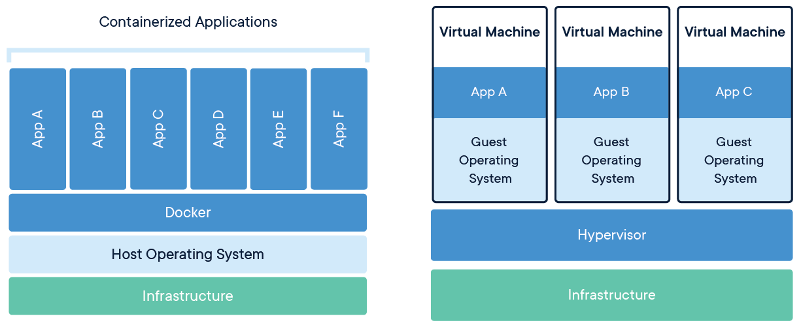
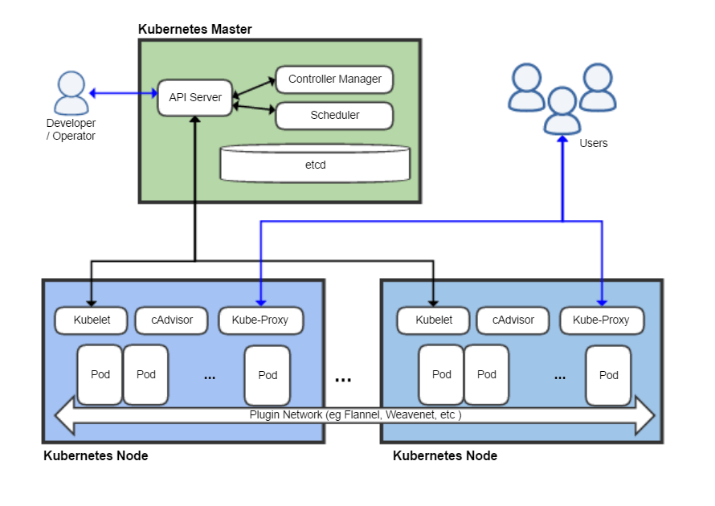
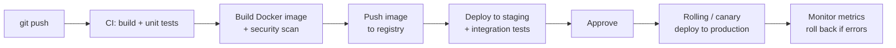

# 📦 Virtual Machines & Containers

## Virtual machines and containers (cloud & DevOps, any language)

### ❓ What is the difference between a virtual machine and a container?

- A **virtual machine (VM)** pretends to be a whole computer. A **hypervisor** splits one physical server into several VMs, and each runs its **own full operating system**. Strong isolation, but heavy: GBs in size, minutes to boot.
- A **container** packages just your **app and its libraries** and **shares the host's operating-system kernel**. Light: MBs in size, starts in seconds; many more fit on one machine.



_Image: [Wikimedia Commons](https://commons.wikimedia.org/wiki/File:Docker-containerized-and-vm-transparent-bg.png) · Docker · CC BY-SA 4.0_

**Analogy:** VMs are **separate houses**, each with its own plumbing and electricity. Containers are **flats in one building** — private rooms, but shared foundations and pipes.

| | Virtual machine | Container |
|---|---|---|
| Includes | Full guest OS + app | App + libraries only |
| Size / start-up | GBs / minutes | MBs / seconds |
| Isolation | Strong (separate kernel) | Good (shared kernel) |
| Typical use | Cloud servers (EC2), mixed operating systems | Microservices, CI pipelines, Kubernetes |

In the cloud you usually run **containers inside VMs**: Kubernetes nodes are themselves VMs.

---

### ❓ How does Docker build and run an image?

- A **Dockerfile** lists the steps to build your app's environment.
- `docker build` runs those steps and saves the result as an **image** made of **read-only layers** — one per step. Unchanged layers are reused from cache, so rebuilds are fast.
- `docker run` starts a **container** from the image: the read-only layers plus a thin **writable layer**, with its own isolated processes, network and file system (Linux namespaces), limited in CPU and memory (cgroups).

```dockerfile
FROM eclipse-temurin:21-jre          # layer 1: base OS + Java
COPY target/app.jar /app/app.jar     # layer 2: your app
EXPOSE 8080
ENTRYPOINT ["java", "-jar", "/app/app.jar"]
```

**Analogy:** an image is a **cake recipe plus pre-baked layers**; a container is one **cake made from it**. You can make many cakes (containers) from one recipe (image).

**Tip:** copy files that change rarely (dependencies) before files that change often (your code), so most layers come from cache.

---

### ❓ How does Kubernetes keep applications running?

Kubernetes runs containers across many machines and keeps them in the state you asked for.

1. You declare what you want: "3 copies of `orders-api:1.4`, each with 512 MB memory".
2. The **control plane** stores that, and the **scheduler** picks worker nodes with enough room.
3. On each node, the **kubelet** starts the containers in **pods** and reports their health.
4. Controllers keep comparing **desired** vs **actual** state: a pod crashes → a new one starts; a node dies → its pods move elsewhere.
5. A **Service** gives the pods one stable address and load-balances between them.



_Image: [Wikimedia Commons](https://commons.wikimedia.org/wiki/File:Kubernetes.png) · Khtan66 · CC BY-SA 4.0_

**Analogy:** a **thermostat** — you set the temperature you want, and it keeps adjusting until the room matches.

---

### ❓ How does code get from a developer's laptop to production?



Each step is automated in a **CI/CD pipeline** (GitHub Actions, Jenkins, GitLab CI). The **same image** that passed testing is the one deployed, so "it worked on my machine" problems disappear.
