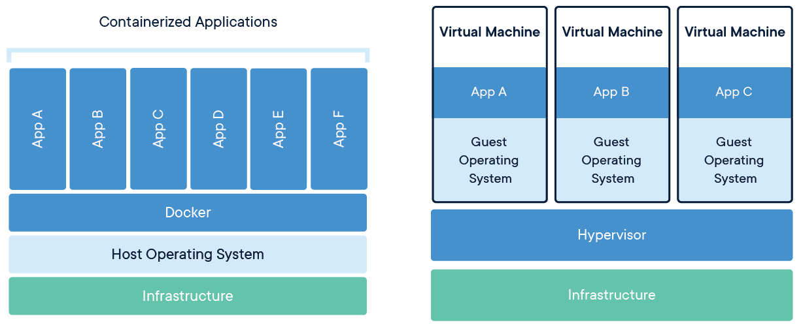
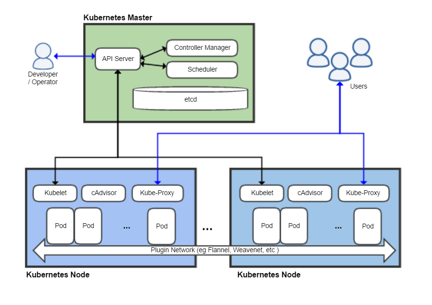
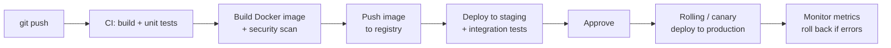

# 📦 Virtual Machines & Containers

## Virtual machines and containers (cloud & DevOps, any language)

### ❓ What is the difference between a virtual machine and a container?

**Generic answer:** A VM emulates a whole computer with its own operating system; a container packages just the app and its libraries and shares the host's OS kernel, so it's much lighter.

**Under the hood:**

Imagine one powerful server and ten apps from different teams. Running them directly causes clashes: one needs Java 17, another Java 21; one crash or memory hog affects all. We need isolation — but how much, at what cost?

**Step 1: Full isolation — virtual machines**

A **hypervisor** splits the physical server into several VMs. Each runs its **own full OS**. Strong isolation, but heavy: GBs in size, minutes to boot.

**Step 2: Lighter isolation — containers**

A container shares the host **kernel** and isolates only what the app sees:
- **Namespaces** give it its own processes, network and file system view.
- **cgroups** cap its CPU and memory.

MBs in size, starts in seconds.



_Image: [Wikimedia Commons](https://commons.wikimedia.org/wiki/File:Docker-containerized-and-vm-transparent-bg.png) · Docker · CC BY-SA 4.0_

**Step 3: Compare**

| | Virtual machine | Container |
|---|---|---|
| Includes | Full guest OS + app | App + libraries only |
| Size / start-up | GBs / minutes | MBs / seconds |
| Isolation | Strong (separate kernel) | Good (shared kernel) |
| Typical use | Cloud servers (EC2) | Microservices, CI, Kubernetes |

**Analogy:** VMs are **separate houses**; containers are **flats in one building** — private rooms, shared foundations.

**Step 4: Together**

In the cloud you usually run **containers inside VMs**: Kubernetes nodes are VMs.

**Final understanding:** **Apps clash on one machine → isolate with a whole OS (VM, heavy) or with kernel features (container, light).**

---

### ❓ How does Docker build and run an image?

**Generic answer:** `docker build` runs the Dockerfile's steps and saves each as a read-only layer; `docker run` starts a container from those layers plus a thin writable layer, isolated by namespaces and limited by cgroups.

**Under the hood:**

Imagine "it works on my machine" — your app works locally but fails on the server because of a different Java version or a missing library. We need to ship the **environment**, not just the jar.

**Step 1: Describe the environment (Dockerfile)**

```dockerfile
FROM eclipse-temurin:21-jre          # layer 1: base OS + Java
COPY target/app.jar /app/app.jar     # layer 2: your app
EXPOSE 8080
ENTRYPOINT ["java", "-jar", "/app/app.jar"]
```

**Step 2: Build layers**

`docker build` runs each step and saves the result as a **read-only layer**. Unchanged layers come from cache, so rebuilds are fast.

**Step 3: Store and share**

The image (layers + metadata) is pushed to a **registry** (Docker Hub, ECR).

**Step 4: Run**

`docker run` stacks the layers, adds a thin **writable layer**, and starts the process inside its own **namespaces**, limited by **cgroups**.

**Analogy:** an image is a **recipe plus pre-baked layers**; a container is one **cake** made from it.

**Tip:** copy rarely-changing files (dependencies) before often-changing ones (your code), so most layers come from cache.

**Final understanding:** **Environment drift → describe it (Dockerfile) → build cached layers (image) → ship (registry) → run isolated (container).**

---

### ❓ How does Kubernetes keep applications running?

**Generic answer:** You declare the desired state; Kubernetes schedules containers onto machines and its controllers keep comparing desired versus actual state, fixing any difference.

**Under the hood:**

Imagine 50 microservices across 20 machines. At 3 a.m. one machine dies. Someone must restart its containers elsewhere and update the routing — every time, instantly.

**Step 1: Declare what you want**

"3 copies of `orders-api:1.4`, each with 512 MB memory."

**Step 2: Store and schedule**

The **control plane** stores this; the **scheduler** picks nodes with enough room.

**Step 3: Run on nodes**

Each node's **kubelet** starts the containers in **pods** and reports their health.

**Step 4: Keep reconciling**

**Controllers** compare desired vs actual: a pod crashes → a new one starts; a node dies → its pods move elsewhere.

**Step 5: Stable address**

A **Service** gives the pods one address and load-balances among them.



_Image: [Wikimedia Commons](https://commons.wikimedia.org/wiki/File:Kubernetes.png) · Khtan66 · CC BY-SA 4.0_

**Analogy:** a **thermostat** — set the temperature; it keeps adjusting until the room matches.

**Final understanding:** **Too much to manage by hand → declare desired state → schedule → watch → reconcile forever.**

---

### ❓ How does code get from a developer's laptop to production?

**Generic answer:** A CI/CD pipeline builds and tests every push, packages a Docker image, deploys it to staging and then production gradually, and rolls back on errors.

**Under the hood:**

Imagine ten developers pushing code daily. Manual builds and copy-paste deploys lead to "it worked on my machine" and Friday-night outages.

**Step 1: Push** — `git push` triggers the pipeline.

**Step 2: Build and test** — compile, run unit tests; fail fast.

**Step 3: Package** — build a Docker image and scan it for known vulnerabilities.

**Step 4: Publish** — push the image to a registry.

**Step 5: Staging** — deploy and run integration tests.

**Step 6: Production** — rolling or canary deploy: a few instances first, then the rest.

**Step 7: Watch** — monitor errors and latency; roll back automatically if they rise.



**Final understanding:** **Manual releases are risky → automate build, test, package, deploy and watch → the same tested image reaches production.**
