# 🔩 Under the Hood: Distributed Systems & Microservices

How services find and call each other, survive failures, avoid duplicates, keep data consistent, agree on a leader, share locks and trace requests across the system.

## Service Communication

### ❓ How do microservices communicate with each other?

### 📝 Answer

**1. What is it?**
Services talk over the network in two styles:

- **Synchronous** — the caller sends a request and **waits** for the answer: REST (HTTP + JSON) or **gRPC** (HTTP/2 + Protocol Buffers).
- **Asynchronous** — the sender publishes a **message/event** to a broker (Kafka, RabbitMQ) and continues; consumers process it later.

**2. How does it work internally?**
Synchronous (REST):

1. Find the target's address (service discovery / DNS).
2. Serialise the request (object → JSON bytes).
3. Send over a pooled HTTP connection; wait with a **timeout**.
4. The callee deserialises, processes, serialises the response.

gRPC: the `.proto` contract generates client/server code; messages are compact **binary** protobuf; many calls are multiplexed on one HTTP/2 connection; supports streaming.

Asynchronous: serialise an event → publish to a topic/exchange → broker stores it → consumers receive it whenever they are ready.

**3. Visual**

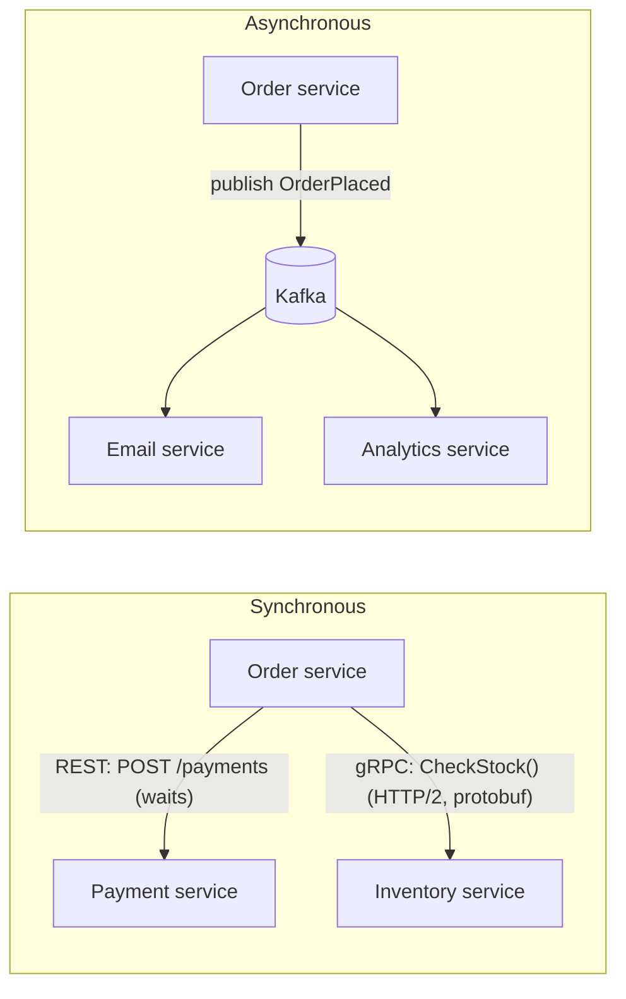

**4. Internal implementation**

- JSON is human-readable but larger and slower to parse; protobuf uses numbered fields and varint encoding — often several times smaller.
- Clients keep **connection pools** and set connect/read timeouts; HTTP/2 lets one connection carry many concurrent calls.
- Contracts: OpenAPI for REST, `.proto` for gRPC, Avro/JSON Schema + a **schema registry** for events — each allows backward-compatible evolution.

**5. Why is it designed this way?**
Sync calls are simple and give immediate answers but **couple** availability and latency (if Payment is down, Order fails). Async messaging decouples services in time and absorbs spikes, at the cost of eventual consistency and harder debugging.

**6. Framework differences**
Spring: `RestClient`, `WebClient`, OpenFeign (declarative), Spring gRPC, Spring Kafka/AMQP. .NET: `HttpClient` + Polly, Grpc.Net. Node: axios/fetch, `@grpc/grpc-js`, kafkajs. Go: `net/http`, grpc-go.

**7. Practical example**

```java
@HttpExchange("/stock")
interface InventoryClient {
    @GetExchange("/{sku}") Stock get(@PathVariable String sku);   // declarative REST client
}
```

**8. How can I observe it?**
Distributed tracing (Zipkin/Jaeger/Grafana Tempo) shows every call between services with timings. `grpcurl` calls gRPC services from the command line; Kafka UI shows events flowing.

---

### ❓ How does Service Discovery work?

### 📝 Answer

**1. What is it?**
In the cloud, service instances start, stop and move constantly, so their IPs change. **Service discovery** keeps an up-to-date list of healthy instances per service name, so callers use `order-service` instead of hard-coded IPs.

**2. How does it work internally?**
Client-side discovery (Eureka, Consul):

1. Each instance **registers** itself (name, IP, port) with the **registry** on start-up.
2. It sends **heartbeats** (Eureka: every 30 s); missing heartbeats → the instance is removed.
3. Clients fetch and **cache** the registry, then pick an instance themselves (client-side load balancing).

Server-side discovery (Kubernetes):

1. A `Service` named `order-service` gets a stable **virtual IP** and DNS name.
2. Kubernetes tracks ready Pods in **EndpointSlices** using readiness probes.
3. The caller resolves the DNS name; kube-proxy/eBPF forwards the connection to one healthy Pod.

**3. Visual**

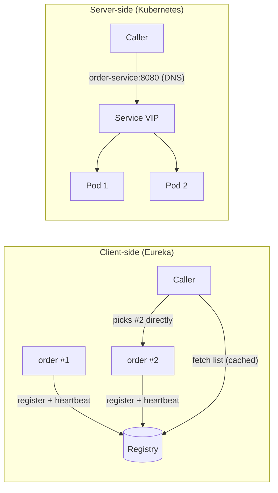

**4. Internal implementation**

- Eureka favours **availability** (AP): during network problems it keeps possibly stale entries (self-preservation mode) rather than emptying the registry.
- Consul and etcd use **Raft** for a consistent registry; Consul adds health checks and DNS interface.
- DNS caching can route to dead instances; clients must still use timeouts and retries.

**5. Why is it designed this way?**
Dynamic infrastructure needs dynamic addressing. Client-side discovery avoids an extra hop and allows smart balancing; server-side discovery keeps clients simple and language-neutral — which is why Kubernetes-native setups rarely need Eureka.

**6. Framework differences**
Spring Cloud: `@EnableDiscoveryClient` + Eureka/Consul, `lb://order-service` URIs with Spring Cloud LoadBalancer; on Kubernetes, Spring Cloud Kubernetes or plain DNS. Service meshes (Istio, Linkerd) move discovery and balancing into sidecar/ambient proxies.

**7. Practical example**

```java
@Bean @LoadBalanced
RestClient.Builder lbBuilder() { return RestClient.builder(); }
// "http://order-service/orders/42" → resolved to a healthy instance from the registry
```

**8. How can I observe it?**
Eureka dashboard (`http://localhost:8761`) lists instances and status. Kubernetes: `kubectl get endpointslices -l kubernetes.io/service-name=order-service`, `nslookup order-service` from a Pod.

---

## Resilience

### ❓ How do Circuit Breakers, Retries and Timeouts prevent cascading failures?

### 📝 Answer

**1. What is it?**
A **cascading failure**: one slow service makes its callers wait, their threads fill up, they become slow too, and the failure spreads up the call chain until everything is down. Three tools stop it:

- **Timeout** — stop waiting after a limit.
- **Retry** — try again for brief glitches (limited, with backoff).
- **Circuit breaker** — after many failures, **stop calling** the sick service for a while and fail fast (or use a fallback).

**2. How does it work internally?**

1. Every remote call has a **timeout** shorter than the caller's own deadline.
2. Failed calls are retried a few times with **exponential backoff + jitter**.
3. The circuit breaker records results in a **sliding window** (last N calls or last N seconds).
4. Failure rate (or slow-call rate) above a threshold (e.g. 50%) → **OPEN**: calls fail immediately without touching the network.
5. After a wait time → **HALF-OPEN**: let a few trial calls through; success → **CLOSED**, failure → OPEN again.
6. **Bulkheads** (separate thread pools/semaphores per dependency) stop one dependency from using all threads.

**3. Visual**

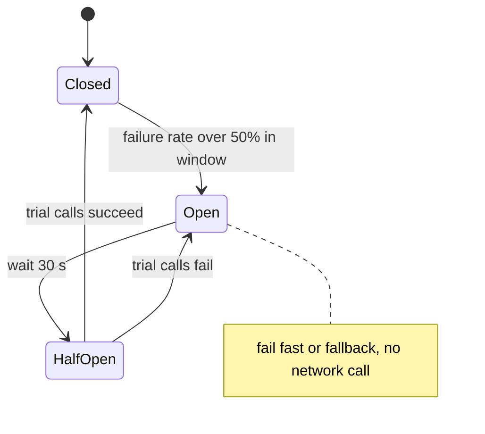

**4. Internal implementation**

- Resilience4j: count- or time-based ring buffer of outcomes; configurable `failureRateThreshold`, `slowCallDurationThreshold`, `waitDurationInOpenState`, `permittedNumberOfCallsInHalfOpenState`.
- Order of decorators matters: usually `Retry( CircuitBreaker( TimeLimiter( call )))` — a retry should not hammer an open circuit.
- **Retry budgets** limit total retries to a percentage of traffic to prevent retry storms.

**5. Why is it designed this way?**
Failing fast frees threads and returns a quick, degraded answer instead of a slow total outage, and gives the failing service room to recover instead of being flooded.

**6. Framework differences**
Java: Resilience4j (Spring Cloud CircuitBreaker), formerly Netflix Hystrix (retired). .NET: **Polly**. Node: `opossum`. Go: `sony/gobreaker`. Service meshes (Istio/Envoy) offer outlier detection, retries and timeouts without code changes.

**7. Practical example**

```java
@CircuitBreaker(name = "inventory", fallbackMethod = "unknownStock")
@Retry(name = "inventory")
public Stock check(String sku) { return inventory.get(sku); }

Stock unknownStock(String sku, Throwable t) { return Stock.unknown(sku); }   // fast degraded answer
```

**8. How can I observe it?**
Actuator `/actuator/circuitbreakers` and `/actuator/circuitbreakerevents`; metrics `resilience4j.circuitbreaker.state`. Stop the downstream service during a load test and watch the state go CLOSED → OPEN → HALF_OPEN → CLOSED.

---

### ❓ How does Idempotency prevent duplicate processing?

### 📝 Answer

**1. What is it?**
An operation is **idempotent** if doing it many times has the **same effect** as doing it once. Because retries and at-least-once delivery cause duplicates, idempotency makes duplicates harmless (e.g. a payment is not charged twice).

**2. How does it work internally?**
Idempotency key pattern (API):

1. The client generates a unique **Idempotency-Key** (UUID) per logical operation and sends it with the request.
2. The server checks a store (DB table / Redis) for the key:
   - **Not seen** → insert the key as "in progress" (unique constraint), process, save the response with the key.
   - **Seen and finished** → return the **saved response** without processing again.
   - **Seen, still in progress** → return `409 Conflict` (or wait).
3. Keys expire after a retention period (e.g. 24 hours).

For messages: store processed **message IDs** in the same transaction as the business change.

**3. Visual**

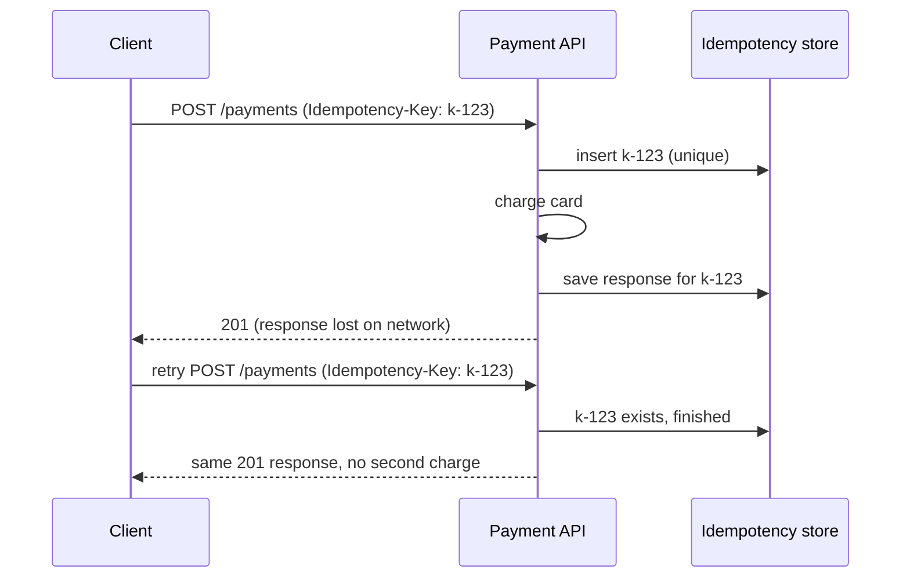

**4. Internal implementation**

- HTTP semantics: `GET`, `PUT`, `DELETE` are defined as idempotent; `POST` and `PATCH` are not — they need keys.
- Natural idempotency: `UPDATE ... SET status='PAID' WHERE id=? AND status='PENDING'`, `INSERT ... ON CONFLICT DO NOTHING`, upserts by business key.
- Store a **hash of the request body** with the key and reject a reused key with a different body (`422`).

**5. Why is it designed this way?**
In distributed systems you can't tell "request failed" from "response lost". Making retries safe is simpler and more reliable than trying to guarantee exactly-once delivery.

**6. Framework differences**
Stripe and many payment APIs use `Idempotency-Key` headers. AWS SQS FIFO deduplication IDs, Kafka idempotent producer (broker-side sequence numbers per producer). In Spring, usually a filter/aspect + table with a unique key.

**7. Practical example**

```sql
CREATE TABLE idempotency_keys (
  key_id VARCHAR(64) PRIMARY KEY,
  request_hash CHAR(64) NOT NULL,
  response_json TEXT,
  created_at TIMESTAMP NOT NULL
);
```

**8. How can I observe it?**
Send the same request twice with `curl -H "Idempotency-Key: abc"` and check that one row is created and both responses are identical. In tests, simulate a lost response (WireMock fault) and verify the client retry doesn't duplicate.

---

## Transactions and Consistency

### ❓ How do Distributed Transactions work?

### 📝 Answer

**1. What is it?**
A **distributed transaction** makes changes in **several** databases or systems commit **all together or not at all**. The classic protocol is **Two-Phase Commit (2PC)**, coordinated by a transaction manager.

**2. How does it work internally?**

1. **Phase 1 — Prepare**: the coordinator asks every participant "can you commit?". Each writes its changes and a prepare record to its log, holds its locks, and votes **YES** or **NO**.
2. **Phase 2 — Commit/Abort**: all YES → the coordinator logs the decision and sends **COMMIT**; any NO or timeout → **ROLLBACK**.
3. Participants apply the decision and release locks.

**3. Visual**

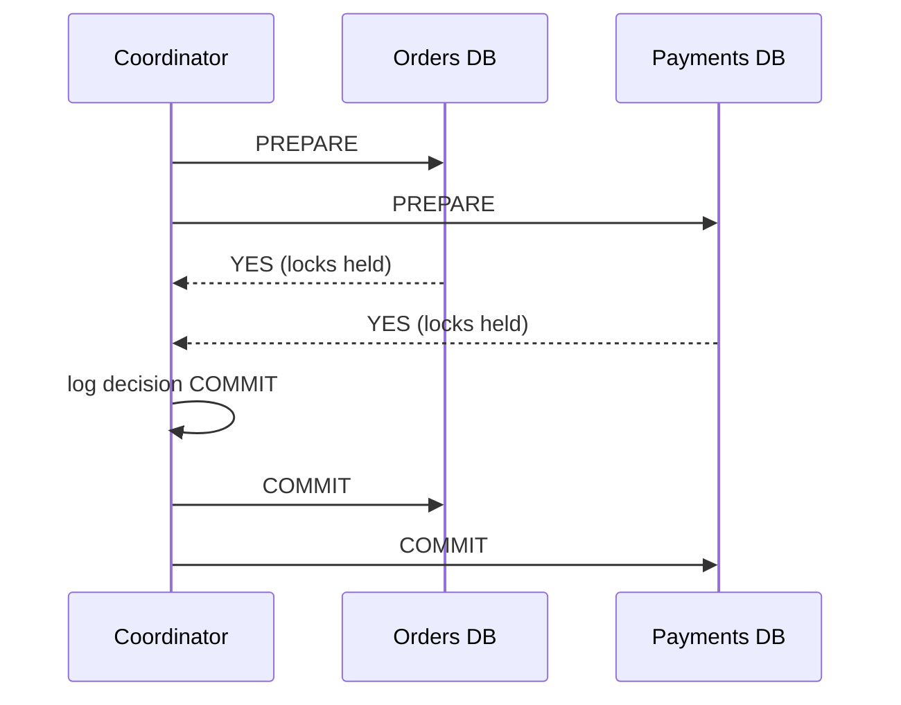

**4. Internal implementation**

- Standard interface: **XA** (JTA in Java: Atomikos, Narayana); PostgreSQL `PREPARE TRANSACTION` / `COMMIT PREPARED`.
- **Blocking problem**: if the coordinator crashes after participants voted YES, they must keep locks until it recovers (in-doubt transactions).
- Distributed databases (Spanner, CockroachDB, YugabyteDB) run 2PC internally on top of Raft-replicated data to avoid that single point of failure.

**5. Why is it designed this way?**
2PC gives strong atomicity across resources, but locks are held across network round-trips, throughput drops, and one slow or failed participant blocks others. Most microservice architectures therefore prefer **Sagas** + outbox + idempotency (eventual consistency) over 2PC.

**6. Platform differences**
Java EE/Jakarta: JTA with XA datasources and JMS. .NET: `TransactionScope` escalating to MSDTC (Windows). Kafka transactions are a 2PC-like protocol **inside** Kafka only. Most cloud-native brokers and REST APIs don't support XA at all.

**7. Practical example**
Moving money between two bank databases in one atomic step with XA: both debit and credit commit, or neither — at the cost of locks held until both confirm.

**8. How can I observe it?**
PostgreSQL: set `max_prepared_transactions`, run `PREPARE TRANSACTION 'tx1'`, then `SELECT * FROM pg_prepared_xacts;` — the transaction stays in-doubt, holding locks, until `COMMIT PREPARED 'tx1'`.

---

### ❓ How does the Saga Pattern work?

### 📝 Answer

**1. What is it?**
A **saga** splits a business transaction across services into a sequence of **local transactions**. Each step commits in its own database and triggers the next. If a step fails, earlier steps are undone by **compensating transactions** (e.g. refund instead of rollback).

**2. How does it work internally?**
Two styles:

- **Choreography** — each service listens for events and reacts: `OrderCreated` → Payment charges → `PaymentCompleted` → Inventory reserves → `StockReserved` → Order confirms. Failures publish events that trigger compensations.
- **Orchestration** — a **saga orchestrator** (a state machine) sends commands to each service in order, records progress, and runs compensations in reverse order on failure.

Each step uses the **outbox** pattern to commit its data and its event/command atomically.

**3. Visual**

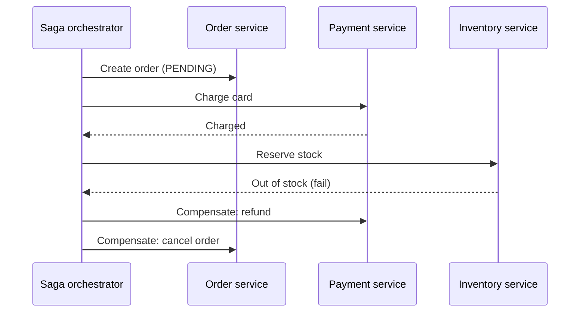

**4. Internal implementation**

- The orchestrator persists saga state (`STARTED → PAYMENT_DONE → FAILED → COMPENSATING → CANCELLED`) so it can resume after a crash.
- Every step and compensation must be **idempotent** (they may be retried).
- No isolation between sagas: other requests can see intermediate states (order `PENDING`). Countermeasures: **semantic locks** (status flags), commutative updates, re-reading values.
- Steps after the "pivot" (point of no return) must be retryable until they succeed rather than compensated.

**5. Why is it designed this way?**
Each service owns its database, so one ACID transaction across them isn't possible without 2PC. Sagas keep services autonomous and available, trading immediate consistency for **eventual** consistency and explicit compensation logic.

**6. Framework differences**
Orchestration engines: **Temporal**, Camunda/Zeebe, AWS Step Functions, Axon (Java), MassTransit state machines (.NET), Eventuate Tram Sagas. Choreography: plain Kafka/RabbitMQ events with Spring Kafka / Spring Cloud Stream.

**7. Practical example**
Travel booking: book flight → book hotel → charge card. Hotel fails → cancel flight booking. Card fails → cancel hotel and flight.

**8. How can I observe it?**
Temporal/Camunda UIs show each saga instance's steps and current state. With choreography, use **distributed tracing** plus correlation IDs in events to follow one saga across services.

---

### ❓ How do distributed systems maintain consistency?

### 📝 Answer

**1. What is it?**
When data is copied across nodes, **consistency** describes what readers may see after a write:

- **Strong (linearizable)** — every read sees the latest committed write, as if there were one copy.
- **Eventual** — replicas may disagree briefly, but converge if writes stop.
- In between: **read-your-writes**, **monotonic reads**, **causal** consistency.

**CAP**: during a network **P**artition, a system must choose **C**onsistency or **A**vailability. **PACELC** adds: **E**lse (normal operation) choose **L**atency or **C**onsistency.

**2. How does it work internally?**

1. **Single leader** replication: all writes go to the leader; reading from the leader is strongly consistent, reading from async followers may be stale.
2. **Consensus** (Raft/Paxos): a write is committed only when a **majority** has it → survives minority failures, stays consistent.
3. **Quorums** (Dynamo-style, Cassandra): with N replicas, write to W and read from R; if **R + W > N**, read and write sets overlap → a read sees the latest write.
4. Conflict handling for multi-leader/leaderless writes: last-write-wins timestamps, version vectors, or **CRDTs** (data types that merge automatically).

**3. Visual**

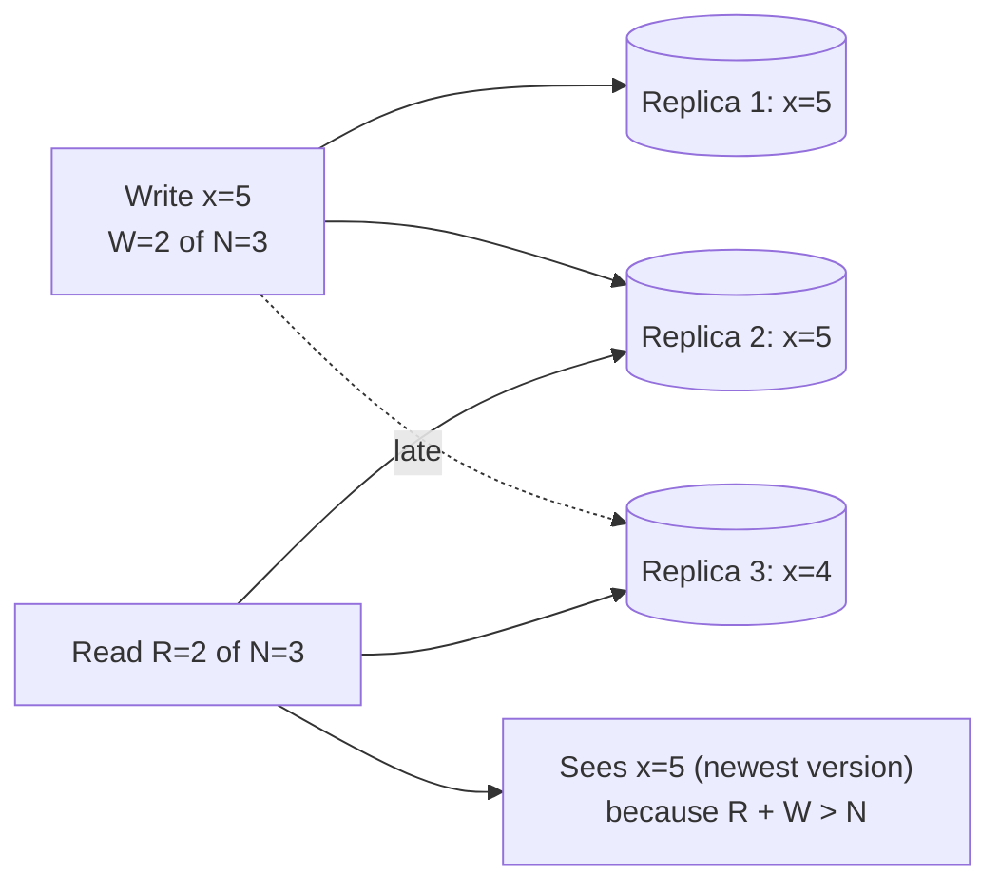

**4. Internal implementation**

- Versions/timestamps on each value let a reader pick the newest among replicas; **read repair** and **anti-entropy** (Merkle trees) fix stale replicas.
- Clock skew makes wall-clock "last write wins" unsafe; Spanner uses TrueTime (bounded clock uncertainty), others use logical clocks.
- Application patterns: send writes and the user's next reads to the leader (read-your-writes), version numbers for **optimistic locking**.

**5. Why is it designed this way?**
Strong consistency needs coordination (latency, reduced availability during failures). Many features (likes, feeds, analytics) tolerate staleness, so they choose eventual consistency for speed and uptime; money and inventory choose strong consistency.

**6. Platform differences**
PostgreSQL/MySQL with sync replication or a single primary → strong. Cassandra/DynamoDB → tunable (`QUORUM`, `ConsistentRead=true`). MongoDB → configurable read/write concerns. etcd/ZooKeeper/Consul → strong (consensus). Redis replication → asynchronous.

**7. Practical example**
User updates their profile, then reloads: the read hits a lagging replica and shows the old name. Fix: read from the primary for that user for a few seconds after a write, or use a version token.

**8. How can I observe it?**
Measure replica lag (`pg_stat_replication`, MySQL `Seconds_Behind_Source`). Cassandra `cqlsh`: `CONSISTENCY ONE` vs `CONSISTENCY QUORUM` while a node is down. **Jepsen** reports (jepsen.io) show real systems tested under partitions.

---

## Coordination

### ❓ How do Replication and Leader Election work?

### 📝 Answer

**1. What is it?**

- **Replication** — keeping copies of data/state on several nodes so the system survives failures.
- **Leader election** — the nodes agree that exactly **one** of them is the leader that accepts writes; if it dies, they choose a new one.

Modern systems do both with a **consensus** algorithm such as **Raft**.

**2. How does it work internally?** (Raft)

1. Every node is a **follower**. The leader sends **heartbeats** regularly.
2. A follower that hears nothing for a random **election timeout** (e.g. 150–300 ms) becomes a **candidate**, increments the **term** number, votes for itself and asks others for votes.
3. A node votes for at most one candidate per term, and only if the candidate's log is at least as up to date. A **majority** of votes → **leader**.
4. The leader appends client commands to its **log** and replicates entries to followers.
5. An entry is **committed** once stored on a majority; then it is applied to the state machine.
6. Old leaders that come back see a higher term and step down.

**3. Visual**

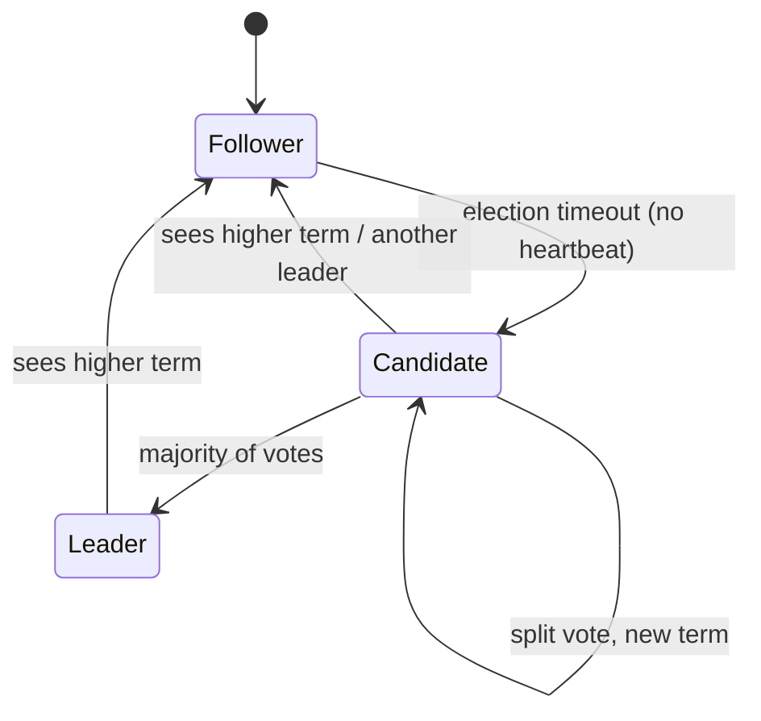

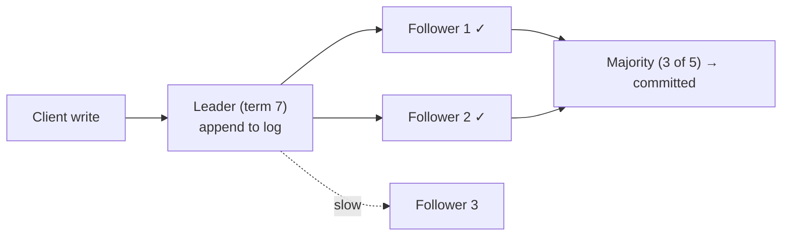

**4. Internal implementation**

- Cluster sizes are odd (3, 5): 3 nodes tolerate 1 failure, 5 tolerate 2.
- **Terms** act as a logical clock that fences off stale leaders; randomized timeouts make split votes rare.
- **Split brain** (two leaders accepting writes) is prevented because a leader needs a majority, and two majorities always overlap.

**5. Why is it designed this way?**
Majority quorums keep the system correct even when nodes crash or the network splits: the minority side stops accepting writes (choosing consistency over availability). Raft was designed to be **understandable** compared to Paxos.

**6. Platform differences**
Raft: etcd (Kubernetes), Consul, CockroachDB, TiKV, RabbitMQ quorum queues, Kafka KRaft. ZooKeeper uses ZAB. MongoDB replica sets use a Raft-like protocol. PostgreSQL itself has no built-in election — tools like Patroni use etcd/Consul for it.

**7. Practical example**
A 3-node etcd cluster loses its leader: within about a second, a follower times out, wins 2 of 3 votes in term 8, and Kubernetes continues working.

**8. How can I observe it?**
**raft.github.io** has an interactive visualisation (kill nodes, watch elections). `etcdctl endpoint status --cluster -w table` shows the leader, term and raft index; stop the leader container and run it again.

---

### ❓ How does Distributed Locking work?

### 📝 Answer

**1. What is it?**
A **distributed lock** ensures only **one** process across many machines does something at a time (run a scheduled job, process a resource). Local locks (`synchronized`) only work inside one JVM.

**2. How does it work internally?**
Redis-based lock:

1. Acquire: `SET lock:report <randomToken> NX PX 30000` — set only if not exists, auto-expire after 30 s (so a crashed holder can't block forever).
2. Do the work (shorter than the lease, or extend it periodically).
3. Release: delete the key **only if** it still holds your token (an atomic Lua script) — otherwise you might delete someone else's lock after yours expired.

Consensus-based (ZooKeeper/etcd): create an **ephemeral** node / a key attached to a **lease**; the lowest sequence number holds the lock; the lock disappears automatically if the client's session dies.

Database-based: a row lock (`SELECT ... FOR UPDATE`) or a lock table (ShedLock).

**3. Visual**

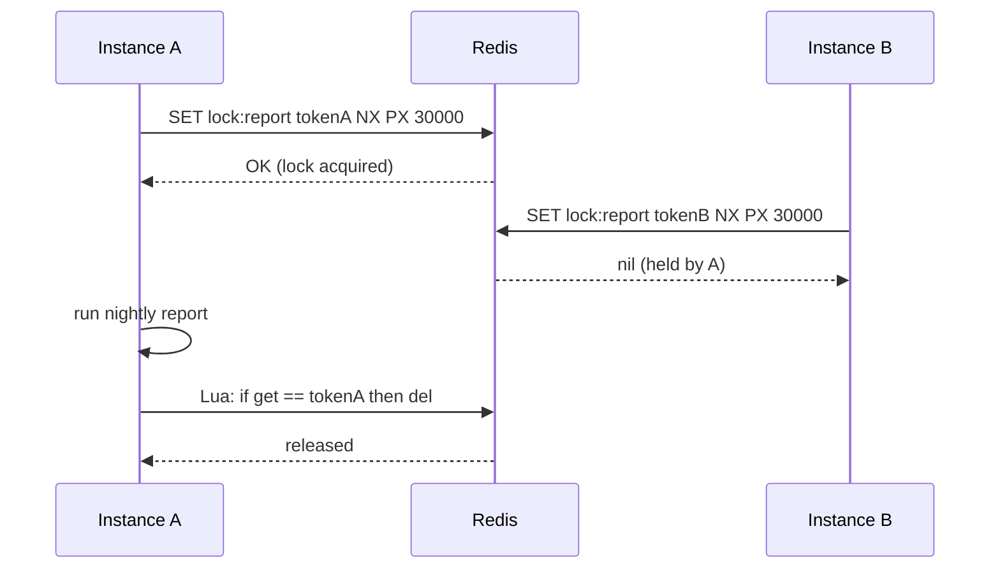

**4. Internal implementation**

- **Lease expiry problem**: a long GC pause can make A's lock expire while A still thinks it holds it; B acquires it; both work. Fix: **fencing tokens** — an increasing number issued with each lock; the protected resource rejects writes with an older token.
- Single Redis node failover can lose a lock (async replication). **Redlock** (majority of independent Redis nodes) tries to fix that but is debated; for correctness-critical locks, prefer etcd/ZooKeeper or database locks.

**5. Why is it designed this way?**
Leases (TTLs) keep the system live when holders crash; tokens keep it safe when holders are slow. The right tool depends on whether the lock is for **efficiency** (avoid duplicate work; Redis fine) or **correctness** (never two at once; needs consensus + fencing).

**6. Framework differences**
Java: **ShedLock** (scheduled jobs; JDBC/Redis/Mongo backends), **Redisson** (`RLock` with watchdog renewal), Spring Integration `LockRegistry`, Apache Curator (ZooKeeper). .NET: `DistributedLock` library. Node: `redlock`. Go: etcd `concurrency.Mutex`.

**7. Practical example**

```java
@Scheduled(cron = "0 0 2 * * *")
@SchedulerLock(name = "nightlyReport", lockAtMostFor = "PT30M", lockAtLeastFor = "PT1M")
public void nightlyReport() { ... }   // runs on only one of the 5 instances
```

**8. How can I observe it?**
`redis-cli GET lock:report` and `PTTL lock:report` while the job runs; ShedLock's `shedlock` table shows `locked_by` and `lock_until`. Run two instances locally and check logs: only one executes the job.

---

## Observability

### ❓ How does Distributed Tracing track a request across multiple services?

### 📝 Answer

**1. What is it?**
**Distributed tracing** follows one request through every service it touches. The whole journey is a **trace**; each unit of work (an HTTP call, a DB query) is a **span** with a start time, duration and parent. All spans share one **trace ID**.

**2. How does it work internally?**

1. The first service (or gateway) starts a trace: random **trace ID** + a root **span ID**.
2. Every outgoing call **propagates context** in headers — W3C `traceparent: 00-<traceId>-<spanId>-01`.
3. The next service reads the header, creates a **child span** (new span ID, same trace ID, parent = caller's span) and passes its own context onward (HTTP, Kafka headers, gRPC metadata).
4. Each service's tracing SDK **exports** finished spans asynchronously to a collector (OpenTelemetry Collector).
5. The backend (Jaeger, Zipkin, Grafana Tempo) stores spans and **assembles** them by trace ID into a timeline.

**3. Visual**

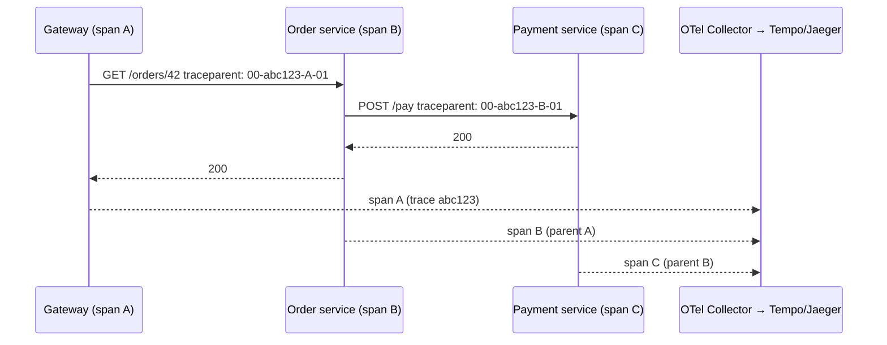

**4. Internal implementation**

- Context lives in a thread-local / async context inside each service; instrumentation of HTTP clients, servers, JDBC and messaging creates spans automatically.
- **Sampling** (e.g. 10% of traces, or tail-based: keep slow/error traces) controls cost.
- Trace and span IDs are added to **log lines** (MDC), so logs and traces link together.

**5. Why is it designed this way?**
In microservices, a slow request may be caused by any of a dozen services. Propagating a small context header is cheap and lets a backend rebuild the full call tree without central coordination.

**6. Framework differences**
Spring Boot 3: **Micrometer Tracing** with an OpenTelemetry or Brave bridge (Spring Cloud Sleuth is retired). Java agent: OpenTelemetry Java agent (zero-code). .NET: `System.Diagnostics.Activity` + OpenTelemetry. Node/Python/Go: OpenTelemetry SDKs. Service meshes can create spans at the proxy level.

**7. Practical example**

```properties
management.tracing.sampling.probability=1.0
management.otlp.tracing.endpoint=http://otel-collector:4318/v1/traces
logging.pattern.level=%5p [${spring.application.name},%X{traceId},%X{spanId}]
```

**8. How can I observe it?**
Open the trace in **Jaeger/Zipkin/Grafana Tempo**: a waterfall of spans shows where time is spent. In browser DevTools or `curl -v`, look for the `traceparent` header on outgoing requests; search logs by trace ID.
