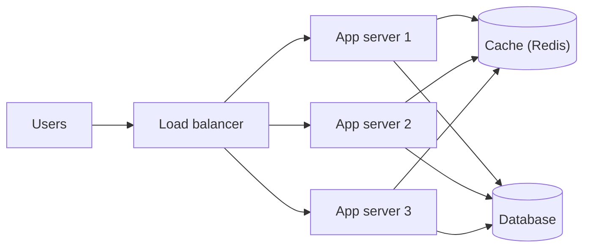
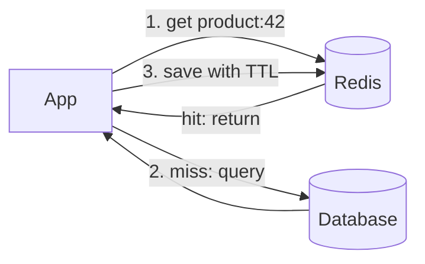
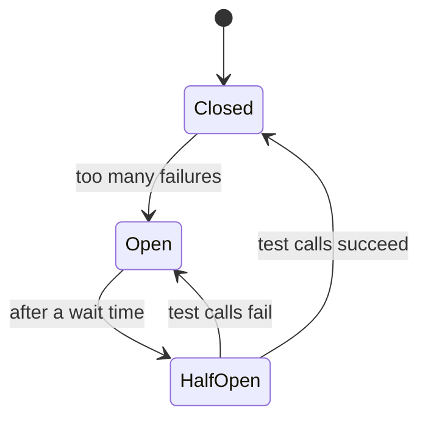

# 🌍 Systems With Many Servers: Scaling & Resilience

## Scaling: serving more users with more servers (system design, any language)

### ❓ Why do large systems run on many servers instead of one big one?

**Generic answer:** One server has limits and is a single point of failure; many smaller servers behind a load balancer add capacity, survive failures and allow zero-downtime releases.

**Under the hood:**

Imagine your app runs on one big server. A sale starts, traffic triples, CPU hits 100%. You can buy a bigger server — until there is no bigger one. And when that one server reboots, the whole site is down.

**Step 1: Add servers instead of growing one (horizontal scaling)**

Run several identical app servers.

**Step 2: Put a load balancer in front**

It spreads requests across servers and stops sending to unhealthy ones.



**Step 3: Make servers stateless**

Keep sessions and shared data in Redis or the database, not in one server's memory, so any server can handle any request.

**Step 4: The benefits**

More capacity on demand, no single point of failure, and releases one server at a time.

**Final understanding:** **One server hits limits and can fail → many stateless servers → load balancer spreads traffic → add servers as you grow.**

---

### ❓ How does a cache like Redis make systems faster?

**Generic answer:** Redis keeps hot data in RAM, so reads take well under a millisecond instead of a database query's milliseconds; the app checks the cache first and falls back to the database.

**Under the hood:**

Imagine a product page viewed 10,000 times a minute. Each view runs the same database query for data that changes once a day. The database does the same work 10,000 times.

**Step 1: Keep a copy in RAM**

Redis is an in-memory key–value store (see the memory hierarchy in *Memory & data*).

**Step 2: Cache-aside**

1. The app looks in Redis first.
2. **Hit** → return it. **Miss** → read from the database, save it in Redis with a **TTL**, return it.
3. On updates, delete or refresh the cached copy.



**Step 3: Accept staleness**

Cached data can be **stale** until it expires — fine for product pages, not for bank balances.

**Final understanding:** **Same expensive read many times → keep a copy in RAM → check cache first → expire or invalidate on change.**

---

### ❓ Why use a message queue like Kafka or RabbitMQ?

**Generic answer:** A service drops a message in a queue and moves on; other services pick it up when ready — decoupling services, absorbing traffic spikes and surviving consumer failures.

**Under the hood:**

Imagine the order service directly calls email, inventory and analytics on every order. If email is slow, checkout is slow. If analytics is down, checkout fails.

**Step 1: Publish instead of call**

The order service writes "order placed" to a queue and returns to the user.

**Step 2: Consumers work at their own pace**

Email, inventory and analytics each read the message when ready.

**Step 3: What you gain**

- **Decoupling:** the order service doesn't know who listens.
- **Spike absorption:** a sale's burst queues up instead of crashing the email service.
- **Failure tolerance:** if a consumer is down, messages wait safely.

**Analogy:** a **restaurant order rail** — waiters clip orders and go back to customers; cooks take them in turn.

**Kafka vs RabbitMQ in one line:** Kafka is a durable **event log** many consumers can replay; RabbitMQ is a **task queue** with flexible routing.

**Final understanding:** **Direct calls chain failures together → put a queue in between → producers and consumers run independently.**

---

### ❓ How does Kafka store messages and achieve such high throughput?

**Generic answer:** Kafka is a distributed event log: messages are appended to partitioned, replicated logs on disk, and consumers read them in parallel by offset.

**Under the hood:**

Imagine an e-commerce site. Each order must update inventory, start payment, send an email, generate an invoice and update analytics. With 10,000 orders arriving at once, calling all five services synchronously would make the order service slow and fragile.

**Step 1: Publish an event**

The order service publishes `ORDER_CREATED` to Kafka. Each other service consumes it independently.

**Step 2: Topics and partitions**

Events go into a **topic**, split into **partitions**. Each partition is an ordered log.

```text
ORDER_TOPIC
Partition 0 → msg 1, msg 4
Partition 1 → msg 2, msg 5
Partition 2 → msg 3, msg 6
```

Events with the same key (e.g. `orderId`) always go to the same partition, so they stay in order.

**Step 3: Append-only storage**

A new message is simply **appended** to the end of the partition's file. No searching for a place to insert — sequential disk writes are very fast.

**Step 4: Offsets**

Each message in a partition gets a number, its **offset**:

```text
Partition 0: offset 0 → Order 101, offset 1 → Order 102, offset 2 → Order 103
```

Consumers remember the last offset they processed, so they can resume — or replay old events.

**Step 5: Consumer groups**

Each service is its own **consumer group** and gets every event. Inside a group, partitions are split among instances: 3 partitions → up to 3 instances working in parallel.

**Step 6: Replication**

Each partition has a **leader** on one broker and **followers** on others. If the leader's broker fails, an in-sync follower becomes leader.

**Step 7: Why it's so fast**

- Sequential disk writes and reads.
- Partitions processed in parallel.
- **Batching** and **compression** of many messages together.
- The OS **page cache** serves recent data from RAM.
- **Zero-copy** sends file data to the network without copying through the app.

**Final understanding:** **Too many synchronous calls → publish events → partitioned append-only logs → offsets for progress → consumer groups for parallelism → replicas for safety → batching and sequential I/O for speed.**

---

## Resilience: surviving failures (any language; Java examples)

### ❓ What is resilience, and is it Java-specific?

**Generic answer:** Resilience is a system's ability to keep working, perhaps in a reduced way, when parts fail. It's a system-design idea for any language, not a Java feature.

**Under the hood:**

Imagine your checkout calls a recommendations service that suddenly takes 30 seconds to answer. Checkout threads pile up waiting, and soon checkout itself is down — because of a feature nobody needs to pay.

**Step 1: Accept that remote calls fail**

Networks drop packets, services restart, databases slow down. In any distributed system, some calls *will* fail.

**Step 2: Limit the damage with patterns**

| Pattern | What it does | Everyday comparison |
|---|---|---|
| **Timeout** | Stop waiting after a set time | Hanging up after 10 rings |
| **Retry with backoff** | Try again, waiting longer each time | Redialling after 1 s, 2 s, 4 s |
| **Circuit breaker** | Stop calling a failing service for a while | A tripped fuse |
| **Fallback** | Return a default instead of an error | "Popular items" when recommendations are down |
| **Bulkhead** | Limit resources per dependency | Ship compartments |
| **Rate limiting** | Cap requests per client | A club's entry limit |

**Step 3: Use a library or the platform**

**Resilience4j** (Java/Spring), **Polly** (.NET), **opossum** (Node.js), or a service mesh like **Istio** without code.

**Final understanding:** **Failures are certain → contain them (timeouts, bulkheads) → recover (retries, fallbacks) → stop spreading them (circuit breakers).**

---

### ❓ How does a circuit breaker work?

**Generic answer:** A circuit breaker wraps calls to another service, counts failures, and when they pass a threshold it "opens" and fails fast for a while, then tests the service again before closing.

**Under the hood:**

Imagine the payment service is down. Each order call waits 10 seconds to time out. With 200 Tomcat threads, 20 orders per second fill every thread in 10 seconds — your service is now down too (a **cascading failure**).

**Step 1: Closed — normal**

Calls go through; the breaker counts results. If failures pass a threshold (e.g. 50% of the last 20 calls), it **opens**.

**Step 2: Open — fail fast**

Calls fail **immediately** with a fallback. No threads wait on a dead service.

**Step 3: Half-open — test**

After a wait, a few test calls go through. Success → **closed**; failure → **open** again.



```java
@CircuitBreaker(name = "payments", fallbackMethod = "paymentPending")
public PaymentResult charge(Order order) { return paymentClient.charge(order); }

PaymentResult paymentPending(Order order, Throwable error) {
    return PaymentResult.pending();   // try again later instead of failing the order
}
```

**Final understanding:** **Slow dependency → threads pile up → count failures → open and fail fast → test later → close when healthy.**

---

### ❓ What does the CAP theorem mean in practice?

**Generic answer:** When the network between servers breaks, a distributed system must choose between consistency (refuse or delay answers) and availability (answer with possibly outdated data).

**Under the hood:**

Imagine two database servers, Mumbai and Chennai, copying data to each other. The link between them breaks. A user in Chennai asks for a seat that may have just been sold in Mumbai.

**Step 1: Partitions happen**

Networks fail; you can't rule it out. So the real question is what to do **during** a partition.

**Step 2: Option C — consistency**

Chennai refuses or waits: "can't confirm right now". Nobody sees outdated data.

**Step 3: Option A — availability**

Chennai answers from its own copy, which may be slightly old.

**Step 4: Choose per feature**

- **Bank balance, seat booking:** consistency — better an error than selling the same seat twice.
- **Social likes, product reviews:** availability — a slightly old count is fine.

**Final understanding:** **Network splits → can't both stay up and stay current → choose per feature: correctness (C) or uptime (A).**
