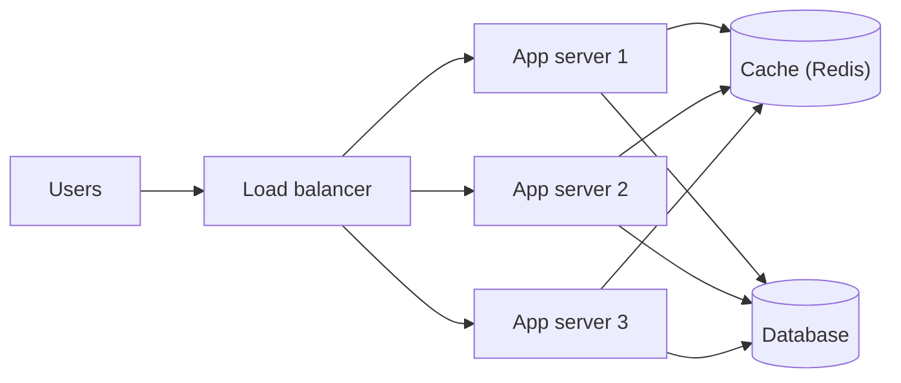
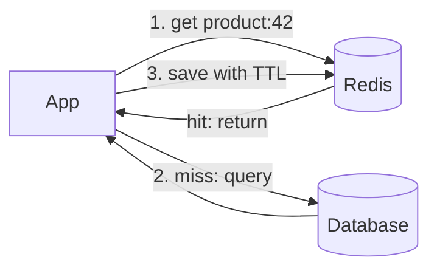
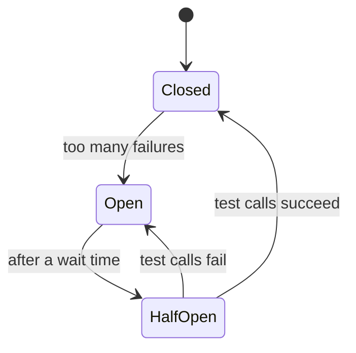

# 🌍 Systems With Many Servers: Scaling & Resilience

## Scaling: serving more users with more servers (system design, any language)

### ❓ Why do large systems run on many servers instead of one big one?

One server has limits — CPU, memory and network — and if it fails, everything stops. Running **many smaller servers** behind a **load balancer** gives:

- **More capacity:** add servers as traffic grows (**horizontal scaling**).
- **No single point of failure:** if one server dies, the others keep serving.
- **Zero-downtime releases:** update servers one at a time.



**The catch:** app servers must be **stateless** — keep sessions and shared data in Redis or the database, not in one server's memory — so any server can handle any request.

---

### ❓ How does a cache like Redis make systems faster?

Redis keeps data **in RAM**, so reads take well under a millisecond instead of the milliseconds a database query needs (see the memory hierarchy in *Memory & data*).

**Cache-aside (the most common pattern):**
1. The app looks in Redis first.
2. **Hit** → return it. **Miss** → read from the database, save it in Redis with a **TTL** (expiry time), then return it.
3. On updates, delete or refresh the cached copy.



**Trade-off:** cached data can be **stale** until it expires — fine for product pages, not for bank balances.

---

### ❓ Why use a message queue like Kafka or RabbitMQ?

Instead of calling another service directly and waiting, a service drops a **message** in a queue and moves on; other services pick it up when ready.

- **Decoupling:** the order service doesn't need to know who listens.
- **Absorbing spikes:** a sale's burst of orders queues up instead of crashing the email service.
- **Surviving failures:** if a consumer is down, messages wait safely and are processed when it returns.

**Analogy:** a **restaurant order rail** — waiters clip orders up and go back to customers; cooks take them in turn.

**Kafka vs RabbitMQ in one line:** Kafka is a durable **event log** that many consumers can replay; RabbitMQ is a **task queue** with flexible routing.

---

## Resilience: surviving failures (any language; Java examples)

### ❓ What is resilience, and is it Java-specific?

**Resilience** is a system's ability to **keep working — maybe in a reduced way — when parts of it fail**. It is **not Java-specific**: it's a **system-design idea** that applies to any language or platform, because in any system with networks, calls *will* sometimes be slow or fail.

Libraries differ by language — **Resilience4j** (Java/Spring), **Polly** (.NET), **opossum** (Node.js) — and service meshes like **Istio** can add it without code. The patterns are the same everywhere:

| Pattern | What it does | Everyday comparison |
|---|---|---|
| **Timeout** | Stop waiting after a set time | Hanging up after the phone rings 10 times |
| **Retry with backoff** | Try again, waiting longer each time | Redialling after 1 s, then 2 s, then 4 s |
| **Circuit breaker** | Stop calling a failing service for a while | A tripped fuse that stops more damage |
| **Fallback** | Return a default instead of an error | Showing "popular items" when recommendations are down |
| **Bulkhead** | Limit resources per dependency | Ship compartments: one leak doesn't sink the ship |
| **Rate limiting** | Cap requests per client | A club's entry limit |

---

### ❓ How does a circuit breaker work?

A circuit breaker sits around calls to another service and **counts failures**:

- **Closed** (normal): calls go through. If failures pass a threshold (e.g. 50% of the last 20 calls), it **opens**.
- **Open:** calls **fail immediately** with a fallback — no waiting on a dead service, so your threads stay free.
- **Half-open:** after a pause, let a few test calls through. If they succeed → **closed**; if they fail → **open** again.



```java
@CircuitBreaker(name = "payments", fallbackMethod = "paymentPending")
public PaymentResult charge(Order order) { return paymentClient.charge(order); }

PaymentResult paymentPending(Order order, Throwable error) {
    return PaymentResult.pending();   // try again later instead of failing the order
}
```

**Why it matters:** without it, one slow service makes every caller wait, threads run out, and the failure spreads through the whole system (a **cascading failure**).

---

### ❓ What does the CAP theorem mean in practice?

When the network between servers breaks (a **partition**), a distributed system must choose:

- **Consistency (C):** refuse or delay answers so nobody sees outdated data, **or**
- **Availability (A):** keep answering, even if some answers are a little out of date.

Partitions can't be avoided in real networks, so the real choice is **C or A while one lasts**.

**Examples:**
- **Bank balance, seat booking:** choose **consistency** — better to show an error than to sell the same seat twice.
- **Social feed likes, product reviews:** choose **availability** — a slightly old count is fine.

Many systems mix both: strongly consistent for payments, eventually consistent for everything else.
