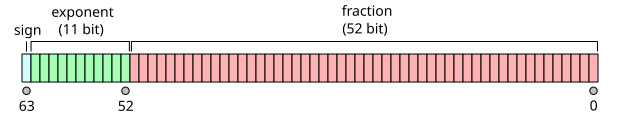
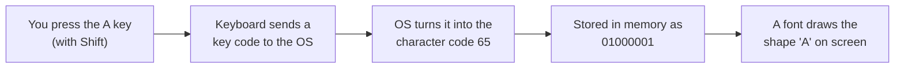
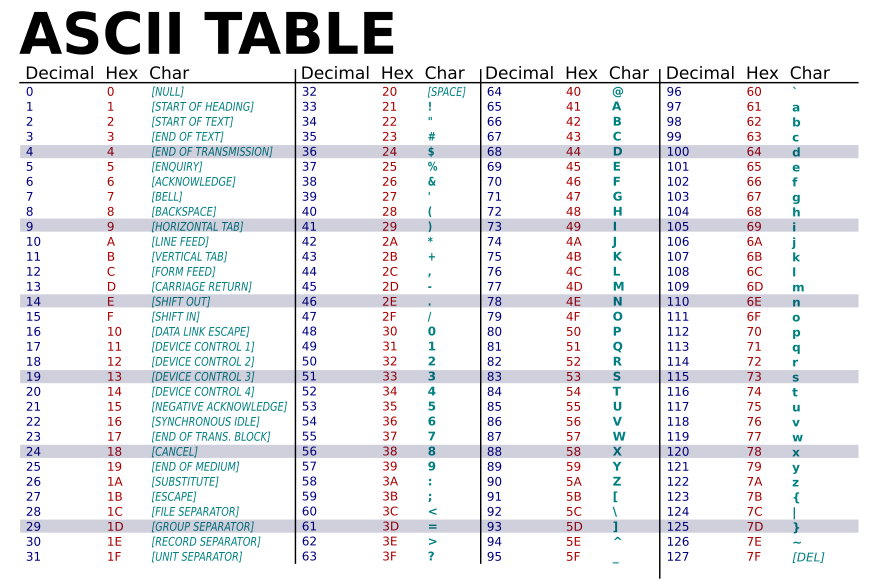
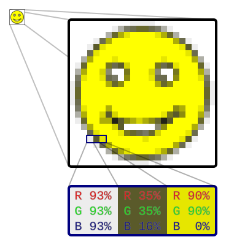
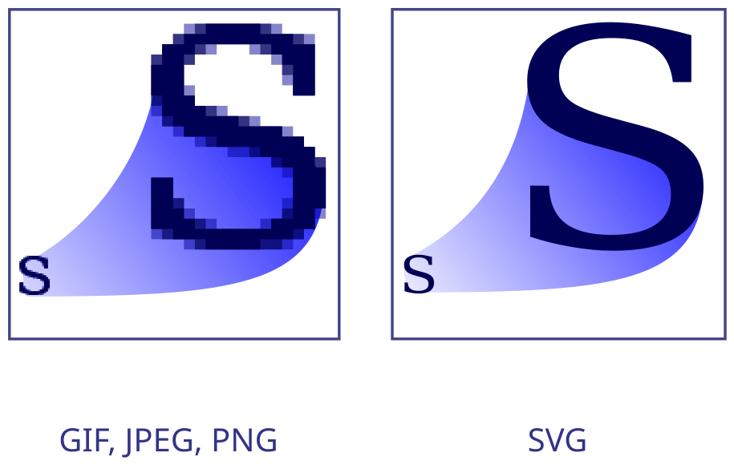

# 🔢 Bits, Text and Pictures: How a Computer Stores Everything as 0s and 1s

## Bits and bytes: the smallest pieces of data (all computers)

### ❓ What are bits and bytes?

A **bit** is one **0 or 1**: a tiny switch that is off or on. A **byte** is **8 bits**, so it can hold 2⁸ = **256** different values (0 to 255).

| Unit | Size | Holds roughly |
|---|---|---|
| 1 bit | 0 or 1 | yes / no |
| 1 byte (B) | 8 bits | one English letter, like `A` |
| 1 kilobyte (KB) | ~1,000 bytes | a short text message |
| 1 megabyte (MB) | ~1 million bytes | a phone photo is 2–5 MB |
| 1 gigabyte (GB) | ~1 billion bytes | a 1-hour HD movie is ~1.5 GB |
| 1 terabyte (TB) | ~1,000 GB | ~250,000 photos |

**How a byte stores a number:** each of the 8 places has a value, and the 1s are added up.

| Place value | 128 | 64 | 32 | 16 | 8 | 4 | 2 | 1 | = |
|---|---|---|---|---|---|---|---|---|---|
| `00000101` | 0 | 0 | 0 | 0 | 0 | 1 | 0 | 1 | **5** (4 + 1) |
| `01000001` | 0 | 1 | 0 | 0 | 0 | 0 | 0 | 1 | **65** (64 + 1) |

**Analogy:** a row of 8 light switches. Every on/off pattern means one number.

**Why a "1 TB" disk shows ~931 GB:** disk makers count 1 KB = 1,000 bytes; Windows counts 1 KB = 1,024 bytes. Same disk, different counting.

---

### ❓ How much memory does an int, a char or a boolean take?

It depends on the type, and a little on the language. Typical sizes (Java):

| Type | Size | Range / precision | Example |
|---|---|---|---|
| `byte` | 1 byte | −128 to 127 | a file's raw bytes |
| `short` | 2 bytes | −32,768 to 32,767 | rarely used |
| `int` | 4 bytes | about ±2.1 billion | age, count, ID |
| `long` | 8 bytes | about ±9.2 × 10¹⁸ | timestamps, big IDs |
| `float` | 4 bytes | ~7 digits | graphics |
| `double` | 8 bytes | ~15–16 digits | most decimals |
| `char` | 2 bytes | one UTF-16 unit | `'A'` |
| `boolean` | 1 bit of information, usually stored as 1 byte | true / false | flags |

**Other languages:** C's `char` is 1 byte and its `int` size depends on the machine (usually 4). Every JavaScript number is an 8-byte `double`. Python integers grow as big as needed.

**What happens when a number is too big (overflow):**

```java
int max = Integer.MAX_VALUE;   // 2147483647
System.out.println(max + 1);   // -2147483648: it wraps around, no error
long safe = (long) max + 1;    // 2147483648: use long for big values
```

**Rule of thumb:** use `int` for counts, `long` for IDs and time in milliseconds, and `BigDecimal` (never `double`) for money.

---

### ❓ How much memory do Strings, arrays, objects, dates and other data types take?

Everything that isn't a simple number is an **object**, and an object costs more than its data: it has a **header** (type and lock information) and is reached through a **reference** (an address).

**Java (64-bit JVM, typical):**

| Value | Memory | Why |
|---|---|---|
| reference (any object variable) | 4 bytes (8 on very large heaps) | just an address |
| `null` | no object | the reference holds 0 |
| empty object `new Object()` | 16 bytes | 12-byte header, rounded to 8 |
| `Integer` (wrapper) | 16 bytes | header + the 4-byte `int` — 4× the size of `int` |
| `"hello"` (`String`) | ~48 bytes | String object (24) + its byte array (24); 1 byte per English character |
| `int[1000]` | ~4 KB | 16-byte header + 1,000 × 4 bytes |
| `ArrayList<Integer>` of 1,000 | ~20 KB | the list + 1,000 separate `Integer` objects |
| `LocalDate` | ~24 bytes | year, month, day fields |
| `BigDecimal` | ~40+ bytes | a number plus its scale, bigger for long numbers |
| `enum` value | one reference | each constant exists only once |

**Other languages:**

| Language | Values |
|---|---|
| **JavaScript** | every `number` is an 8-byte double; `BigInt` grows as needed; strings ~1–2 bytes per character; `true`/`false`, `null`, `undefined` are tiny fixed values |
| **Python** | everything is an object: `0` is 24 bytes and `1` is 28 bytes, a `float` 24 bytes, `""` 49 bytes (+1 per English character), an empty `list` 56 bytes (+8 per item) |
| **C** | `char` 1, `short` 2, `int` 4, `long` 4 or 8, `double` 8, any pointer 8 bytes (64-bit) |
| **SQL (MySQL)** | `TINYINT` 1, `SMALLINT` 2, `INT` 4, `BIGINT` 8, `DATE` 3, `TIMESTAMP` 4, `DATETIME` 5, `CHAR(10)` always 10 bytes (more with multi-byte characters), `VARCHAR(255)` = actual length + 1–2 bytes, `BOOLEAN` = `TINYINT(1)` |

```python
import sys
sys.getsizeof(1)        # 28
sys.getsizeof("hi")     # 51
sys.getsizeof([1, 2])   # 72
```

**Why it matters:** a list of a million `Integer` objects in Java uses ~4× the memory of an `int[]`. For big data, prefer primitive arrays (Java), NumPy arrays (Python) or typed arrays (JavaScript).

---

### ❓ What is the difference between 32-bit and 64-bit?

It is how many bits the CPU handles in one step, and how big a **memory address** can be.

| | 32-bit | 64-bit |
|---|---|---|
| Biggest address | 2³² bytes = **4 GB** of RAM | 2⁶⁴ bytes = 16 exabytes (far more than any computer has) |
| Used in | old PCs, small devices | almost every PC, phone and server today |

**Why it matters:** a 32-bit system cannot use more than 4 GB of RAM, even if more is installed. A 64-bit OS usually runs old 32-bit apps, but a 32-bit OS cannot run 64-bit apps.

---

### ❓ Why is 0.1 + 0.2 not exactly 0.3 in most programming languages?

```javascript
0.1 + 0.2          // 0.30000000000000004
0.1 + 0.2 === 0.3  // false
```

A `double` stores a number in **binary**, in 64 bits: a sign, an exponent (where the point goes) and 52 bits of digits.



_Image: [Wikimedia Commons](https://commons.wikimedia.org/wiki/File:IEEE_754_Double_Floating_Point_Format.svg) · Codekaizen · CC BY-SA 4.0_

**The problem:** 0.1 has no exact binary form — it repeats forever, just like 1/3 = 0.3333… in decimal. The computer cuts it off after 52 bits, so it stores a value a tiny bit off. Two tiny errors added together become visible.

**This is not a bug in JavaScript** — Java, Python, C# and C all do the same, because they all follow the same standard (IEEE 754).

**How to handle it:**

| Situation | Do this |
|---|---|
| Money | store whole **paise / cents** in a `long`, or use `BigDecimal` (Java) / `Decimal` (Python) created from a **string**: `new BigDecimal("0.1")` |
| Comparing decimals | allow a tiny difference: `Math.abs(a - b) < 1e-9` |
| Showing to users | round when displaying: `(0.1 + 0.2).toFixed(2)` → `"0.30"` |
| Databases | use `DECIMAL(10,2)` for money, not `FLOAT` or `DOUBLE` |

---

## Text and keys: how letters become numbers (all computers)

### ❓ How does a computer store letters, digits and symbols if it only knows 0s and 1s?

Everyone agrees on a **table that gives every character a number** (a character set). The computer stores the number in binary; when it shows the text, a **font** draws the shape for that number.



| Text | Character codes | Stored bytes |
|---|---|---|
| `Hi!` | 72, 105, 33 | `01001000 01101001 00100001` |
| `5` (the character) | 53 | `00110101` |
| 5 (the number) | — | `00000101` |

**Why it matters:** the character `"5"` (code 53) is not the number 5. That's why `"5" + "5"` gives `"55"` in JavaScript, and why form input must be converted with `Number()` or `Integer.parseInt()` before doing maths.

---

### ❓ What are ASCII and Unicode, and what are the codes for Space, Enter, Tab and other keys?

- **ASCII** (1960s): **128 characters** — English letters, digits, punctuation and a few control codes. Needs 7 bits.
- **Unicode**: one number (a **code point**, written `U+0041`) for **every character in every language**, plus emoji — about 150,000 characters.
- **UTF-8**: the usual way to store Unicode in bytes. It uses **1 to 4 bytes** per character, and the first 128 are exactly ASCII, so old English text still works.

| Character | Code point | UTF-8 bytes |
|---|---|---|
| `A` | U+0041 | 1 |
| `é` | U+00E9 | 2 |
| `அ` (Tamil) | U+0B85 | 3 |
| `😀` | U+1F600 | 4 |



_Image: [Wikimedia Commons](https://commons.wikimedia.org/wiki/File:ASCII-Table-wide.svg) · ZZT32, derivative by Yufeng Huang · Public domain_

**Codes worth remembering:**

| Key / character | ASCII code | Notes |
|---|---|---|
| Space | **32** | |
| Enter | **13** (CR) and/or **10** (LF) | Windows saves a new line as 13 10; Linux and macOS as 10 |
| Tab | **9** | |
| Backspace | **8** | |
| Escape | **27** | |
| Delete | **127** | |
| `0`–`9` | **48–57** | `'7' - '0'` = 7 is a quick digit-to-number trick |
| `A`–`Z` | **65–90** | |
| `a`–`z` | **97–122** | lowercase = uppercase + 32 |
| Null | **0** | marks the end of a string in C |

**Shift, Ctrl, Alt, arrows and F1 have no ASCII code** — they are not characters. The keyboard sends a **key code**, and the OS combines it: Shift + `a` → `A` (65). In the browser, use `event.key` (`"Shift"`, `"Enter"`, `"ArrowUp"`) instead of the old numeric `keyCode` (Enter 13, Shift 16, Ctrl 17, Alt 18, arrows 37–40).

```javascript
"A".charCodeAt(0);          // 65
String.fromCharCode(97);    // "a"
"😀".length;                // 2 — JavaScript counts UTF-16 units, not characters
```

**Common bug:** text that shows as `é` instead of `é` was saved as UTF-8 but read with another encoding. Fix: use UTF-8 everywhere (files, database, HTTP `Content-Type: text/html; charset=utf-8`).

---

## Pictures and icons: how images become numbers (all computers)

### ❓ How does a computer read and show an image or an icon?

There are two ways to describe a picture:

**1. Raster images (PNG, JPEG, GIF, WebP): a grid of pixels.** Each pixel is three numbers: how much **Red, Green and Blue** light, each 0–255 (1 byte each).



_Image: [Wikimedia Commons](https://commons.wikimedia.org/wiki/File:Rgb-raster-image.svg) · Gringer · CC0_

A 1920 × 1080 photo has ~2 million pixels × 3 bytes ≈ **6 MB** raw. PNG and JPEG compress it to much less.

**2. Vector images (SVG): drawing instructions.** "Draw a circle here, this size, this colour." They stay sharp at any size, which is why most app icons are SVG.

```html
<svg width="24" height="24"><circle cx="12" cy="12" r="10" fill="gold"/></svg>
```



_Image: [Wikimedia Commons](https://commons.wikimedia.org/wiki/File:Bitmap_VS_SVG.svg) · Yug, modifications by Cfaerber et al. · CC BY-SA 2.5_

**From file to screen:** the file's bytes → a decoder (PNG, JPEG or SVG) builds the pixel grid in memory → the GPU sends it to the screen → each screen pixel lights its tiny red, green and blue parts.

**Icon fonts** (like Font Awesome) are a third way: each icon is a character code in a special font, so it is drawn like a letter.
