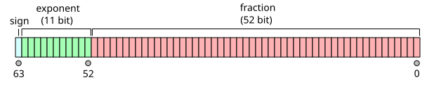
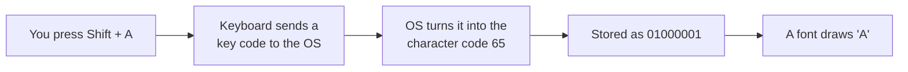
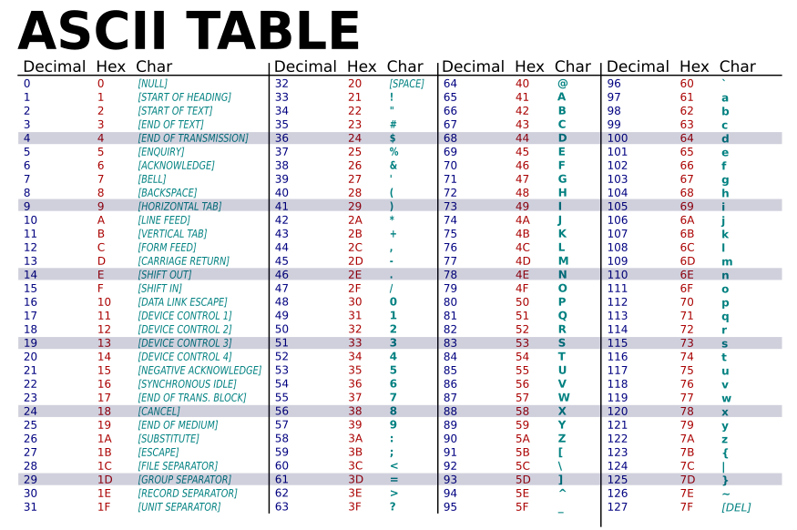
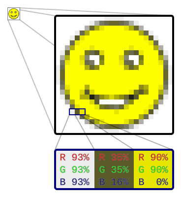
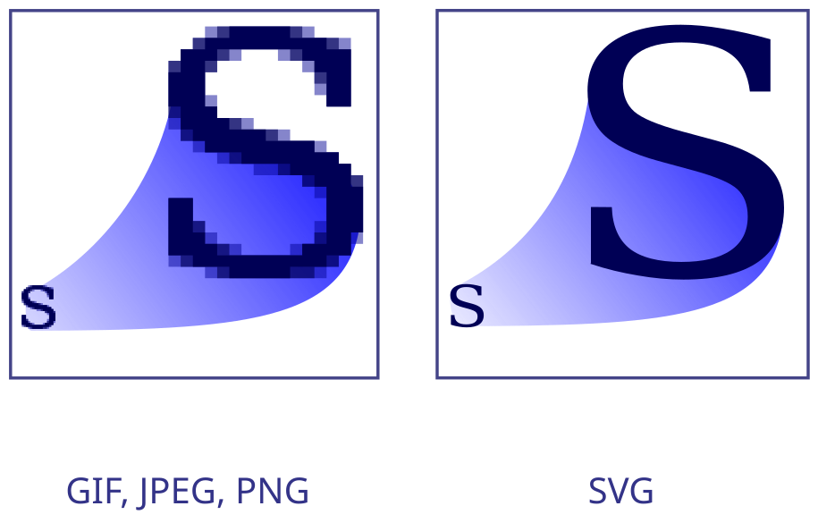

# 🔢 Bits, Text and Pictures: How a Computer Stores Everything as 0s and 1s

## Bits and bytes: the smallest pieces of data (all computers)

### ❓ What are bits and bytes?

**Generic answer:** A bit is one 0 or 1; a byte is 8 bits, which can hold 256 different values (0–255). Everything in a computer is stored as patterns of bytes.

**Under the hood:**

Imagine you must store a number, a letter and a photo using only light switches that are either off or on. That's exactly the computer's situation.

**Step 1: One switch = one bit**

A **bit** is a tiny switch: off (0) or on (1). One bit can only say yes or no.

**Step 2: Group switches = one byte**

8 bits make a **byte**: 2⁸ = **256** patterns, enough for 0–255.

**Step 3: Place values**

Each position has a value; add up the positions that are 1:

| Place value | 128 | 64 | 32 | 16 | 8 | 4 | 2 | 1 | = |
|---|---|---|---|---|---|---|---|---|---|
| `00000101` | 0 | 0 | 0 | 0 | 0 | 1 | 0 | 1 | **5** (4 + 1) |
| `01000001` | 0 | 1 | 0 | 0 | 0 | 0 | 0 | 1 | **65** (64 + 1) |

**Step 4: Scale up**

| Unit | Size | Holds roughly |
|---|---|---|
| 1 byte (B) | 8 bits | one English letter |
| 1 KB | ~1,000 bytes | a short text message |
| 1 MB | ~1 million bytes | a phone photo is 2–5 MB |
| 1 GB | ~1 billion bytes | a 1-hour HD movie ~1.5 GB |
| 1 TB | ~1,000 GB | ~250,000 photos |

**Trivia:** a "1 TB" disk shows ~931 GB because makers count 1 KB = 1,000 bytes and Windows counts 1,024.

**Final understanding:** **Only on/off switches → group them → place values give numbers → everything else is built on numbers.**

---

### ❓ How much memory does an int, a char or a boolean take?

**Generic answer:** It depends on the type: in Java, `int` is 4 bytes, `long` and `double` 8, `char` 2, `byte` 1, and a `boolean` is usually stored in 1 byte.

**Under the hood:**

Imagine choosing a box for each value: too small and the value doesn't fit; too big and you waste memory across millions of values.

**Step 1: Fixed-size boxes (Java)**

| Type | Size | Range / precision | Example |
|---|---|---|---|
| `byte` | 1 byte | −128 to 127 | raw file bytes |
| `short` | 2 bytes | −32,768 to 32,767 | rarely used |
| `int` | 4 bytes | about ±2.1 billion | age, count, ID |
| `long` | 8 bytes | about ±9.2 × 10¹⁸ | timestamps, big IDs |
| `float` | 4 bytes | ~7 digits | graphics |
| `double` | 8 bytes | ~15–16 digits | most decimals |
| `char` | 2 bytes | one UTF-16 unit | `'A'` |
| `boolean` | 1 bit of information, usually 1 byte | true / false | flags |

**Step 2: When the value doesn't fit (overflow)**

```java
int max = Integer.MAX_VALUE;   // 2147483647
System.out.println(max + 1);   // -2147483648: wraps around, no error
long safe = (long) max + 1;    // 2147483648
```

**Step 3: Other languages differ**

C's `char` is 1 byte and `int` depends on the machine (usually 4). Every JavaScript number is an 8-byte `double`. Python integers grow as needed.

**Rule of thumb:** `int` for counts, `long` for IDs and milliseconds, `BigDecimal` (never `double`) for money.

**Final understanding:** **Each type is a fixed-size box → pick the smallest box that safely fits → overflow wraps silently.**

---

### ❓ How much memory do Strings, arrays, objects, dates and other data types take?

**Generic answer:** Objects cost more than their data: each has a header and is reached through a reference. A Java `Integer` takes 16 bytes versus 4 for an `int`.

**Under the hood:**

Imagine storing a million numbers in `ArrayList<Integer>` and running out of memory, while an `int[]` of the same numbers fits easily. Why?

**Step 1: Every object has overhead**

A Java object has a **header** (type and lock info, ~12 bytes), and sizes round up to 8 bytes.

**Step 2: Objects are reached by reference**

Each variable holding an object stores an address (4 bytes, 8 on very large heaps).

**Step 3: Add it up (64-bit JVM, typical)**

| Value | Memory | Why |
|---|---|---|
| reference | 4 bytes | just an address |
| `new Object()` | 16 bytes | header, rounded |
| `Integer` | 16 bytes | header + 4-byte `int` |
| `"hello"` | ~48 bytes | String object + byte array |
| `int[1000]` | ~4 KB | 16-byte header + 1,000 × 4 |
| `ArrayList<Integer>` of 1,000 | ~20 KB | list + 1,000 `Integer` objects |
| `LocalDate` | ~24 bytes | year, month, day |
| `BigDecimal` | ~40+ bytes | number plus scale |

**Step 4: Other languages**

| Language | Values |
|---|---|
| **JavaScript** | every `number` 8 bytes; strings ~1–2 bytes per character |
| **Python** | everything is an object: `1` is 28 bytes, empty `list` 56 bytes (+8 per item) |
| **C** | `char` 1, `int` 4, `double` 8, pointers 8 (64-bit) |
| **SQL (MySQL)** | `INT` 4, `BIGINT` 8, `DATE` 3, `DATETIME` 5, `VARCHAR(255)` = length + 1–2 bytes |

```python
import sys
sys.getsizeof(1)        # 28
sys.getsizeof([1, 2])   # 72
```

**Final understanding:** **Objects = header + data + a reference to reach them → boxed numbers cost ~4× → use primitive arrays (Java), NumPy (Python) or typed arrays (JS) for big data.**

---

### ❓ What is the difference between 32-bit and 64-bit?

**Generic answer:** It's how many bits the CPU handles in one step and how big a memory address can be: 32-bit can address only 4 GB of RAM; 64-bit can address far more than any computer has.

**Under the hood:**

Imagine house numbers with only a fixed number of digits. With 3 digits you can number at most 1,000 houses. Memory addresses work the same way.

**Step 1: Addresses are numbers**

Every byte of RAM has an address. The CPU's address size limits how many bytes it can point to.

**Step 2: The limits**

| | 32-bit | 64-bit |
|---|---|---|
| Biggest address | 2³² bytes = **4 GB** | 2⁶⁴ bytes = 16 exabytes |
| Used in | old PCs, small devices | almost everything today |

**Step 3: Compatibility**

A 64-bit OS usually runs 32-bit apps; a 32-bit OS cannot run 64-bit apps.

**Final understanding:** **Address size = how much memory you can name → 32 bits cap at 4 GB → 64 bits removes the cap.**

---

### ❓ Why is 0.1 + 0.2 not exactly 0.3 in most programming languages?

**Generic answer:** Doubles store numbers in binary, and 0.1 has no exact binary form, so tiny rounding errors appear; this follows the IEEE 754 standard in nearly every language.

**Under the hood:**

```javascript
0.1 + 0.2          // 0.30000000000000004
0.1 + 0.2 === 0.3  // false
```

Imagine writing 1/3 in decimal: 0.3333… forever. You must stop somewhere, so you're slightly off.

**Step 1: How a double is stored**

64 bits: a sign, an exponent (where the point goes) and 52 bits of digits — all in **binary**.



_Image: [Wikimedia Commons](https://commons.wikimedia.org/wiki/File:IEEE_754_Double_Floating_Point_Format.svg) · Codekaizen · CC BY-SA 4.0_

**Step 2: 0.1 repeats forever in binary**

Just like 1/3 in decimal. The computer cuts it after 52 bits, storing a value a tiny bit off.

**Step 3: Errors add up**

Two tiny errors added together become visible in the last digit.

**Step 4: Not a JavaScript bug**

Java, Python, C# and C do the same — they all follow IEEE 754.

**Step 5: How to handle it**

| Situation | Do this |
|---|---|
| Money | whole **paise/cents** in a `long`, or `BigDecimal` from a **string**: `new BigDecimal("0.1")` |
| Comparing | allow a tiny difference: `Math.abs(a - b) < 1e-9` |
| Display | round: `(0.1 + 0.2).toFixed(2)` → `"0.30"` |
| Databases | `DECIMAL(10,2)` for money, not `FLOAT` |

**Final understanding:** **Decimal fractions → binary that repeats forever → cut at 52 bits → tiny errors → use exact decimal types for money.**

---

## Text and keys: how letters become numbers (all computers)

### ❓ How does a computer store letters, digits and symbols if it only knows 0s and 1s?

**Generic answer:** Everyone agrees on a table giving each character a number; the computer stores that number in binary, and a font draws the matching shape on screen.

**Under the hood:**

Imagine you press **Shift + A**. The keyboard only sends electrical signals; memory only holds numbers; the screen only shows pixels. How does an "A" appear?

**Step 1: Key press → key code**

The keyboard sends a **key code** to the OS.

**Step 2: Key code → character code**

The OS combines keys (Shift + a) into the character code **65**.

**Step 3: Stored as binary**

65 is stored as `01000001`.

**Step 4: Drawn by a font**

A font looks up code 65 and draws the shape "A".



| Text | Character codes | Stored bytes |
|---|---|---|
| `Hi!` | 72, 105, 33 | `01001000 01101001 00100001` |
| `5` (character) | 53 | `00110101` |
| 5 (number) | — | `00000101` |

**Why it matters:** the character `"5"` (code 53) is not the number 5. That's why `"5" + "5"` is `"55"` in JavaScript, and form input must be converted with `Number()` or `Integer.parseInt()`.

**Final understanding:** **Key → key code → agreed character number → binary in memory → font draws the shape.**

---

### ❓ What are ASCII and Unicode, and what are the codes for Space, Enter, Tab and other keys?

**Generic answer:** ASCII gives numbers to 128 English characters; Unicode gives a number to every character in every language; UTF-8 stores Unicode in 1–4 bytes and is compatible with ASCII.

**Under the hood:**

Imagine the 1960s: computers only needed English, so 128 codes were enough. Then came Tamil, Chinese, Arabic and emoji — thousands of characters, and many incompatible local tables that turned text into garbage when shared.

**Step 1: ASCII — the English table**

**128 characters** (7 bits): letters, digits, punctuation, control codes.

**Step 2: Unicode — one table for the world**

Every character gets a **code point** (`U+0041`) — about 150,000 characters, including emoji.

**Step 3: UTF-8 — store it efficiently**

1 to 4 bytes per character. The first 128 are exactly ASCII, so old English text still works.

| Character | Code point | UTF-8 bytes |
|---|---|---|
| `A` | U+0041 | 1 |
| `é` | U+00E9 | 2 |
| `அ` (Tamil) | U+0B85 | 3 |
| `😀` | U+1F600 | 4 |



_Image: [Wikimedia Commons](https://commons.wikimedia.org/wiki/File:ASCII-Table-wide.svg) · ZZT32, derivative by Yufeng Huang · Public domain_

**Step 4: Codes worth remembering**

| Key / character | ASCII code | Notes |
|---|---|---|
| Space | **32** | |
| Enter | **13** (CR) and/or **10** (LF) | Windows: 13 10; Linux/macOS: 10 |
| Tab | **9** | |
| Backspace | **8** | |
| Escape | **27** | |
| Delete | **127** | |
| `0`–`9` | **48–57** | `'7' - '0'` = 7 |
| `A`–`Z` | **65–90** | |
| `a`–`z` | **97–122** | lowercase = uppercase + 32 |
| Null | **0** | ends a C string |

**Step 5: Keys that aren't characters**

Shift, Ctrl, Alt, arrows and F1 have **no ASCII code**. In the browser use `event.key` (`"Shift"`, `"Enter"`, `"ArrowUp"`) instead of the old `keyCode`.

```javascript
"A".charCodeAt(0);          // 65
String.fromCharCode(97);    // "a"
"😀".length;                // 2 — JavaScript counts UTF-16 units
```

**Common bug:** `é` instead of `é` = saved as UTF-8, read as another encoding. Use UTF-8 everywhere.

**Final understanding:** **English-only table (ASCII) → world table (Unicode) → compact storage compatible with ASCII (UTF-8).**

---

## Pictures and icons: how images become numbers (all computers)

### ❓ How does a computer read and show an image or an icon?

**Generic answer:** Raster images (PNG, JPEG) are grids of pixels, each pixel three numbers for red, green and blue; vector images (SVG) are drawing instructions that stay sharp at any size.

**Under the hood:**

Imagine describing a smiley to someone over the phone. You can read out the colour of every square on graph paper, or say "draw a yellow circle with two dots". Computers use both methods.

**Step 1: Raster — a grid of pixels**

Each pixel = **Red, Green, Blue**, each 0–255 (1 byte each).



_Image: [Wikimedia Commons](https://commons.wikimedia.org/wiki/File:Rgb-raster-image.svg) · Gringer · CC0_

A 1920 × 1080 photo = ~2 million pixels × 3 bytes ≈ **6 MB** raw; PNG and JPEG compress it.

**Step 2: Vector — drawing instructions**

```html
<svg width="24" height="24"><circle cx="12" cy="12" r="10" fill="gold"/></svg>
```

Sharp at any size, so most app icons are SVG.



_Image: [Wikimedia Commons](https://commons.wikimedia.org/wiki/File:Bitmap_VS_SVG.svg) · Yug, modifications by Cfaerber et al. · CC BY-SA 2.5_

**Step 3: From file to screen**

File bytes → decoder (PNG/JPEG/SVG) builds a pixel grid in memory → GPU sends it to the screen → each screen pixel lights its red, green and blue parts.

**Step 4: Icon fonts**

Font Awesome-style icons are characters in a special font, drawn like letters.

**Final understanding:** **Picture → pixels (raster) or instructions (vector) → decoded to a pixel grid → GPU → screen.**
