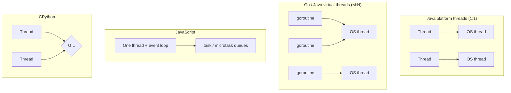
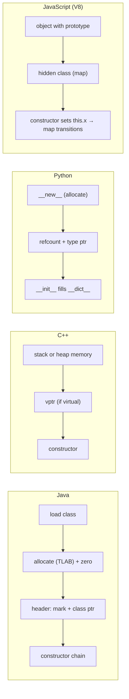
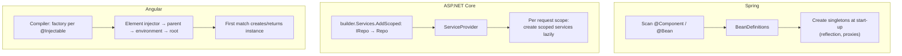
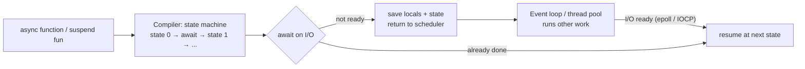
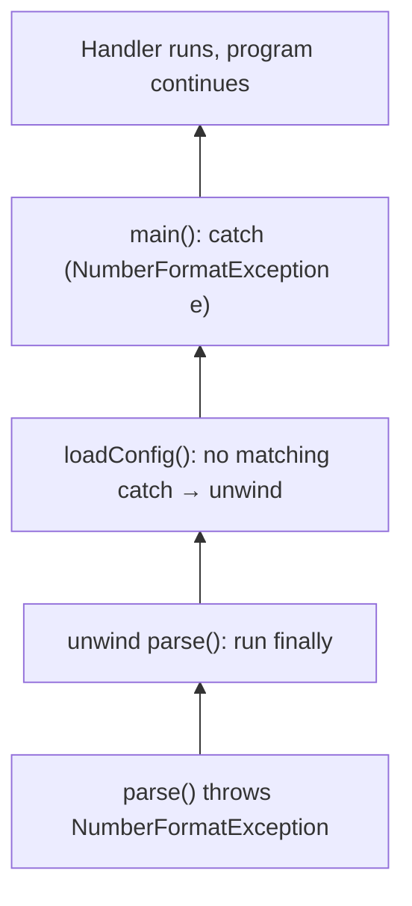
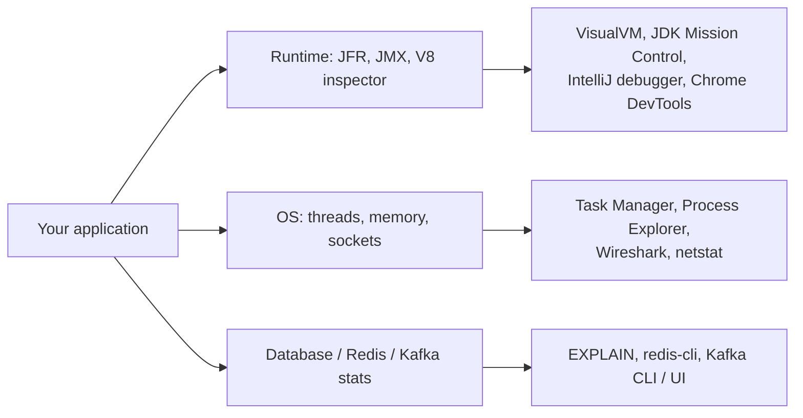

# 🔩 Under the Hood: Language Implementation Comparisons

The same concept, implemented differently by each language. (Compilation, memory management and garbage collection are compared in the Compilers & Execution and OS, CPU & Memory notes.)

## Runtime Behaviour Across Languages

### ❓ How do Java, JavaScript, Python, Go, Rust and C# implement concurrency differently?

### 📝 Answer

**1. What is it?**
**Concurrency** = handling many tasks that overlap in time; **parallelism** = running them at the same instant on multiple cores. Languages offer very different building blocks: OS threads, lightweight threads, event loops, or ownership-checked threads.

**2. How does it work internally?**

| Language | Unit | Scheduled by | Parallel on many cores? |
|---|---|---|---|
| **Java** | Platform `Thread` (1:1 OS thread); **virtual threads** (Java 21, M:N) | OS / JVM scheduler (ForkJoinPool carriers) | Yes |
| **C#** | Threads + `Task` on the thread pool | OS + .NET thread pool | Yes |
| **Go** | **Goroutines** (start ~2 KB stack, growable) | Go runtime **M:N scheduler** (G-M-P model, work stealing) | Yes |
| **Rust** | OS threads (`std::thread`); async tasks via runtimes (Tokio) | OS / Tokio work-stealing scheduler | Yes, with **compile-time** data-race checks |
| **JavaScript** | One thread per realm + **event loop**; Web Workers / `worker_threads` | Engine event loop | Only with workers (no shared objects) |
| **Python (CPython)** | OS threads, but the **GIL** lets one execute Python bytecode at a time; `asyncio`; `multiprocessing` | OS / event loop | Threads: not for Python code (except free-threaded 3.13+ builds); processes: yes |

**3. Visual**



**4. Internal implementation**

- **Shared memory + locks** (Java, C#, C++, Go also has mutexes): need the **memory model** (`volatile`, `synchronized`, atomics) for visibility between cores.
- **Go**: "share memory by communicating" — **channels** pass values between goroutines; the scheduler parks goroutines blocked on I/O and runs others.
- **Rust**: the `Send` and `Sync` traits plus ownership make sharing unsynchronised mutable data a **compile error**.
- **JavaScript**: no shared objects between workers (except `SharedArrayBuffer`) → no data races on normal objects.
- **CPython GIL**: simplifies the interpreter (reference counting isn't thread-safe), at the cost of CPU parallelism for threads.

**5. Why is it designed this way?**
OS threads are general but heavy (~1 MB stack, kernel context switches). M:N lightweight threads make millions of concurrent tasks cheap. Event loops avoid locks entirely but can't use many cores alone. Rust trades compile-time strictness for fearless parallelism.

**6. Language differences**
Covered in the table: the key questions are **1:1 vs M:N**, **shared memory vs message passing**, and **who prevents data races** (you, the compiler, or the single-threaded design).

**7. Practical example**
Handling 10,000 concurrent slow HTTP calls: Java 21 virtual threads or Go goroutines with plain blocking code; Node.js with `Promise.all`; Python with `asyncio.gather`; classic Java platform threads would need 10,000 OS threads.

**8. How can I observe it?**
Java: `jcmd <pid> Thread.dump_to_file -format=json out.json` (includes virtual threads). Go: `GODEBUG=schedtrace=1000`, `pprof` goroutine profile. Python: compare CPU-bound threads vs processes timing. Node: `--cpu-prof`, DevTools Performance main-thread view.

---

### ❓ How do Java, C++, Python and JavaScript create objects internally?

### 📝 Answer

**1. What is it?**
Creating an object means: **allocate memory**, **initialise** its fields, and connect it to its **type** information (for method calls). Each language does these steps differently.

**2. How does it work internally?**

- **Java** `new User("Asha")`:
  1. Class loaded and initialised if first use.
  2. Memory allocated on the heap (TLAB bump pointer), fields **zeroed**.
  3. Object header written (mark word + class pointer).
  4. Constructor chain runs (`super()` first, field initialisers, constructor body).
  5. A reference is returned.
- **C++** `User u("Asha");` / `new User("Asha")`: memory on the **stack** (or heap with `new`), constructor runs; objects with virtual methods get a **vptr** to the class's **vtable**; no header otherwise. Destructor runs at scope end / `delete`.
- **Python** `User("Asha")`: `type.__call__` → `User.__new__` allocates (pymalloc) → `__init__` initialises; every object has a reference count and type pointer; attributes live in a `__dict__` (or fixed `__slots__`).
- **JavaScript** `new User("Asha")`: creates an object whose prototype is `User.prototype`, runs the constructor with `this` bound to it; V8 assigns a **hidden class (map)** and transitions it as properties are added.

**3. Visual**



**4. Internal implementation**

| | Header / overhead | Method lookup | Layout fixed? |
|---|---|---|---|
| Java | 12–16 bytes header | vtable + inline caches | Yes (class) |
| C++ | 0 bytes (+ vptr if virtual) | Direct call or vtable | Yes |
| Python | ~16 bytes + `__dict__` | Dictionary lookups along the MRO (with caches) | No (unless `__slots__`) |
| JavaScript | Map pointer + properties | Hidden class + inline caches | Dynamic, optimised when shapes are stable |

**5. Why is it designed this way?**
Static languages know the layout at compile time → compact objects and fast field access. Dynamic languages allow adding attributes at runtime, so engines add tricks (hidden classes, `__slots__`) to recover speed.

**6. Language differences**
Covered above. Practical rule: in JavaScript, initialise all properties in the constructor in the same order so objects share hidden classes; in Python, use `__slots__` for millions of small objects.

**7. Practical example**

```java
User u = new User("Asha");   // bytecode: new User; dup; ldc "Asha"; invokespecial User.<init>
```

```js
function P(x, y) { this.x = x; this.y = y; }   // all P objects share one hidden class
```

**8. How can I observe it?**
Java: `javap -c` (the `new` / `invokespecial` pair), **JOL** for object size. Python: `sys.getsizeof(obj)`, `obj.__dict__`. V8: `node --allow-natives-syntax` with `%HaveSameMap(a, b)`; DevTools heap snapshot shows object sizes. C++: `sizeof(User)`.

---

### ❓ How do Spring, ASP.NET Core and Angular implement Dependency Injection differently?

### 📝 Answer

**1. What is it?**
All three provide an **IoC container**: you declare dependencies; the framework constructs objects and passes them in. They differ in **when** wiring happens, **object lifetimes**, and how the container is **structured**.

**2. How does it work internally?**

- **Spring (Java)**: at start-up, scan classes → `BeanDefinition`s → create singletons eagerly, resolving constructor parameters **by type** via reflection; post-processors may wrap beans in proxies.
- **ASP.NET Core (C#)**: you register services in `Program.cs` (`AddSingleton/AddScoped/AddTransient`); the `ServiceProvider` builds them **lazily** on first request using constructor parameters; **scoped** services live per HTTP request.
- **Angular (TypeScript)**: the compiler generates a factory per injectable; **hierarchical injectors** (environment → element) resolve tokens by walking up the tree at runtime; `providedIn: 'root'` services are lazy and tree-shakable.

**3. Visual**



**4. Internal implementation**

| | Spring | ASP.NET Core | Angular |
|---|---|---|---|
| Registration | Annotations + scanning, `@Bean` | Explicit in code | Decorators + `providers` arrays |
| Resolution time | Start-up (eager singletons) | First use (lazy) | First injection (lazy) |
| Lifetimes | singleton, prototype, request, session | singleton, scoped (request), transient | per injector (root, route, component) |
| Mechanism | Reflection (or AOT-generated) | Reflection / compiled expression trees | Compiler-generated factories |
| Extra | AOP proxies, conditional auto-config | Middleware, options pattern | Hierarchy per component tree |

**5. Why is it designed this way?**
Spring favours convention (scanning, auto-configuration) for large enterprise apps; ASP.NET Core favours explicit registration and request scopes; Angular needs a **tree** of injectors to match the UI component tree and lazy-loaded routes.

**6. Framework differences**
Build-time DI exists too: Dagger/Hilt (Android), Micronaut and Quarkus (Java), which generate wiring code instead of using runtime reflection → faster start-up.

**7. Practical example**

```java
// Spring
@Service class OrderService { OrderService(OrderRepository repo) { } }
```

```csharp
// ASP.NET Core
builder.Services.AddScoped<IOrderRepository, OrderRepository>();
public class OrderService(IOrderRepository repo) { }
```

```ts
// Angular
@Injectable({ providedIn: 'root' }) export class OrderService { private repo = inject(OrderApi); }
```

**8. How can I observe it?**
Spring: `/actuator/beans`. ASP.NET Core: `builder.Host.UseDefaultServiceProvider(o => o.ValidateScopes = true)` catches lifetime mistakes; debugger shows the `ServiceProvider`. Angular: DevTools → Injector Tree.

---

### ❓ How do Java, JavaScript, Python, C# and Kotlin implement asynchronous execution?

### 📝 Answer

**1. What is it?**
**Asynchronous execution** lets a program start slow work (I/O, timers) and continue doing other things, resuming the rest of the code when the result is ready — without blocking a thread while waiting.

**2. How does it work internally?**

- **JavaScript**: `async/await` compiles to a **state machine** over Promises; continuations run as **microtasks** on the single event-loop thread.
- **C#**: `async/await` compiled by Roslyn into a **state machine struct**; awaiting a `Task` registers a continuation; it resumes on the thread pool (or the captured `SynchronizationContext` in UI apps).
- **Python**: `async def` creates a **coroutine** (a generator-like object); `await` yields control to the **asyncio event loop**, which uses `selectors` (epoll/IOCP) to resume coroutines when I/O is ready.
- **Kotlin**: `suspend` functions are transformed by the compiler into **continuation-passing** state machines; **coroutines** run on dispatchers (thread pools) and are very cheap.
- **Java**: `CompletableFuture` chains callbacks on executors; reactive (Project Reactor `Mono/Flux`); since Java 21, **virtual threads** make plain blocking code behave asynchronously under the hood (the JVM unmounts the virtual thread on I/O).

**3. Visual**



**4. Internal implementation**

| Language | Await target | Resumes on | Colours functions? |
|---|---|---|---|
| JavaScript | Promise | Same event-loop thread (microtask) | Yes (`async`) |
| C# | Task / ValueTask | Thread pool / sync context | Yes |
| Python | Awaitable (coroutine/Future) | asyncio loop thread | Yes |
| Kotlin | `suspend` call | Coroutine dispatcher | Yes (`suspend`) |
| Java 21 | (none — blocking call on a virtual thread) | Any carrier thread | **No** |

"Coloured functions" = async code can only be awaited from async code, which spreads `async` through the codebase; Java's virtual threads (and Go's goroutines) avoid that.

**5. Why is it designed this way?**
Threads blocked on I/O waste memory; state machines let one thread serve thousands of waiting operations. Languages differ in whether they make this explicit (await) or hide it in the runtime (virtual threads, goroutines).

**6. Language differences**
See the table. Pitfalls: blocking calls inside async code freeze the event loop (Node, Python); `.Result`/`.Wait()` in C# can deadlock; `synchronized` blocks pinned virtual threads in Java 21–23 (fixed in Java 24).

**7. Practical example**

```js
const [user, orders] = await Promise.all([getUser(id), getOrders(id)]);   // both requests in flight at once
```

```kotlin
val user = async { api.user(id) }; val orders = async { api.orders(id) }
show(user.await(), orders.await())
```

**8. How can I observe it?**
Decompile a C# async method (ILSpy/SharpLab.io) or a Kotlin suspend function (IntelliJ "Show Kotlin Bytecode") to see the generated state machine. Node: `--trace-event-categories`. Python: `asyncio` debug mode (`PYTHONASYNCIODEBUG=1`) warns about slow callbacks.

---

### ❓ How do Java, Python, C++, C# and JavaScript implement exception handling internally?

### 📝 Answer

**1. What is it?**
An **exception** transfers control from where an error happens to the nearest matching handler up the call stack, running cleanup code on the way. Languages differ in the **cost model**, **checked vs unchecked** rules, and **cleanup** mechanisms.

**2. How does it work internally?**
General flow:

1. `throw` creates an exception object (often capturing a **stack trace**).
2. The runtime searches the current function for a matching handler (`catch`).
3. None → the function's frame is **unwound** (popped), cleanup runs (`finally`, destructors, `using`), and the search continues in the caller.
4. Found → execution continues in the handler. Not found anywhere → the thread/program terminates with an uncaught-exception error.

**3. Visual**



**4. Internal implementation**

| Language | Mechanism | Cost when no exception | Cleanup |
|---|---|---|---|
| **Java** | Per-method **exception table** (bytecode ranges → handler) | ~Zero | `finally`, try-with-resources |
| **C#** | Two-pass SEH-style: find handler, then unwind | ~Zero | `finally`, `using` |
| **C++** | **Zero-cost** unwind tables (Itanium ABI / Windows SEH) | Zero; throw is expensive | **Destructors (RAII)** |
| **Python** | Exception table (3.11+ "zero-cost"), unwinds interpreter frames | ~Zero | `finally`, `with` (context managers) |
| **JavaScript** | Engine unwinds the call stack; async errors become **rejected Promises** | ~Zero | `finally` |

- **Checked exceptions** exist only in **Java**: the compiler forces you to catch or declare them. Kotlin, C#, Python and JS have only unchecked ones.
- Filling stack traces is the main throw cost in Java; `new Exception(msg, cause, false, false)` can disable it for control-flow-heavy cases.

**5. Why is it designed this way?**
Table-based ("zero-cost") exceptions make the normal path fast and pay only when something goes wrong — matching how rare errors should be. Go and Rust deliberately avoid exceptions for expected errors, returning error values (`error`, `Result`) so failure paths are explicit.

**6. Language differences**
See the table; plus: C++ `noexcept` functions terminate if they throw; JavaScript `await` turns a rejected Promise back into a thrown error inside `try/catch`; unhandled Promise rejections crash Node.js processes (since Node 15).

**7. Practical example**

```java
try (var in = Files.newBufferedReader(path)) {   // closed automatically, even on exception
    return parse(in.readLine());
} catch (IOException e) {
    throw new ConfigException("Cannot read " + path, e);   // keep the cause
}
```

**8. How can I observe it?**
Java: `javap -c -v` shows the `Exception table:` of a method. IntelliJ / VS / Chrome DevTools: "break on exceptions" (caught and uncaught). C++: Compiler Explorer shows `.gcc_except_table` sections. Python: `dis.dis()` on 3.11+ prints the exception table.

---

## Observing Internals in Practice

### ❓ Which tools can I use to observe software internals, and what should I look for?

### 📝 Answer

**1. What is it?**
A toolbox for **seeing** what this whole section describes: bytecode, threads, memory, GC, network packets, query plans, containers, caches and messages. Observing real behaviour is how you confirm theory and find problems.

**2. How does it work internally?**
Tools get information in three ways:

1. **Runtime introspection APIs** — the JVM's JMX / JFR events, V8 inspector protocol, .NET EventPipe.
2. **OS-level instrumentation** — process/thread tables, performance counters, packet capture (Npcap/libpcap), eBPF.
3. **Application/DB statistics** — `EXPLAIN` plans, Redis `INFO`, Kafka metrics, Actuator endpoints.

**3. Visual**



**4. Internal implementation**

| Area | Tools | Look for |
|---|---|---|
| Java / JVM | IntelliJ debugger, VisualVM, JConsole, **JFR + JDK Mission Control**, `javap`, `jcmd` | Hot methods, GC pauses, heap growth, blocked threads, bytecode |
| JavaScript / browser | **Chrome DevTools** (Performance, Memory, Network, Sources) | Long tasks > 50 ms, layout thrashing, detached DOM leaks, waterfall |
| Angular | **Angular DevTools** | Change detection cycles, component tree, injectors |
| Database | `EXPLAIN ANALYZE`, SQL Server execution plans + `SET STATISTICS IO ON` | Scans vs seeks, estimated vs actual rows, logical reads |
| Networking | **Wireshark**, browser Network tab, `curl -v` | Handshakes, retransmissions, TTFB, protocol (h2/h3) |
| Memory | VisualVM heap dump, JFR allocation profiling, Eclipse MAT | Retained size, dominator tree, allocation hot spots |
| Operating system | Task Manager, **Process Explorer**, Resource Monitor | Threads per process, handles, page faults, CPU per core |
| Docker | `docker stats`, `docker inspect`, Docker Desktop | Memory vs limit, restarts, layers, mounts |
| Redis | `redis-cli INFO`, `SLOWLOG`, `MONITOR` | Hit ratio, memory, slow commands |
| Kafka | `kafka-consumer-groups.sh --describe`, Kafka UI | Consumer lag, partition skew, under-replicated partitions |

**5. Why is it designed this way?**
Low-overhead, always-on tools (JFR, metrics) let you observe production safely; heavy tools (debuggers, heap dumps, packet capture) are for reproducing issues locally or in staging.

**6. Language differences**
.NET: `dotnet-counters`, `dotnet-trace`, `dotnet-dump`, Visual Studio diagnostics. Python: `cProfile`, `py-spy`, `tracemalloc`. Go: `pprof`, `go tool trace`. Node: `--inspect` + Chrome DevTools, `clinic.js`. Rust/C++: `perf`, Valgrind, sanitizers.

**7. Practical example**
"Spring Boot API is slow": JFR recording (method profiling) → most time in `OrderRepository.findAll` → `EXPLAIN ANALYZE` shows a sequential scan → add an index → JFR confirms the hotspot is gone.

**8. How can I observe it?**
Start small: `jcmd <pid> JFR.start duration=60s filename=rec.jfr`, open it in JDK Mission Control; record a page load in Chrome DevTools Performance; capture one HTTPS request in Wireshark; run `EXPLAIN ANALYZE` on your slowest query. For each, write down what you expected vs what you saw.
