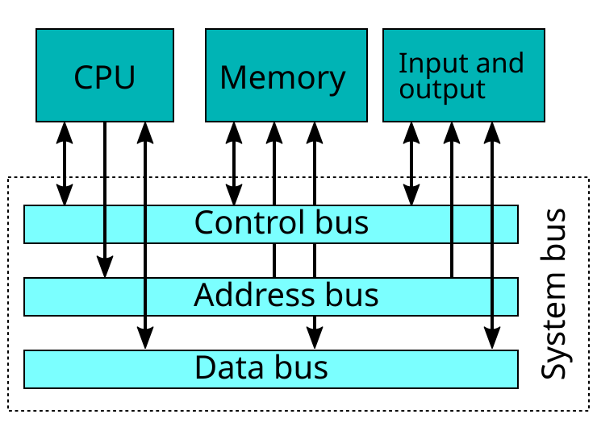
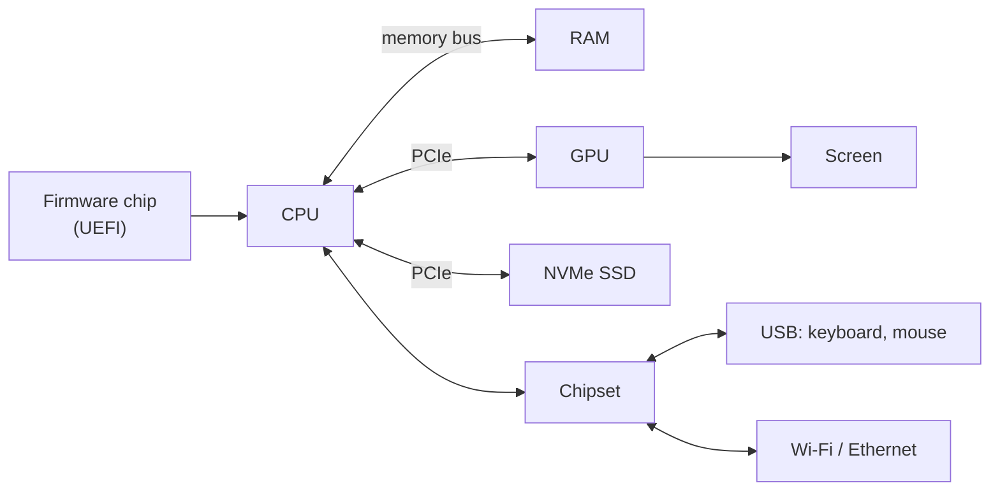
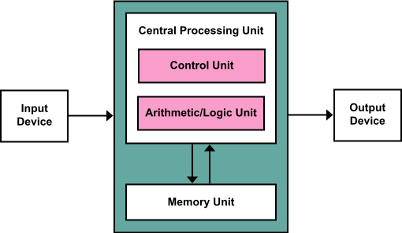
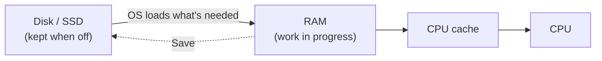
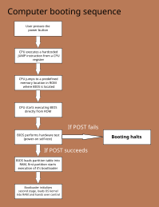
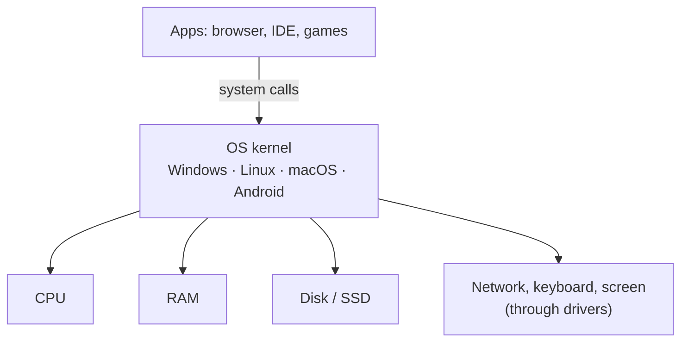
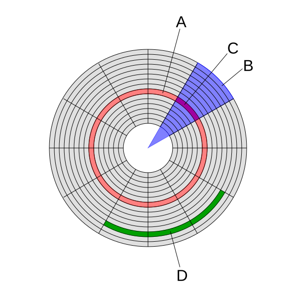

# ⚙️ Inside the Machine: CPU, RAM, Booting and Files

## CPU and RAM: why programs run from memory (all computers)

### ❓ How do the CPU, RAM, ROM, disk, motherboard and OS connect, and what happens when you open an app?

**Generic answer:** The motherboard's buses connect the CPU, RAM, disk and devices; the OS manages them; opening an app means the OS loads its code from disk into RAM and gives it CPU time.

**Under the hood:**

Imagine you double-click the Chrome icon. A second later a window appears. Mouse, chipset, SSD, RAM, CPU, GPU and the OS all took part.

**Step 1: Know the parts**

| Part | Job | Analogy |
|---|---|---|
| **Motherboard** | connects everything through copper paths (**buses**) | the city's roads |
| **CPU** | runs instructions | the chef |
| **RAM** | holds running apps; forgets when power is off | the kitchen counter |
| **ROM / firmware** (UEFI/BIOS) | the start-up program; keeps contents without power | the opening checklist |
| **SSD / hard disk** | keeps files permanently | the warehouse |
| **GPU** | draws the screen (and runs AI maths) | the decorator |
| **Chipset** | traffic control for USB, SATA, audio, network | the roundabout |
| **OS** | manages all of it for every app | the restaurant manager |

_Image: [Wikimedia Commons](https://commons.wikimedia.org/wiki/File:Computer_system_bus.svg) · W Nowicki · CC BY-SA 3.0_

The **address bus** says *where*, the **data bus** carries *what*, the **control bus** says *read or write*.

**Step 2: Click** — the mouse signals over USB; the chipset **interrupts** the CPU; the OS sees a double-click on Chrome.

**Step 3: Find the app** — the OS looks up `chrome.exe` in the file system on the SSD.

**Step 4: Load it** — the OS creates a **process**, gives it memory, and copies the needed code from **SSD into RAM**.

**Step 5: Run it** — the scheduler gives Chrome CPU turns; the CPU fetches instructions from RAM into its cache.

**Step 6: Draw** — Chrome asks the OS for a window; the **GPU** draws it.

**Step 7: Settings and network** — Chrome reads your profile from the SSD and asks the network card for your home page.

**Final understanding:** **Click → interrupt → OS finds the file → loads it into RAM → CPU runs it → GPU draws it** — and every step goes **through the OS**.

---

### ❓ Why does the CPU always work with RAM and not directly with the disk?

**Generic answer:** The disk is far too slow and gives data in blocks through a controller, while the CPU can only point at memory addresses; so the OS copies what's needed into RAM first.

**Under the hood:**

Imagine a chef who must walk to a warehouse across town for every single ingredient. Nothing would get cooked. The CPU faces the same problem with the disk.

**Step 1: The speed gap**

If one CPU step took 1 second:

| Part | Real time | If a CPU step were 1 second |
|---|---|---|
| CPU step (3 GHz) | 0.3 ns | 1 second |
| CPU cache | ~1–10 ns | 3–30 seconds |
| RAM | ~100 ns | ~5 minutes |
| SSD | ~100 µs | ~4 days |
| Hard disk | ~10 ms | ~1 year |

**Step 2: The addressing gap**

CPU instructions say "read byte 1,048,576 of memory". A disk is a separate device handing out whole **blocks** (usually 4 KB) when the OS asks.

**Step 3: Copy first, then work**

The OS **copies** program and data from disk into RAM; the CPU works from RAM and keeps the busiest parts in cache.

_Image: [Wikimedia Commons](https://commons.wikimedia.org/wiki/File:Von_Neumann_Architecture.svg) · Kapooht · CC BY-SA 3.0_

**Step 4: Why unsaved work is lost**

RAM forgets without power. "Save" copies it to disk.

**Final understanding:** **Disk is slow and block-based → copy to RAM → CPU works from RAM and cache → save back to disk.** See also: [CPU cache, RAM and disk](02-Memory-and-Data.md).

---

### ❓ What do CPU cores and GHz mean?

**Generic answer:** GHz is how many steps a core takes per second; a core is a complete worker; more cores run more things at the same time.

**Under the hood:**

Imagine a kitchen preparing a 200-guest party versus one omelette. One very fast cook is great for the omelette; ten slower cooks win the party.

**Step 1: Clock speed (GHz)** — 3 GHz = 3 billion steps per second per core.

**Step 2: Cores** — 8 cores run 8 things at exactly the same time.

**Step 3: Hyper-threading** — one core switches between two tasks to stay busy; helps, but isn't a second core.

**Step 4: Match to the work**

| Task | What helps most |
|---|---|
| Video export, compiling, many tabs | **more cores** |
| Older games, single-threaded apps | **higher GHz** |
| AI models, graphics | a **GPU** |

**Final understanding:** **GHz = speed of each worker; cores = number of workers; pick by whether the work can be split.**

---

### ❓ CPU vs GPU vs TPU vs NPU vs DPU vs APU vs QPU — what is each one for?

**Generic answer:** All are processors built for different work: CPUs for general step-by-step tasks, GPUs for massive parallel maths, TPUs/NPUs for AI, DPUs for networking and storage, APUs combine CPU and GPU, QPUs for experimental quantum problems.

**Under the hood:**

Imagine one general doctor treating a whole city — including running every blood test. Specialists exist because some work is better done by many simple workers or by dedicated equipment.

**Step 1: General purpose — CPU**

A few powerful cores; any task, step by step.

**Step 2: Same maths on lots of data — GPU**

Thousands of small cores; graphics and AI training.

**Step 3: AI-only chips — TPU and NPU**

TPU: Google's data-centre chip for neural-network matrix maths. NPU: small, battery-friendly AI on phones and AI PCs.

**Step 4: Infrastructure work — DPU**

Handles networking, storage and security so the server CPU is free for apps.

**Step 5: Combined and experimental — APU, QPU**

| Chip | Good at | Examples |
|---|---|---|
| **CPU** | any task, step by step | Intel Core, AMD Ryzen, Apple M |
| **GPU** | parallel maths | NVIDIA H100, AMD Radeon |
| **TPU** | neural-network maths | Google TPU |
| **NPU** | low-power AI | Apple Neural Engine |
| **DPU** | network/storage offload | NVIDIA BlueField, AWS Nitro |
| **APU** | CPU + GPU on one chip | AMD Ryzen with Radeon, PS5 |
| **QPU** | special problems using qubits | IBM Quantum, Google Willow |

**Phones combine several** in one **System on a Chip**. **A quantum computer is not a faster normal computer** — it can't run Windows.

**Final understanding:** **Different work shapes → specialised chips: general (CPU), parallel (GPU), AI (TPU/NPU), infrastructure (DPU).** See also: [Why AI runs on GPUs](14-How-AI-Chatbots-Work.md).

---

### ❓ Why does a computer get slow, and when does more RAM help?

**Generic answer:** It's slow when one part is full — memory, disk, CPU, or it's overheating. More RAM helps only when memory is full and the OS is swapping to disk.

**Under the hood:**

Imagine your laptop crawls. Buying 16 GB more RAM might fix it — or change nothing. You first need to know which part is the bottleneck.

**Step 1: Look** — open **Task Manager** (Ctrl + Shift + Esc) or **Activity Monitor**.

**Step 2: Find the full part**

| Full part | What's happening | Fix |
|---|---|---|
| **Memory** ~100% | OS moves app pages to disk (**swapping**) | close apps; **more RAM helps** |
| **Disk** 100% (hard disk) | slow disk can't keep up | **switch to an SSD** |
| **CPU** 100% | too much work or a stuck app | end that app |
| All low, still slow | CPU **too hot**, or slow network | clean fans, check Wi-Fi |

**Step 3: Check the usual suspects** — start-up apps, updates, antivirus scans, a nearly full disk.

**Final understanding:** **Slow → find the saturated part → fix that part.** More RAM helps only when memory is full. See also: [Virtual memory](02-Memory-and-Data.md).

---

## Starting up: from the power button to the login screen (all computers)

### ❓ What happens when you press the power button — what starts first, the CPU or the OS?

**Generic answer:** The CPU starts first, runs firmware (UEFI/BIOS) from a chip on the motherboard, which tests the hardware and loads a bootloader, which loads the OS kernel.

**Under the hood:**

Imagine the CPU waking up with empty RAM. The OS is on the SSD — but reading the SSD needs software, and that software isn't loaded yet. Who loads the loader?

**Step 1: Power on** — the CPU starts at a fixed address pointing to the **firmware** chip.

**Step 2: POST** — firmware checks RAM, CPU, graphics, keyboard. Problems → beeps, boot stops.

**Step 3: Find a boot device** — by boot order (SSD, USB, network).

**Step 4: Bootloader** — a small program (Windows Boot Manager, GRUB) is loaded into RAM.

**Step 5: Kernel** — the bootloader loads the **OS kernel** into RAM and hands over control.

**Step 6: OS start-up** — drivers, disks, system services (systemd on Linux).

**Step 7: Login screen**, then your apps.

_Image: [Wikimedia Commons](https://commons.wikimedia.org/wiki/File:Flow-diagram-computer-booting-sequences.svg) · WhoAteMyButter · CC BY-SA 4.0_

**Sleep vs hibernate:** sleep keeps RAM powered; hibernate saves RAM to disk and powers off.

**Final understanding:** **Empty RAM → built-in firmware → hardware test → bootloader → kernel → services → login** — each stage loads the next, bigger one.

---

### ❓ What does an operating system actually do?

**Generic answer:** It manages the hardware for every app — sharing the CPU, giving each app private memory, handling files, devices and security — and apps request its help through system calls.

**Under the hood:**

Imagine every app driving the disk, Wi-Fi card and memory directly. Two apps would write to the same disk block, one buggy app could read another's passwords, and every app would need drivers for every printer.

**Step 1: Put a manager in between**

Apps never touch hardware; they ask the **kernel** through **system calls** (open file, send data, start thread).

**Step 2: Its jobs**

| Job | Example |
|---|---|
| Share the CPU | switch between music, browser and IDE many times a second |
| Manage memory | private memory per app, so one crash doesn't break others |
| Files | turn "save `report.pdf`" into disk blocks |
| Devices | drivers for printers, Wi-Fi, GPU |
| Security | users, passwords, permissions |

**Final understanding:** **Apps can't safely share hardware alone → the kernel owns the hardware → apps ask via system calls.** See also: [Process vs thread](03-Processes-and-Threads.md).

---

## Files on disk: deleting and recovering (all computers)

### ❓ What happens inside the disk when you delete a file?

**Generic answer:** Deleting removes the file's entry from the file system's index and marks its blocks free; the data stays until overwritten (SSDs erase it soon after via TRIM).

**Under the hood:**

Imagine deleting a 10 GB video and it vanishes in one second. Writing 10 GB takes minutes — so clearly the data wasn't wiped.

**Step 1: Disks are blocks + an index**

The disk is split into **blocks** (usually 4 KB). The **file system** (NTFS, ext4, APFS) keeps an index: "`report.pdf` → blocks 120 to 135".

_Image: [Wikimedia Commons](https://commons.wikimedia.org/wiki/File:Disk-structure2.svg) · Heron2 / MistWiz · Public domain_

**Step 2: Delete** — the file moves to the **Recycle Bin**. Nothing is freed.

**Step 3: Empty the bin** — the index entry is removed and the blocks marked **free**. The bytes remain.

**Step 4: Overwrite later** — new files eventually reuse those blocks.

**Step 5: SSDs are different** — the OS sends **TRIM**; the SSD erases those blocks in the background, so recovery is usually impossible.

**Analogy:** a library removes a book's catalogue card; the book stays on the shelf until its space is needed.

**To really erase:** overwrite free space (`cipher /w`, `shred`), or encrypt the disk and destroy the key.

**Final understanding:** **Delete = forget the location, not the data → blocks reused later → SSD TRIM erases sooner.**

---

### ❓ How do admins recover a deleted or corrupted file?

**Generic answer:** Stop writing to the disk, check backups and old versions first, then use recovery tools that read old index entries or scan for file signatures; repair corrupted file systems with `chkdsk`/`fsck`.

**Under the hood:**

Imagine someone empties the Recycle Bin and loses a month of reports. From the previous answer, the data may still sit in "free" blocks — but every new write might overwrite it.

**Step 1: Stop writing** to that disk at once.

**Step 2: Check easy places** — Recycle Bin, **backups**, **old versions** (File History, Time Machine, OneDrive/Google Drive history, cloud snapshots, Git).

**Step 3: Deleted file on a hard disk** — image the disk first (`ddrescue`), then work on the copy. Tools read old index entries or scan for **file signatures** (JPEG starts `FF D8 FF`, PDF starts `%PDF`) — **file carving** (PhotoRec, Recuva).

**Step 4: Corrupted file system** — `chkdsk` (Windows) or `fsck` (Linux). NTFS and ext4 keep a **journal** to finish or undo half-done changes.

**Step 5: Failing hardware** — copy what's readable with `ddrescue`; otherwise a clean-room lab.

**On servers:** RAID 1 mirrors disks, but **RAID is not a backup** — deletes are mirrored too. Follow **3-2-1**: 3 copies, 2 kinds of storage, 1 off-site.

**Final understanding:** **Data lingers until overwritten → stop writes → try backups → carve from a disk image → repair the index.**

---

### ❓ How does a computer know whether a file is a PDF, a photo or a program?

**Generic answer:** The extension tells the OS which app to open it with; the first bytes inside the file (its signature or "magic number") say what it really is.

**Under the hood:**

Imagine renaming `photo.jpg` to `photo.pdf`. The icon changes — but the PDF reader says the file is broken. So the name isn't the truth.

**Step 1: Extension → which app** — the OS only uses `.pdf`, `.jpg`, `.exe` to choose the program.

**Step 2: First bytes → what it is**

| File type | First bytes | As text |
|---|---|---|
| PDF | `25 50 44 46` | `%PDF` |
| PNG | `89 50 4E 47` | `‰PNG` |
| JPEG | `FF D8 FF` | — |
| ZIP (also `.docx`, `.xlsx`, `.jar`) | `50 4B 03 04` | `PK` |
| Windows `.exe` | `4D 5A` | `MZ` |

**Step 3: The app checks** — the PDF reader expects `%PDF`, finds `FF D8 FF`, and reports a broken file.

**Step 4: On the web** — servers send `Content-Type: application/pdf`, because URLs often have no extension. Upload checks should read the first bytes — an attacker can rename `virus.exe` to `cat.jpg`.

**Fun fact:** a `.docx` or `.jar` is really a ZIP. **Try it:** `file report.pdf` (Linux/Mac).

**Final understanding:** **Name chooses the app; content bytes reveal the truth → always validate the bytes, not the name.**
