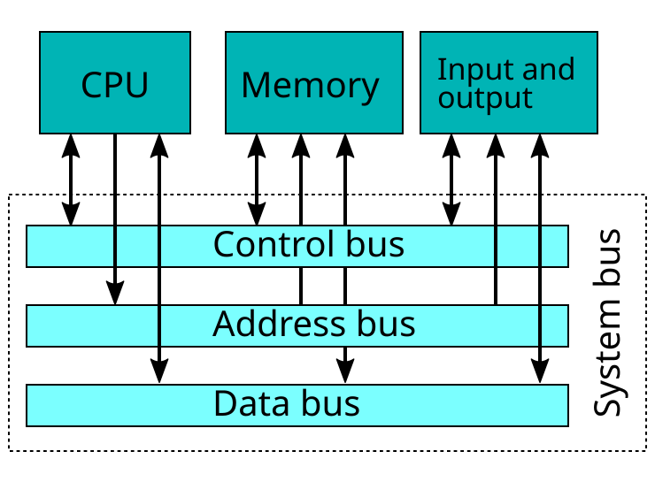
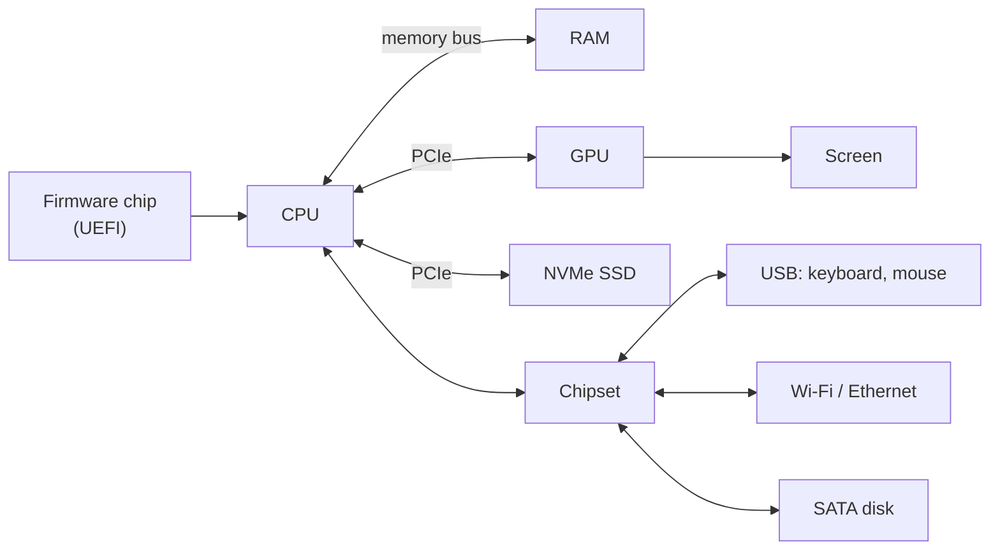
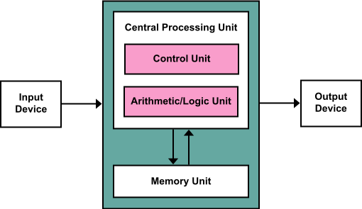
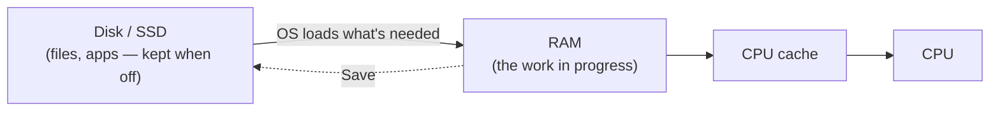
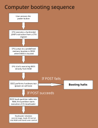
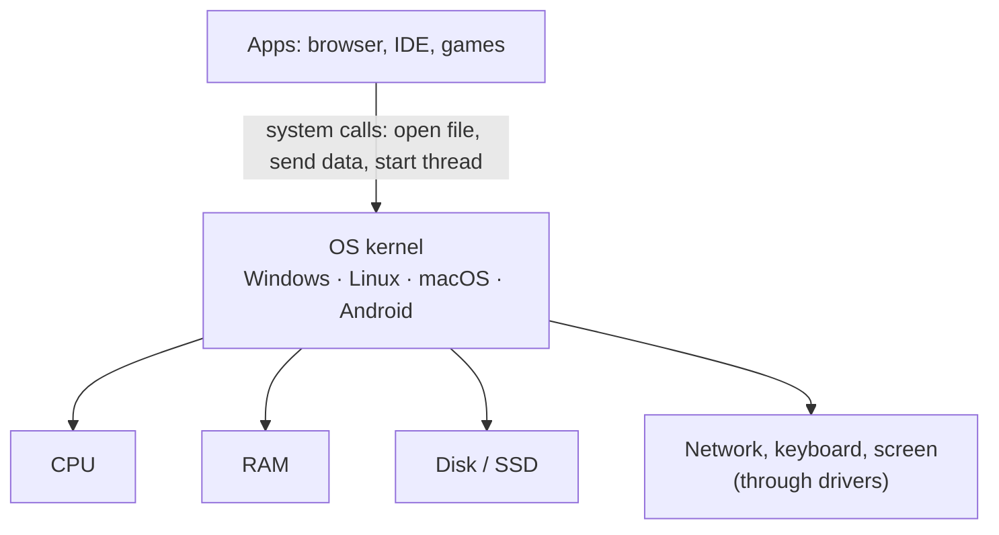
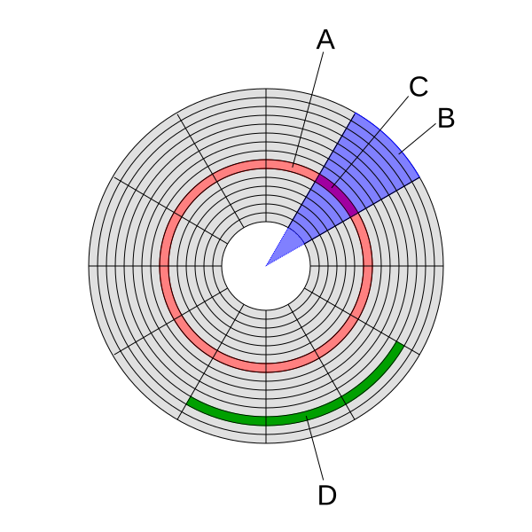

# ⚙️ Inside the Machine: CPU, RAM, Booting and Files

## CPU and RAM: why programs run from memory (all computers)

### ❓ How do the CPU, RAM, ROM, disk, motherboard and OS connect, and what happens when you open an app?

**The parts:**

| Part | Job | Analogy |
|---|---|---|
| **Motherboard** | the board everything plugs into; its copper paths (**buses**) carry data between parts | the city's roads |
| **CPU** | runs instructions | the chef |
| **RAM** | holds running apps and their data; forgets everything when power is off | the kitchen counter |
| **ROM / firmware chip** (UEFI/BIOS) | small chip with the start-up program; keeps its contents without power | the opening checklist on the wall |
| **SSD / hard disk** | keeps files and installed apps permanently | the warehouse |
| **GPU** | draws the screen (and runs AI maths) | the decorator |
| **Chipset** | traffic controller for USB, SATA disks, audio and network | the roundabout |
| **Power supply** | turns wall power into the voltages each part needs | the electricity board |
| **OS** | software that manages all of the above for every app | the restaurant manager |

_Image: [Wikimedia Commons](https://commons.wikimedia.org/wiki/File:Computer_system_bus.svg) · W Nowicki · CC BY-SA 3.0_

The **address bus** says *where* ("memory address 5,000"), the **data bus** carries *what* (the bytes), and the **control bus** says *what to do* (read or write).

**Example: you double-click the Chrome icon.**

1. **Click:** the mouse sends a signal over USB; the chipset tells the CPU (an **interrupt**); the OS sees a double-click on the Chrome icon.
2. **Find the app:** the OS looks up `chrome.exe` in the file system's index on the SSD.
3. **Load it:** the OS creates a new **process**, gives it memory, and copies the program's code from the **SSD into RAM** (only the parts needed first; the rest when needed).
4. **Run it:** the OS scheduler gives Chrome turns on the CPU; the CPU fetches its instructions from RAM into its cache and runs them.
5. **Draw the window:** Chrome asks the OS for a window; the **GPU** draws it in its own memory and sends it to the screen.
6. **Settings and network:** Chrome reads your profile from the SSD and asks the network card to fetch your home page.

The app never touches the hardware itself — every step goes **through the OS**.

---

### ❓ Why does the CPU always work with RAM and not directly with the disk?

Two reasons: **speed** and **how the CPU addresses data**.

**1. The disk is far too slow.** If one CPU step took 1 second, the other parts would take:

| Part | Real time | If a CPU step were 1 second |
|---|---|---|
| CPU step (3 GHz) | 0.3 ns | 1 second |
| CPU cache | ~1–10 ns | 3–30 seconds |
| RAM | ~100 ns | ~5 minutes |
| SSD | ~100 µs | ~4 days |
| Hard disk | ~10 ms | ~1 year |

**2. The CPU can only point at memory addresses.** Its instructions say "read byte 1,048,576 of memory". A disk is a separate device that hands out whole **blocks** (usually 4 KB) through a controller, when the operating system asks for them.

So the OS **copies** the program and the data it needs **from disk into RAM**, and the CPU works from RAM (and keeps the busiest parts in its cache).

_Image: [Wikimedia Commons](https://commons.wikimedia.org/wiki/File:Von_Neumann_Architecture.svg) · Kapooht · CC BY-SA 3.0_

**Analogy:** a chef. The CPU is the chef, the cache is the chopping board, RAM is the kitchen counter, and the disk is the warehouse across town. Nobody cooks in the warehouse.

**Why unsaved work is lost in a power cut:** RAM forgets everything without power. "Save" copies it to the disk.

See also: [What is the difference between CPU cache, RAM and disk?](02-Memory-and-Data.md)

---

### ❓ What do CPU cores and GHz mean?

- **Clock speed (GHz):** how many steps a core takes per second. 3 GHz = 3 billion steps per second.
- **Core:** a complete worker inside the CPU. 8 cores can run 8 things at exactly the same time.
- **Threads (hyper-threading):** one core switching quickly between two tasks to stay busy; it helps, but is not a second core.

| Task | What helps most |
|---|---|
| Video export, compiling code, many browser tabs | **more cores** |
| Older games, single-threaded apps | **higher GHz** |
| AI models, graphics | a **GPU** (thousands of small cores) |

**Analogy:** cores are cooks in a kitchen; GHz is how fast each cook chops. Ten slow cooks beat one fast cook for a big party, but not for one omelette.

---

### ❓ CPU vs GPU vs TPU vs NPU vs DPU vs APU vs QPU — what is each one for?

They are all processors, each built for a different kind of work.

| Chip | Full name | Good at | Where you find it | Examples |
|---|---|---|---|---|
| **CPU** | Central Processing Unit | any task, step by step; a few powerful cores | every computer and phone | Intel Core, AMD Ryzen, Apple M-series |
| **GPU** | Graphics Processing Unit | the same maths on huge amounts of data at once (thousands of small cores) | gaming PCs, AI servers | NVIDIA GeForce and H100, AMD Radeon |
| **TPU** | Tensor Processing Unit | only the matrix maths of neural networks, very efficiently | Google's data centres (Google Cloud) | Google TPU |
| **NPU** | Neural Processing Unit | small AI tasks using very little battery | phones and new "AI PCs" | Apple Neural Engine, Qualcomm Hexagon, Intel/AMD NPUs |
| **DPU** | Data Processing Unit | networking, storage and security work, so the server's CPU is free for apps | network cards in data centres | NVIDIA BlueField, AWS Nitro |
| **APU** | Accelerated Processing Unit | a CPU and a GPU on one chip (AMD's name) | budget laptops, PlayStation 5, Xbox | AMD Ryzen with Radeon graphics |
| **QPU** | Quantum Processing Unit | special problems (molecules, some optimisation) using qubits; experimental | research labs, through the cloud | IBM Quantum, Google Willow |

**Everyday examples:**
- Face unlock and photo touch-ups on your phone → **NPU**.
- Training ChatGPT-like models → thousands of **GPUs** or **TPUs**.
- A cloud server handling encrypted network traffic → **DPU**.

**Phones combine several in one chip** (a **System on a Chip**, SoC): an Apple A-series or Snapdragon chip has CPU, GPU and NPU together.

**A quantum computer is not a faster normal computer.** It cannot run Windows or a website; it is only faster for a few special kinds of problems.

**Analogy:** a hospital. The CPU is the general doctor; the GPU is a team of a thousand nurses doing the same check on everyone; TPU and NPU are specialist clinics (big and small); the DPU is the reception desk handling all incoming traffic; the APU is a doctor and nurse team sharing one room; the QPU is an experimental research lab.

See also: [Why do AI models run on GPUs instead of normal CPUs?](14-How-AI-Chatbots-Work.md)

---

### ❓ Why does a computer get slow, and when does more RAM help?

Open **Task Manager** (Ctrl + Shift + Esc) or **Activity Monitor** (Mac) and see which part is full:

| Full part | What's happening | Fix |
|---|---|---|
| **Memory** near 100% | RAM is full, so the OS moves parts of apps to the disk (**swapping**) — the disk is thousands of times slower | close tabs and apps; **more RAM helps here** |
| **Disk** at 100% (hard disk) | the slow disk can't keep up | **switch to an SSD** — the biggest speed-up for old PCs |
| **CPU** at 100% | too much work, or one app stuck in a loop | end that app; a faster CPU only if it's always busy |
| Everything low but still slow | the CPU is **too hot** and slows itself down, or a slow network | clean the fans, check Wi-Fi |

**Other common causes:** many apps starting with the computer, a background update or antivirus scan, and a nearly full disk.

**More RAM helps only if memory is full.** If you use 6 GB out of 16 GB, adding 16 GB more changes nothing.

See also: [What is virtual memory?](02-Memory-and-Data.md)

---

## Starting up: from the power button to the login screen (all computers)

### ❓ What happens when you press the power button — what starts first, the CPU or the OS?

**The CPU starts first, but it knows nothing yet.** It always begins by running small built-in software on a chip on the motherboard, called **firmware** (**UEFI**, or **BIOS** on older PCs). The firmware then finds and loads the operating system.

_Image: [Wikimedia Commons](https://commons.wikimedia.org/wiki/File:Flow-diagram-computer-booting-sequences.svg) · WhoAteMyButter · CC BY-SA 4.0_

1. **Power on:** the power supply settles, then the CPU starts at a fixed address that points to the firmware chip.
2. **POST (power-on self-test):** the firmware checks RAM, CPU, graphics and keyboard. A problem gives beeps or an error and booting stops.
3. **Find a boot device:** in the boot order (SSD, USB, network).
4. **Bootloader:** a small program on that disk (Windows Boot Manager, GRUB on Linux) is loaded into RAM.
5. **Kernel:** the bootloader loads the **OS kernel** into RAM and hands over control.
6. **OS start-up:** the kernel starts drivers, mounts the disks and starts system services (systemd on Linux).
7. **Login screen**, then your apps.

**Sleep vs hibernate:** sleep keeps RAM powered, so waking skips all of this. Hibernate saves RAM to the disk and powers off; start-up reloads it.

---

### ❓ What does an operating system actually do?

It is the **manager between apps and hardware**. Apps never touch the hardware themselves; they ask the OS (a **system call**).

| Job | Example |
|---|---|
| Share the CPU | runs your music, browser and IDE by switching between them many times a second |
| Manage memory | gives each app its own private memory, so one crash doesn't break the others |
| Files | turns "save `report.pdf`" into blocks on the disk |
| Devices | drivers talk to the printer, Wi-Fi card and GPU |
| Security | users, passwords and permissions |

See also: [What is the difference between a process and a thread?](03-Processes-and-Threads.md)

---

## Files on disk: deleting and recovering (all computers)

### ❓ What happens inside the disk when you delete a file?

The disk is divided into small **blocks** (also called clusters, usually 4 KB). The **file system** (NTFS on Windows, ext4 on Linux, APFS on Mac) keeps an index: "`report.pdf` → blocks 120 to 135".

_Image: [Wikimedia Commons](https://commons.wikimedia.org/wiki/File:Disk-structure2.svg) · Heron2 / MistWiz · Public domain_

**Deleting does not wipe the data.**

1. **Delete** → the file only **moves to the Recycle Bin**. Nothing is freed.
2. **Empty the bin** (or Shift + Delete) → the file system **removes the name from the index** and **marks its blocks as free**. The bytes are still there. That's why deleting 10 GB takes a second.
3. **Later**, new files are written into those free blocks and the old data is finally overwritten.
4. **On an SSD**, the OS also sends a **TRIM** command, and the SSD erases those blocks soon after in the background, so recovery is usually impossible.

**Analogy:** a library removes a book's catalogue card. The book stays on the shelf until another book needs the space.

**To really erase:** overwrite the free space (`sdelete`, `cipher /w` on Windows, `shred` on Linux), or encrypt the whole disk (BitLocker, FileVault) and destroy the key.

---

### ❓ How do admins recover a deleted or corrupted file?

From easiest to hardest:

1. **Stop writing to that disk** at once, so the freed blocks are not overwritten.
2. **Check the easy places:** the Recycle Bin, **backups**, and **old versions** (Windows File History, macOS Time Machine, OneDrive / Google Drive version history, cloud disk snapshots, Git).
3. **Deleted file on a hard disk:** copy the whole disk to an image first (`ddrescue`), then work on the copy. Recovery tools either read the old index entries, or scan for **file signatures** — every JPEG starts with bytes `FF D8 FF`, every PDF with `%PDF` (called **file carving**). Tools: PhotoRec / TestDisk, Recuva.
4. **Corrupted file system** (after a crash or power cut): `chkdsk` (Windows) or `fsck` (Linux) repairs the index. NTFS and ext4 keep a **journal**, so they can finish or undo half-done changes.
5. **Physically failing disk:** copy what can still be read with `ddrescue`; otherwise a data-recovery lab opens it in a clean room.

**On servers:** RAID 1 keeps a mirror copy on a second disk, so one disk can die without data loss. But **RAID is not a backup** — deleting a file deletes it on both disks. Follow the **3-2-1 rule**: 3 copies, on 2 kinds of storage, 1 off-site.

---

### ❓ How does a computer know whether a file is a PDF, a photo or a program?

Two clues:

1. **The extension** (`.pdf`, `.jpg`, `.exe`) — the OS uses it only to choose **which app opens the file**.
2. **The first bytes inside the file** (the **signature** or "magic number") — what the file really is.

| File type | First bytes | As text |
|---|---|---|
| PDF | `25 50 44 46` | `%PDF` |
| PNG | `89 50 4E 47` | `‰PNG` |
| JPEG | `FF D8 FF` | — |
| ZIP (also `.docx`, `.xlsx`, `.jar`) | `50 4B 03 04` | `PK` |
| Windows program (`.exe`) | `4D 5A` | `MZ` |

**So renaming `photo.jpg` to `photo.pdf` does not convert it** — the PDF reader opens it, sees `FF D8 FF` instead of `%PDF`, and reports a broken file.

**Fun fact:** a `.docx` or `.jar` file is really a ZIP — rename it to `.zip` and you can open it and look inside.

**On the web**, the server says the type in a header (`Content-Type: application/pdf`), because URLs often have no extension. Upload checks should read the first bytes too, not trust the name — an attacker can rename `virus.exe` to `cat.jpg`.

**Try it:** `file report.pdf` (Linux / Mac) prints the real type.
