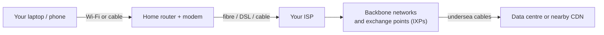
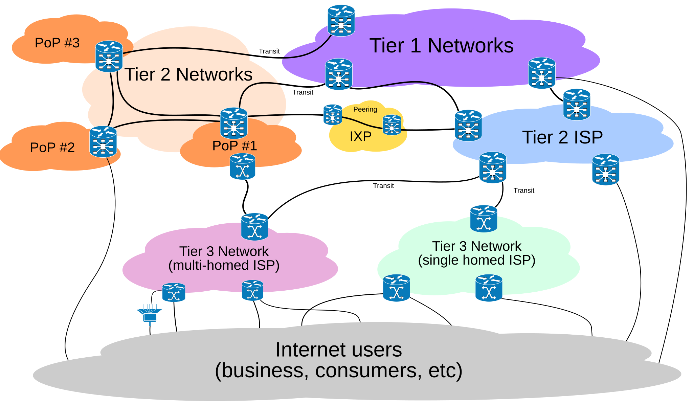
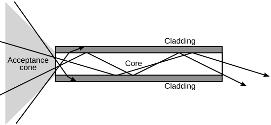
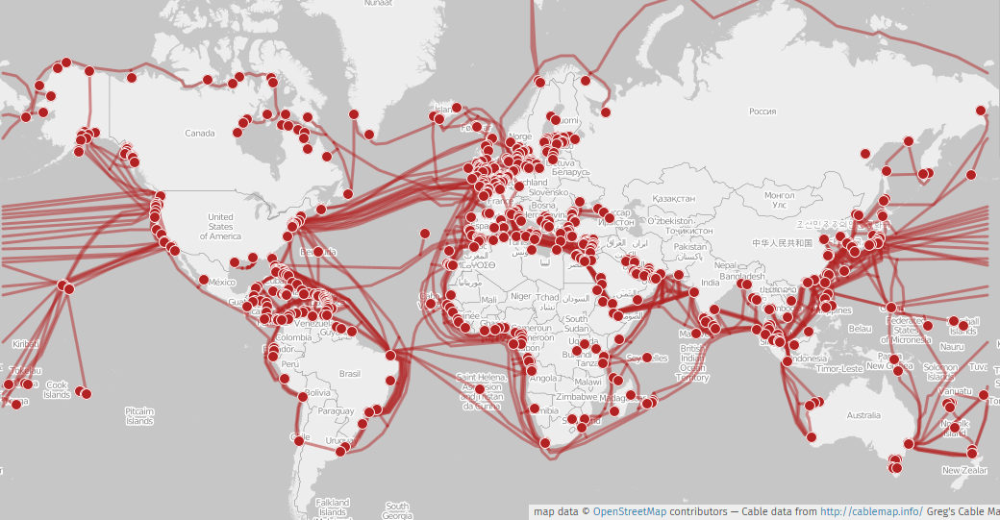
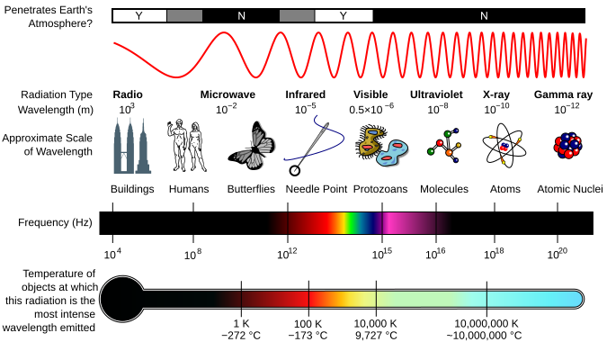
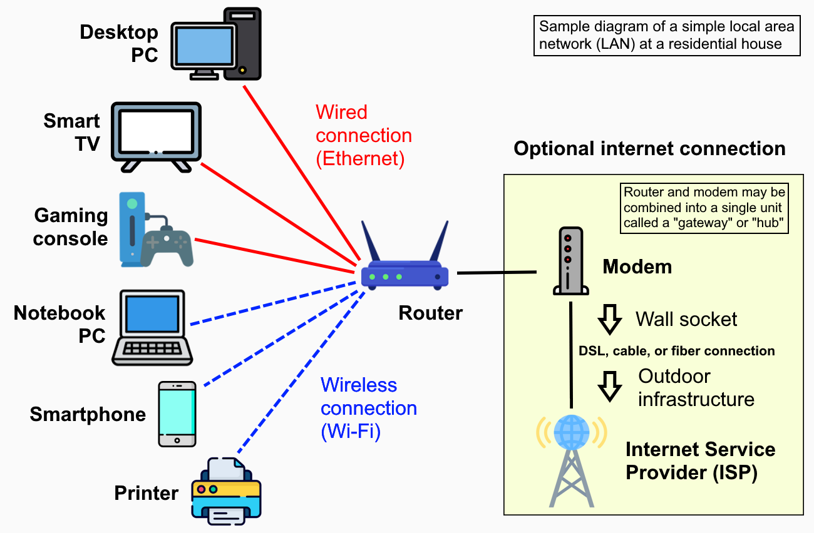

# 🌍 How the Internet Is Connected: Cables, Light and Radio

## The physical internet: who connects you to a website (networking, all languages)

### ❓ How is the internet connected — what links my laptop to a website?

**Generic answer:** The internet is a network of networks: your router connects to your ISP, ISPs connect to bigger backbone networks at exchange points, and backbones link continents through undersea fibre cables to the website's data centre or a nearby CDN.

**Under the hood:**

Imagine opening a website hosted in the USA from Chennai. No company owns a cable from your home to that server. Yet your packets get there in a fraction of a second.

**Step 1: Your device → router** — over Wi-Fi or cable.

**Step 2: Router → ISP** — the **modem** puts packets on the line (fibre, DSL, cable) to your **Internet Service Provider** (Jio, Airtel, ACT…).

**Step 3: ISP → other networks** — directly or at an **Internet Exchange Point (IXP)**, a building where networks plug into each other (e.g. NIXI in India).

**Step 4: Backbones across continents** — the biggest **Tier 1** networks (Tata Communications, Lumen) carry traffic between continents, mostly over **undersea fibre**.

**Step 5: Destination** — the website's **data centre**, or a **CDN** server near you holding a copy.

_Image: [Wikimedia Commons](https://commons.wikimedia.org/wiki/File:Internet_Connectivity_Distribution_%26_Core.svg) · Ludovic.ferre · CC BY-SA 3.0_

**Analogy:** your street (home Wi-Fi) → city road (ISP) → national highways (backbones) → sea routes (undersea cables).

**Try it:** `tracert google.com` (Windows) or `traceroute google.com` lists every router on the way.

**Final understanding:** **No single owner → thousands of networks agree to carry each other's traffic → home → ISP → exchange → backbone → destination.** See also: [How data travels](08-How-Data-Travels.md).

---

### ❓ Do data packets travel at the speed of light? Which cables carry them, and why?

**Generic answer:** Almost: bits travel as light in fibre, electric signals in copper or radio waves in air — all near light speed but slowed by the material. Delay comes mostly from distance, router hops and round trips.

**Under the hood:**

Imagine pinging a US server from India and seeing ~200 ms. Light could circle the Earth in that time. Where does the delay come from?

**Step 1: Choose the medium**

| Medium | What travels | Speed | Used for | Why |
|---|---|---|---|---|
| **Fibre** | light pulses in glass | ~200,000 km/s (⅔ light speed) | backbones, undersea, fibre-to-home | huge capacity, long distance, no interference |
| **Copper** | electric signals | ~60–70% light speed | buildings, last metres | cheap; Ethernet up to 100 m |
| **Radio** (Wi-Fi, 4G/5G) | radio waves | ~light speed | last hop to devices | no wires |
| **Satellite** | radio to space and back | light speed, long path | ships, villages, planes | reaches anywhere |

**Step 2: How fibre carries light**

The glass core is wrapped in **cladding** that reflects light back in, so it bounces along for tens of kilometres before an amplifier boosts it.

_Image: [Wikimedia Commons](https://commons.wikimedia.org/wiki/File:Optical-fibre.svg) · Gringer · Public domain_

**Step 3: Cross the oceans**

500+ **undersea cables** carry ~99% of traffic between continents.

_Image: [Wikimedia Commons](https://commons.wikimedia.org/wiki/File:Submarine_cable_map_umap.png) · cable data by Greg Mahlknecht, map © OpenStreetMap contributors · CC BY-SA 2.0_

**Step 4: Where the delay comes from**

- **Distance:** India → USA ~15,000 km ≈ 75 ms each way.
- **Stops:** every router reads and forwards each packet.
- **Round trips:** TCP + TLS need several before data flows.
- **Satellites:** geostationary (36,000 km) ~600 ms round trip; Starlink (~550 km) ~25–60 ms.

**Speed (Mbps) ≠ delay (ms):** Mbps is how *much* per second (lanes); latency is how *long* one trip takes (distance).

**Final understanding:** **Signals move near light speed → distance, hops and round trips add up → that's latency, separate from bandwidth.**

---

### ❓ How does data travel without wires (Wi-Fi, mobile data, Bluetooth)?

**Generic answer:** Using radio waves: the sender changes a wave's strength, timing or shape to encode bits (modulation), and the receiver turns those changes back into bits.

**Under the hood:**

Imagine sending bits across a room with no cable. You need something that travels through air and that you can vary in a pattern the other side can read.

**Step 1: Encode bits onto a wave**

The antenna **modulates** a radio wave. Modern Wi-Fi packs ~10 bits into each change.

**Step 2: Travel**

The wave spreads through the air at light speed.

**Step 3: Decode**

The receiver's antenna picks up the changes and turns them **back into bits**.

_Image: [Wikimedia Commons](https://commons.wikimedia.org/wiki/File:EM_Spectrum_Properties_edit.svg) · Inductiveload, NASA · CC BY-SA 3.0_

**Step 4: Frequency trade-off**

| Technology | Frequency | Range | Note |
|---|---|---|---|
| Wi-Fi 2.4 GHz | 2.4 GHz | ~40 m indoors | better through walls, slower |
| Wi-Fi 5 / 6 GHz | 5–6 GHz | ~15–20 m | faster, blocked more |
| Bluetooth | 2.4 GHz | ~10 m | headphones, watches |
| 4G / 5G | 0.7–3.5 GHz (+26 GHz) | km | tower connects to fibre |
| NFC | 13.56 MHz | a few cm | tap to pay |

**Rule:** higher frequency = more data, shorter range.

**Step 5: Only the last hop**

Your phone reaches a tower or router by radio; from there it's fibre.

**Security:** anyone nearby can receive radio, so Wi-Fi is encrypted (WPA2/WPA3) and websites add HTTPS.

**Final understanding:** **No cable → encode bits on radio waves → decode at the other end → hand over to fibre.**

---

## Home network devices and addresses (networking, all languages)

### ❓ What is the difference between a modem, a router and a switch?

**Generic answer:** A modem converts the ISP line's signal into data, a router connects your home network to the internet and shares one public IP, and a switch connects wired devices within one network.

**Under the hood:**

Imagine a home with two laptops, a TV, phones and a printer, and one fibre line from the ISP. Something must translate the line's signal, give each device an address, share the connection, and link wired devices.

**Step 1: Translate the line — modem (ONT for fibre)**

Turns light/DSL/cable signals into network data.

**Step 2: Join and share — router**

Gives each device a local IP (DHCP) and shares one public IP (NAT).

**Step 3: Connect wired devices — switch**

Links many cables inside the network.

**Step 4: Add wireless — access point**

| Device | Job | Analogy |
|---|---|---|
| **Modem / ONT** | convert ISP signal | border translator |
| **Router** | local IPs, NAT, internet link | reception desk |
| **Switch** | connect wired devices | corridor |
| **Access point** | add Wi-Fi | wireless doorway |

Most home "Wi-Fi routers" are all four in one box.

_Image: [Wikimedia Commons](https://commons.wikimedia.org/wiki/File:Home_LAN_local_area_network_example_diagram.png) · CC0_

**Final understanding:** **ISP signal → modem (translate) → router (address and share) → switch/AP (connect devices).**

---

### ❓ What is the difference between an IP address and a MAC address?

**Generic answer:** A MAC address is the network card's fixed hardware ID, used for delivery within the local network; an IP address is assigned by the network and used for delivery across the internet.

**Under the hood:**

Imagine a parcel from Delhi to your flat. The courier needs your postal address to reach your building, then your name to hand it to you. Networks need both kinds of address too.

**Step 1: MAC — your name on the local network**

Built into the network card by the maker (`3C:52:82:4A:1B:9F`). Switches use it to deliver frames on the local network.

**Step 2: IP — your current postal address**

Given by the network (`192.168.1.24` at home, `49.37.12.8` public). Routers use it across the internet. Changes when you move networks.

**Step 3: Private and public IPs**

`192.168.x.x` and `10.x.x.x` work only inside; the router swaps them for its **public IP** (NAT).

**Step 4: IPv4 vs IPv6**

IPv4 (~4.3 billion addresses) has run out; **IPv6** (`2401:4900:1c…`) has plenty.

| | MAC address | IP address |
|---|---|---|
| Given by | the maker | the network |
| Changes? | no (phones may randomise) | yes |
| Used for | local delivery | internet delivery |
| Analogy | your name | your postal address |

**Try it:** `ipconfig /all` (Windows) or `ip addr` (Linux).

**Final understanding:** **Across the internet → IP (logical, changes); last step in the local network → MAC (hardware, fixed).**
