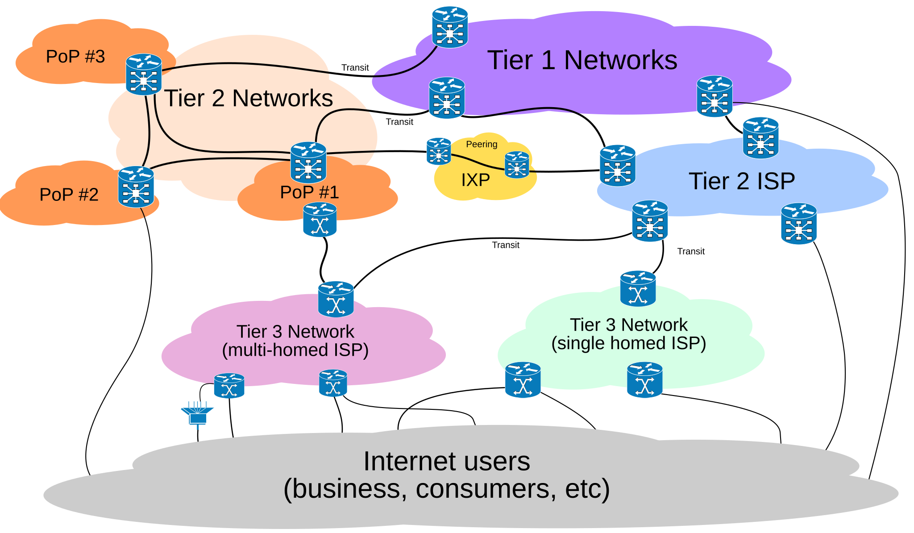
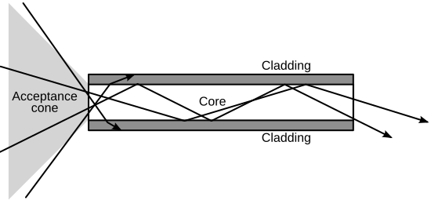
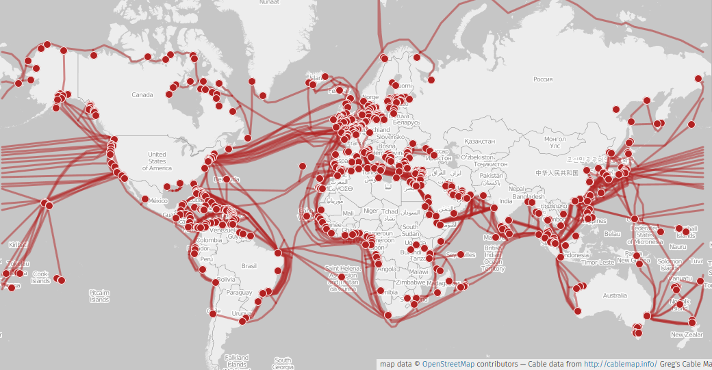
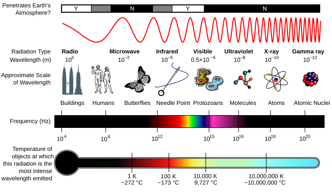
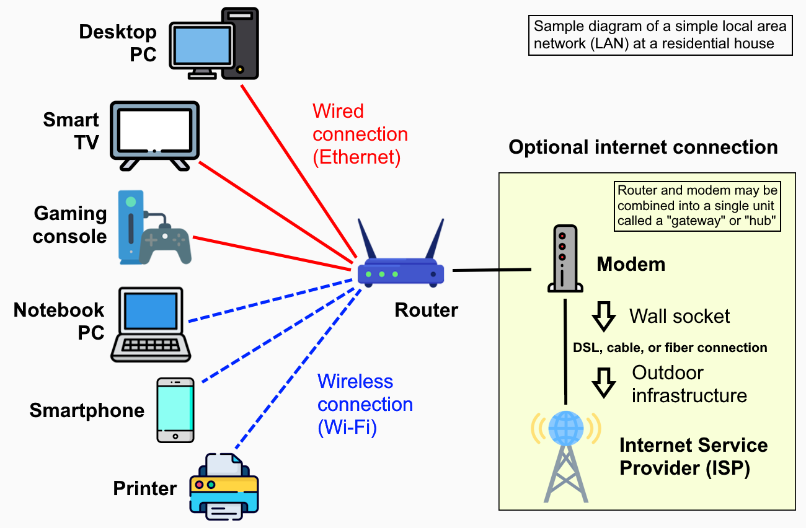

# 🌍 How the Internet Is Connected: Cables, Light and Radio

## The physical internet: who connects you to a website (networking, all languages)

### ❓ How is the internet connected — what links my laptop to a website?

The internet is a **network of networks**. No single company owns it; thousands of networks agree to carry each other's traffic.

1. Your device sends packets to your **router**.
2. The **modem** puts them on the line to your **Internet Service Provider (ISP)**.
3. Your ISP passes them to bigger networks, either directly or at an **Internet Exchange Point (IXP)** — a building where networks plug into each other (for example NIXI in India).
4. The biggest **Tier 1** networks (such as Tata Communications or Lumen) connect continents, mostly through **undersea fibre cables**.
5. The packets reach the website's **data centre**, or a **CDN** server close to you that keeps a copy.

_Image: [Wikimedia Commons](https://commons.wikimedia.org/wiki/File:Internet_Connectivity_Distribution_%26_Core.svg) · Ludovic.ferre · CC BY-SA 3.0_

**Analogy:** roads. Your street (home Wi-Fi) joins a city road (ISP), which joins national highways (backbones) and sea routes (undersea cables).

**Try it:** `tracert google.com` (Windows) or `traceroute google.com` (Mac/Linux) lists every router your packets pass through.

See also: [How does data travel from one computer to another?](08-How-Data-Travels.md)

---

### ❓ Do data packets travel at the speed of light? Which cables carry them, and why?

**Almost.** The bits travel as **light** in fibre, **electric signals** in copper, or **radio waves** through the air — all close to light speed, but slowed by the material.

| Medium | What travels | Speed | Used for | Why |
|---|---|---|---|---|
| **Fibre-optic cable** | pulses of light in thin glass | ~200,000 km/s (⅔ of light speed) | backbones, undersea cables, fibre-to-home | huge capacity (terabits per second), long distances, no electrical interference |
| **Copper** (Ethernet, DSL, TV cable) | electric signals | ~60–70% of light speed | inside buildings, last metres to a home | cheap and easy; Ethernet works up to 100 m |
| **Radio** (Wi-Fi, 4G/5G) | radio waves | ~light speed | the last hop to phones and laptops | no wires |
| **Satellite** | radio to space and back | light speed, but a long way | ships, villages, planes | reaches anywhere |

**How fibre carries light:** the glass core is wrapped in a layer (cladding) that reflects the light back in, so it bounces along the cable for tens of kilometres before an amplifier boosts it.

_Image: [Wikimedia Commons](https://commons.wikimedia.org/wiki/File:Optical-fibre.svg) · Gringer · Public domain_

More than 500 **undersea cables** carry about 99% of traffic between continents:

_Image: [Wikimedia Commons](https://commons.wikimedia.org/wiki/File:Submarine_cable_map_umap.png) · cable data by Greg Mahlknecht, map © OpenStreetMap contributors · CC BY-SA 2.0_

**So why isn't the internet instant?**
- **Distance:** India → USA is ~15,000 km of cable ≈ 75 ms each way, ~150 ms or more for a round trip.
- **Stops:** every router on the way reads and forwards each packet.
- **Many round trips:** opening a secure connection (TCP + TLS) needs several trips before any data flows.
- **Satellites:** a classic satellite is 36,000 km up, so a round trip takes ~600 ms. Low-orbit ones like Starlink (~550 km) take ~25–60 ms.

**Speed (Mbps) is not the same as delay (ms):** 100 Mbps is how *much* data per second (lanes on a highway); latency is how *long* one trip takes (the distance). See [What is the difference between latency and throughput?](../architecture/04-System-Design.md)

---

### ❓ How does data travel without wires (Wi-Fi, mobile data, Bluetooth)?

With **radio waves** — the same kind of wave as light, but invisible and with a much longer wavelength.

1. The sender's antenna **changes a radio wave** to encode bits (its strength, timing or shape — called **modulation**). Modern Wi-Fi packs about 10 bits into each change.
2. The wave spreads through the air at light speed.
3. The receiver's antenna picks up the changes and turns them **back into bits**.

_Image: [Wikimedia Commons](https://commons.wikimedia.org/wiki/File:EM_Spectrum_Properties_edit.svg) · Inductiveload, NASA · CC BY-SA 3.0_

| Technology | Frequency | Range | Note |
|---|---|---|---|
| Wi-Fi 2.4 GHz | 2.4 GHz | ~40 m indoors | goes through walls better, slower |
| Wi-Fi 5 / 6 GHz | 5–6 GHz | ~15–20 m indoors | faster, blocked more by walls |
| Bluetooth | 2.4 GHz | ~10 m | headphones, watches |
| 4G / 5G | 0.7–3.5 GHz (5G also 26 GHz) | km from a tower | the tower connects to fibre |
| NFC | 13.56 MHz | a few cm | tap to pay |

**Rule:** higher frequency = more data, but shorter range and weaker through walls.

**Wireless is only the last hop.** Your phone talks to a tower or router by radio; from there, the data goes over fibre.

**Security:** anyone nearby can receive radio waves, so Wi-Fi is encrypted (WPA2 / WPA3), and websites add HTTPS on top.

---

## Home network devices and addresses (networking, all languages)

### ❓ What is the difference between a modem, a router and a switch?

| Device | Job | Analogy |
|---|---|---|
| **Modem** (or **ONT** for fibre) | converts the signal on your ISP's line (light, DSL, cable) into data your devices understand | a translator at the border |
| **Router** | connects your home network to the internet, gives each device a local IP address, and shares one public IP between them (NAT) | the building's reception desk |
| **Switch** | connects many wired devices inside one network | a corridor linking rooms |
| **Access point** | adds Wi-Fi | a wireless doorway |

Most home "Wi-Fi routers" combine all four in one box.

_Image: [Wikimedia Commons](https://commons.wikimedia.org/wiki/File:Home_LAN_local_area_network_example_diagram.png) · CC0_

---

### ❓ What is the difference between an IP address and a MAC address?

| | MAC address | IP address |
|---|---|---|
| Example | `3C:52:82:4A:1B:9F` | `192.168.1.24` (inside your home) · `49.37.12.8` (public) |
| Given by | the maker, built into the network card | the network (your router or ISP) |
| Changes? | no (phones may randomise it for privacy) | yes, when you move to another network |
| Used for | delivery **inside the local network** | delivery **across the internet** |
| Analogy | your name | your current postal address |

- **Private IPs** (`192.168.x.x`, `10.x.x.x`) work only inside your home or office; the router swaps them for its one **public IP** on the internet.
- **IPv4** has ~4.3 billion addresses and has run out; **IPv6** (`2401:4900:1c…`) has enough for every device on Earth.

**Try it:** `ipconfig /all` (Windows) or `ip addr` (Linux) shows both.
