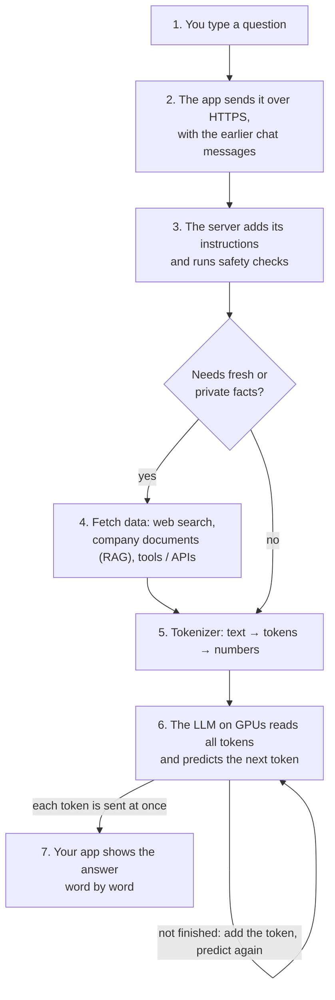
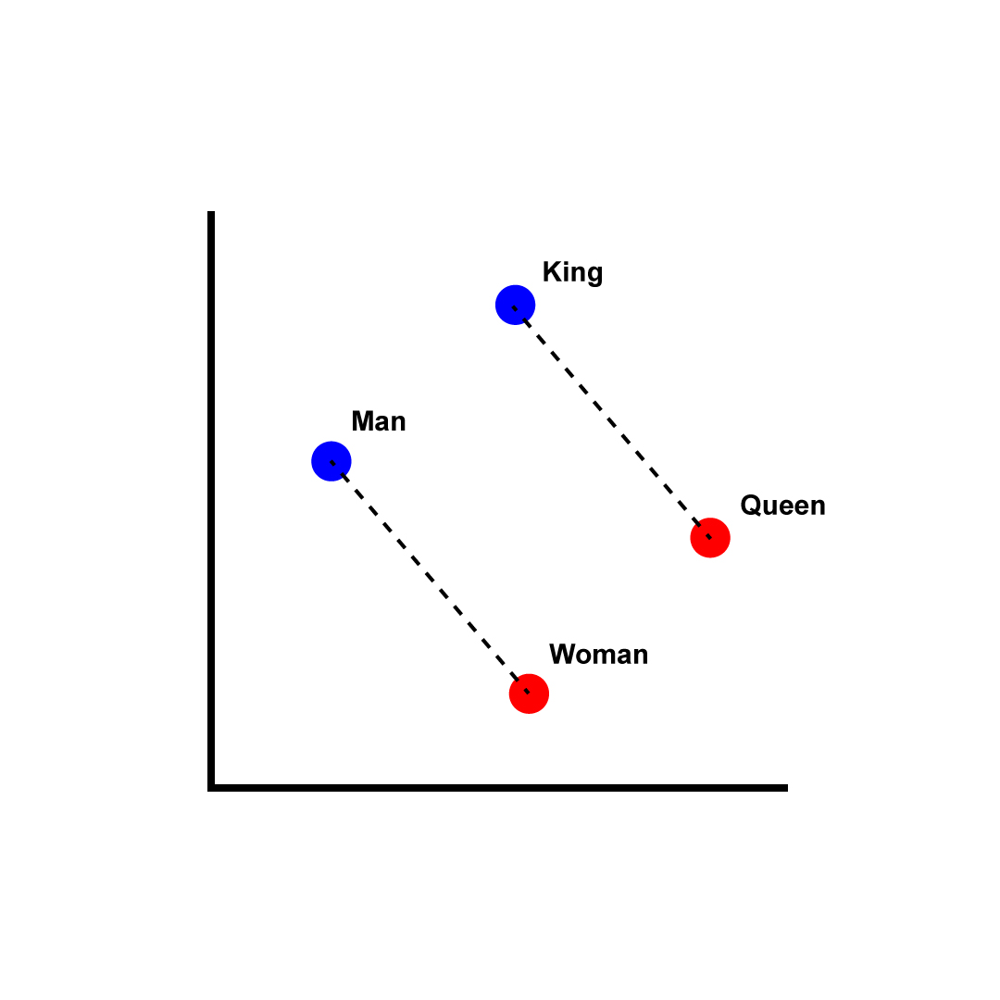
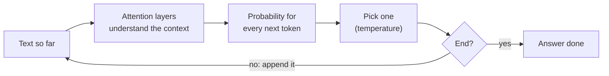
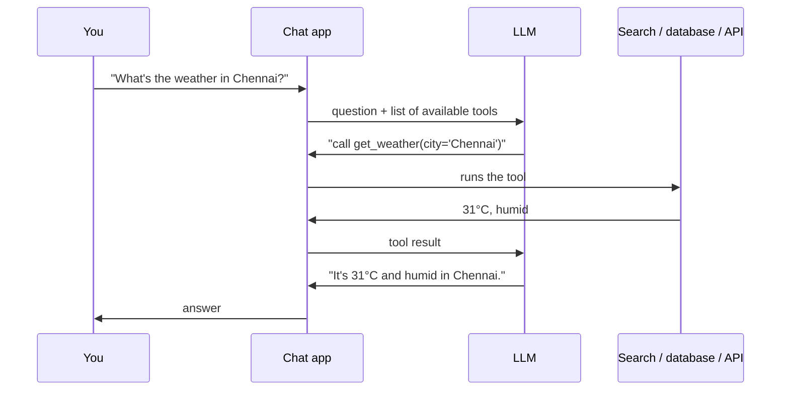

# 🤖 How AI Chatbots Work: From Your Question to the Answer

## The full journey of one question (AI & LLMs, any language)

### ❓ What happens, step by step, when you send a message to an AI chatbot like ChatGPT or Claude?

1. **You type** "What is a closure in JavaScript?".
2. **The app sends it** to the AI company's servers over HTTPS, together with the earlier messages (the model itself remembers nothing between requests).
3. **The server prepares the prompt:** it adds hidden instructions ("you are a helpful assistant…") and checks the request is safe.
4. **Fetching (only if needed):** for today's news, your company's documents or live data, the app first runs a search or a tool and pastes the results into the prompt.
5. **Tokenizing:** the whole text is cut into **tokens** and each becomes a number.
6. **The model predicts one token at a time:** it reads everything so far, picks the most fitting next token, adds it, and repeats — hundreds of times for one answer.
7. **Streaming back:** each new token is sent to your app immediately (Server-Sent Events), so you see the answer appear word by word instead of waiting for all of it.

See also: [What is a token?](../ai/01-AI-LLM-RAG-Agents.md) · [What is a context window?](../ai/01-AI-LLM-RAG-Agents.md) · [How would you implement streaming AI responses?](../ai/01-AI-LLM-RAG-Agents.md)

---

### ❓ How does an LLM break text into tokens and turn them into numbers?

**1. Tokens: pieces of words.** Common words are one token; rare words are split into parts.

| Text | Tokens (example) |
|---|---|
| `cat` | `cat` |
| `unbelievable` | `un` · `believ` · `able` |
| `Hello, world!` | `Hello` · `,` · ` world` · `!` |

Rule of thumb: **1 token ≈ 4 English characters ≈ ¾ of a word**. Pricing and limits are counted in tokens.

**2. Token IDs:** each token has a fixed number in the model's vocabulary (~100,000 tokens). With GPT-2's tokenizer, `Hello, world!` becomes `[15496, 11, 995, 0]`; every model has its own vocabulary.

**3. Embeddings: numbers with meaning.** Each ID becomes a list of thousands of numbers that places the token in a "meaning space". Words used in similar ways end up close together, and even relationships line up: *king − man + woman ≈ queen*.

_Image: [Wikimedia Commons](https://commons.wikimedia.org/wiki/File:Word_vector_illustration.jpg) · Singerep · CC BY-SA 4.0_

**4. Position:** information about each token's position is added, so "dog bites man" means something different from "man bites dog".

---

### ❓ How does an LLM pick the right next word and build a sentence?

**1. Attention — work out what each word refers to.** Every token looks at all the other tokens and decides which ones matter for it. In *"The animal didn't cross the street because **it** was tired"*, attention links **it** to **animal**. This runs again in many layers (dozens to over a hundred), each one refining the meaning.

**2. Score every possible next token.** At the end, the model gives a probability to every token in its vocabulary:

| "The capital of France is …" | Probability |
|---|---|
| ` Paris` | 92% |
| ` a` | 2% |
| ` located` | 1% |
| … 100,000 others | the rest |

**3. Choose one.** With low **temperature** it nearly always takes the top choice (precise answers); with higher temperature it sometimes takes a less likely one (more creative text).

**4. Repeat.** The chosen token is added to the text and the whole process runs again for the next one, until the model produces an "end" token.

**Where the "knowledge" comes from:** during **training**, the model read trillions of tokens and kept adjusting its billions of internal numbers (**weights**) to predict the next token better. Grammar, facts and reasoning patterns are stored in those weights.

**Why it can be wrong (hallucination):** it produces the most *likely-sounding* text, not checked facts. That's why apps add search and documents (next question).

---

### ❓ Where does an AI chatbot get its knowledge, and how does it fetch new data?

Two sources:

| Source | What it is | Limit |
|---|---|---|
| **Training** | what the model learned, frozen in its weights | stops at a **cutoff date**; knows nothing private |
| **Fetched at question time** | web search, your documents (RAG), live tools and APIs | only as good as what is found |

**The model never browses by itself.** It asks; the app does the work; the result goes back to the model as text:

- **RAG (company documents):** documents are split into chunks and stored as embeddings in a vector database. For each question, the closest chunks are found and pasted into the prompt, so the answer comes from your documents.
- **Tools / function calling:** the model can ask for a calculator, a database query, an API call or a web search.

See also: [What is RAG?](../ai/01-AI-LLM-RAG-Agents.md) · [What is tool calling?](../ai/01-AI-LLM-RAG-Agents.md)

---

### ❓ Why do AI models run on GPUs instead of normal CPUs?

Predicting **one token** means billions of simple multiply-and-add steps, and most of them can run **at the same time**.

| | CPU | GPU |
|---|---|---|
| Cores | 4–64 powerful cores | thousands of small cores |
| Good at | varied tasks one after another (your OS, apps) | the same maths on huge amounts of data at once |
| AI speed | slow | ~10–100× faster |

**Memory matters too:** the model's weights must fit in the GPU's own memory. A 70-billion-weight model at 2 bytes per weight needs ~140 GB, so it is spread across several GPUs.

**Analogy:** a CPU is a few expert chefs; a GPU is a thousand kitchen helpers who all chop onions at the same moment. AI is a mountain of onions.
