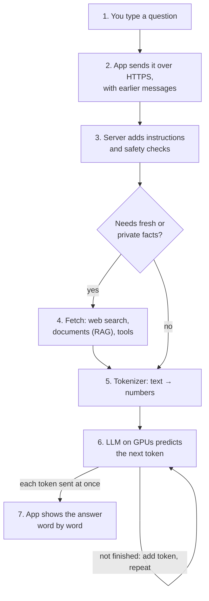
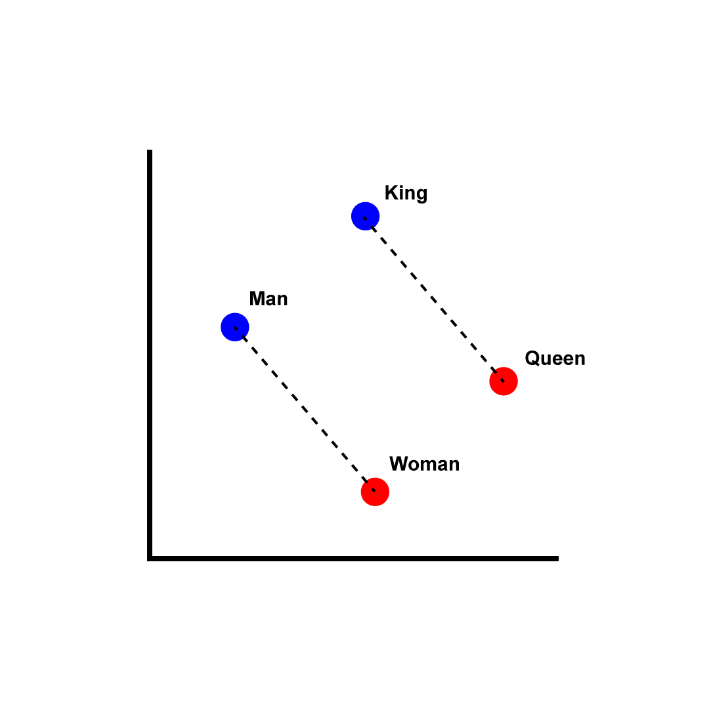
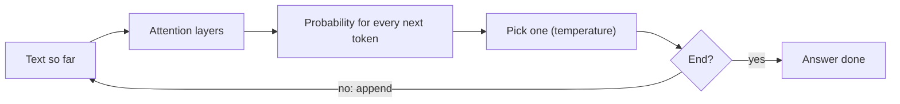
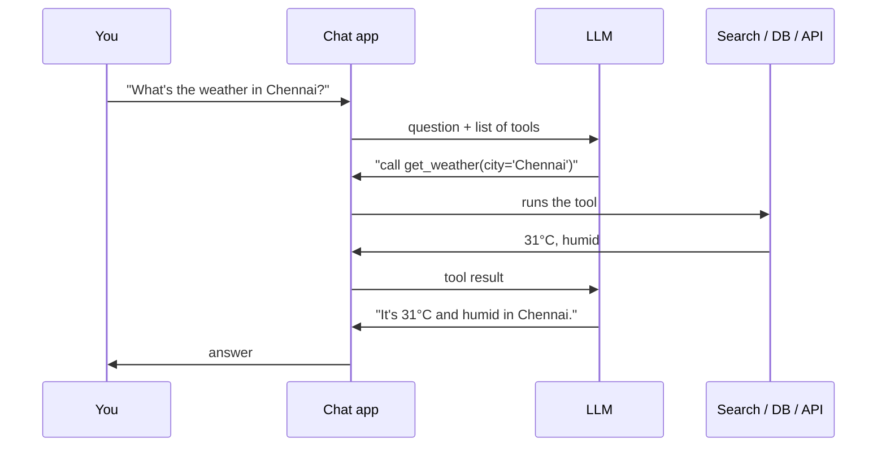

# 🤖 How AI Chatbots Work: From Your Question to the Answer

## The full journey of one question (AI & LLMs, any language)

### ❓ What happens, step by step, when you send a message to an AI chatbot like ChatGPT or Claude?

**Generic answer:** The app sends your message and the chat history to the server, which adds instructions, optionally fetches data, turns the text into tokens, and the model predicts the answer one token at a time, streaming each back to you.

**Under the hood:**

Imagine you type "What is a closure in JavaScript?" and the answer appears word by word within a second. The model has no memory, no internet browser and doesn't understand letters directly. So what happens?

**Step 1: You type** the question.

**Step 2: The app sends it** over HTTPS, **with the earlier messages** — the model remembers nothing between requests.

**Step 3: The server prepares the prompt** — adds hidden instructions ("you are a helpful assistant…") and runs safety checks.

**Step 4: Fetch data if needed** — for news, company documents or live data, the app runs a search or tool and pastes the results in.

**Step 5: Tokenize** — the text is cut into **tokens**, each turned into a number.

**Step 6: Predict one token at a time** — the model reads everything so far, picks the next token, adds it, and repeats hundreds of times.

**Step 7: Stream back** — each token is sent immediately (Server-Sent Events), so you see the answer appear word by word.

**Final understanding:** **Stateless model → resend history → add instructions and fetched facts → tokens → predict-append-repeat → stream.** See also: [What is a token?](../ai/01-AI-LLM-RAG-Agents.md) · [Context window](../ai/01-AI-LLM-RAG-Agents.md)

---

### ❓ How does an LLM break text into tokens and turn them into numbers?

**Generic answer:** Text is split into tokens (words or word pieces), each token gets a fixed ID, each ID becomes an embedding vector that captures meaning, and position information is added.

**Under the hood:**

Imagine feeding "unbelievable" to a model. A model is a giant maths function — it can only take numbers. And it must handle any word, even ones it never saw.

**Step 1: Split into tokens**

Common words are one token; rare words are split into parts.

| Text | Tokens (example) |
|---|---|
| `cat` | `cat` |
| `unbelievable` | `un` · `believ` · `able` |
| `Hello, world!` | `Hello` · `,` · ` world` · `!` |

Rule of thumb: **1 token ≈ 4 English characters ≈ ¾ of a word**. Pricing and limits are counted in tokens.

**Step 2: Token → ID**

Each token has a number in the model's vocabulary (~100,000). GPT-2's tokenizer turns `Hello, world!` into `[15496, 11, 995, 0]`.

**Step 3: ID → embedding (meaning)**

Each ID becomes a list of thousands of numbers placing it in a "meaning space". Similar words land close together: *king − man + woman ≈ queen*.

_Image: [Wikimedia Commons](https://commons.wikimedia.org/wiki/File:Word_vector_illustration.jpg) · Singerep · CC BY-SA 4.0_

**Step 4: Add position**

So "dog bites man" differs from "man bites dog".

**Final understanding:** **Text → tokens (handle any word) → IDs (numbers) → embeddings (meaning) + position (order).**

---

### ❓ How does an LLM pick the right next word and build a sentence?

**Generic answer:** Attention layers work out how each token relates to the others, the model scores every possible next token, picks one (controlled by temperature), appends it and repeats until it outputs an end token.

**Under the hood:**

Imagine the text "The animal didn't cross the street because **it** was tired". To continue sensibly, the model must know "it" means the animal, not the street.

**Step 1: Attention — what refers to what**

Every token looks at all others and weighs which matter. "it" links to "animal". This repeats in many layers, each refining meaning.

**Step 2: Score every possible next token**

| "The capital of France is …" | Probability |
|---|---|
| ` Paris` | 92% |
| ` a` | 2% |
| ` located` | 1% |

**Step 3: Choose one**

Low **temperature** → nearly always the top choice; higher → sometimes a less likely one (more creative).

**Step 4: Repeat**

Append the token and run again until an "end" token.

**Step 5: Where knowledge comes from**

During **training**, the model read trillions of tokens and adjusted billions of **weights** to predict the next token better. Grammar, facts and reasoning patterns live in those weights.

**Why it can be wrong (hallucination):** it produces the most *likely-sounding* text, not checked facts.

**Final understanding:** **Context → attention → probabilities → pick → append → repeat**; knowledge is patterns in weights, not a fact database.

---

### ❓ Where does an AI chatbot get its knowledge, and how does it fetch new data?

**Generic answer:** From its training (frozen at a cutoff date) and from data the app fetches at question time — web search, documents via RAG, or tools and APIs — which is pasted into the prompt.

**Under the hood:**

Imagine asking "What's the weather in Chennai right now?" The model's training ended months ago, and it can't open a browser. Yet it answers correctly.

**Step 1: Two sources**

| Source | What it is | Limit |
|---|---|---|
| **Training** | learned, frozen in weights | **cutoff date**; nothing private |
| **Fetched now** | search, documents (RAG), tools | only as good as what's found |

**Step 2: The model asks, the app acts**

**Step 3: RAG for company documents**

Documents are split into chunks and stored as embeddings in a vector database. For each question, the closest chunks are found and pasted into the prompt.

**Step 4: Tools / function calling**

Calculator, database query, API call or web search on request.

**Final understanding:** **Frozen training knowledge → model requests a tool → app runs it → result added as text → model answers from it.** See also: [What is RAG?](../ai/01-AI-LLM-RAG-Agents.md)

---

### ❓ Why do AI models run on GPUs instead of normal CPUs?

**Generic answer:** Predicting each token needs billions of simple multiply-and-add operations that can run at the same time, which GPUs with thousands of cores do far faster than CPUs.

**Under the hood:**

Imagine having to chop a mountain of onions. A few expert chefs (CPU) are skilled but few; a thousand helpers (GPU) each chopping at once finish far sooner. AI is a mountain of onions.

**Step 1: The work** — each token = billions of multiply-adds on matrices, mostly independent.

**Step 2: Match the hardware**

| | CPU | GPU |
|---|---|---|
| Cores | 4–64 powerful | thousands of small |
| Good at | varied tasks in sequence | same maths on lots of data |
| AI speed | slow | ~10–100× faster |

**Step 3: Memory matters**

Weights must fit in GPU memory. A 70-billion-weight model at 2 bytes each ≈ 140 GB, spread across several GPUs.

**Final understanding:** **Huge, parallel, repetitive maths → many simple cores win → GPUs (with enough memory for the weights).**
