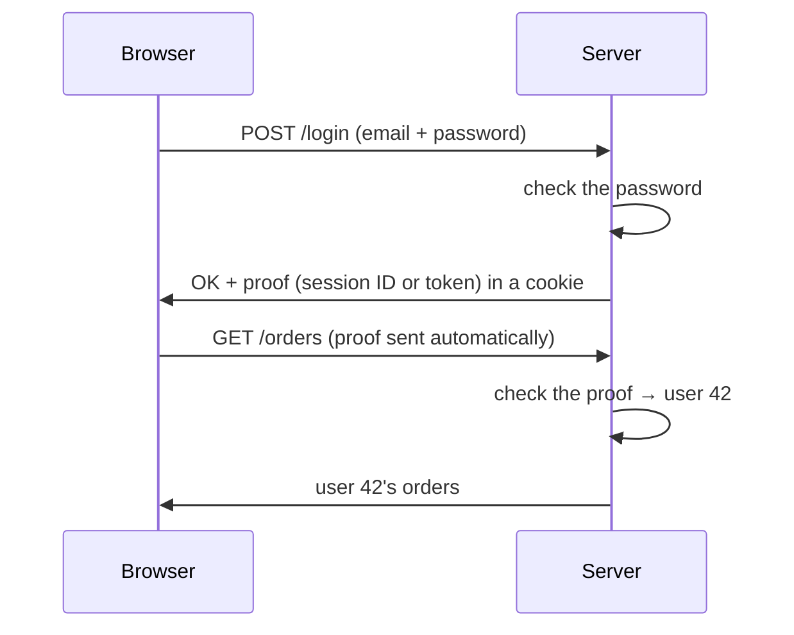

# 🔑 Staying Logged In: Cookies, Sessions and JWT

## How a website remembers you (web, any backend)

### ❓ How does a website remember that you are logged in?

**Generic answer:** HTTP is stateless, so after login the server gives the browser a proof (a session ID or a token), usually in a cookie, and the browser sends it back with every request.

**Under the hood:**

Imagine logging in, then clicking "My orders". The server receives that second request completely on its own — HTTP doesn't link it to the login. Without something extra, you'd have to send your password on every click.

**Step 1: Log in once**

`POST /login` with email and password; the server checks them.

**Step 2: Hand out a proof**

The server returns a **session ID** or a **token**, usually in a cookie.

**Step 3: Browser sends it back automatically**

Every later request carries the cookie.

**Step 4: Server checks the proof**

"This is user 42" — then returns user 42's data.



**Analogy:** a cinema wristband — show your ticket once, then the wristband lets you back in all evening.

**Final understanding:** **Stateless HTTP → prove identity once → carry a proof on every request → server checks the proof.**

---

### ❓ Cookies vs sessions vs JWT — which is best, and where is each used?

**Generic answer:** A cookie is the carrier; a session ID and a JWT are two kinds of proof it can carry. Sessions keep login data on the server (easy logout); JWTs keep it inside a signed token (no lookup, harder to revoke).

**Under the hood:**

Imagine your app grows from one server to ten, then adds a mobile app and partner APIs. Where you keep "who is logged in" suddenly matters a lot.

**Step 1: The carrier — cookie**

A small text the browser stores and sends back to that site automatically.

**Step 2: Proof type A — session**

The browser holds a random ID (`sid=8f3a9c…`); login data lives **on the server** (memory, Redis, database). The server looks the ID up. Logout = delete the session.

**Step 3: Proof type B — JWT**

The browser holds a **signed token** containing the user's details. Any server with the key verifies the signature — no lookup. But a stolen token stays valid until it expires.

| | Session | JWT |
|---|---|---|
| Browser holds | random ID | signed token with user details |
| Login data lives | **on the server** | **inside the token** |
| Server checks by | lookup | signature verification |
| Logout / block | easy | hard until expiry |
| Many servers | need shared store (Redis) | any server with the key |
| Best for | websites, banking, admin | mobile, APIs, microservices, SSO |

**Step 4: Choose**

- **Website with its own backend →** session ID in a secure cookie.
- **Mobile app, APIs, many microservices →** short-lived JWT (5–15 min) + refresh token.
- In the browser, keep either in an **`HttpOnly` cookie**, not `localStorage`.

**Step 5: Lock the cookie down**

| Setting | Effect |
|---|---|
| `HttpOnly` | JavaScript can't read it (XSS) |
| `Secure` | HTTPS only |
| `SameSite=Lax`/`Strict` | not sent from other sites' forms (CSRF) |
| `Max-Age` | expiry |

```http
Set-Cookie: sid=8f3a9c2e…; HttpOnly; Secure; SameSite=Lax; Max-Age=3600
```

**Step 6: Inside a JWT**

`header.payload.signature`, each Base64:

```json
{ "alg": "HS256", "typ": "JWT" }
{ "sub": "42", "role": "admin", "exp": 1767225600 }
```

The signature proves nobody changed it. The payload is **encoded, not encrypted** — never put secrets in it.

**Final understanding:** **Cookie carries the proof → session (server remembers, easy revoke) or JWT (token remembers, no lookup) → pick by architecture.** See also: [JWT flow](../backend/java/05-Spring-Security.md)
