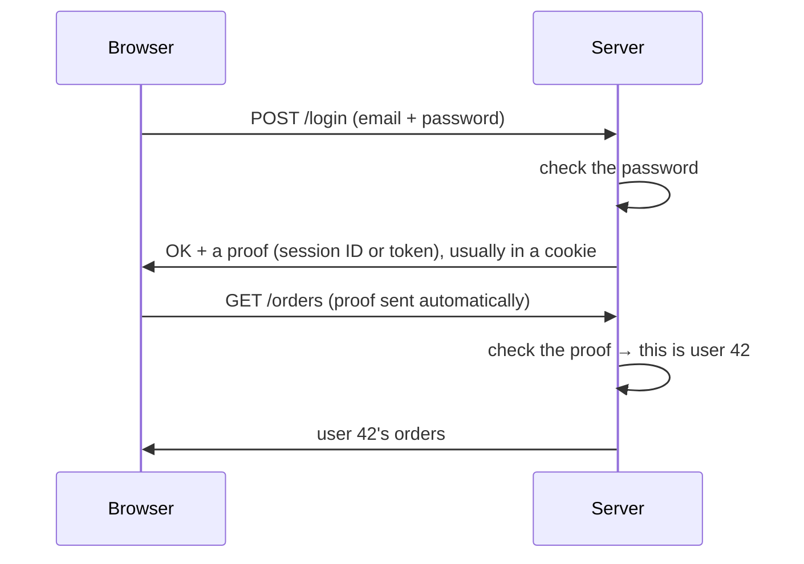

# 🔑 Staying Logged In: Cookies, Sessions and JWT

## How a website remembers you (web, any backend)

### ❓ How does a website remember that you are logged in?

HTTP is **stateless**: every request arrives on its own, and the server doesn't remember the previous one. So after you log in, the server gives your browser a **proof**, and the browser sends it back with **every** request.



The proof is either a **session ID** or a **token (JWT)** — next question.

**Analogy:** a cinema wristband. You show your ticket once at the door, then the wristband lets you back in all evening.

---

### ❓ Cookies vs sessions vs JWT — which is best, and where is each used?

They are not three rivals:

- A **cookie** is a **carrier**: a small piece of text the browser stores and sends back to that website automatically.
- A **session** and a **JWT** are **what is carried**: two different kinds of proof.

| | Session | JWT (JSON Web Token) |
|---|---|---|
| What the browser holds | a random ID, like `sid=8f3a9c…` | a signed token holding the user's details |
| Where your login data lives | **on the server** (memory, Redis, database) | **inside the token** |
| How the server checks it | looks the ID up | verifies the signature with its key — no lookup |
| Log out / block a user | easy: delete the session | hard until the token expires |
| Many servers | they need a shared session store (Redis) | any server with the key can check it |
| Best for | normal websites, banking, admin panels | mobile apps, public APIs, microservices, single sign-on |

**Which to use:**
- **Website with its own backend →** a **session ID in a secure cookie**. Simple, and logout really works.
- **Mobile app, API used by other systems, or many microservices →** a **short-lived JWT** (5–15 minutes) plus a **refresh token** to get a new one.
- **In the browser, keep either one in an `HttpOnly` cookie**, not in `localStorage` — JavaScript (including injected malicious scripts) can read `localStorage`.

**Cookie settings that keep it safe:**

| Setting | Effect |
|---|---|
| `HttpOnly` | JavaScript can't read the cookie (protects against XSS) |
| `Secure` | sent only over HTTPS |
| `SameSite=Lax` or `Strict` | not sent from other sites' forms (protects against CSRF) |
| `Max-Age` | when it expires |

```http
Set-Cookie: sid=8f3a9c2e…; HttpOnly; Secure; SameSite=Lax; Max-Age=3600
```

**Inside a JWT:** three Base64 parts joined by dots — `header.payload.signature`.

```json
{ "alg": "HS256", "typ": "JWT" }
{ "sub": "42", "role": "admin", "exp": 1767225600 }
```

The signature proves nobody changed it. The payload is only **encoded, not encrypted** — anyone can read it at jwt.io, so never put passwords or secrets in it.

See also: [Explain JWT authentication flow](../backend/java/05-Spring-Security.md) · [How do cookies, localStorage, sessionStorage and IndexedDB differ?](06-Inside-the-Browser.md)
