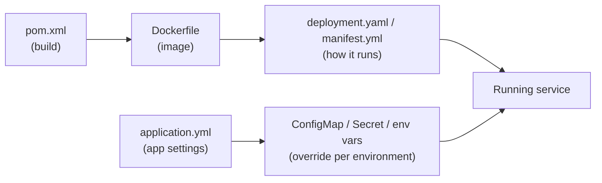

# 🧾 Config Files in Microservices: YAML, Properties and manifest.yml

## Reading config files (microservices: Spring Boot, Cloud Foundry, Docker, Kubernetes)

### ❓ How do you read a YAML file?

YAML is a way to write settings that people can read easily. Only a few rules:

| Rule | Example | Meaning |
|---|---|---|
| `key: value` (a space after the colon) | `port: 8080` | a setting |
| **Indentation = belongs to** (spaces only, never tabs) | `server:` then `  port: 8080` on the next line | `port` is inside `server` |
| `-` starts a list item | `- orders-db` | one item of a list |
| `#` | `# comment` | ignored |
| `\|` at the end of a line | `script: \|` | a multi-line text follows |
| `---` | | starts another document in the same file |

The same data in YAML and in JSON:

```yaml
server:
  port: 8080
services:
  - orders-db
  - redis-cache
debug: false
```

```json
{ "server": { "port": 8080 }, "services": ["orders-db", "redis-cache"], "debug": false }
```

**How to read any YAML file:** follow the indentation like folders. `server` → `port` means the setting `server.port`.

**Common mistakes:** a tab instead of spaces, a missing space after `:`, or wrong indentation — a setting indented one level too far silently belongs to the wrong parent.

---

### ❓ What do the common settings in a microservice's application.yml mean?

A typical Spring Boot microservice, with a note on every line:

```yaml
server:
  port: 8081                          # the port this service listens on

spring:
  application:
    name: order-service               # its name in service discovery, logs and config server
  datasource:
    url: jdbc:postgresql://db:5432/orders   # which database to use
    username: orders_app
    password: ${DB_PASSWORD}          # read from an environment variable, never written here
  profiles:
    active: dev                       # also loads application-dev.yml on top of this file
  config:
    import: optional:configserver:http://config:8888   # fetch shared settings from Spring Cloud Config

eureka:
  client:
    service-url:
      defaultZone: http://discovery:8761/eureka   # where to register so other services can find it

management:
  endpoints:
    web:
      exposure:
        include: health,info,prometheus   # health checks and metrics for monitoring

logging:
  level:
    com.shop.orders: DEBUG            # more detailed logs for our own code
```

**The same thing as `application.properties`:** each indentation level becomes a dot.

```properties
server.port=8081
spring.application.name=order-service
spring.datasource.password=${DB_PASSWORD}
```

**Who wins when a setting is in several places** (highest first): command-line arguments → environment variables (`SPRING_DATASOURCE_URL` sets `spring.datasource.url`) → `application-{profile}.yml` → `application.yml`. That's how one jar runs with different settings in dev, test and production.

See also: [application.properties vs application.yml?](../backend/java/03-Spring-1.md)

---

### ❓ What is manifest.yml, and how do you read one?

`manifest.yml` tells **Cloud Foundry** (also SAP BTP and VMware Tanzu) **how to deploy and run your app** when you type `cf push`.

```yaml
applications:
- name: order-service                 # app name in Cloud Foundry
  path: target/order-service.jar      # what to upload
  memory: 1G                          # RAM per copy
  instances: 2                        # run 2 copies for load and safety
  buildpacks:
    - java_buildpack                  # how to build and run it (installs Java)
  routes:
    - route: orders.apps.example.com  # the public URL
  env:                                # environment variables for the app
    SPRING_PROFILES_ACTIVE: cloud
    JBP_CONFIG_OPEN_JDK_JRE: '{ jre: { version: 17.+ } }'   # Java version
  services:
    - orders-db                       # bind a database the platform created
  health-check-type: http
  health-check-http-endpoint: /actuator/health   # restart the app if this fails
```

**Read it as:** "deploy **this file**, with **this much memory**, **this many copies**, at **this URL**, with **these settings and services**."

**Don't confuse it with `META-INF/MANIFEST.MF`** inside a jar, which only says which class has `main()`.

---

### ❓ Which config file does what in a microservice project?

| File | What it controls | Read it when… |
|---|---|---|
| `pom.xml` / `build.gradle` | libraries and how to build | a dependency is missing or the build fails |
| `application.yml` / `.properties` | the app's own settings: port, database, logging | the app behaves differently than expected |
| `application-dev.yml`, `-prod.yml` | overrides for one environment | it works in dev but not in prod |
| `Dockerfile` | how to build the container image | the image won't build or start |
| `docker-compose.yml` | run several containers together locally | you start the whole system on your laptop |
| Kubernetes `deployment.yaml`, `service.yaml` | how many copies run, ports, memory limits | pods crash or can't be reached |
| Kubernetes `configmap.yaml` / `secret.yaml` | settings and passwords given to the pods | a setting differs per cluster |
| `manifest.yml` | deployment on Cloud Foundry | `cf push` fails |
| `.github/workflows/*.yml`, `Jenkinsfile` | the CI/CD pipeline | a build or deploy step fails |
| `values.yaml` (Helm) | settings for Kubernetes templates | one chart is deployed to many environments |


