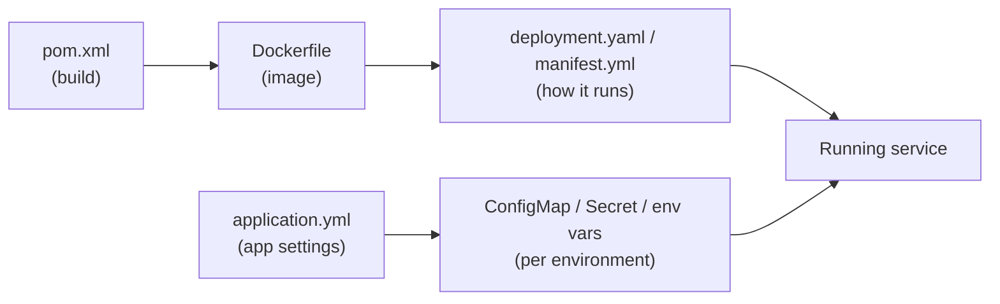

# 🧾 Config Files in Microservices: YAML, Properties and manifest.yml

## Reading config files (microservices: Spring Boot, Cloud Foundry, Docker, Kubernetes)

### ❓ How do you read a YAML file?

**Generic answer:** YAML is a readable settings format where `key: value` sets a value, indentation (spaces only) means "belongs to", and `-` starts a list item.

**Under the hood:**

Imagine settings for a service: a server with a port, a list of services, a debug flag. JSON works, but it's full of braces and quotes, and you can't add comments. People needed a format that's easy to read and edit by hand.

**Step 1: Learn the few rules**

| Rule | Example | Meaning |
|---|---|---|
| `key: value` (space after the colon) | `port: 8080` | a setting |
| **Indentation = belongs to** (spaces, never tabs) | `server:` then `  port: 8080` | `port` is inside `server` |
| `-` starts a list item | `- orders-db` | one list item |
| `#` | `# comment` | ignored |
| `\|` at line end | `script: \|` | multi-line text follows |
| `---` | | another document in the same file |

**Step 2: See it next to JSON**

```yaml
server:
  port: 8080
services:
  - orders-db
  - redis-cache
debug: false
```

```json
{ "server": { "port": 8080 }, "services": ["orders-db", "redis-cache"], "debug": false }
```

**Step 3: Read it like folders**

`server` → `port` means `server.port`.

**Step 4: Avoid the traps**

A tab instead of spaces, no space after `:`, or one level too deep — the setting silently belongs to the wrong parent.

**Final understanding:** **Hand-edited settings → YAML → indentation builds the tree → read paths like folders (`server.port`).**

---

### ❓ What do the common settings in a microservice's application.yml mean?

**Generic answer:** `application.yml` holds a Spring Boot service's own settings — port, name, database, profiles, config server, discovery, monitoring and logging — and each can be overridden per environment.

**Under the hood:**

Imagine one `order-service.jar` that must run on your laptop, in test and in production — with different databases, passwords and log levels. Rebuilding the jar per environment would be risky.

**Step 1: Read a typical file**

```yaml
server:
  port: 8081                          # port this service listens on

spring:
  application:
    name: order-service               # name in discovery, logs and config server
  datasource:
    url: jdbc:postgresql://db:5432/orders
    username: orders_app
    password: ${DB_PASSWORD}          # from an environment variable, never written here
  profiles:
    active: dev                       # also loads application-dev.yml
  config:
    import: optional:configserver:http://config:8888   # shared settings from Spring Cloud Config

eureka:
  client:
    service-url:
      defaultZone: http://discovery:8761/eureka   # register so others can find it

management:
  endpoints:
    web:
      exposure:
        include: health,info,prometheus   # health checks and metrics

logging:
  level:
    com.shop.orders: DEBUG
```

**Step 2: Same thing as properties**

```properties
server.port=8081
spring.application.name=order-service
spring.datasource.password=${DB_PASSWORD}
```

**Step 3: Layer overrides**

Highest wins: command-line args → environment variables (`SPRING_DATASOURCE_URL` sets `spring.datasource.url`) → `application-{profile}.yml` → `application.yml`.

**Final understanding:** **One jar, many environments → defaults in `application.yml` → overrides from profiles and env vars → no rebuilds.** See also: [properties vs yml](../backend/java/03-Spring-1.md)

---

### ❓ What is manifest.yml, and how do you read one?

**Generic answer:** `manifest.yml` tells Cloud Foundry (also SAP BTP, VMware Tanzu) how to deploy and run your app when you type `cf push`: what to upload, memory, copies, URL, settings and services.

**Under the hood:**

Imagine deploying by typing `cf push` with a dozen flags every time — memory, instances, routes, Java version. One typo and production differs from yesterday.

**Step 1: Write the deployment down once**

```yaml
applications:
- name: order-service
  path: target/order-service.jar      # what to upload
  memory: 1G                          # RAM per copy
  instances: 2                        # 2 copies for load and safety
  buildpacks:
    - java_buildpack                  # installs Java and runs the jar
  routes:
    - route: orders.apps.example.com  # public URL
  env:
    SPRING_PROFILES_ACTIVE: cloud
    JBP_CONFIG_OPEN_JDK_JRE: '{ jre: { version: 17.+ } }'
  services:
    - orders-db                       # bind a platform database
  health-check-type: http
  health-check-http-endpoint: /actuator/health
```

**Step 2: `cf push` reads it**

Uploads the jar, the buildpack prepares a container, the platform starts the copies, binds services and maps the route.

**Step 3: Read it as one sentence**

"Deploy **this file**, with **this memory**, **this many copies**, at **this URL**, with **these settings and services**."

**Don't confuse** with `META-INF/MANIFEST.MF` inside a jar, which only names the `main()` class.

**Final understanding:** **Error-prone manual deploy flags → describe deployment in a file → platform reads it on every push.**

---

### ❓ Which config file does what in a microservice project?

**Generic answer:** Each file owns one stage — build (`pom.xml`), app settings (`application.yml`), image (`Dockerfile`), how it runs (`deployment.yaml` / `manifest.yml`), per-environment overrides (ConfigMaps, Secrets) and the pipeline (`Jenkinsfile`, workflows).

**Under the hood:**

Imagine a service fails in production. Is it the build, a setting, the image, the deployment or the pipeline? Knowing which file owns which stage tells you where to look.

**Step 1: Build** — `pom.xml` / `build.gradle`: libraries and build.

**Step 2: App settings** — `application.yml` (+ `-dev`, `-prod`).

**Step 3: Image** — `Dockerfile`; `docker-compose.yml` runs several locally.

**Step 4: How it runs** — Kubernetes `deployment.yaml`, `service.yaml`, Helm `values.yaml`, or Cloud Foundry `manifest.yml`.

**Step 5: Environment overrides** — `configmap.yaml`, `secret.yaml`, env vars.

**Step 6: Pipeline** — `.github/workflows/*.yml`, `Jenkinsfile`.

| File | Controls | Read it when… |
|---|---|---|
| `pom.xml` | libraries, build | dependency missing, build fails |
| `application.yml` | app settings | app behaves unexpectedly |
| `application-prod.yml` | one environment | works in dev, not prod |
| `Dockerfile` | image | image won't build/start |
| `docker-compose.yml` | local multi-container | starting the system locally |
| `deployment.yaml`, `service.yaml` | copies, ports, limits | pods crash or unreachable |
| `configmap.yaml` / `secret.yaml` | settings per cluster | setting differs per cluster |
| `manifest.yml` | Cloud Foundry deploy | `cf push` fails |
| workflows / `Jenkinsfile` | CI/CD | pipeline step fails |
| `values.yaml` (Helm) | template settings | one chart, many environments |



**Final understanding:** **Build → image → run → configure → automate**; one file per stage, so a failure points to its file.
