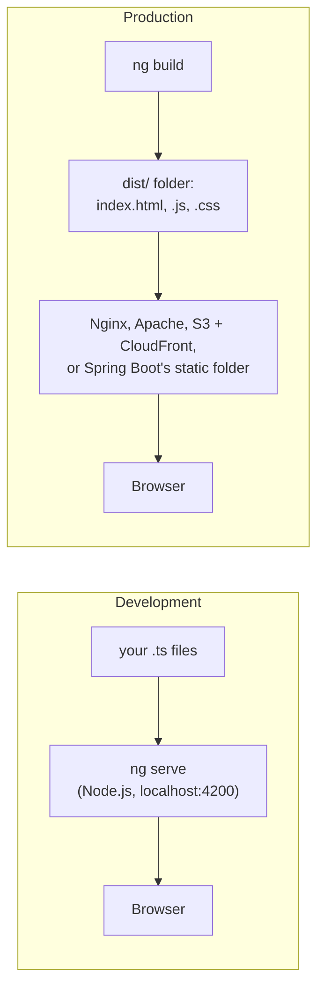
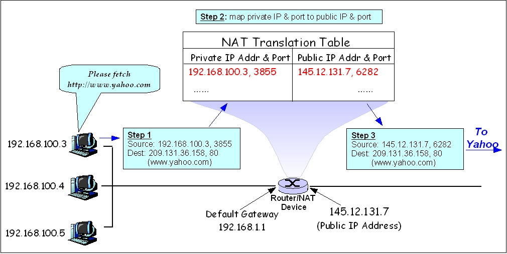

# 🏠 Local Servers and Finding Devices: localhost, ng serve, IPs and NAT

## Servers on your own computer (frontend and backend)

### ❓ Does my computer have its own local server? What is localhost?

**Not by default.** A computer becomes a server the moment you **run a program that listens on a port** and waits for requests:

| You run | It listens on |
|---|---|
| `ng serve` (Angular) | `localhost:4200` |
| `npm run dev` (React / Vite) | `localhost:5173` |
| a Spring Boot app | `localhost:8080` |
| MySQL | `localhost:3306` |

**localhost (`127.0.0.1`)** is a special address that means **"this same computer"**. Requests to it never touch the network card or the internet — the OS loops them straight back (the **loopback** interface). That's why `localhost` works with Wi-Fi switched off.

**`127.0.0.1` vs `0.0.0.0`:**
- Listening on `127.0.0.1` → only programs on **your own computer** can connect (safe default).
- Listening on `0.0.0.0` → **other devices** on your Wi-Fi can connect using your computer's IP, e.g. your phone opens `http://192.168.1.24:4200`. In Angular: `ng serve --host 0.0.0.0`.

**Your OS also runs a few servers of its own** — for example Windows file sharing (port 445).

**Try it:** `netstat -ano | findstr LISTENING` (Windows) or `lsof -i -P | grep LISTEN` (Mac/Linux) lists every program waiting for connections.

See also: [What exactly is a server — hardware or software?](07-Inside-a-Web-Server.md)

---

### ❓ What is the "server" in Angular's ng serve, and why does a frontend framework need a server?

**The browser needs files to come over HTTP.** Opening `index.html` straight from the disk (`file://…`) breaks modern apps: JavaScript modules, routing and API calls don't work that way.

**`ng serve` starts a development server** — a **Node.js program** from the Angular CLI (Vite and esbuild in Angular 17+, webpack in older versions). On `localhost:4200` it:

1. **Compiles** your TypeScript and templates into JavaScript, in memory.
2. **Serves** the files to the browser.
3. **Watches** your files and **reloads** the page when you save.
4. Can **forward API calls** to your backend (`proxy.conf.json`), so you avoid CORS errors in development.

**It is for development only.** In production there is usually **no Angular server at all**:

| | `ng serve` | Production (normal) | Production with SSR |
|---|---|---|---|
| What runs | Node.js dev server | any web server serving **static files** | a **Node.js server** |
| Builds HTML | in the browser | in the browser | **on the server**, for each request |
| Used for | coding on your laptop | most Angular / React apps | faster first load and better SEO (Angular SSR, Next.js) |

**React and Vue work the same way:** `npm run dev` is a dev server; `npm run build` produces static files.

See also: [Can you walk me through how HMR works and how Angular integrates it into the dev server?](../frontend/05-Angular-2.md)

---

## Finding a server or device on the internet (networking, all languages)

### ❓ How is a server identified — hostname, domain name, IP address, port, or something else?

Several names work together. Take `https://api.shop.com:443/orders`:

| Identifier | Example | What it answers | Who sets it |
|---|---|---|---|
| **Domain name** | `api.shop.com` | "which website?" — a name people remember | bought from a registrar; DNS points it to an IP |
| **IP address** | `203.0.113.10` | "**where** is the machine?" | the network or cloud provider |
| **Port** | `443` | "**which program** on that machine?" | the app's configuration |
| **Hostname** | `web-01`, `DESKTOP-7KQ2B1` | the machine's own name inside its network | the admin, when setting it up |
| **MAC address** | `3C:52:82:4A:1B:9F` | which network card, on the **local** network only | the maker |
| **TLS certificate** | issued to `*.shop.com` | "is this **really** shop.com?" — proves identity | a certificate authority |

**They are not one-to-one:**
- **One name → many servers:** `google.com` points to many IPs and load balancers around the world.
- **Many names → one server:** one machine can host hundreds of websites; the browser sends the name it wants (the `Host` header and SNI), and the server picks the right site.

**Try it:** `hostname` (your machine's name), `nslookup shop.com` (name → IP).

See also: [How does DNS find a website's IP address?](08-How-Data-Travels.md)

---

### ❓ How does the internet know which phone or computer to send data to?

Step by step, for your laptop at home opening a website:

1. **Getting an address:** when you join Wi-Fi, the router gives your laptop a **private IP** like `192.168.1.24` (this is called **DHCP**). The router itself has one **public IP** from your ISP.
2. **Going out:** the router replaces your private address with its public IP and a port number, and **writes it down in a table** (this is **NAT**).
3. **Across the internet:** each router on the way looks at the **destination IP** and forwards the packet towards it. Big networks tell each other which IP ranges they can reach (**BGP**).
4. **Coming back:** the reply arrives at your router's public IP and port. The router **looks up its NAT table**, finds `192.168.1.24`, and delivers it to your laptop over Wi-Fi (using its MAC address).

_Image: [Wikimedia Commons](https://commons.wikimedia.org/wiki/File:Network_Address_Translation_(file2).jpg) · Yangliy at English Wikibooks · Public domain_

**Phones:** your mobile operator gives your phone an IP when mobile data is on, and always knows **which tower your SIM is connected to**. As you travel, it hands you from tower to tower but keeps your connection going. Operators usually share one public IP between many customers (**carrier-grade NAT**).

**Why a stranger can't connect to your laptop directly:** NAT only lets in replies to requests **you** started. To show your local app to someone outside, you need port forwarding on the router or a tunnel (ngrok, Cloudflare Tunnel).

**How your phone still gets notifications:** it keeps one connection **open** to Apple's or Google's push servers, and messages come back through it.

**Analogy:** an office with one public phone number. The receptionist (router) notes which desk (private IP) made each outgoing call, so returned calls go to the right desk.

---

### ❓ What is a firewall?

A **firewall** is a guard that checks network traffic against rules and **allows or blocks** it — by IP address, port or app.

| Where | Example rule |
|---|---|
| **Your computer** (Windows Defender Firewall, macOS firewall) | the "Allow Java to access networks?" pop-up when a Spring Boot app first listens on a port |
| **Your home router** | block all incoming connections nobody asked for (NAT already does most of this) |
| **Cloud** (AWS security groups, Azure network security groups) | allow port 443 from anyone, port 22 (SSH) only from the office IP, database port 5432 only from the app servers |
| **Web application firewall** (Cloudflare, AWS WAF) | block requests that look like attacks (SQL injection, bots) |

**Rule of thumb:** open only the ports you need, to only the people who need them. A database should never be open to the whole internet.

**Common surprise:** "it works on my laptop but not from my phone" — often the computer's firewall is blocking the incoming connection.
