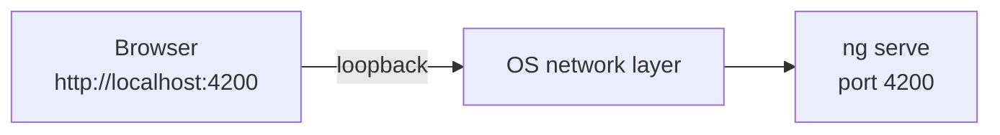
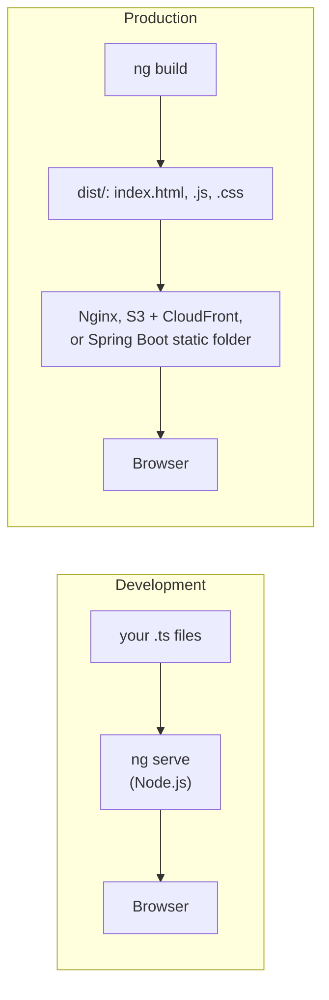
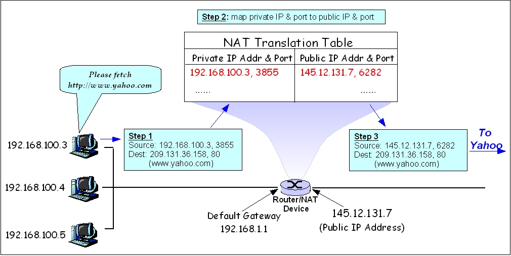

# 🏠 Local Servers and Finding Devices: localhost, ng serve, IPs and NAT

## Servers on your own computer (frontend and backend)

### ❓ Does my computer have its own local server? What is localhost?

**Generic answer:** Not by default — your computer becomes a server when you run a program that listens on a port. `localhost` (`127.0.0.1`) means "this same computer"; its requests never leave the machine.

**Under the hood:**

Imagine you run `ng serve` and open `http://localhost:4200` — with Wi-Fi off — and it works. So no internet was involved. What answered?

**Step 1: A program starts listening**

| You run | It listens on |
|---|---|
| `ng serve` (Angular) | `localhost:4200` |
| `npm run dev` (Vite) | `localhost:5173` |
| Spring Boot | `localhost:8080` |
| MySQL | `localhost:3306` |

**Step 2: The browser sends to localhost**

`127.0.0.1` is the **loopback** address. The OS loops the request straight back — no network card, no internet.

**Step 3: Who may connect — `127.0.0.1` vs `0.0.0.0`**

- `127.0.0.1` → only your own computer (safe default).
- `0.0.0.0` → other devices on your Wi-Fi too, e.g. your phone at `http://192.168.1.24:4200` (`ng serve --host 0.0.0.0`).

**Try it:** `netstat -ano | findstr LISTENING` (Windows) or `lsof -i -P | grep LISTEN`.

**Final understanding:** **A listening program makes a server → localhost loops back inside the OS → bind address decides who else can connect.**

---

### ❓ What is the "server" in Angular's ng serve, and why does a frontend framework need a server?

**Generic answer:** `ng serve` is a Node.js development server that compiles your code in memory, serves it over HTTP, reloads on save and can proxy API calls. In production, Angular is usually just static files served by any web server.

**Under the hood:**

Imagine double-clicking `index.html`. The page is blank: JavaScript modules, routing and API calls don't work from `file://`. The browser needs files to come over HTTP.

**Step 1: Compile** — TypeScript and templates → JavaScript, in memory (Vite/esbuild in Angular 17+).

**Step 2: Serve** — files over HTTP on `localhost:4200`.

**Step 3: Watch and reload** — save a file, the page updates.

**Step 4: Proxy APIs** — `proxy.conf.json` forwards `/api` to your backend, avoiding CORS in development.

**Step 5: Production is different**

| | `ng serve` | Production (normal) | Production with SSR |
|---|---|---|---|
| What runs | Node.js dev server | any static web server | a Node.js server |
| Builds HTML | in the browser | in the browser | on the server |
| Used for | coding | most apps | faster first load, SEO |

**Final understanding:** **Browsers need HTTP → dev server compiles, serves and reloads → production ships static files (or SSR).**

---

## Finding a server or device on the internet (networking, all languages)

### ❓ How is a server identified — hostname, domain name, IP address, port, or something else?

**Generic answer:** Several identifiers work together: a domain name (which site), an IP address (which machine), a port (which program), plus a hostname, a MAC address and a TLS certificate proving identity.

**Under the hood:**

Imagine `https://api.shop.com:443/orders`. People remember names, routers need numbers, one machine runs many programs, and you must be sure it's the real shop.com.

**Step 1: Name → machine** — DNS turns `api.shop.com` into `203.0.113.10`.

**Step 2: Machine → program** — port `443` picks the HTTPS server.

**Step 3: Prove identity** — the TLS certificate for `*.shop.com`.

| Identifier | Example | Answers | Set by |
|---|---|---|---|
| **Domain name** | `api.shop.com` | which website? | registrar + DNS |
| **IP address** | `203.0.113.10` | where is the machine? | network / cloud |
| **Port** | `443` | which program? | app config |
| **Hostname** | `web-01` | machine's own name | admin |
| **MAC address** | `3C:52:82:4A:1B:9F` | which card, locally | maker |
| **TLS certificate** | `*.shop.com` | is it really shop.com? | certificate authority |

**Step 4: Not one-to-one**

One name → many servers (`google.com`). Many names → one server (the `Host` header and SNI pick the site).

**Final understanding:** **Name (people) → IP (routers) → port (program) → certificate (trust).** See also: [DNS](08-How-Data-Travels.md)

---

### ❓ How does the internet know which phone or computer to send data to?

**Generic answer:** Your router gives your device a private IP, swaps it for its one public IP on the way out (NAT) and remembers the mapping; routers forward by destination IP, and replies are mapped back to your device.

**Under the hood:**

Imagine five devices at home sharing one public IP. A reply arrives from Google. Which device asked?

**Step 1: Get an address (DHCP)** — the router gives your laptop `192.168.1.24`; the router has one public IP from the ISP.

**Step 2: Going out (NAT)** — the router replaces your private address with its public IP and a port, and **writes the mapping in a table**.

**Step 3: Across the internet** — each router forwards by destination IP; big networks share which ranges they reach (**BGP**).

**Step 4: Coming back** — the reply hits the router's public IP and port; it **looks up the NAT table** and delivers to `192.168.1.24` (by MAC address over Wi-Fi).

_Image: [Wikimedia Commons](https://commons.wikimedia.org/wiki/File:Network_Address_Translation_(file2).jpg) · Yangliy at English Wikibooks · Public domain_

**Phones:** the operator gives an IP, tracks your tower, hands you between towers, and often shares one public IP among many customers (**carrier-grade NAT**).

**Why strangers can't reach your laptop:** NAT only lets in replies to requests you started. Use port forwarding or a tunnel (ngrok, Cloudflare Tunnel) to expose a local app. Phones get notifications through a connection they keep **open** to Apple/Google push servers.

**Analogy:** an office with one public number; the receptionist notes which desk made each call.

**Final understanding:** **Private address → NAT swaps to public + remembers → routers forward by IP → reply mapped back to the right device.**

---

### ❓ What is a firewall?

**Generic answer:** A firewall checks network traffic against rules and allows or blocks it by IP address, port or app.

**Under the hood:**

Imagine your laptop, home router and cloud servers each exposed to anyone who wants to connect — including bots scanning for open databases. You need a guard that lets in only what you expect.

**Step 1: Define rules** — allow or deny by source IP, destination port, protocol or app.

**Step 2: Check every packet or connection** — match it against the rules, allow or drop.

**Step 3: Place guards at several levels**

| Where | Example rule |
|---|---|
| **Your computer** | "Allow Java to access networks?" when Spring Boot first listens |
| **Home router** | block unsolicited incoming connections |
| **Cloud** (AWS security groups) | 443 from anyone; 22 only from office IP; 5432 only from app servers |
| **Web application firewall** | block SQL injection patterns and bots |

**Rule of thumb:** open only needed ports, only to who needs them. Never expose a database to the internet.

**Common surprise:** "works on my laptop, not from my phone" — the computer's firewall blocks incoming connections.

**Final understanding:** **Anyone can try to connect → rules decide who may → guards on device, router, cloud and app layers.**
