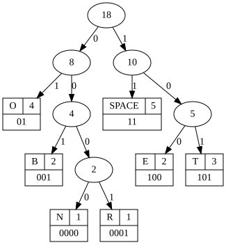
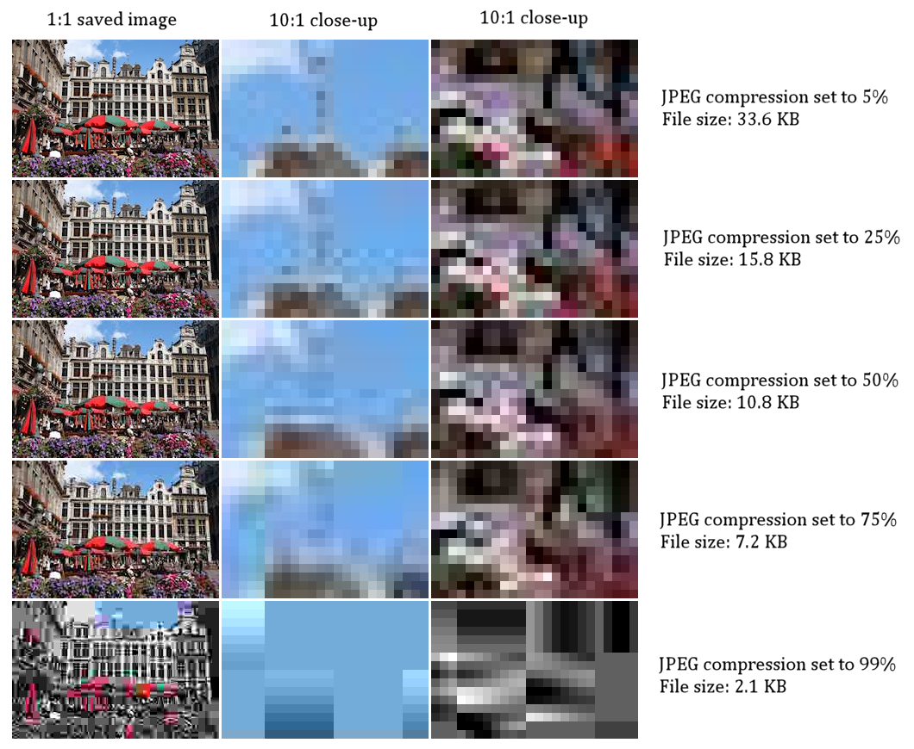
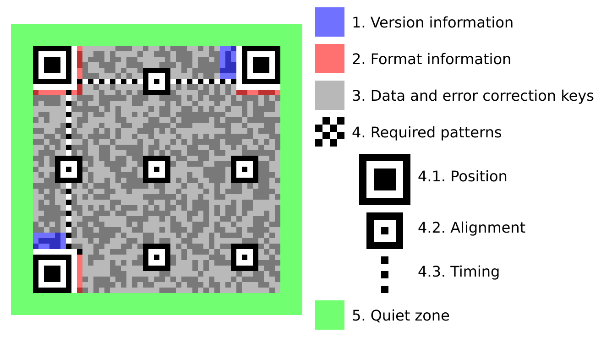
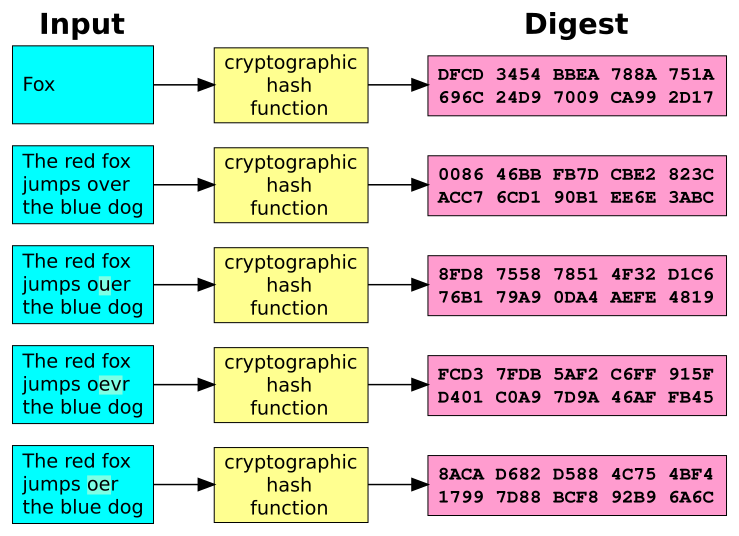
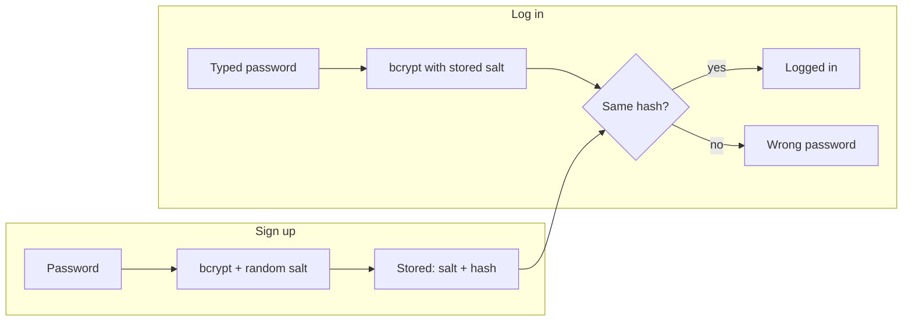
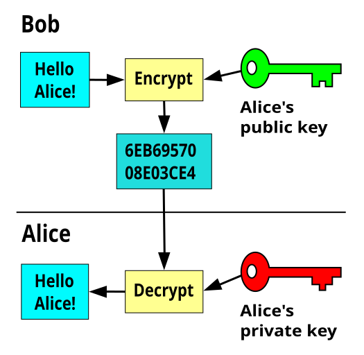
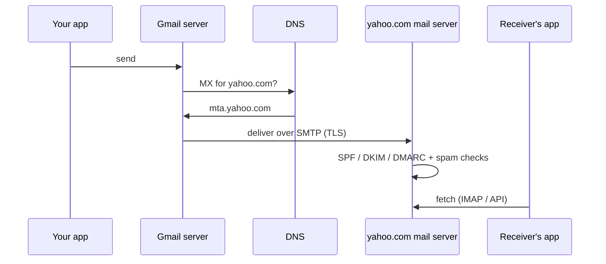
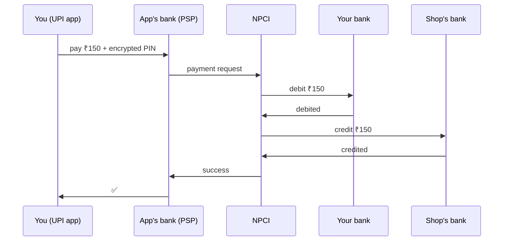
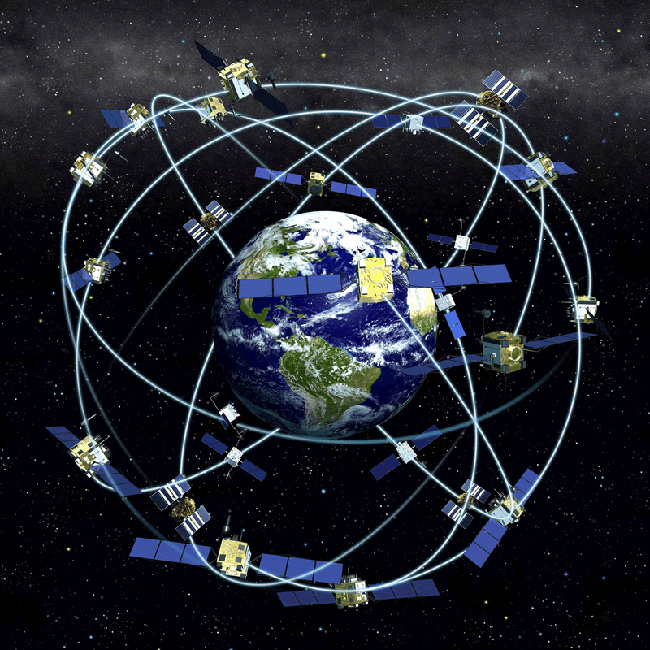
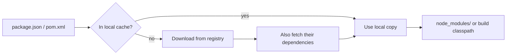

# 📱 How Everyday Tech Works: ZIP, Passwords, Encryption, Email, UPI, GPS and More

## Making data smaller and scannable: compression and QR codes (all computers)

### ❓ How does ZIP or JPEG compression make files smaller?

**Generic answer:** Lossless compression (ZIP, PNG) removes repetition and gives common symbols shorter codes, so the original comes back exactly; lossy compression (JPEG, MP3) also throws away detail people barely notice.

**Under the hood:**

Imagine emailing a 50 MB log file and a 12 MB photo. Both are too big. But the log has endless repeated lines, and the photo has detail no eye can see. Each waste needs a different trick.

**Step 1: Decide — exact or "close enough"?**

| | **Lossless** (ZIP, PNG, GZIP) | **Lossy** (JPEG, MP3, MP4) |
|---|---|---|
| After decompressing | **exactly** the original | **close to** the original |
| Used for | documents, code, screenshots | photos, music, video |
| Typical saving | text to ~20–40% | photo to ~10% |

**Step 2: ZIP trick 1 — replace repeats**

In `the cat and the hat`, the second `the` becomes "go back 12 characters, copy 4".

**Step 3: ZIP trick 2 — shorter codes for common symbols (Huffman)**

Normally every character is 8 bits; frequent ones get 2 bits, rare ones more.

_Image: [Wikimedia Commons](https://commons.wikimedia.org/wiki/File:Huffman_(To_be_or_not_to_be).svg) · huffman.ooz.ie · CC0_

`TO BE OR NOT TO BE`: 18 × 8 = **144 bits** → **47 bits**.

**Step 4: JPEG — drop what eyes miss**

1. Eyes notice **brightness** more than **colour**, so colour is stored at lower detail.
2. The image is cut into **8 × 8 blocks**, each turned into a mix of smooth-to-busy patterns.
3. The **quality slider** decides how many busy patterns to drop.
4. The rest is packed losslessly.

_Image: [Wikimedia Commons](https://commons.wikimedia.org/wiki/File:01_JPEG_JPG_compression_image_quality_degradation_-_comparison_of_photo_quality_and_file_size_saved_with_different_quality_settings.png) · Marek Ślusarczyk (Tupungato) · CC BY 3.0_

**Why zipping a JPEG saves almost nothing:** no repeats left. Same ideas: MP3 drops inaudible sounds; video stores only **what changed** between frames; websites send text GZIP-compressed.

**Final understanding:** **Wasted bits → remove repeats + short codes (lossless) → also drop unnoticeable detail (lossy).**

---

### ❓ How does a QR code store data?

**Generic answer:** A QR code is a grid where black = 1 and white = 0, storing text (often a link or UPI string) plus error-correction bits, with corner squares that help the camera find and straighten it.

**Under the hood:**

Imagine a phone camera seeing a code at an angle, in bad light, with a coffee stain on it — and still reading `upi://pay?pa=shop@okicici&pn=Shop&am=150` perfectly.

**Step 1: Text → bits → squares** — black = 1, white = 0.

**Step 2: Help the camera find it**

| Part | Job |
|---|---|
| **3 big corner squares** | find the code and its angle |
| **Alignment squares** | correct curved surfaces |
| **Timing dots** | ruler for square size |
| **Format information** | error-correction level and mask |
| **Data area** | your text + error-correction bits |

_Image: [Wikimedia Commons](https://commons.wikimedia.org/wiki/File:QR_Code_Structure_Example_3.svg) · Bobmath · CC BY-SA 3.0_

**Step 3: Survive damage** — **error correction** adds extra bits so up to ~30% can be dirty or covered (that's why logos fit in the middle).

**Step 4: Capacity** — the biggest (177 × 177) holds ~2,900 bytes.

**Safety:** a QR is just text — anyone can print one pointing to a fake site. Check the link or payee name.

**Final understanding:** **Text → bits → squares + finder patterns + error correction → readable at any angle, even damaged.**

---

## Keeping secrets: hashing and encryption (security, any language)

### ❓ How are passwords stored safely, and why can't the website see yours?

**Generic answer:** Websites store a salted, slow, one-way hash of your password, not the password; at login they hash what you type and compare.

**Under the hood:**

Imagine a website's database is stolen. If passwords were stored as plain text, attackers could log in as everyone — and try those passwords on their banks.

**Step 1: Use a one-way fingerprint (hash)**

- same input → same output;
- one character changed → completely different output;
- **cannot be reversed**.

_Image: [Wikimedia Commons](https://commons.wikimedia.org/wiki/File:Cryptographic_Hash_Function.svg) · Jorge Stolfi · Public domain_

**Step 2: Add salt**

A random value per user, so two users with `Mango@123` get different hashes and pre-computed dictionaries are useless.

**Step 3: Make it slow on purpose**

bcrypt/Argon2 take ~0.1 s per try — nothing for one login, impractical for billions of guesses.

**Step 4: Login = hash and compare**

**Why the site can't show your password:** it never saved it — so "Forgot password" sends a reset link. **If a site emails your current password, it stores passwords unsafely.**

**Final understanding:** **Stolen database risk → store only salted, slow, one-way hashes → login re-hashes and compares.** See also: [Password storage](../security/01-Web-Security-OWASP.md)

---

### ❓ What is encryption, in plain words — and what are public and private keys?

**Generic answer:** Encryption scrambles data so only someone with the key can read it. Symmetric encryption uses one shared key (fast); asymmetric uses a public key to lock and a private key to unlock.

**Under the hood:**

Imagine sending a secret to someone you've never met, over a network anyone can read. One shared key is fast — but how do you send that key safely?

**Step 1: Symmetric (AES)** — one key locks and unlocks. Very fast. Problem: sharing the key.

**Step 2: Asymmetric (RSA, elliptic curves)** — a key pair: **public key** locks (give to everyone), **private key** unlocks (keep secret).

_Image: [Wikimedia Commons](https://commons.wikimedia.org/wiki/File:Public_key_encryption.svg) · Davidgothberg · Public domain_

**Analogy:** you hand out open padlocks; anyone can snap one shut, only you can open it.

**Step 3: Combine them**

| Where | How |
|---|---|
| **HTTPS** | key pair agrees a fresh shared key; AES encrypts the page |
| **WhatsApp** | locked on your phone, unlocked only on the receiver's |
| **Digital signatures** | **sign with private**, anyone **checks with public** — proves sender and integrity |

**Final understanding:** **Shared key is fast but hard to share → key pair solves sharing → use the pair to agree a shared key, then encrypt fast.** See also: [TLS handshake](08-How-Data-Travels.md)

---

## Everyday journeys: email, payments and location (how it works)

### ❓ What happens when you click "Send" on an email?

**Generic answer:** Your provider's server looks up the receiver domain's mail server in DNS (MX record), delivers over SMTP, the receiver's server checks authenticity and spam, stores it, and the receiver's app fetches it.

**Under the hood:**

Imagine sending from Gmail to a Yahoo address. Gmail doesn't own Yahoo's mailboxes, and anyone could pretend to be gmail.com.

**Step 1:** your app sends the email to **your provider's server**.

**Step 2:** that server asks **DNS** for the receiver's **MX record** — its mail server.

**Step 3:** it delivers using **SMTP**, usually TLS-encrypted.

**Step 4:** the receiving server checks it's **really from gmail.com** (SPF, DKIM, DMARC) and scans for spam.

**Step 5:** it **stores** it in the mailbox.

**Step 6:** the receiver's app **fetches** it (IMAP or API).

Usually a few seconds; a bad address gets a **bounce**.

**Final understanding:** **Different providers → DNS finds the receiving server → SMTP delivers → authenticity checks → store → fetch.**

---

### ❓ How does a UPI payment travel from your phone to the shop's bank?

**Generic answer:** Your UPI app's bank sends the request to NPCI's UPI switch, which asks your bank to debit you (after checking your encrypted PIN) and the shop's bank to credit the shop, then confirms both sides.

**Under the hood:**

Imagine paying ₹150 by scanning a shop's QR. Your app (PhonePe, GPay), your bank and the shop's bank are three different companies — and the app must never see your PIN.

**Step 1: Scan** — the QR holds the shop's **UPI ID** (`shop@okicici`).

**Step 2: Enter PIN** — **encrypted on your phone** so only **your bank** can check it.

**Step 3: App's bank → NPCI** — the central UPI switch for all banks.

**Step 4: Find and debit** — NPCI finds the shop's bank from the UPI ID and asks **your bank** to debit.

**Step 5: Credit** — your bank checks PIN and balance, debits, confirms; NPCI tells the shop's bank to credit.

**Step 6: Confirm** — both sides get "Success" in 2–5 seconds.

**Step 7: Settle later** — NPCI totals what banks owe each other; they settle via RBI accounts several times a day.

**Good to know:** "debited but failed" payments auto-reverse; you never need a PIN to **receive** money.

**Final understanding:** **Many banks + one switch (NPCI) → PIN checked only by your bank → debit, credit, confirm → settle in bulk.**

---

### ❓ How does GPS find your location?

**Generic answer:** Satellites broadcast their position and exact time; your phone measures how long each signal took to arrive, converts that to distance, and intersects the distances from four or more satellites to find its position.

**Under the hood:**

Imagine you're lost, and four lighthouses each flash "I'm at position X, the time is exactly T". If you know how long each flash took to reach you, you know how far away each lighthouse is.

**Step 1: Satellites broadcast** — ~31 GPS satellites at ~20,000 km, with atomic clocks: "I am X, here's my position, time is T."

_Image: [Wikimedia Commons](https://commons.wikimedia.org/wiki/File:GPS-constellation-3D-NOAA.jpg) · NOAA, U.S. government · Public domain_

**Step 2: Time → distance** — travel time × speed of light.

**Step 3: Intersect spheres (trilateration)** — three distances meet at one point.

**Step 4: Fix the clock** — a 4th satellite corrects your phone's cheap clock (1 µs error ≈ 300 m).

**Step 5: Phones add helpers** — other systems (**NavIC**, Galileo, GLONASS, BeiDou), **A-GPS** for a fast first fix, Wi-Fi and towers indoors.

**GPS only receives** — satellites don't know where you are. Accuracy: 3–5 m in open sky.

**Final understanding:** **Known positions + exact time → travel time → distances → intersection → your location.**

---

## Where code libraries come from (npm, Maven — any project)

### ❓ What happens during npm install or a Maven build — where do the libraries come from?

**Generic answer:** The tool reads your dependency list, checks a local cache, downloads anything missing (plus their dependencies) from a public registry like npmjs or Maven Central, verifies checksums, and makes them available to your build.

**Under the hood:**

Imagine a new developer clones your project. It needs Spring, Jackson, Hibernate and 150 more libraries — none are in Git. How do they appear, in exactly the right versions?

**Step 1: Read the list** — `package.json` / `pom.xml`.

**Step 2: Fix exact versions** — `package-lock.json`; versions in `pom.xml`.

**Step 3: Check the local cache** — `~/.npm`, `~/.m2/repository`.

**Step 4: Download what's missing** — from **registry.npmjs.org** or **Maven Central** (or a company Nexus/Artifactory).

**Step 5: Fetch dependencies of dependencies** — **transitive**; Maven picks the **nearest** version on clashes.

**Step 6: Verify** — compare hashes/checksums.

**Step 7: Use** — `node_modules/`, or Maven compiles → tests → packages `target/app.jar`.

**Useful:** `npm ls`, `mvn dependency:tree`, `npm audit`. **Commit lock files** so everyone gets the same versions.

**Final understanding:** **Libraries aren't in your repo → declared list → cache → registry download → transitive resolution → checksum → build.** See also: [Maven repositories](../architecture/03-devops-build-tools.md)
