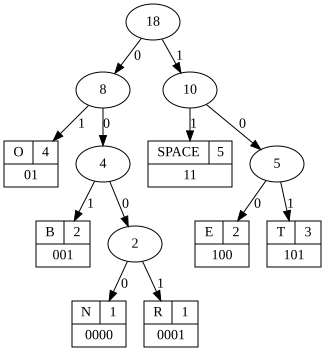
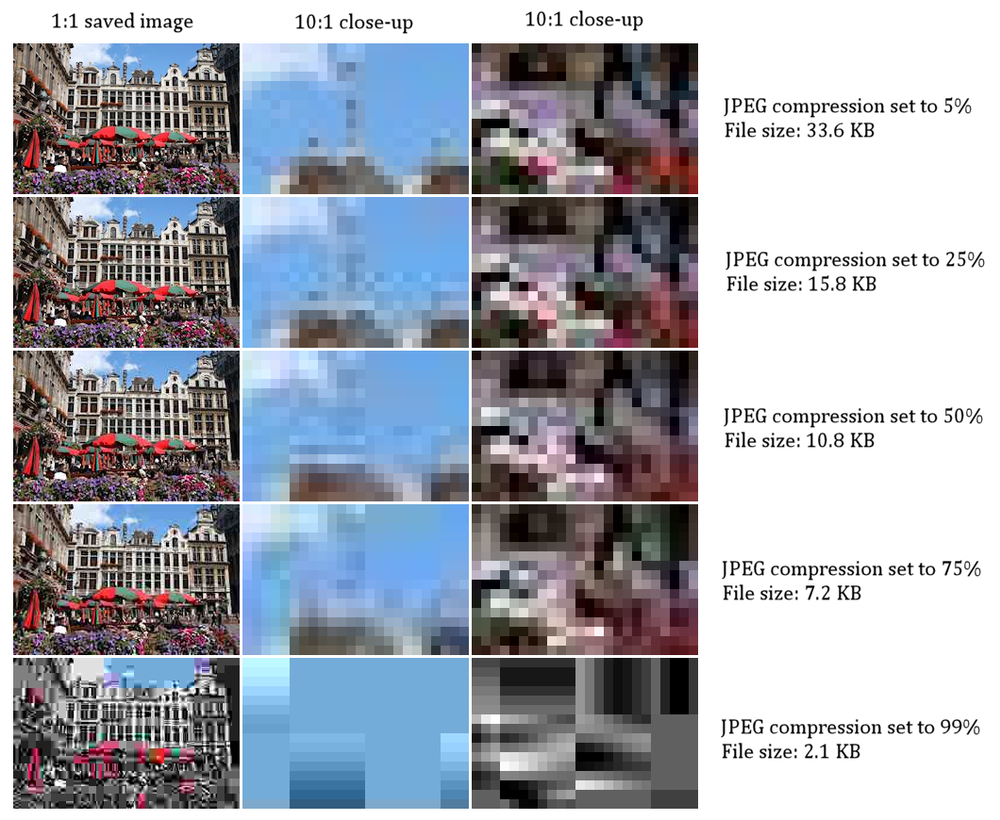
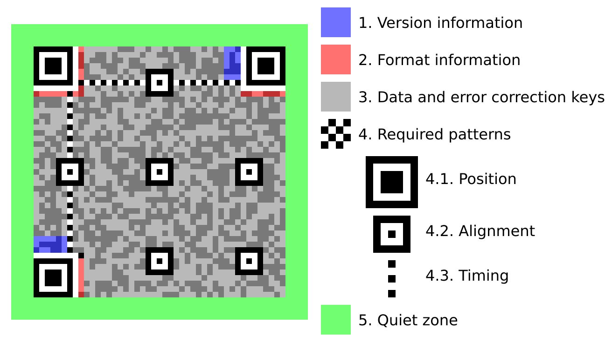
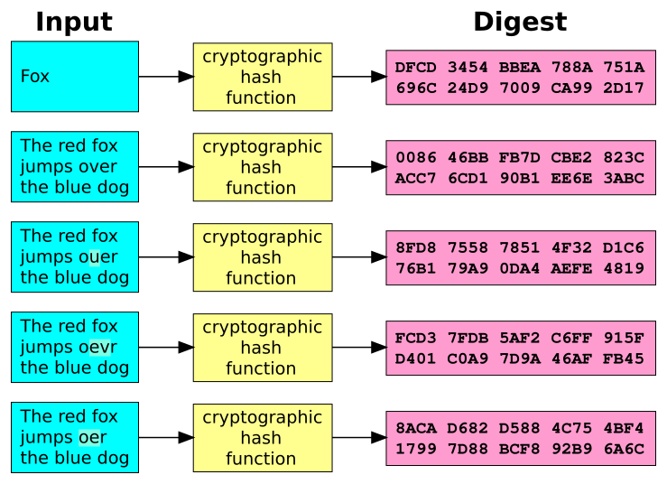
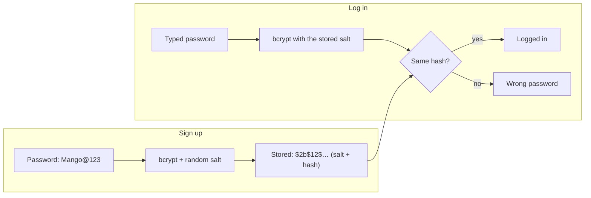
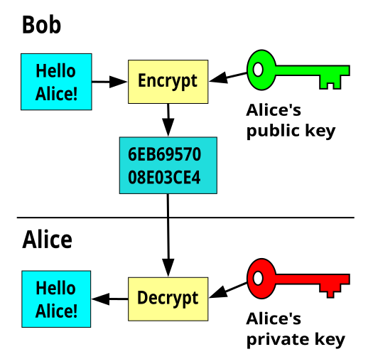
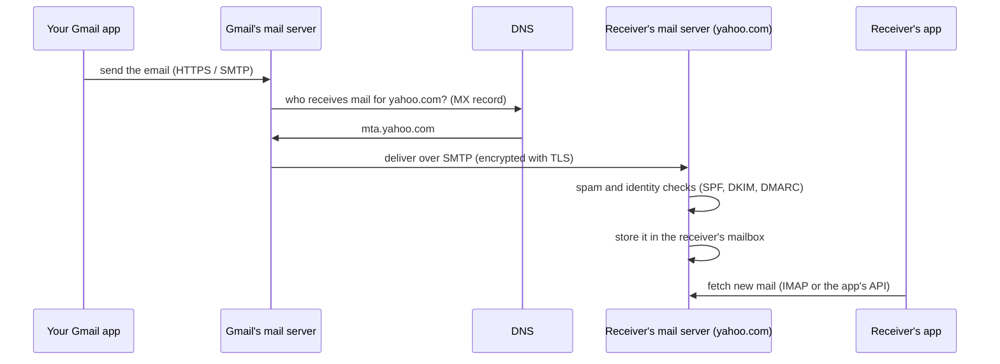
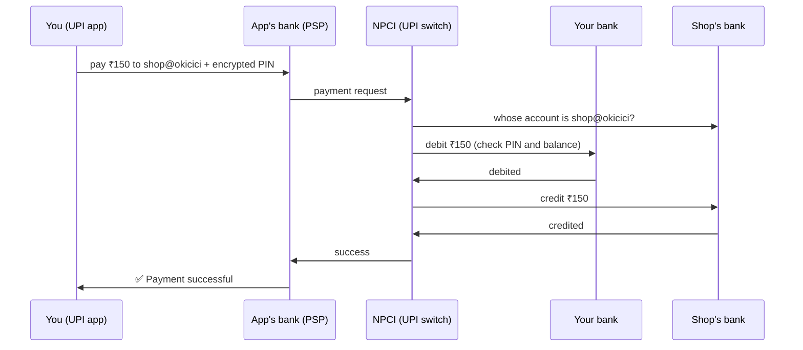
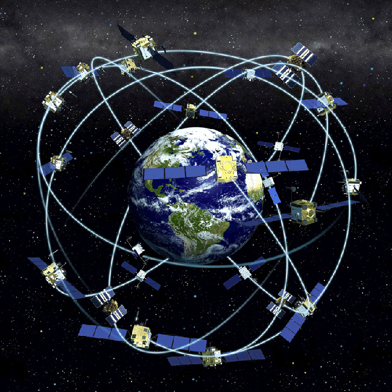
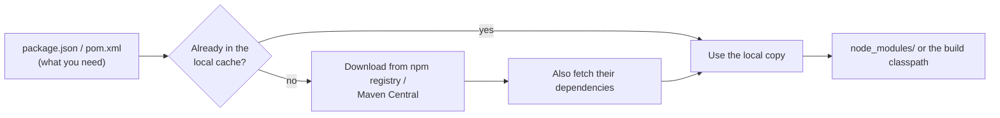

# 📱 How Everyday Tech Works: ZIP, Passwords, Encryption, Email, UPI, GPS and More

## Making data smaller and scannable: compression and QR codes (all computers)

### ❓ How does ZIP or JPEG compression make files smaller?

There are two kinds of compression:

| | **Lossless** (ZIP, PNG, GZIP) | **Lossy** (JPEG, MP3, MP4) |
|---|---|---|
| After unzipping | **exactly** the original, bit for bit | **close to** the original; some detail is gone for good |
| Used for | documents, code, programs, logos, screenshots | photos, music, video |
| Typical saving | text shrinks to ~20–40% | a photo shrinks to ~10% |

**How ZIP works (lossless):** two tricks.

1. **Replace repeats with a short note.** In `the cat and the hat`, the second `the` becomes "go back 12 characters and copy 4".
2. **Give common symbols shorter codes** (**Huffman coding**). Normally every character takes 8 bits. ZIP gives frequent ones 2 bits and rare ones more.

_Image: [Wikimedia Commons](https://commons.wikimedia.org/wiki/File:Huffman_(To_be_or_not_to_be).svg) · huffman.ooz.ie · CC0_

`TO BE OR NOT TO BE` is 18 characters × 8 bits = **144 bits**. With the codes in the tree it needs only **47 bits** — about a third.

**How JPEG works (lossy):** it throws away detail your eyes hardly notice.

1. Our eyes notice **brightness** more than **colour**, so colour is kept at lower detail.
2. The picture is cut into **8 × 8 pixel blocks**; each block is turned into a mix of simple patterns (smooth to busy).
3. The **quality slider** decides how many of the fine, busy patterns are dropped.
4. What's left is packed losslessly, like ZIP.

_Image: [Wikimedia Commons](https://commons.wikimedia.org/wiki/File:01_JPEG_JPG_compression_image_quality_degradation_-_comparison_of_photo_quality_and_file_size_saved_with_different_quality_settings.png) · Marek Ślusarczyk (Tupungato) · CC BY 3.0_

**Why zipping a JPEG or MP4 saves almost nothing:** it is already compressed — there are no repeats left to remove.

**Same ideas elsewhere:** MP3 drops sounds you can't hear; video stores only **what changed** between frames; websites send text GZIP-compressed.

---

### ❓ How does a QR code store data?

A QR code is a grid of black and white squares: **black = 1, white = 0**. The data is usually just **text** — most often a link, or a UPI payment string like `upi://pay?pa=shop@okicici&pn=Shop&am=150`.

_Image: [Wikimedia Commons](https://commons.wikimedia.org/wiki/File:QR_Code_Structure_Example_3.svg) · Bobmath · CC BY-SA 3.0_

| Part | Job |
|---|---|
| **3 big corner squares** | let the camera find the code and its angle, even upside down or tilted |
| **Alignment squares** | correct for a bent or curved surface |
| **Timing dots** | show the size of one square, like a ruler |
| **Format information** | how much error correction is used, and which pattern (mask) was applied |
| **Data area** | your text as bits, plus **error-correction** bits |

**Error correction** adds extra bits so the code still works when part of it is dirty, torn or covered — up to ~30% at the highest level. That's why shops can put a logo in the middle.

**How much fits:** the biggest QR (177 × 177 squares) holds about 7,000 digits or 2,900 bytes. A short link needs a much smaller grid.

**Safety:** a QR code is just text — anyone can print one pointing to a fake site. Check the link or payee name before you pay or log in.

---

## Keeping secrets: hashing and encryption (security, any language)

### ❓ How are passwords stored safely, and why can't the website see yours?

Websites don't store your password. They store a **hash** — a fingerprint made by a **one-way** function.

_Image: [Wikimedia Commons](https://commons.wikimedia.org/wiki/File:Cryptographic_Hash_Function.svg) · Jorge Stolfi · Public domain_

A good hash:
- gives the **same output** for the same input,
- gives a **completely different output** if one character changes,
- **cannot be reversed** — there is no "un-hash".

- **Salt:** a random value added to each password before hashing, so two users with the same password get different hashes, and pre-computed "hash dictionaries" are useless.
- **Slow on purpose:** bcrypt and Argon2 take ~0.1 second per try. Nothing for one login, but it makes billions of guesses by an attacker impractical.

**Why the website can't show your password:** it never saved it — it only sees it for a moment when you log in (over HTTPS), hashes it, and throws it away. That's why "Forgot password" sends a **reset link**, not your old password. **If a site ever emails you your current password, it is storing passwords unsafely.**

See also: [How should passwords be stored?](../security/01-Web-Security-OWASP.md) · [What is the difference between encryption, hashing and encoding?](../security/01-Web-Security-OWASP.md)

---

### ❓ What is encryption, in plain words — and what are public and private keys?

**Encryption** scrambles data so only someone with the right **key** can read it. Unlike hashing, it **can be reversed** — with the key.

**1. Symmetric encryption — one shared key** (AES): the same key locks and unlocks. Very fast. Problem: how do you send the key to the other person safely?

**2. Asymmetric encryption — a key pair** (RSA, elliptic curves):
- **Public key:** given to everyone. It can only **lock**.
- **Private key:** kept secret by its owner. Only it can **unlock**.

_Image: [Wikimedia Commons](https://commons.wikimedia.org/wiki/File:Public_key_encryption.svg) · Davidgothberg · Public domain_

**Analogy:** you hand out open padlocks (public keys) to everyone. Anyone can put a message in a box and snap your padlock shut, but only you have the key that opens it.

**Real life uses both:**

| Where | How |
|---|---|
| **HTTPS** | the key pair is used once to agree on a fresh shared key; then fast AES encrypts the page |
| **WhatsApp (end-to-end)** | messages are locked on your phone and unlocked only on the receiver's phone; WhatsApp's servers can't read them |
| **Digital signatures** (certificates, signed JWTs, app updates) | the reverse: **sign with the private key**, anyone **checks with the public key** — proves who sent it and that nothing changed |

See also: [How does HTTPS keep data private (the TLS handshake)?](08-How-Data-Travels.md)

---

## Everyday journeys: email, payments and location (how it works)

### ❓ What happens when you click "Send" on an email?

1. **Your app** sends the email to **your provider's server** (Gmail, Outlook).
2. That server asks **DNS** for the receiver domain's **MX record** — the address of its mail server.
3. It delivers the email to that server using **SMTP**, the internet's mail-sending language, usually encrypted.
4. The receiving server checks the email is **really from gmail.com** (SPF, DKIM signatures, DMARC) and scans it for spam and viruses.
5. It **stores** it in the receiver's mailbox.
6. The receiver's app **fetches** it (IMAP or the app's own API) and shows a notification.

All of this usually takes **a few seconds**. If the address doesn't exist, the receiving server sends back a **bounce** message.

---

### ❓ How does a UPI payment travel from your phone to the shop's bank?

1. **Scan:** the shop's QR code holds its **UPI ID** (like `shop@okicici`) and name.
2. **Enter your UPI PIN:** it is **encrypted on your phone** so that only **your bank** can check it — not PhonePe, Google Pay or Paytm.
3. **The app's bank** forwards the request to **NPCI**, the central UPI switch run for all banks.
4. NPCI finds the **shop's bank** from the UPI ID and asks **your bank** to **debit** you.
5. Your bank checks the PIN and balance, debits ₹150 and confirms; NPCI tells the shop's bank to **credit** the shop.
6. Both sides get "Success" — the shop's speaker announces it — usually in **2–5 seconds**.

**The banks settle up later:** money doesn't move as cash for every payment. NPCI totals what each bank owes the others, and they settle through their accounts with the RBI several times a day.

**Good to know:**
- **"Debited but failed"** payments are reversed automatically, usually within a day or so.
- You need your PIN **only to pay, never to receive** money. Anyone asking you to "enter your PIN to receive money" is a scammer.

---

### ❓ How does GPS find your location?

About **31 GPS satellites** circle the Earth at ~20,000 km. Each one keeps **very accurate time** (atomic clocks) and constantly broadcasts: **"I am satellite X, here is my position, and the time is exactly T."**

_Image: [Wikimedia Commons](https://commons.wikimedia.org/wiki/File:GPS-constellation-3D-NOAA.jpg) · NOAA, U.S. government · Public domain_

1. Your phone receives signals from **4 or more** satellites.
2. For each, it measures **how long the signal took** to arrive. Time × speed of light = **distance** to that satellite.
3. Knowing you are, say, 20,500 km from satellite A puts you somewhere on a giant **sphere** around it. Spheres from **three** satellites cross at one point — your position (**trilateration**).
4. The **fourth** satellite fixes your phone's cheap clock: a timing error of just 1 millionth of a second would put you 300 m off.

**GPS only receives** — the satellites don't know where you are. Your phone works it out, and apps like Google Maps share it only if you allow them.

**Phones do more than GPS:**
- They also use other satellite systems: **NavIC** (India), Galileo (Europe), GLONASS (Russia), BeiDou (China).
- **A-GPS** downloads where the satellites are via mobile data, so the first fix takes seconds instead of minutes.
- **Indoors**, where satellite signals are weak, they estimate the position from nearby **Wi-Fi networks and mobile towers**.

**Accuracy:** about 3–5 m in open sky; worse between tall buildings, where signals bounce.

---

## Where code libraries come from (npm, Maven — any project)

### ❓ What happens during npm install or a Maven build — where do the libraries come from?

Both tools read a list of the libraries your project needs, then **download them from a public online store** (a **registry** or **repository**) and keep a copy on your computer.

| Step | **npm** (JavaScript) | **Maven** (Java) |
|---|---|---|
| 1. Read the list | `package.json` (`"express": "^4.19.0"`) | `pom.xml` (`groupId : artifactId : version`) |
| 2. Exact versions | `package-lock.json` pins every version | the versions written in `pom.xml` |
| 3. Check the local copy first | the cache in `~/.npm` | `~/.m2/repository` |
| 4. Download what's missing | from **registry.npmjs.org** | from **Maven Central** (or your company's Nexus / Artifactory) |
| 5. Libraries of libraries | downloaded too (**transitive** dependencies) | downloaded too; if two versions clash, the one **nearest** your project wins |
| 6. Check nothing was changed | compares each file's **hash** (`integrity` in the lock file) | compares checksums |
| 7. Result | everything goes into `node_modules/` | the build runs: compile → test → package → `target/app.jar` |

**Why the first build is slow and the next ones are fast:** the first time, everything is downloaded; after that it comes from the local cache.

**Useful commands:** `npm ls` / `mvn dependency:tree` show the whole tree; `npm audit` lists libraries with known security holes.

**Why lock files matter:** without exact versions, two developers may get different library versions and different bugs. Commit `package-lock.json`.

See also: [What are Maven repositories?](../architecture/03-devops-build-tools.md) · [What is dependency management in Maven?](../architecture/03-devops-build-tools.md)
