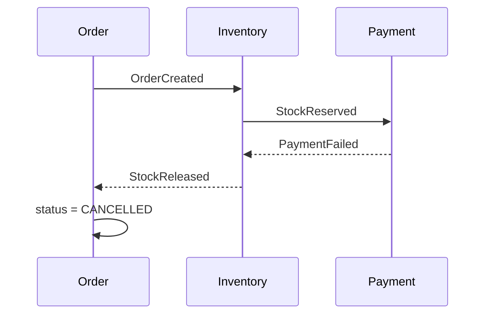
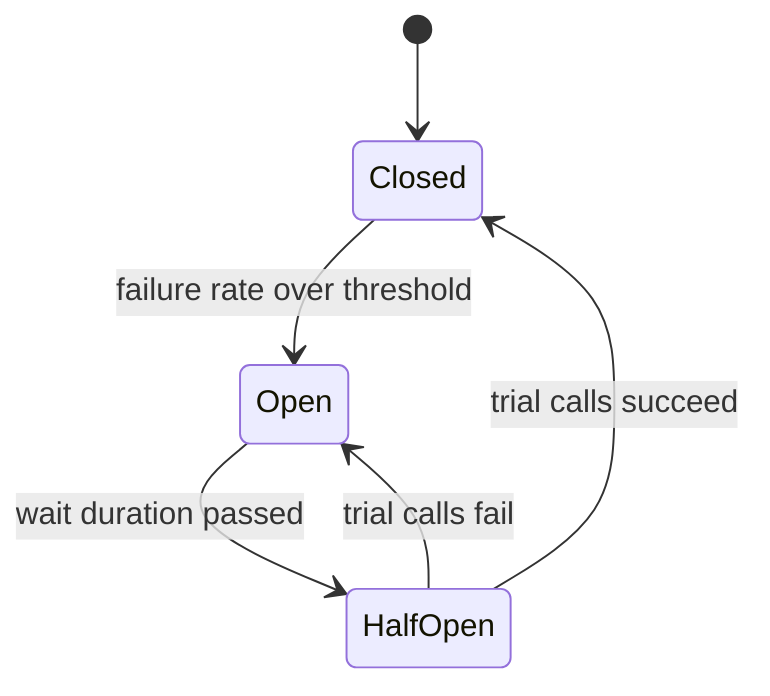

# 🧩 Inside Microservices: Communication, Consistency and Resilience

## Microservices fundamentals (architecture, any language; Spring Cloud examples)

### ❓ Why were microservices introduced?

**Generic answer:** Microservices split a large application into small, independently deployable services, each owning one business capability, so teams can scale, deploy and change parts independently.

**Under the hood:**

Imagine an e-commerce app built as one large Spring Boot application with employees, customers, orders, payments, inventory and notifications. It works well — until the business grows.

**Step 1: Scaling problem** — orders get 10,000 requests a minute, employees 100. To scale orders you must scale the whole app.

**Step 2: Deployment problem** — a one-line payment fix means building, testing and deploying everything.

**Step 3: Team and technology coupling** — eight teams share one codebase, one release train, one set of library versions.

**Step 4: Split by business capability**

```text
              API Gateway
         ┌────────┼────────┐
       Order   Payment  Inventory
      Service  Service   Service
         │        │         │
      Order DB Payment DB Inventory DB
```

**Step 5: Independent scaling** — run 10 order instances and 2 of the rest.

**Step 6: Independent deployment** — release payments without touching orders.

**Step 7: New challenges** — network failures, distributed transactions, data consistency, service discovery, tracing, duplicate messages, partial failures.

**Final understanding:** Microservices solve scaling, deployment and team problems of a big monolith — **in exchange for distributed-system complexity**.

---

### ❓ What problems do monolithic architectures create as applications grow?

**Generic answer:** As a monolith grows, builds and deployments slow down, one module's bug or load affects everything, scaling is all-or-nothing, teams block each other, and technology upgrades become huge projects.

**Under the hood:**

Imagine year one: 5 developers, 50k lines, deploy in 5 minutes — a monolith is perfect. Year five: 60 developers, 1.5M lines.

**Step 1: Slow feedback** — builds take 40 minutes; startup takes 3 minutes; tests are flaky.

**Step 2: Risky releases** — every release ships everyone's changes, so releases become rare and big.

**Step 3: Shared fate** — a memory leak in reporting crashes checkout.

**Step 4: Coarse scaling** — CPU-heavy search forces bigger machines for the whole app.

**Step 5: Tangled code** — without strong module boundaries, everything calls everything (a "big ball of mud").

**Step 6: Frozen stack** — upgrading Java or Spring touches every module at once.

**Note:** many of these are fixable with a **modular monolith** first; split only where the pain is real.

**Final understanding:** **Size multiplies coupling → slow builds, risky releases, shared failures, coarse scaling → split (or modularise) along business boundaries.**

---

### ❓ How do microservices communicate internally?

**Generic answer:** Synchronously over the network with request/response (REST, gRPC), or asynchronously through a message broker with events or commands (Kafka, RabbitMQ).

**Under the hood:**

Imagine checkout: it needs the price **now** (to show the total), but the email and loyalty points can happen later.

**Step 1: Synchronous** — the caller sends a request and waits: `GET /prices/42` over HTTP/JSON, or gRPC over HTTP/2 with Protobuf.

**Step 2: Asynchronous** — the caller publishes `OrderPlaced` to a broker and continues; consumers process it in their own time.

**Step 3: Choose per interaction**

| Need | Style |
|---|---|
| Answer needed to continue | sync (REST/gRPC) |
| Notify others, they react later | async event |
| Long-running work | async command + status/callback |

**Step 4: Add the plumbing** — service discovery, timeouts, retries, circuit breakers, tracing headers, authentication.

**Final understanding:** **Need an answer now → request/response; just tell others → events through a broker.**

---

### ❓ How does service discovery work?

**Generic answer:** Instances register their address with a registry (Eureka, Consul, Kubernetes) and renew it with heartbeats; callers look up a service name and get the list of healthy instances.

**Under the hood:**

Imagine `order-service` must call `payment-service`, which runs 4 instances whose IPs change every deployment and every autoscale.

**Step 1: Register** — each payment instance on startup tells the registry: "payment-service at 10.0.3.7:8080".

**Step 2: Heartbeat** — every ~30 s it renews; missing heartbeats → removed.

**Step 3: Look up** — `order-service` asks for "payment-service" and gets the healthy instance list (usually cached locally).

**Step 4: Choose and call** — a client-side load balancer (Spring Cloud LoadBalancer) picks one instance.

**Kubernetes style:** a **Service** has a stable DNS name (`payment-service.default.svc`); kube-proxy routes to healthy pods — discovery without Eureka.

**Final understanding:** **Changing IPs → instances register and heartbeat → callers look up by name → pick a healthy instance.**

---

### ❓ How does an API gateway route requests?

**Generic answer:** The gateway is the single entry point for clients; it matches each request against route rules (path, host, header), applies filters (auth, rate limit, rewrite) and forwards it to the right service instance.

**Under the hood:**

Imagine an Angular app calling 12 services. It would need 12 URLs, 12 CORS setups and token checks in every service.

**Step 1: One entry point** — `https://api.shop.com`.

**Step 2: Route rules**

```yaml
spring:
  cloud:
    gateway:
      routes:
        - id: orders
          uri: lb://order-service          # lb = look up in discovery
          predicates: [ Path=/api/orders/** ]
          filters: [ StripPrefix=1 ]
```

**Step 3: Match** — `/api/orders/42` matches the `orders` route.

**Step 4: Pre-filters** — validate JWT, rate limit, add correlation ID, rewrite path.

**Step 5: Forward** — resolve `order-service` via discovery, pick an instance, proxy the request.

**Step 6: Post-filters** — add headers, map errors, log.

**Final understanding:** **Many services, one client → one gateway → match route → apply cross-cutting filters → forward to a healthy instance.**

---

### ❓ How does load balancing work across microservices?

**Generic answer:** A load balancer spreads requests across healthy instances of a service using an algorithm such as round robin or least connections — either a separate server-side component or a client-side library inside the caller.

**Under the hood:**

Imagine 4 payment instances. Sending everything to the first one wastes the others and overloads it.

**Step 1: Know the instances** — from discovery or a target group.

**Step 2: Exclude unhealthy ones** — health checks or failed heartbeats.

**Step 3: Pick one** — round robin (in turn), least connections, weighted, or random.

**Step 4: Forward** — and on connection failure, possibly retry another instance.

**Where it runs:**
- **Server-side:** AWS ALB, Nginx, Kubernetes Service — callers see one address.
- **Client-side:** Spring Cloud LoadBalancer in the caller — no extra hop.

**Final understanding:** **Several instances → know the healthy ones → pick with an algorithm → forward (server-side or in the client).**

---

### ❓ How does service registration and deregistration work?

**Generic answer:** On startup an instance registers itself (or the platform registers it) with its address and metadata, keeps a lease alive with heartbeats, deregisters on graceful shutdown, and is evicted when heartbeats stop.

**Under the hood:**

Imagine an instance crashes without saying goodbye. If the registry kept it, callers would keep sending requests to a dead address.

**Step 1: Register** — Eureka client sends name, host, port, health URL, metadata (zone, version).

**Step 2: Lease** — valid for ~90 s; renewed every ~30 s.

**Step 3: Graceful shutdown** — `@PreDestroy`/shutdown hook calls deregister; the registry removes it at once.

**Step 4: Crash** — no renewals → lease expires → evicted.

**Step 5: Clients refresh** — callers fetch the registry every ~30 s, so they briefly may still try a dead instance → combine with retries to another instance.

**Kubernetes:** pods are added to a Service's endpoints only when their **readiness probe** passes, and removed on termination.

**Final understanding:** **Register on start → heartbeat to stay → deregister on clean stop → expire on crash → clients refresh and retry.**

---

### ❓ How do services locate one another without hardcoded IP addresses?

**Generic answer:** By using logical service names that are resolved at call time — through a discovery registry (Eureka/Consul), platform DNS (Kubernetes Services), or a gateway/service mesh.

**Under the hood:**

Imagine `http://10.0.3.7:8080` written in `application.yml`. The next autoscale or redeploy changes the IP and everything breaks.

**Step 1: Call by name** — `http://payment-service/api/pay`.

**Step 2: Resolve at runtime**
- **Registry:** Spring Cloud LoadBalancer looks up `payment-service` in Eureka.
- **DNS:** Kubernetes resolves `payment-service` to a stable ClusterIP.
- **Mesh:** a sidecar (Envoy/Istio) resolves and routes.

**Step 3: Pick an instance** — load balancing.

**Step 4: Config only for outside systems** — third-party URLs still come from configuration, never code.

**Final understanding:** **IPs change, names don't → call by name → resolve at runtime via registry, DNS or mesh.**

---

### ❓ How do microservices handle configuration centrally?

**Generic answer:** A config server (Spring Cloud Config, Consul, Kubernetes ConfigMaps/Secrets, AWS Parameter Store) stores settings per service and environment; each service fetches its settings at startup and can refresh them at runtime.

**Under the hood:**

Imagine 30 services × 4 environments, each with its own `application.yml` in its own repo. Changing a shared timeout means 120 edits and 30 redeploys.

**Step 1: One store** — e.g. a Git repo with `order-service-prod.yml`, `application.yml` (shared).

**Step 2: Config server** — serves them over HTTP by name + profile.

**Step 3: Service fetches at startup**

```yaml
spring.config.import: configserver:http://config:8888
```

**Step 4: Secrets separate** — Vault or Kubernetes Secrets, never plain Git.

**Step 5: Refresh** — `@RefreshScope` beans reload via `/actuator/refresh` (or Spring Cloud Bus to all instances).

**Final understanding:** **Settings scattered across services → one versioned store → services pull at startup → refresh without redeploying.**

---

### ❓ How does distributed configuration management work?

**Generic answer:** Configuration is versioned in one place, layered (global → service → environment → instance), delivered to every instance, and changes are pushed or polled so all instances converge on the same values safely.

**Under the hood:**

Imagine turning on a feature flag for 40 instances of 10 services. Some instances get it, others don't, and behaviour differs per request.

**Step 1: Version it** — Git or a KV store with history and review.

**Step 2: Layer it** — global defaults, per service, per environment, per region.

**Step 3: Deliver it** — pull at startup; push on change (Spring Cloud Bus over Kafka/RabbitMQ, Consul watches, ConfigMap volume updates).

**Step 4: Apply safely** — refresh-scoped beans rebuild; validate before applying; roll out gradually.

**Step 5: Audit and roll back** — Git history shows who changed what.

**Final understanding:** **Many instances need the same truth → versioned, layered store → push or poll → apply safely and audibly.**

---

### ❓ How do you identify appropriate service boundaries?

**Generic answer:** Draw boundaries around business capabilities and DDD bounded contexts — places where a term has one meaning, data is owned by one team, and changes usually happen together — not around technical layers or database tables.

**Under the hood:**

Imagine splitting by tables: `customer-service`, `address-service`, `order-line-service`. Every feature now needs five services changed together and chatty calls between them — a "distributed monolith".

**Step 1: Map business capabilities** — ordering, payments, inventory, shipping.

**Step 2: Find bounded contexts** — "Product" means a catalogue item to marketing and a stock unit to the warehouse — two contexts.

**Step 3: Check change patterns** — things that change together stay together (high cohesion).

**Step 4: Check data ownership** — one service owns each piece of data and is its source of truth.

**Step 5: Check communication** — if two services must call each other on every request, merge them.

**Step 6: Align with teams** — one team per service (Conway's law).

**Final understanding:** **Split by business meaning and change patterns, not tables → high cohesion inside, few calls across.**

---

### ❓ How does the database-per-service architecture work?

**Generic answer:** Each service owns its own schema or database, and only that service reads and writes it; other services get the data through its API or its events.

**Under the hood:**

Imagine order-service and inventory-service sharing one `products` table. Inventory renames a column — order-service breaks in production.

**Step 1: Private data** — order-service owns `orders`; inventory-service owns `stock`. Separate databases, schemas or at least separate credentials.

**Step 2: Access through the owner** — need stock? Call inventory's API or listen to its `StockChanged` events.

**Step 3: Local copies when needed** — order-service keeps a read-only cache of product names from events.

**Step 4: Freedom** — each service picks its own storage (PostgreSQL, MongoDB, Redis) and changes its schema independently.

**Step 5: The cost** — no cross-service joins or transactions → sagas and eventual consistency.

**Final understanding:** **Shared tables couple services → each owns its data → others use its API or events → independence in exchange for distributed consistency.**

---

### ❓ Why should microservices avoid sharing the same database schema?

**Generic answer:** A shared schema couples services through table structure: one team's change can break others, deployments must be coordinated, ownership is unclear, and one service's load or locks hurt everyone.

**Under the hood:**

Imagine five services reading and writing the same `customer` table.

**Step 1: Hidden contract** — the table structure is now an API nobody versioned.

**Step 2: Breaking changes** — renaming `phone` to `mobile` requires five coordinated releases.

**Step 3: Unclear ownership** — who validates the data? Who may delete rows?

**Step 4: Shared load** — a heavy report from one service locks rows another needs.

**Step 5: No independent scaling** — every service depends on one database's capacity.

**Result:** a "distributed monolith" — all the cost of microservices, none of the independence.

**Final understanding:** **Shared schema = invisible shared API → coordinated releases and shared failures → give each service its own data.**

---

### ❓ How do you handle shared business data across services?

**Generic answer:** Pick one owner per piece of data; others call its API when they need fresh data, or keep a local read-only copy updated from its events (with the copy holding only the fields they need).

**Under the hood:**

Imagine order, shipping and invoicing all need the customer's name and address, owned by customer-service.

**Step 1: One owner** — customer-service is the source of truth.

**Step 2: Option A — ask when needed** — call `GET /customers/7`. Always fresh, but adds latency and a runtime dependency.

**Step 3: Option B — replicate via events** — customer-service publishes `CustomerUpdated`; shipping stores `{id, name, address}` locally. Fast and resilient, but eventually consistent.

**Step 4: Option C — copy at the moment of use** — an order stores the shipping address **as it was** when ordered (often the correct business rule anyway).

**Step 5: Avoid** — shared tables, or everyone writing the same data.

**Final understanding:** **One owner → others query it, replicate it from events, or snapshot it when used.**

---

### ❓ How does horizontal scaling work in microservices?

**Generic answer:** You run more instances of the service that needs capacity behind a load balancer; services must be stateless so any instance can serve any request, and an autoscaler adds or removes instances based on metrics.

**Under the hood:**

Imagine a sale: order-service CPU hits 90% while every other service is idle.

**Step 1: Stateless instances** — no session or cache that only one instance has; state lives in the database, Redis or the client token.

**Step 2: Add instances** — Kubernetes `replicas: 10` or an autoscaling group.

**Step 3: Autoscale** — the Horizontal Pod Autoscaler watches CPU/RPS/queue lag and adjusts replicas.

**Step 4: Spread traffic** — load balancer / Service routes across them.

**Step 5: Watch the dependencies** — 10× instances = 10× database connections; Kafka consumers scale only up to the partition count.

**Final understanding:** **Scale only the hot service → stateless instances → add copies (automatically) → balance traffic → check downstream limits.**

---

## Inter-service communication (architecture, any language; Spring examples)

### ❓ How does synchronous communication work between services?

**Generic answer:** The caller sends a request over the network (HTTP/REST or gRPC) and its thread waits until the response arrives or a timeout fires.

**Under the hood:**

Imagine checkout calling pricing to get the total. Checkout can't continue without the answer.

**Step 1: Resolve** — find a pricing instance (discovery + load balancing).

**Step 2: Connect** — reuse a pooled connection or open TCP (+ TLS).

**Step 3: Send** — serialise the request (JSON/Protobuf) and write it.

**Step 4: Wait** — the calling thread blocks (or, reactively, the call is suspended).

**Step 5: Receive** — read and deserialise the response; map errors (4xx/5xx).

**Step 6: Failure paths** — timeout, connection refused, 503 → retry, fallback or fail.

**Trade-off:** simple and immediate, but **temporal coupling** — if pricing is down or slow, checkout is too.

**Final understanding:** **Need the answer to continue → request → wait → response (or timeout) → caller's health depends on the callee's.**

---

### ❓ How does asynchronous communication work?

**Generic answer:** The sender puts a message on a broker and continues immediately; the broker stores it durably; consumers receive it when they're ready, process it and acknowledge it.

**Under the hood:**

Imagine order-service must trigger email, loyalty and analytics. If any is down, orders should still succeed.

**Step 1: Publish** — `OrderPlaced` to Kafka/RabbitMQ; the broker confirms it's stored.

**Step 2: Sender continues** — returns to the user.

**Step 3: Broker holds it** — on disk, replicated.

**Step 4: Consumers pull/receive** — each at its own pace.

**Step 5: Acknowledge** — after successful processing (commit offset / ack); failures → retry or dead-letter queue.

**Trade-off:** decoupled in time and resilient, but eventually consistent, harder to trace, and messages can arrive twice or out of order.

**Final understanding:** **Don't need an answer now → hand the message to a durable broker → consumers process later and acknowledge.**

---

### ❓ What happens when Service A calls Service B over HTTP?

**Generic answer:** A resolves B's address, borrows a pooled connection, serialises the request, sends it through the network (often via load balancers or sidecars), B processes it on a worker thread and returns a serialised response that A deserialises — with timeouts at each step.

**Under the hood:**

Imagine order-service calling `POST http://payment-service/api/payments`. It looks like a method call; it's about ten steps.

**Step 1: Name → address** — discovery/DNS → `10.0.3.7:8080`.

**Step 2: Connection** — from A's HTTP connection pool (or a new TCP + TLS handshake).

**Step 3: Serialise** — Java object → JSON bytes; add headers (auth token, trace ID).

**Step 4: Network** — packets through switches, maybe a load balancer or Envoy sidecar.

**Step 5: B receives** — Tomcat thread, filters, controller, B's database.

**Step 6: Response** — JSON back over the same connection.

**Step 7: A deserialises** — JSON → object; status mapped to success or exception.

**Step 8: Connection returned** to the pool.

**Every step can fail or be slow** — hence timeouts (connect, read), retries and circuit breakers.

**Final understanding:** **"Method call" across the network → resolve → connect → serialise → transmit → process → respond → deserialise — many places to fail.**

---

### ❓ What happens internally when using RestTemplate, WebClient or HTTP Interface clients?

**Generic answer:** All three build an HTTP request, serialise the body with message converters/codecs, send it through an underlying HTTP library with a connection pool, and deserialise the response; RestTemplate/RestClient block a thread, WebClient is non-blocking, and HTTP Interfaces generate a proxy over either.

**Under the hood:**

Imagine the same call written three ways.

**Step 1: RestTemplate / RestClient (blocking)**

```java
Payment p = restClient.post().uri("http://payment-service/api/payments")
    .body(req).retrieve().body(Payment.class);
```

Converter → underlying client (JDK HttpClient, Apache HttpClient) → thread waits for the response. (`RestTemplate` is in maintenance mode; `RestClient` is its modern replacement.)

**Step 2: WebClient (non-blocking)**

```java
Mono<Payment> p = webClient.post().uri(...).bodyValue(req).retrieve().bodyToMono(Payment.class);
```

Reactor Netty sends the request; the thread is freed; the `Mono` completes when bytes arrive on an event-loop thread.

**Step 3: HTTP Interface (declarative)**

```java
interface PaymentClient { @PostExchange("/api/payments") Payment pay(@RequestBody PaymentReq r); }
```

`HttpServiceProxyFactory` creates a proxy that turns each method call into a RestClient/WebClient request (like Feign).

**Step 4: Shared concerns** — connection pool size, connect/read timeouts, `@LoadBalanced` for service names, observation (tracing headers).

**Final understanding:** **Same HTTP journey, three APIs: imperative blocking (RestClient), reactive non-blocking (WebClient), declarative proxy (HTTP Interface).**

---

### ❓ How does connection pooling work in service-to-service communication?

**Generic answer:** The HTTP client keeps open TCP/TLS connections per target host and reuses them for later requests (keep-alive), with limits on total and per-host connections and a timeout for waiting on a free one.

**Under the hood:**

Imagine order-service making 500 calls per second to payment-service. A new TCP + TLS handshake per call adds ~2 round trips and CPU for encryption each time.

**Step 1: First call** — open a connection, handshake, send.

**Step 2: Keep it alive** — after the response, the connection returns to the pool instead of closing.

**Step 3: Reuse** — next request to the same host takes an idle connection — no handshake.

**Step 4: Limits** — max total and max per route (Apache HttpClient defaults are small: 20 per route in v5 — tune them).

**Step 5: Wait when empty** — a "connection request timeout"; then error.

**Step 6: Evict** — close idle or stale connections (servers and load balancers drop idle ones).

**HTTP/2 / gRPC:** many requests share **one** multiplexed connection.

**Final understanding:** **Handshakes are expensive → keep connections open and reuse them → cap and time-out the pool → evict stale ones.**

---

### ❓ What happens when a downstream service becomes slow?

**Generic answer:** Callers' threads and connections stay busy waiting, pools fill up, new requests queue or time out, and the slowness spreads upstream — often worse than if the downstream service were simply down.

**Under the hood:**

Imagine payment-service normally answers in 50 ms. Its database slows down; now it takes 10 s.

**Step 1: Waiting threads pile up** — order-service has 200 Tomcat threads; at 20 requests/s, all 200 are stuck within 10 s.

**Step 2: Connection pool exhausted** — new calls wait for a free connection.

**Step 3: Order-service stops responding** — even for endpoints that don't need payments.

**Step 4: The gateway and front end time out** — users retry, adding more load.

**Step 5: Cascade** — services calling order-service now suffer the same.

**Protection:** short timeouts, circuit breakers (fail fast on high slow-call rate), bulkheads (separate pools per dependency), and async handoff where possible.

**Final understanding:** **Slow is worse than down → resources held while waiting → exhaustion spreads upstream → cap the wait and isolate the dependency.**

---

### ❓ How do network timeouts affect upstream services?

**Generic answer:** A timeout decides how long the caller holds a thread and connection; too long and slow dependencies exhaust upstream resources, too short and healthy-but-busy calls fail; timeouts must also fit inside the upstream caller's own timeout.

**Under the hood:**

Imagine gateway timeout 5 s → order-service → payment-service with a 30 s read timeout. The gateway gives up after 5 s, but order-service keeps waiting 25 s more, holding resources for a response nobody will receive.

**Step 1: Kinds of timeout** — connect (reach the server), read/response (wait for data), and overall/deadline.

**Step 2: No timeout = infinite wait** — some clients default to that.

**Step 3: Budget them** — each hop's timeout < its caller's, minus processing time: gateway 5 s → order 3 s → payment 1.5 s.

**Step 4: Base on data** — set around the callee's p99 latency plus margin.

**Step 5: Combine with retries carefully** — 3 retries × 1.5 s must still fit the budget.

**Final understanding:** **Timeouts limit how long failures hold resources → set them on every call → shrink them down the chain → base them on real latency.**

---

### ❓ What is connection exhaustion?

**Generic answer:** Connection exhaustion is when every connection in a pool (HTTP client or database) is in use, so new requests wait and eventually fail — usually caused by slow downstreams, leaks, missing timeouts or more instances than the target can handle.

**Under the hood:**

Imagine logs full of `Timeout waiting for connection from pool` or HikariCP `Connection is not available`. CPU is low, yet the service is effectively down.

**Step 1: Fixed pool** — e.g. 20 HTTP connections to payments, 10 database connections.

**Step 2: Connections held longer** — slow responses, transactions doing remote calls, leaked connections never returned.

**Step 3: Pool empty** — new requests wait for the acquisition timeout.

**Step 4: Failures and queueing** — threads pile up waiting for connections → thread pool exhausted too.

**Step 5: Also the other side** — 30 instances × 20 connections = 600 on a database that allows 500.

**Fix:** timeouts, release connections quickly, no remote calls inside DB transactions, bulkheads, right-sized pools (`instances × pool ≤ target limit`), metrics alerts on pending acquisitions.

**Final understanding:** **Finite connections held too long or by too many → none left → requests wait and fail → shorten holding time and size pools to the target's limits.**

---

### ❓ How do you prevent cascading failures?

**Generic answer:** Contain each failure where it starts: timeouts on every call, circuit breakers, bulkheads, limited retries with backoff, fallbacks, load shedding and asynchronous decoupling.

**Under the hood:**

Imagine recommendations-service slows down, and an hour later checkout, search and login are all down — because each waited on the next.

**Step 1: Timeouts** — no call waits forever.

**Step 2: Circuit breakers** — stop calling a failing dependency; fail fast.

**Step 3: Bulkheads** — separate thread/connection pools per dependency, so recommendations can't use up checkout's threads.

**Step 4: Careful retries** — few, with exponential backoff and jitter, only for idempotent calls, with a retry budget.

**Step 5: Fallbacks / graceful degradation** — show popular items instead of personal ones.

**Step 6: Load shedding and rate limits** — reject excess early with 429/503.

**Step 7: Async where possible** — non-essential work through queues.

**Final understanding:** **Failures spread by holding resources and adding load → cap waiting, stop calling, isolate pools, retry gently, degrade, shed.**

---

### ❓ How does service-to-service authentication work?

**Generic answer:** Each service proves its identity — with mutual TLS certificates (often issued automatically by a service mesh) and/or OAuth2 client-credentials tokens — and the receiver verifies it before authorising the call.

**Under the hood:**

Imagine an attacker inside your network calling `payment-service/refund` directly. "It's internal" is not security.

**Step 1: Machine identity** — each service gets credentials: a certificate (mTLS) or a client ID/secret.

**Step 2a: mTLS** — both sides present certificates during the TLS handshake; Istio/Linkerd issue and rotate them automatically (SPIFFE IDs).

**Step 2b: OAuth2 client credentials** — the service gets a short-lived JWT from the auth server and sends `Authorization: Bearer …`.

**Step 3: Verify** — the receiver validates the certificate or the JWT signature, issuer, audience and expiry.

**Step 4: Authorise** — "order-service may call `/payments`, not `/refunds`" (scopes, mesh authorization policies).

**Step 5: User context** — forward the user's token (or a token-exchange token) when the action is on behalf of a user.

**Final understanding:** **Zero trust inside the network → every service has an identity → prove it (mTLS / tokens) → verify and authorise on every call.**

---

### ❓ How do distributed tracing headers propagate between services?

**Generic answer:** The first service starts a trace with a trace ID; each outgoing call carries it in a header (W3C `traceparent`), each service creates spans under it and passes it on, and spans are exported to a tracing backend that rebuilds the whole request path.

**Under the hood:**

Imagine a slow checkout touching gateway → order → payment → bank adapter, plus Kafka consumers. Logs from five services — which lines belong to *this* request?

**Step 1: Start a trace** — at the gateway: trace ID `4bf92f…`, span ID for this hop.

**Step 2: Propagate in headers**

```http
traceparent: 00-4bf92f3577b34da6a3ce929d0e0e4736-00f067aa0ba902b7-01
```

**Step 3: Each service continues it** — Micrometer Tracing / OpenTelemetry instrumentation reads the header, creates a child span, and adds the IDs to log MDC.

**Step 4: Outgoing calls** — instrumented clients (RestClient, WebClient, Kafka producers) add the header automatically; Kafka puts it in message headers.

**Step 5: Export** — spans (start, end, attributes) go to Jaeger/Tempo/Zipkin.

**Step 6: View** — one waterfall showing where the time went.

**Final understanding:** **One request, many services → shared trace ID in headers → each hop records a span → backend joins them into one timeline.**

---

### ❓ How does asynchronous messaging reduce service coupling?

**Generic answer:** The producer only knows the broker and the event format, not who consumes it or whether consumers are running, so services are decoupled in time, location and number of consumers.

**Under the hood:**

Imagine order-service calling email, loyalty, analytics and fraud directly. Adding a fifth consumer means changing order-service; any of them being down breaks ordering.

**Step 1: Publish facts** — `OrderPlaced {orderId, customerId, total}`.

**Step 2: Time decoupling** — consumers can be down; messages wait.

**Step 3: Location decoupling** — the producer doesn't know consumer addresses.

**Step 4: Number decoupling** — new consumers subscribe without changing the producer.

**Step 5: Load decoupling** — spikes queue up; consumers process at their own rate.

**What remains coupled:** the **event schema** — version it (schema registry, backward-compatible changes).

**Final understanding:** **Direct calls bind services in time and knowledge → publish events to a broker → producer and consumers evolve and fail independently (sharing only the schema).**

---

### ❓ What happens when a downstream service is unavailable during message processing?

**Generic answer:** The consumer's processing fails; the message is not acknowledged and is retried (with backoff); after a limit it goes to a retry topic or dead-letter queue — while a circuit breaker or pause can stop the consumer from burning through messages.

**Under the hood:**

Imagine an email consumer reading `OrderPlaced` while the email provider is down for 20 minutes.

**Step 1: Processing fails** — the provider call throws.

**Step 2: Don't acknowledge** — the Kafka offset isn't committed / the RabbitMQ message is nacked.

**Step 3: Retry with backoff** — Spring Kafka `DefaultErrorHandler` with `ExponentialBackOff`, or non-blocking retry topics (`orders-retry-1m`, `orders-retry-10m`).

**Step 4: Give up safely** — after N attempts → **dead-letter topic** with the error, for inspection and replay.

**Step 5: Don't hammer** — pause the consumer container or use a circuit breaker while the dependency is down.

**Step 6: Be idempotent** — retries mean the same message may be processed twice.

**Final understanding:** **Dependency down → don't acknowledge → retry with backoff → park in DLQ after the limit → pause instead of burning messages → idempotent handling.**

---

## Distributed transactions and data consistency (architecture, any language)

### ❓ Why are distributed transactions difficult?

**Generic answer:** Because several independent systems must agree on one outcome while networks can delay or lose messages and any participant can crash at any moment — and they share no common lock manager or log.

**Under the hood:**

Imagine an order that must reserve stock (inventory DB), charge a card (payment service) and create the order (order DB). In one database, a transaction guarantees all-or-nothing. Here there are three.

**Step 1: No shared log** — each database commits on its own.

**Step 2: Partial failure** — payment succeeds, then the order DB is unreachable. What now?

**Step 3: Unknown outcomes** — a timeout doesn't tell you whether the other side committed.

**Step 4: Coordination is costly** — protocols like 2PC need extra round trips and hold locks across the network.

**Step 5: Availability trade-off** — if one participant is down, a strict protocol blocks everyone (CAP).

**Final understanding:** **Many independent commits + unreliable network + crashes → no free all-or-nothing → coordinate (2PC, costly) or design for eventual consistency (sagas).**

---

### ❓ Why can't a normal database transaction span independent microservices automatically?

**Generic answer:** A database transaction lives inside one database connection; each microservice has its own database and talks over HTTP or messaging, which have no transaction context, so `@Transactional` stops at the service boundary.

**Under the hood:**

Imagine:

```java
@Transactional
public void placeOrder(Order o) {
    orderRepo.save(o);
    paymentClient.charge(o);   // HTTP call to another service
}
```

If `charge` succeeds and then `save`'s commit fails, the order rolls back — but the payment doesn't.

**Step 1: Scope** — the transaction is bound to order-service's connection to **its** database.

**Step 2: The HTTP call** — payment-service runs its **own** transaction and commits immediately.

**Step 3: No rollback signal** — HTTP has no "undo if my caller fails".

**Step 4: Different technologies** — Kafka, MongoDB and REST APIs can't join a JDBC transaction.

**Answer:** use sagas with compensating actions, the outbox pattern and idempotency.

**Final understanding:** **Transactions are per database connection → each service commits alone → coordinate at the business level instead.**

---

### ❓ How does the Saga pattern work internally?

**Generic answer:** A saga splits a business transaction into a sequence of local transactions, one per service; each publishes an event or replies to trigger the next step, and if a step fails, compensating transactions undo the earlier steps.

**Under the hood:**

Imagine placing an order: create order → reserve stock → charge payment → confirm. Payment fails at step 3 — stock is reserved and the order exists.

**Step 1: Local transactions** — each step commits in its own service's database.

**Step 2: Messages link steps** — `OrderCreated` → inventory reserves → `StockReserved` → payment charges.

**Step 3: Failure** — `PaymentFailed`.

**Step 4: Compensate backwards** — inventory releases stock; order-service marks the order `CANCELLED`.

**Step 5: State tracking** — the order has a status (`PENDING → CONFIRMED / CANCELLED`) so users and services see where it is.

**Step 6: Reliability** — outbox for publishing, idempotent consumers, retries.



**Final understanding:** **No global transaction → chain of local commits → failure triggers compensations in reverse → eventual consistency with visible states.**

---

### ❓ What are choreography and orchestration in a saga?

**Generic answer:** In choreography, services react to each other's events with no central controller; in orchestration, a central orchestrator tells each service what to do next and handles failures.

**Under the hood:**

Imagine the order saga with 3 steps versus 9 steps. Who knows the full flow?

**Step 1: Choreography** — order publishes `OrderCreated`; inventory listens and publishes `StockReserved`; payment listens… The flow lives in the event subscriptions.
- ✅ Simple for few steps, loosely coupled.
- ❌ Hard to see and change the whole flow; risk of cyclic dependencies.

**Step 2: Orchestration** — an `OrderSaga` orchestrator sends commands: "reserve stock", waits for the reply, then "charge payment", and on failure sends "release stock".
- ✅ Flow in one place, easy to monitor and change.
- ❌ An extra component; risk of putting business logic in the orchestrator.

**Step 3: Tools** — Temporal, Camunda, Axon, or a state machine with an outbox.

**Final understanding:** **Few steps → choreography (events, no boss); many steps or complex compensation → orchestration (one coordinator).**

---

### ❓ What are compensating transactions?

**Generic answer:** A compensating transaction is a business action that semantically undoes an earlier, already-committed step of a saga — such as refunding a payment or releasing reserved stock.

**Under the hood:**

Imagine payment already committed ₹2,000 and then shipping fails. You can't "roll back" a committed database transaction in another service — or an email already sent.

**Step 1: Define the undo for each step**

| Step | Compensation |
|---|---|
| Reserve stock | Release stock |
| Charge card | Refund |
| Create order | Mark cancelled (not delete) |
| Send email | Send correction email |

**Step 2: Run in reverse order** when a later step fails.

**Step 3: Make them idempotent and retryable** — a compensation must eventually succeed.

**Step 4: Accept visibility** — for a while others may see the reserved stock; that's eventual consistency.

**Design tip:** put risky, non-reversible steps (shipping, external emails) **last**.

**Final understanding:** **Committed work can't be rolled back → define a business "undo" → run it backwards on failure → make it idempotent.**

---

### ❓ How does the two-phase commit protocol work?

**Generic answer:** A coordinator asks every participant to prepare (vote yes after making the change durable but uncommitted); if all vote yes it tells them to commit, otherwise to roll back.

**Under the hood:**

Imagine transferring money between two separate databases that must commit together.

**Step 1: Phase 1 — prepare** — the coordinator sends PREPARE; each participant writes its changes and a "prepared" record to its log, holds the locks, and votes YES or NO.

**Step 2: Decide** — all YES → COMMIT; any NO or timeout → ABORT. The decision is logged.

**Step 3: Phase 2 — commit/abort** — participants apply the decision and release locks.

**Step 4: The weakness** — if the coordinator crashes after participants voted YES, they're **stuck holding locks** until it recovers (blocking).

**Step 5: Where it's used** — XA transactions (JTA) across databases/JMS in one data centre; rarely between microservices (slow, blocking, many brokers/APIs don't support it).

**Final understanding:** **All-or-nothing across systems → vote (prepare) then decide (commit) → strong consistency, but blocking and slow → sagas preferred for microservices.**

---

### ❓ What is eventual consistency?

**Generic answer:** Eventual consistency means that after a change, different copies or services may briefly disagree, but if no new changes happen, they all converge to the same state.

**Under the hood:**

Imagine you update your address; the order page shows it instantly, but the invoice service, updated through an event, shows the old one for 2 seconds.

**Step 1: Write in one place** — customer-service commits.

**Step 2: Propagate asynchronously** — an event or replication carries the change.

**Step 3: Window of difference** — readers of other copies may see old data for a short time.

**Step 4: Converge** — once the event is processed, all agree.

**Step 5: Design for it** — show statuses ("payment processing"), read-your-own-writes where needed, idempotent and ordered processing.

**Final understanding:** **Asynchronous propagation → short-lived disagreement → guaranteed convergence → design the UX and business rules around the window.**

---

### ❓ What is the dual-write problem?

**Generic answer:** The dual-write problem occurs when a service must update its database and publish a message, but the two writes aren't atomic, so a crash or failure between them leaves one done and the other not.

**Under the hood:**

Imagine order-service must save the order **and** publish `ORDER_CREATED` to Kafka:

```java
orderRepository.save(order);
kafkaTemplate.send("orders", event);
```

**Step 1: Database succeeds, Kafka fails** — the order exists but no one is told: no stock reserved, no email.

**Step 2: Kafka succeeds, database fails** — consumers act on an order that was never committed.

**Step 3: Putting `send` inside `@Transactional` doesn't help** — Kafka isn't part of the database transaction; the message may be sent and then the DB commit fails.

**Step 4: Why** — two separate systems, no shared transaction.

**Fix:** transactional outbox, or change data capture.

**Final understanding:** **Two systems, two writes, no shared transaction → any crash between them → inconsistency → write once, publish from that write.**

---

### ❓ How does the transactional outbox pattern solve the dual-write problem?

**Generic answer:** The service writes the business change and an event row into an outbox table in the same database transaction; a separate relay reads the outbox and publishes to the broker, retrying until it succeeds.

**Under the hood:**

Imagine the order-service dual write from the previous question.

**Step 1: One transaction, two rows**

```text
BEGIN
  INSERT INTO orders ...
  INSERT INTO outbox (id, aggregate_id, type, payload) VALUES (..., 'ORDER_CREATED', '{...}')
COMMIT
```

Both commit or neither does.

**Step 2: Relay publishes** — a poller (`SELECT … FROM outbox WHERE published = false`) or CDC (Debezium reading the log) sends each event to Kafka.

**Step 3: Mark or delete** — after the broker acknowledges.

**Step 4: Kafka down?** — events wait in the outbox and are retried.

**Step 5: Duplicates possible** — the relay may crash after sending but before marking → consumers must be **idempotent** (use the event ID).

**Final understanding:** **Make the event part of the database transaction → publish it afterwards, reliably → at-least-once delivery + idempotent consumers.**

---

### ❓ How does change data capture (CDC) work?

**Generic answer:** CDC reads the database's own change log (MySQL binlog, PostgreSQL WAL) and turns every committed insert, update and delete into an event stream, without changing application code or polling tables.

**Under the hood:**

Imagine you want every change to the `orders` table in Kafka — for search indexing, analytics and the outbox — without adding publishing code everywhere.

**Step 1: The database already logs every change** — for durability and replication.

**Step 2: CDC connects like a replica** — subscribes to that log (PostgreSQL logical replication slot, MySQL binlog).

**Step 3: Decode** — each log entry becomes a change event: table, operation, before/after values, transaction position.

**Step 4: Publish** — to Kafka, one topic per table (or routed outbox events).

**Step 5: Track position** — the last processed log offset is stored, so it resumes without gaps after a restart.

**Benefits:** only committed changes, in commit order, no polling load, no dual writes.

**Final understanding:** **Every commit is already in the log → read the log like a replica → emit change events in order → resume from saved position.**

---

### ❓ How does Debezium capture database changes?

**Generic answer:** Debezium is a set of Kafka Connect source connectors that take an initial snapshot of the tables, then stream changes from the database log (binlog/WAL/redo), convert them to change events with before/after state, and write them to Kafka topics, storing log offsets to resume.

**Under the hood:**

Imagine connecting Debezium to the orders PostgreSQL database.

**Step 1: Deploy a connector** — Kafka Connect with `PostgresConnector` config (host, slot, tables).

**Step 2: Snapshot** — read existing rows once, emitting `op: r` (read) events.

**Step 3: Stream** — through a logical replication slot (pgoutput), receive committed changes.

**Step 4: Build events**

```json
{ "op": "u", "before": {"id": 7, "status": "NEW"}, "after": {"id": 7, "status": "PAID"},
  "source": {"lsn": 23400128, "txId": 991} }
```

**Step 5: Publish** — topic `shop.public.orders`, keyed by primary key (ordering per row).

**Step 6: Offsets** — stored in Kafka Connect, so a restart resumes at the right log position.

**Outbox mode:** the Outbox Event Router reads the `outbox` table and routes each row to its own topic as a clean domain event.

**Final understanding:** **Snapshot once → stream the database log → before/after events per row → Kafka topics → offsets for exact resume.**

---

### ❓ How do you maintain consistency between a database and Kafka?

**Generic answer:** Never write to both directly in business code; write to the database (with an outbox row) and let a relay or CDC publish to Kafka, and make consumers idempotent. In the other direction, consume from Kafka and write to the database with the offset or event ID stored transactionally.

**Under the hood:**

Imagine order-service (DB → Kafka) and a reporting service (Kafka → DB). Both directions can lose or duplicate data.

**Step 1: DB → Kafka** — transactional outbox + Debezium or poller. Database is the source of truth; Kafka follows.

**Step 2: Kafka → DB** — consume, write, then commit the offset. A crash between them = reprocessing → duplicates.

**Step 3: Make reprocessing harmless** — store processed event IDs in the same DB transaction (`processed_events` table, unique key), or upsert by natural key.

**Step 4: Kafka-only pipelines** — Kafka transactions give exactly-once **within Kafka** (read-process-write), not across an external database.

**Final understanding:** **Pick one source of truth → derive the other from it (outbox/CDC) → idempotent writes on the consuming side.**

---

### ❓ How do you handle duplicate events?

**Generic answer:** Assume at-least-once delivery and make consumers idempotent: give every event a unique ID, record processed IDs (or use natural-key upserts and version checks) in the same transaction as the side effect, and skip events already seen.

**Under the hood:**

Imagine `PaymentReceived` delivered twice after a consumer crash and a rebalance. Without care, loyalty points are granted twice.

**Step 1: Why duplicates happen** — producer retries, outbox relay crashes after sending, consumer crashes before committing the offset, rebalances.

**Step 2: Unique event ID** — UUID set by the producer (not the offset).

**Step 3: Dedup store**

```sql
INSERT INTO processed_event(event_id) VALUES (?)   -- unique key
```

in the **same transaction** as the business change; a duplicate fails the insert → skip.

**Step 4: Or naturally idempotent operations** — `SET status = 'PAID'` instead of `balance = balance + 100`; upserts by business key.

**Step 5: Expire old IDs** — keep them longer than the maximum redelivery window.

**Final understanding:** **Duplicates are normal → unique IDs → record processing atomically with the effect → or design operations that are safe to repeat.**

---

### ❓ How does idempotent message processing work?

**Generic answer:** Processing a message once or many times produces the same result, achieved by deduplicating on a message ID, using absolute (set) rather than relative (add) updates, and checking state before acting.

**Under the hood:**

Imagine a consumer for `ShipOrder` that sometimes receives the same command twice.

**Step 1: Read the message ID** — `eventId = 9f2c…`.

**Step 2: Begin a DB transaction.**

**Step 3: Check / record** — insert into `processed_event`; if it already exists, commit nothing and acknowledge.

**Step 4: Check business state** — order already `SHIPPED`? Do nothing.

**Step 5: Apply the change** — and commit together with the dedup record.

**Step 6: Acknowledge** the message.

**For external calls** (payment APIs): pass an **idempotency key** so the provider also deduplicates.

**Final understanding:** **Same message twice → recognise it (ID or state) → apply effect at most once, atomically with the record → then acknowledge.**

---

### ❓ How do you handle out-of-order events?

**Generic answer:** Keep related events on the same partition (same key) so they stay in order, and in consumers use versions or timestamps to ignore older events and, if needed, buffer or re-fetch the current state.

**Under the hood:**

Imagine `OrderShipped` arriving before `OrderPaid` because they were retried at different times, or published by different services.

**Step 1: Same key, same partition** — key Kafka messages by `orderId`; Kafka keeps order **within** a partition.

**Step 2: Watch producer settings** — retries with `max.in.flight > 1` can reorder unless idempotence is enabled (`enable.idempotence=true`, the default in recent clients).

**Step 3: Version every event** — `orderVersion: 5`.

**Step 4: Consumer rule** — apply only if `event.version > stored.version`; ignore older ones.

**Step 5: Missing predecessor** — park the event and retry later, or call the owner's API for current state.

**Step 6: Design for commutativity** — state transitions that tolerate order (`status` set by the highest version).

**Final understanding:** **Order isn't guaranteed globally → keep related events on one partition → version them → ignore stale, park or re-fetch when gaps appear.**

---

### ❓ How do you design reliable event-driven workflows?

**Generic answer:** Combine the outbox (or CDC) for publishing, durable replicated topics, idempotent consumers, retries with backoff and dead-letter queues, versioned schemas, correlation/trace IDs, explicit workflow states with timeouts, and monitoring of consumer lag.

**Under the hood:**

Imagine an order workflow across five services running a million times a day. Everything that can go wrong — crashes, duplicates, reordering, poison messages, slow consumers — will.

**Step 1: Publish reliably** — outbox / CDC.

**Step 2: Store durably** — replication factor 3, `acks=all`, `min.insync.replicas=2`.

**Step 3: Consume safely** — idempotent handlers, commit offsets after processing.

**Step 4: Handle failures** — retry topics with backoff, DLQ with alerting and replay tooling.

**Step 5: Keep order where needed** — key by aggregate ID; version events.

**Step 6: Evolve safely** — schema registry, backward-compatible changes.

**Step 7: Make the workflow visible** — state per business object (`PENDING`, `PAID`…), timeouts for stuck states, orchestration for complex flows.

**Step 8: Observe** — trace IDs in headers, consumer lag dashboards, DLQ size alerts.

**Final understanding:** **Assume crashes, duplicates and reordering → reliable publish, durable storage, idempotent consumption, retries + DLQ, schemas, visible states and monitoring.**

---

## Fault tolerance and resilience (architecture, any language; Resilience4j examples)

### ❓ Why is fault tolerance necessary in microservices?

**Generic answer:** With many services talking over a network, something is always failing or slow; without fault tolerance, one small failure spreads and takes down the whole system.

**Under the hood:**

Imagine 20 services, each 99.9% available. A request touching 10 of them succeeds only ~99% of the time — and that ignores slowdowns, deployments and network blips.

**Step 1: Failures multiply** — more services and hops = more chances to fail.

**Step 2: Partial failures** — some instances slow, some down, some fine — hard to detect.

**Step 3: Shared resources** — threads and connections held by one bad dependency starve others.

**Step 4: Users notice everything** — a broken recommendations box shouldn't block checkout.

**Step 5: So design for failure** — timeouts, retries, circuit breakers, bulkheads, fallbacks, rate limits, redundancy.

**Final understanding:** **Many networked parts → failure is constant → contain it, recover from it, degrade gracefully.**

---

### ❓ How does a circuit breaker work internally?

**Generic answer:** It wraps calls, records outcomes in a sliding window, and when the failure or slow-call rate crosses a threshold it opens and rejects calls immediately; after a wait it lets a few trial calls through (half-open) and closes again if they succeed.

**Under the hood:**

Imagine payment-service timing out on every call. Each caller thread waits 2 s, uses a connection, and the failure spreads.

**Step 1: Sliding window** — Resilience4j keeps the last N calls (count-based) or last N seconds (time-based) in a ring buffer.

**Step 2: Record** — success, failure (configured exceptions), slow (above `slowCallDurationThreshold`).

**Step 3: Evaluate** — after `minimumNumberOfCalls`, if failure rate ≥ 50% (or slow rate ≥ threshold) → **OPEN**.

**Step 4: Open** — calls throw `CallNotPermittedException` instantly → fallback.

**Step 5: Wait** — `waitDurationInOpenState` (e.g. 30 s) → **HALF_OPEN**.

**Step 6: Probe** — allow `permittedNumberOfCallsInHalfOpenState` calls; good → CLOSED, bad → OPEN.

```java
@CircuitBreaker(name = "payments", fallbackMethod = "pending")
public Receipt charge(Order o) { return paymentClient.charge(o); }
```

**Final understanding:** **Measure recent calls → trip when unhealthy → fail fast → probe → recover.** See also: [circuit breaker states](10-Many-Servers-Scaling-and-Resilience.md)

---

### ❓ What are the closed, open and half-open states?

**Generic answer:** Closed = calls pass and outcomes are measured; open = calls are rejected immediately for a wait period; half-open = a limited number of trial calls decide whether to close or reopen.

**Under the hood:**

Imagine an electrical fuse that can also test whether it's safe to reconnect.

**Step 1: CLOSED (normal)** — everything flows; failures are counted.

**Step 2: → OPEN** — threshold crossed. No calls reach the dependency; callers get a fast error or fallback. The dependency gets time to recover.

**Step 3: → HALF_OPEN** — after the wait, a few test calls are allowed; others are still rejected.

**Step 4: → CLOSED or back to OPEN** — based on the trial results.



**Also:** `DISABLED` and `FORCED_OPEN` for manual control.

**Final understanding:** **Normal (measure) → tripped (protect) → testing (decide) → back to normal or tripped again.**

---

### ❓ How does retry work internally?

**Generic answer:** A retry wrapper catches a failed call, checks whether the error is retryable, waits according to a backoff policy, and calls again until it succeeds or hits the maximum attempts, then rethrows or falls back.

**Under the hood:**

Imagine 1 in 200 calls fails because a pod was restarting. One quick retry turns that into success.

**Step 1: Call** — attempt 1.

**Step 2: Classify the failure** — retry on timeouts, connection errors, 503; **not** on 400, 404, validation or business errors.

**Step 3: Wait** — backoff: fixed, exponential, with jitter.

**Step 4: Try again** — attempt 2, 3…

**Step 5: Stop** — success, or max attempts → final exception/fallback.

```java
@Retry(name = "inventory", fallbackMethod = "unknownStock")
public Stock stock(long id) { return inventoryClient.get(id); }
```

**Rules:** only idempotent operations (or with idempotency keys); retry in **one** layer, not every layer (3 layers × 3 retries = 27 calls); keep total time within the caller's timeout.

**Final understanding:** **Transient failure → classify → wait → try again a limited number of times → give up cleanly.**

---

### ❓ Why can immediate retries make an outage worse?

**Generic answer:** When a service is overloaded, every client retrying immediately multiplies its traffic exactly when it can least handle it, preventing recovery — a "retry storm".

**Under the hood:**

Imagine payment-service struggling at 1,000 requests/s. It starts failing; each of 50 callers retries 3 times immediately.

**Step 1: Load triples** — 1,000 → up to 4,000 requests/s.

**Step 2: More failures** — the service sinks further.

**Step 3: Layers multiply** — gateway, order-service and the client SDK each retry → 3 × 3 × 3 = 27× traffic.

**Step 4: Synchronised waves** — clients that failed together retry together.

**Step 5: No recovery window** — the service never gets a quiet moment.

**Fix:** exponential backoff + jitter, a retry budget (e.g. ≤ 10% extra traffic), retries in one layer only, circuit breakers, and honour `Retry-After` / 429 responses.

**Final understanding:** **Overloaded service + eager retries → multiplied, synchronised load → no recovery → back off, add jitter, cap retries, break the circuit.**

---

### ❓ What is exponential backoff?

**Generic answer:** Exponential backoff increases the wait between retries by a factor each time (for example 100 ms, 200 ms, 400 ms, 800 ms), usually up to a maximum, so a struggling service gets more and more breathing room.

**Under the hood:**

Imagine redialling a busy phone line. Calling back every second annoys everyone; waiting a bit longer each time is smarter.

**Step 1: Base delay** — 100 ms.

**Step 2: Multiply each time** — × 2 → 100, 200, 400, 800 ms…

**Step 3: Cap it** — max 10 s, so waits don't grow forever.

**Step 4: Limit attempts or total time** — e.g. 5 attempts or 30 s.

```java
IntervalFunction.ofExponentialBackoff(Duration.ofMillis(100), 2.0, Duration.ofSeconds(10));
```

**Why it works:** short blips are retried fast; long outages get progressively fewer retries.

**Final understanding:** **Repeated failures → wait longer each time (×2) → capped → quick recovery for blips, gentle on real outages.** Add jitter (next question).

---

### ❓ What is jitter, and why is it needed?

**Generic answer:** Jitter adds randomness to retry delays so that many clients that failed at the same time don't all retry at the same moment.

**Under the hood:**

Imagine 10,000 mobile apps lose connection when a server restarts. With plain exponential backoff, all of them retry at exactly 1 s, 2 s, 4 s — waves of 10,000 requests hitting the recovering server at once.

**Step 1: Without jitter** — synchronised spikes ("thundering herd").

**Step 2: Add randomness** — "full jitter": wait a random time between 0 and the backoff value.

```text
attempt 3: backoff 400 ms → wait random(0..400) ms
```

**Step 3: Spread the load** — retries arrive evenly over time.

**Step 4: Use it everywhere timing aligns** — retries, cache expiry times (avoid many keys expiring together), scheduled jobs across instances.

```java
IntervalFunction.ofExponentialRandomBackoff(Duration.ofMillis(100), 2.0, 0.5);   // ±50% randomisation
```

**Final understanding:** **Many clients failing together retry together → add randomness → smooth traffic instead of waves.**

---

### ❓ How does the bulkhead pattern isolate failures?

**Generic answer:** A bulkhead gives each dependency (or workload) its own limited pool of threads or concurrent-call permits, so one slow dependency can only exhaust its own pool, not the whole service.

**Under the hood:**

Imagine order-service with 200 threads calling payments, inventory and recommendations. Recommendations hangs — and within seconds all 200 threads are waiting on it, so payments and inventory calls can't run either.

**Step 1: Divide resources** — like watertight compartments in a ship.

**Step 2: Semaphore bulkhead** — at most 20 concurrent calls to recommendations; the 21st is rejected immediately.

**Step 3: Thread-pool bulkhead** — recommendations calls run in their own 10-thread pool with a small queue.

**Step 4: Result** — recommendations failing uses at most 20 threads; the other 180 keep serving checkout.

```java
@Bulkhead(name = "recommendations", fallbackMethod = "popularItems")
public List<Item> recommend(long userId) { ... }
```

**Also at higher levels:** separate connection pools, separate deployments for critical vs batch traffic, Kubernetes resource limits.

**Final understanding:** **Shared pool = shared fate → split resources per dependency → a leak floods one compartment, not the ship.**

---

### ❓ How do timeouts prevent resource exhaustion?

**Generic answer:** A timeout puts an upper bound on how long a call can hold a thread, connection and memory; without it, slow or dead dependencies keep resources forever and the service runs out.

**Under the hood:**

Imagine a call to a hung server with no read timeout. The thread waits indefinitely. Every new request adds another stuck thread until the pool is empty.

**Step 1: Resources per call** — a thread, a pooled connection, buffers.

**Step 2: No timeout** — held until the TCP connection dies (possibly minutes or hours).

**Step 3: With a timeout** — released after, say, 2 s, and the caller can fall back.

**Step 4: Set all of them** — connect timeout, read/response timeout, pool acquisition timeout, overall deadline (Resilience4j `TimeLimiter`), database query timeout, transaction timeout.

**Step 5: Budget across hops** — inner timeouts shorter than outer ones.

**Final understanding:** **Waiting holds resources → bound every wait → resources return to the pool → service survives slow dependencies.**

---

### ❓ How does rate limiting work internally?

**Generic answer:** A rate limiter counts requests per key (user, IP, API key) in a time window or token bucket and rejects or delays requests over the limit, usually with HTTP 429 and a `Retry-After` header.

**Under the hood:**

Imagine one buggy client sending 5,000 requests per second and starving all other customers.

**Step 1: Pick a key** — API key, user ID, IP, tenant.

**Step 2: Pick an algorithm**
- **Fixed window:** count per minute; simple, but bursts at window edges.
- **Sliding window:** smoother counting over the last 60 s.
- **Token bucket:** allows short bursts up to a capacity.
- **Leaky bucket:** smooths output to a constant rate.

**Step 3: Store the counters** — in memory (one instance) or Redis (shared across instances, atomic `INCR` / Lua scripts).

**Step 4: Decide** — under limit → allow; over → 429 Too Many Requests (+ `Retry-After`).

**Where:** API gateway (Spring Cloud Gateway `RequestRateLimiter` with Redis), Resilience4j `RateLimiter` for outgoing calls, cloud WAF.

**Final understanding:** **One client can starve others → count per key → algorithm decides allow or reject → shared store for many instances.**

---

### ❓ How does a token bucket algorithm work?

**Generic answer:** A bucket holds up to N tokens and is refilled at a fixed rate; each request takes a token, and requests arriving when the bucket is empty are rejected or wait — allowing bursts up to N while enforcing the average rate.

**Under the hood:**

Imagine an API allowing 10 requests per second on average but tolerating a burst of 20 when a page loads.

**Step 1: Bucket** — capacity 20 tokens, starts full.

**Step 2: Refill** — 10 tokens per second, never above 20.

**Step 3: Request** — take 1 token → allowed.

**Step 4: Empty bucket** → reject (429) or wait until a token appears.

**Step 5: Lazy maths** — no timer needed: on each request compute `tokens = min(capacity, tokens + elapsed × rate)`.

```text
t=0s: 20 tokens → burst of 20 requests OK → 0 tokens
t=0.5s: +5 tokens → 5 more requests OK
```

**Used by:** Spring Cloud Gateway Redis rate limiter, Bucket4j, AWS API Gateway, Guava `RateLimiter` (similar).

**Final understanding:** **Tokens drip in at the allowed rate → each request spends one → saved tokens allow bursts → empty bucket means wait or reject.**

---

### ❓ How does a leaky bucket algorithm work?

**Generic answer:** Requests enter a fixed-size queue (the bucket) and leave it at a constant rate; if the bucket is full, new requests are dropped — so output is perfectly smooth, but bursts are queued or rejected.

**Under the hood:**

Imagine a bucket with a small hole: you can pour water in fast, but it drips out at a steady rate; pour too much and it overflows.

**Step 1: Queue with capacity** — e.g. 100 requests.

**Step 2: Constant outflow** — process 10 per second, no matter how fast they arrive.

**Step 3: Arrival** — space in the queue → wait in line; full → drop (429).

**Step 4: Result** — downstream sees a steady 10/s, never a burst.

**Token bucket vs leaky bucket**

| | Token bucket | Leaky bucket |
|---|---|---|
| Bursts | allowed (up to capacity) | smoothed out (queued) |
| Output rate | variable, average limited | constant |
| Good for | APIs where users expect quick bursts | protecting a fragile system that needs a steady rate |

**Final understanding:** **Arrivals queue in a bucket → leave at a constant rate → overflow is dropped → smooth, predictable load.**

---

### ❓ How do you design graceful degradation?

**Generic answer:** Classify features as critical or optional, and when an optional dependency fails or the system is overloaded, switch those features to simpler behaviour — cached data, defaults, or hiding them — while the critical path keeps working.

**Under the hood:**

Imagine a product page during a flash sale: product details, price, stock, reviews, recommendations, "people also bought". Only some of it is needed to buy.

**Step 1: Rank features** — critical: price, stock, add-to-cart. Optional: reviews, recommendations.

**Step 2: Define the degraded mode for each** — reviews → hide; recommendations → static bestsellers; stock → "available" from cache with a final check at checkout.

**Step 3: Trigger it** — circuit breaker open, timeouts, or feature flags / load-shedding switches during overload.

**Step 4: Implement fallbacks** — Resilience4j fallback methods, cached responses, default values.

**Step 5: Tell the user honestly** — "Reviews are temporarily unavailable".

**Step 6: Test it** — chaos experiments (kill the reviews service in staging).

**Final understanding:** **Not every feature is essential → plan a simpler version of each optional one → switch automatically on failure or overload → core journey survives.**

---

### ❓ What is a fallback mechanism?

**Generic answer:** A fallback is the alternative response a call returns when the real call fails, times out or is rejected by a circuit breaker — such as cached data, a default value, a queued "pending" result, or a clear error.

**Under the hood:**

Imagine the currency-rate service is down while a user views prices.

**Step 1: Real call fails** — exception, timeout or open circuit.

**Step 2: Fallback runs instead**

```java
@CircuitBreaker(name = "fx", fallbackMethod = "cachedRate")
public BigDecimal rate(String ccy) { return fxClient.rate(ccy); }

BigDecimal cachedRate(String ccy, Throwable t) { return lastKnownRates.get(ccy); }
```

**Step 3: Choose the right kind**

| Fallback | Example |
|---|---|
| Cached / last known value | yesterday's exchange rate |
| Default | empty recommendations list |
| Alternative source | secondary payment provider |
| Defer | "payment pending — we'll confirm by email" |
| Fail fast with a clear message | for operations that must be exact |

**Step 4: Don't hide real problems** — log and measure fallback usage.

**Final understanding:** **Call fails → return the best safe alternative → keep the user moving → but monitor how often it happens.**

---

### ❓ How do you handle partial system failures?

**Generic answer:** Detect failures quickly (timeouts, health checks), isolate them (bulkheads, circuit breakers), keep serving what still works (degradation, fallbacks, redundancy), finish or undo incomplete work (retries, sagas, idempotency), and make the state visible to users and operators.

**Under the hood:**

Imagine one of three payment instances is broken, the email service is down, and inventory is slow — all at once, while everything else works.

**Step 1: Detect** — timeouts, health checks remove the bad payment instance from load balancing.

**Step 2: Isolate** — circuit breaker on email; bulkhead on inventory calls.

**Step 3: Keep serving** — orders still accepted; emails queued in Kafka for later.

**Step 4: Recover in-flight work** — retries for transient errors; saga compensation for failed steps; idempotency to make retries safe.

**Step 5: Communicate** — order status `PENDING_CONFIRMATION`; status page; alerts with traces.

**Step 6: Learn** — post-incident review; chaos testing.

**Final understanding:** **Some parts fail while others work → detect fast → isolate → serve what you can → finish or undo safely → make it visible.**

---

### ❓ How do you prevent cascading failures in a resilience design?

**Generic answer:** Stop failures from travelling along call chains by bounding waits (timeouts), stopping calls to failing services (circuit breakers), isolating resources (bulkheads), limiting extra load (retry budgets, rate limits, load shedding) and decoupling non-critical work (queues).

**Under the hood:**

Imagine a call chain gateway → A → B → C. C slows down. Within minutes all four are unhealthy.

**Step 1: Why it cascades** — B's threads wait on C, A's threads wait on B, the gateway's on A; retries multiply load at each layer.

**Step 2: Break the chain at every hop**
- Timeouts shorter than the caller's.
- Circuit breaker around each remote dependency.
- Bulkhead per dependency.
- Retries in one layer, with backoff + jitter.

**Step 3: Protect the overloaded service** — rate limits, load shedding (reject early when queues are long), autoscaling.

**Step 4: Remove unnecessary sync calls** — events, caches, data replication.

**Step 5: Verify** — load tests and chaos experiments (inject latency into C).

**Final understanding:** **Waiting and retries carry failures upstream → bound, break, isolate, limit and decouple at every hop.**

---

## Performance, scalability and availability (architecture, any language)

### ❓ How do microservices scale horizontally?

**Generic answer:** By running more identical, stateless instances of the busy service behind a load balancer — added manually or by an autoscaler based on CPU, request rate or queue lag — while making sure databases, caches and brokers can handle the extra instances.

**Under the hood:**

Imagine search traffic tripling every evening while other services stay flat.

**Step 1: Be stateless** — sessions in Redis or tokens, files in object storage, no in-memory state only one instance knows.

**Step 2: Add replicas** — Kubernetes Deployment `replicas: 3 → 9`.

**Step 3: Autoscale** — Horizontal Pod Autoscaler on CPU, or KEDA on Kafka lag / requests per second; Cluster Autoscaler adds nodes when pods don't fit.

**Step 4: Route** — Service/load balancer includes new pods once **ready**.

**Step 5: Check the back end** — 9 instances × 10 DB connections = 90; Kafka consumers ≤ partitions; read replicas or caching for the database.

**Step 6: Scale in safely** — graceful shutdown drains in-flight requests.

**Final understanding:** **Stateless copies + autoscaler + load balancer → capacity follows demand → but every copy adds load downstream.**

---

### ❓ How does load balancing distribute requests?

**Generic answer:** A load balancer keeps a list of healthy backends and uses an algorithm — round robin, least connections, weighted, or hashing — to pick one for each connection or request, at layer 4 (TCP) or layer 7 (HTTP).

**Under the hood:**

Imagine 6 order instances: two are on bigger machines, one is busy with slow requests.

**Step 1: Health** — only instances passing health checks are candidates.

**Step 2: Algorithm**

| Algorithm | Picks | Good when |
|---|---|---|
| Round robin | next in turn | equal instances, similar requests |
| Weighted | in proportion to weight | different instance sizes, canary 5% |
| Least connections / least outstanding requests | the least busy | requests vary in duration |
| Hash (IP, user, key) | same backend for the same key | sticky sessions, cache affinity |
| Power of two choices | best of 2 random | large fleets, low overhead |

**Step 3: Layer 4 vs 7** — L4 forwards TCP connections (fast, protocol-agnostic); L7 reads HTTP and can route by path/header, retry, and terminate TLS.

**Step 4: Long-lived connections** — HTTP/2 and gRPC reuse one connection, so balance **per request** (L7) or connections stick to one pod.

**Final understanding:** **Healthy list → algorithm chooses → L4 (connections) or L7 (requests) → right choice depends on instance sizes and request patterns.**

---

### ❓ How do you handle millions of concurrent requests?

**Generic answer:** Spread the load at every layer: CDN and caches to absorb reads, load balancers over many stateless instances, non-blocking or virtual-thread servers, asynchronous queues for writes, partitioned/sharded data stores, and rate limiting with graceful degradation for peaks.

**Under the hood:**

Imagine a ticket sale opening at 10:00 with 2 million users clicking at once.

**Step 1: Don't let it reach you** — CDN for static assets and cacheable pages; a virtual waiting room to admit users gradually.

**Step 2: Cache reads** — Redis / local caches for event details, seat maps.

**Step 3: Many stateless instances** — autoscaled, pre-warmed before the event.

**Step 4: Cheap concurrency per instance** — non-blocking I/O (WebFlux/Netty) or Java 21 virtual threads, so waiting doesn't cost a platform thread each.

**Step 5: Turn writes into queues** — accept the booking request, put it on Kafka, process at a controlled rate, notify the user.

**Step 6: Partition data** — shard by event or seat block; avoid one hot row (pre-split inventory).

**Step 7: Protect** — rate limits, load shedding, circuit breakers, degrade optional features.

**Final understanding:** **Absorb at the edge → cache reads → scale stateless compute → cheap concurrency → queue writes → partition data → shed what's left.**

---

### ❓ How does distributed caching work?

**Generic answer:** A distributed cache (Redis, Hazelcast, Memcached) is a separate in-memory store shared by all service instances, with keys spread across nodes by hashing and often replicated, so every instance sees the same cached data.

**Under the hood:**

Imagine 10 order-service instances, each with its own local cache. Product 42 changes; now 10 copies may disagree, and each instance warms its cache separately.

**Step 1: One shared store** — all instances read/write `product:42` in Redis.

**Step 2: Spread keys across nodes** — Redis Cluster splits keys into 16,384 hash slots across primaries.

**Step 3: Replicate** — each primary has replicas; failover if a primary dies.

**Step 4: Access pattern** — cache-aside: read cache → miss → database → write cache with TTL.

**Step 5: Evict** — TTLs and memory policies (LRU/LFU) remove old data.

**Costs:** a network hop (~0.2–1 ms), serialisation, and another system to run.

**Final understanding:** **Per-instance caches disagree and duplicate work → one shared in-memory store → keys hashed across nodes, replicated → same view for every instance.**

---

### ❓ How do Redis and local caching differ?

**Generic answer:** A local cache (Caffeine) lives inside each JVM — fastest, no network, but per-instance and inconsistent across instances; Redis is shared over the network — slightly slower but consistent across instances and survives restarts. Many systems use both (two-level cache).

**Under the hood:**

Imagine a product catalogue read 50,000 times a second across 20 instances.

**Step 1: Local (Caffeine)** — a `ConcurrentHashMap`-like structure with eviction in the same process. Nanoseconds. Lost on restart. 20 separate copies.

**Step 2: Redis** — a network call (~0.5 ms). One copy for all. Survives app restarts. Can store large data sets.

| | Local cache | Redis |
|---|---|---|
| Speed | fastest (in-process) | fast (network hop) |
| Shared across instances | no | yes |
| Consistency | each instance differs | one view |
| Memory | uses heap (GC pressure) | separate servers |
| Best for | small, hot, rarely changing data | shared data, sessions, rate limits, locks |

**Step 3: Two levels** — check Caffeine (short TTL) → Redis → database; invalidate locals via Redis pub/sub.

**Final understanding:** **Local = fastest but private copies; Redis = shared truth at a small network cost; combine for hot data.**

---

### ❓ How does cache invalidation work across multiple services?

**Generic answer:** The owning service removes or updates the cached entry when data changes and publishes a change event; other services' caches evict on that event, and TTLs act as a safety net for anything missed.

**Under the hood:**

Imagine a price change in catalog-service, while order-service and search-service both cache prices.

**Step 1: Owner updates the database.**

**Step 2: Owner evicts its own cache** — delete `price:42` (delete is safer than update under races).

**Step 3: Publish** — `PriceChanged{productId: 42, version: 18}` via outbox → Kafka.

**Step 4: Other services evict or update** — on the event, delete their copy (or update if `version` is newer).

**Step 5: Local caches** — Redis pub/sub or a Kafka topic tells every instance to evict.

**Step 6: Safety nets** — TTLs, versioned keys (`price:42:v18`), and critical paths (checkout) reading the source of truth.

**Race to avoid:** read old value → update DB → evict → old value written back to cache. Mitigate with delete-after-commit, short TTLs, or versions.

**Final understanding:** **Data changes in one place → evict there → broadcast a change event → everyone evicts → TTLs catch what's missed.**

---

### ❓ What happens when a service instance becomes unhealthy?

**Generic answer:** Health checks or failed requests detect it, the load balancer or registry stops sending it traffic, the orchestrator restarts or replaces it, and in-flight requests may fail and be retried elsewhere.

**Under the hood:**

Imagine one of five pods runs out of database connections and starts returning 500s.

**Step 1: Detect** — readiness probe fails (`/actuator/health/readiness` reports DOWN), or the load balancer sees errors (outlier detection in Envoy/Istio).

**Step 2: Remove from traffic** — Kubernetes removes the pod from Service endpoints; Eureka marks it DOWN.

**Step 3: Heal** — if the liveness probe fails, Kubernetes restarts the container; crashed pods are rescheduled.

**Step 4: Callers cope** — retries to another instance (idempotent requests), circuit breakers if many fail.

**Step 5: Capacity** — autoscaler may add instances; alerts notify the team.

**Final understanding:** **Bad instance → detect (probes, error rates) → stop routing to it → restart/replace → callers retry elsewhere.**

---

### ❓ How do health checks work?

**Generic answer:** The platform periodically calls an endpoint or command on each instance (e.g. Spring Boot Actuator `/actuator/health`), which checks the app and its key dependencies and returns UP or DOWN; repeated failures trigger removal from traffic or a restart.

**Under the hood:**

Imagine a process that is running but stuck — the port is open, yet it can't serve requests. "Process exists" isn't enough.

**Step 1: Expose health** — Actuator aggregates `HealthIndicator`s: database, disk space, Redis, Kafka, custom checks.

```json
{ "status": "UP", "components": { "db": { "status": "UP" }, "diskSpace": { "status": "UP" } } }
```

**Step 2: Probe periodically** — Kubernetes / load balancer calls it every few seconds with a timeout.

**Step 3: Thresholds** — e.g. 3 failures in a row → unhealthy; 1 success → healthy again.

**Step 4: Act** — remove from routing, restart, or alert.

**Step 5: Choose checks carefully** — a shared database outage shouldn't make *every* instance restart (that turns a DB blip into a full outage) — keep external dependencies out of liveness.

**Final understanding:** **"Running" ≠ "working" → app reports its own health → platform probes regularly → thresholds trigger routing changes or restarts.**

---

### ❓ What is the difference between liveness and readiness probes?

**Generic answer:** Liveness asks "is the process stuck and needing a restart?"; readiness asks "can it serve traffic right now?". Failing liveness restarts the container; failing readiness only removes it from load balancing until it recovers.

**Under the hood:**

Imagine a Spring Boot pod that takes 40 s to start and warm caches, and later temporarily loses its database.

**Step 1: Startup** — not ready yet → **readiness fails** → no traffic, no restart. (A **startup probe** can protect slow starters from liveness kills.)

**Step 2: Ready** — readiness passes → added to the Service.

**Step 3: Database blip** — readiness DOWN → removed from traffic temporarily; liveness still UP → **not** restarted (a restart wouldn't fix the DB).

**Step 4: Deadlock** — app is hung → liveness fails → container restarted.

**Step 5: Spring Boot** — `/actuator/health/liveness` and `/actuator/health/readiness` (enabled on Kubernetes), driven by `AvailabilityChangeEvent`.

```yaml
livenessProbe:  { httpGet: { path: /actuator/health/liveness,  port: 8080 }, periodSeconds: 10 }
readinessProbe: { httpGet: { path: /actuator/health/readiness, port: 8080 }, periodSeconds: 5 }
```

**Final understanding:** **Liveness = "restart me if I'm broken"; readiness = "send me traffic only when I can handle it".**

---

### ❓ How do you achieve high availability across multiple instances?

**Generic answer:** Run several instances spread across failure domains (nodes, availability zones), behind health-checked load balancing, with replicated data stores, automatic failover, zero-downtime deployments and enough spare capacity to survive losing one domain.

**Under the hood:**

Imagine a target of 99.95% availability — about 22 minutes of downtime per month — for checkout.

**Step 1: Multiple instances** — at least 3.

**Step 2: Spread them** — across nodes and availability zones (pod anti-affinity, topology spread).

**Step 3: Health-checked routing** — failed instances removed automatically.

**Step 4: Replicated state** — database primary + standby in another zone (RDS Multi-AZ), Kafka replication factor 3, Redis replicas.

**Step 5: Spare capacity (N+1)** — if one zone is lost, the other two must carry the load.

**Step 6: Safe change** — rolling/canary deployments, PodDisruptionBudgets, quick rollback.

**Step 7: Remove single points of failure** — next question.

**Final understanding:** **Redundant copies in separate failure domains + automatic detection and failover + spare capacity + safe deployments = high availability.**

---

### ❓ How do you eliminate single points of failure?

**Generic answer:** List every component a request depends on and make each one redundant — multiple instances, replicated data, multiple zones, redundant network paths and providers — with automatic failover, then test it by deliberately breaking things.

**Under the hood:**

Imagine drawing the path of one checkout request: DNS → CDN → load balancer → gateway → services → Redis → database → Kafka → payment provider. If any box exists only once, it's a single point of failure.

**Step 1: Map the dependencies** — including hidden ones: config server, secrets store, certificate renewal, NAT gateway, a cron job on one VM.

**Step 2: Make each redundant**

| Component | Redundancy |
|---|---|
| App services | ≥ 3 instances across zones |
| Load balancer / gateway | managed multi-zone LB, ≥ 2 gateway instances |
| Database | primary + synchronous standby, automatic failover |
| Cache / broker | Redis replicas/cluster, Kafka RF = 3 |
| Config / discovery | clustered, and services cache the last good config |
| External provider | secondary provider or queued fallback |
| Scheduled jobs | leader election (ShedLock) instead of "the one server" |

**Step 3: Fail over automatically** — humans are too slow at 3 a.m.

**Step 4: Test** — chaos engineering: kill instances, zones, the primary database in staging.

**Final understanding:** **Trace every dependency → no box exists only once → automatic failover → prove it by breaking it.**

---

### ❓ How do you handle traffic spikes?

**Generic answer:** Absorb with caches and CDNs, scale out (pre-scale for known events, autoscale for the rest), buffer writes in queues, and protect the system with rate limits, load shedding and graceful degradation.

**Under the hood:**

Imagine a TV advert sends 20× normal traffic within 30 seconds — faster than new instances can start.

**Step 1: Absorb at the edge** — CDN, cached pages, static fallbacks.

**Step 2: Headroom and pre-scaling** — keep spare capacity; scale up before planned events (sales, launches).

**Step 3: Autoscale** — on CPU, RPS or queue depth; keep startup fast (smaller images, CDS/native images).

**Step 4: Queue the writes** — accept orders into Kafka, process at a sustainable rate.

**Step 5: Protect the core** — rate limits per client, load shedding (reject early with 503 when queues are long), virtual waiting rooms.

**Step 6: Degrade** — turn off recommendations, heavy search facets.

**Step 7: Rehearse** — load tests at 2–5× expected peak.

**Final understanding:** **Spike faster than scaling → absorb (cache), buffer (queue), add capacity (scale), protect (limit, shed, degrade).**

---

### ❓ What is backpressure?

**Generic answer:** Backpressure is a way for a slower consumer to tell a faster producer to slow down, so data doesn't pile up without limit in memory or queues.

**Under the hood:**

Imagine a service reading 50,000 events/s from Kafka and writing to a database that handles 5,000/s. Without control, it buffers events in memory until it crashes with `OutOfMemoryError`.

**Step 1: The mismatch** — producer faster than consumer.

**Step 2: Unbounded buffers hide it** — until memory or disk runs out.

**Step 3: Signal demand** — the consumer asks for only what it can handle:
- **Reactive Streams** (Project Reactor/WebFlux): `request(n)` — the subscriber pulls n items at a time.
- **Kafka:** consumers **pull**; `max.poll.records` and processing speed naturally limit intake (lag grows instead of memory).
- **TCP:** the receive window shrinks, slowing the sender.
- **HTTP:** 429/503 with `Retry-After`.

**Step 4: Bounded queues** — when full, block, drop or reject — explicitly.

**Step 5: Watch it** — consumer lag and queue depth are your backpressure gauges; scale consumers when they grow.

**Final understanding:** **Fast producer, slow consumer → don't buffer forever → consumer controls the rate (pull, request(n), windows, 429) → bounded queues and lag monitoring.**

---

### ❓ How does bulkhead isolation improve resource utilization?

**Generic answer:** By giving each dependency or workload a fixed share of threads, connections or instances, bulkheads keep one slow part from hoarding shared resources, so the rest stay busy doing useful work and capacity can be sized per workload.

**Under the hood:**

Imagine one service handling fast checkout calls and slow report exports on the same 200-thread pool. A burst of exports occupies all threads for minutes; checkout — the money-maker — waits.

**Step 1: Separate pools** — checkout: 150 threads; exports: 20 threads with a queue.

**Step 2: Separate connection pools** — reporting uses a read-replica pool, checkout the primary pool.

**Step 3: Separate deployments** — run exports as their own service or worker pods with their own scaling.

**Step 4: Better utilisation** — each pool is sized for its workload; a slow workload saturates only its own slice; fast workloads keep their throughput.

**Step 5: Clear signals** — a full export pool shows exactly which workload needs capacity.

**Final understanding:** **Shared pools let slow work crowd out fast work → dedicated slices per workload → predictable throughput and right-sized capacity.**

---

### ❓ How do you identify bottlenecks in distributed applications?

**Generic answer:** Use the three pillars of observability — metrics (latency, traffic, errors, saturation per service), distributed traces (where time goes in one request) and logs — then drill into the slowest span with profilers, database query plans and pool metrics, and confirm with load tests.

**Under the hood:**

Imagine checkout p99 latency jumped from 300 ms to 3 s. Twelve services are involved. Where's the problem?

**Step 1: Start from symptoms** — RED metrics (Rate, Errors, Duration) per service; USE (Utilisation, Saturation, Errors) for resources.

**Step 2: Find the slow hop** — distributed traces (Jaeger/Tempo): one span — `inventory → SELECT stock` — takes 2.6 s.

**Step 3: Check saturation** — HikariCP pending connections, Tomcat busy threads, Kafka consumer lag, CPU throttling, GC pauses.

**Step 4: Drill into the code/data** — `EXPLAIN ANALYZE` the query (missing index?), JFR/async-profiler for CPU hotspots, N+1 queries in SQL logs.

**Step 5: Fix one thing and measure** — compare before/after on the same dashboards.

**Step 6: Prevent** — load tests, SLO alerts, performance budgets in CI.

**Common culprits:** slow queries / missing indexes, N+1, pool exhaustion, chatty synchronous calls, lock contention, under-partitioned topics, GC pressure.

**Final understanding:** **Metrics show *that* it's slow → traces show *where* → saturation and profilers show *why* → fix, measure, prevent.**
