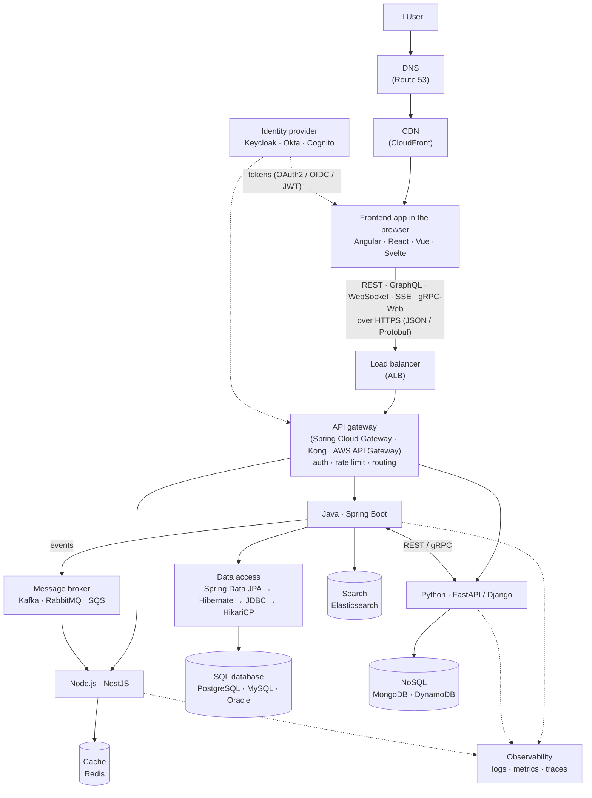
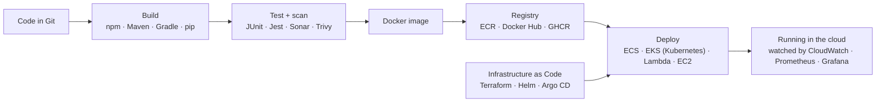

# 🗺 The Big Picture: The Whole Tech Ecosystem, End to End

One page that shows **how every technology connects** — from the user's browser to the database, the message broker, the build pipeline and the cloud. Use it to see where a tool fits before you study it.

**How to read it**

- Each numbered section is one **layer**. Read top to bottom: a request flows down, a response flows back up.
- `(…)` = what the thing is, in a few words.
- `→` / `▼` = "talks to" or "runs on".
- `OR` = interchangeable choices for the same job.
- **📚 Learn it here** under each section links to the notes in this repo.

---

## The whole journey on one page: how frontend, backend, database and cloud connect

Two diagrams: how a request travels at run time (top), and how code travels from Git to production (bottom).





---

## 0. Foundations under everything

Every layer below stands on these. Learn them once; they never go out of date.

```text
┌─────────────────────────────────────────────────────────────────────────────┐
│  0. FOUNDATIONS                                                             │
└─────────────────────────────────────────────────────────────────────────────┘

  COMPUTER
       ├── CPU · RAM · Disk/SSD · CPU cache (Where code runs and data lives)
       ├── Operating system (Processes, threads, memory, files)
       │      ├── Linux (Runs most servers and containers)
       │      ├── Windows / macOS (Developer machines)
       │      └── Shell: bash / PowerShell (Command line)
       └── Bits, bytes, text encoding (ASCII, Unicode, UTF-8)

  NETWORK
       ├── IP addresses · ports · NAT · firewalls
       ├── TCP (Reliable delivery) · UDP (Fast, no guarantees) · QUIC (HTTP/3)
       ├── DNS (Name → IP address)
       ├── TLS / HTTPS (Encryption + server identity)
       └── HTTP/1.1 · HTTP/2 · HTTP/3 (Request/response protocol)

  PROGRAMMING BASICS
       ├── Data structures (Array, list, hash map, tree, queue, heap, graph)
       ├── Algorithms + Big-O (How cost grows with input)
       ├── Compiled vs interpreted vs JIT (How code becomes machine code)
       ├── Concurrency (Threads, async, event loop)
       └── Design principles (SOLID, design patterns, clean code)

  TOOLS
       ├── Git (Version control) → GitHub / GitLab / Bitbucket
       ├── IDE: IntelliJ IDEA · VS Code
       └── Package managers: npm/pnpm · Maven/Gradle · pip/Poetry/uv
```

**📚 Learn it here:** [How code runs](../../interview/under-the-hood/01-How-Code-Runs.md) · [Memory & data](../../interview/under-the-hood/02-Memory-and-Data.md) · [Processes & threads](../../interview/under-the-hood/03-Processes-and-Threads.md) · [How data travels](../../interview/under-the-hood/08-How-Data-Travels.md) · [Networking & HTTP](../../interview/architecture/08-Networking-HTTP.md) · [Linux](../../interview/devops/02-Linux-Shell.md) · [Git](../../interview/devops/01-Git.md) · [DSA](../../interview/coding/02-DSA-Patterns.md) · [Design patterns](../../interview/backend/java/10-Design-Patterns-SOLID.md)

---

## 1. Frontend

What runs **in the user's browser** (or phone).

```text
┌─────────────────────────────────────────────────────────────────────────────┐
│  1. FRONTEND                                                                │
└─────────────────────────────────────────────────────────────────────────────┘

  BROWSER PLATFORM (What every framework compiles down to)
       ├── HTML (Structure) · CSS (Style) · JavaScript (Behaviour)
       ├── DOM (Page as a tree of objects) · CSSOM
       ├── JavaScript engine: V8 / SpiderMonkey / JavaScriptCore
       ├── Event loop (Call stack, microtasks, tasks)
       ├── Rendering: parse → style → layout → paint → composite
       ├── Web APIs: fetch, WebSocket, Web Workers, Service Workers
       ├── Storage: cookies · localStorage · sessionStorage · IndexedDB
       └── Security model: same-origin policy · CORS · CSP

  FRONTEND FRAMEWORK
       │
       ├── ANGULAR (TypeScript-based frontend framework)
       │      │
       │      ├── Language
       │      │     ├── TypeScript (Primary development language)
       │      │     └── JavaScript (Browser execution language)
       │      │
       │      ├── Core concepts
       │      │     ├── Components · Templates · Directives · Pipes
       │      │     ├── Standalone components (No NgModules needed)
       │      │     ├── Dependency injection (Services, providers, injection tokens)
       │      │     ├── Change detection (Zone.js → zoneless with signals; OnPush)
       │      │     ├── Control flow (@if, @for, @switch, @defer)
       │      │     └── Lifecycle hooks (ngOnInit, ngOnDestroy…)
       │      │
       │      ├── UI / CSS Libraries
       │      │     ├── Angular Material + CDK (Angular component library)
       │      │     ├── Bootstrap (Responsive CSS framework)
       │      │     ├── Tailwind CSS (Utility-first CSS framework)
       │      │     └── PrimeNG (Angular UI component library)
       │      │
       │      ├── Styling
       │      │     ├── CSS (Standard styling language)
       │      │     ├── SCSS (CSS preprocessor)
       │      │     └── Sass (CSS extension language)
       │      │
       │      ├── State Management
       │      │     ├── Angular Signals (Reactive state primitives: signal, computed, effect)
       │      │     ├── RxJS (Reactive programming library: Observables, operators)
       │      │     ├── NgRx Store / SignalStore (Centralized reactive state)
       │      │     └── Services + BehaviorSubject (Simple shared state)
       │      │
       │      ├── Forms
       │      │     ├── Reactive Forms (Model-driven, typed)
       │      │     └── Template-driven Forms (ngModel)
       │      │
       │      ├── HTTP Communication
       │      │     └── Angular HttpClient (+ interceptors for tokens, errors, retries)
       │      │
       │      ├── Routing
       │      │     └── Angular Router (Lazy-loaded routes, guards, resolvers)
       │      │
       │      ├── Rendering modes
       │      │     ├── CSR (Client-side rendering, default)
       │      │     └── Angular SSR + hydration (Server-side rendering for speed/SEO)
       │      │
       │      ├── Build Tools
       │      │     ├── Angular CLI (Angular project tooling)
       │      │     ├── esbuild (Fast bundler — default builder since v17)
       │      │     ├── Vite (Dev server)
       │      │     └── Webpack (Older builder)
       │      │
       │      └── Testing
       │            ├── Jasmine (JavaScript testing framework)
       │            ├── Karma (Browser test runner — deprecated)
       │            ├── Jest / Vitest (Fast unit test runners)
       │            └── Playwright / Cypress (End-to-end browser testing)
       │
       ├── REACT (Component-based UI library)
       │      │
       │      ├── Language
       │      │     ├── JavaScript (Primary supported language)
       │      │     └── TypeScript (Typed JavaScript development)
       │      │
       │      ├── Core concepts
       │      │     ├── JSX · components · props · state
       │      │     ├── Hooks (useState, useEffect, useMemo, useContext…)
       │      │     ├── Virtual DOM + reconciliation (Diff, then patch the real DOM)
       │      │     └── Server Components (React 19 / Next.js)
       │      │
       │      ├── Meta-frameworks
       │      │     ├── Next.js (SSR, SSG, routing, API routes)
       │      │     └── Remix / React Router v7 (Full-stack routing)
       │      │
       │      ├── UI / CSS Libraries
       │      │     ├── Material UI (React component library)
       │      │     ├── Bootstrap (Responsive CSS framework)
       │      │     ├── Tailwind CSS (Utility-first CSS framework)
       │      │     ├── shadcn/ui (Copy-in components on Radix + Tailwind)
       │      │     └── Ant Design (Enterprise UI components)
       │      │
       │      ├── Styling
       │      │     ├── CSS · CSS Modules
       │      │     ├── SCSS
       │      │     └── Styled Components / Emotion (CSS-in-JS library)
       │      │
       │      ├── State Management
       │      │     ├── Redux Toolkit (Centralized application state)
       │      │     ├── Zustand (Lightweight state management)
       │      │     ├── MobX (Reactive state management)
       │      │     └── TanStack Query (Server-state: fetching, caching, refetching)
       │      │
       │      ├── Forms
       │      │     └── React Hook Form + Zod (Forms + schema validation)
       │      │
       │      ├── HTTP Communication
       │      │     ├── Fetch API (Browser-native HTTP client)
       │      │     └── Axios (Promise-based HTTP client)
       │      │
       │      ├── Routing
       │      │     └── React Router (Frontend navigation)
       │      │
       │      ├── Build Tools
       │      │     ├── Vite (Frontend development/build tooling)
       │      │     ├── Webpack (JavaScript module bundler)
       │      │     └── Turbopack (Incremental bundler used by Next.js)
       │      │
       │      └── Testing
       │            ├── Jest / Vitest (Unit tests)
       │            ├── React Testing Library (Test like a user)
       │            ├── Cypress
       │            └── Playwright
       │
       ├── VUE (Progressive frontend framework)
       │      ├── JavaScript / TypeScript
       │      ├── Composition API · reactivity (ref, reactive, computed)
       │      ├── Nuxt (SSR / full-stack framework)
       │      ├── Vuetify (Vue UI components)
       │      ├── Tailwind CSS (Utility-first CSS)
       │      ├── Pinia (Vue state management)
       │      ├── Vue Router (Frontend navigation)
       │      ├── Axios / Fetch API (HTTP communication)
       │      ├── Vite (Frontend build tooling)
       │      └── Vitest (Unit testing)
       │
       └── SVELTE (Compile-time UI framework)
              ├── JavaScript / TypeScript
              ├── Runes ($state, $derived — fine-grained reactivity)
              ├── SvelteKit (Full-stack application framework)
              ├── Tailwind CSS (Utility-first CSS)
              ├── Svelte stores (Reactive state management)
              ├── Fetch API (HTTP communication)
              └── Vite (Frontend build tooling)

  CROSS-FRAMEWORK FRONTEND TOOLING
       ├── Node.js + npm / pnpm / yarn (Runs the build tools)
       ├── ESLint (Code linting) · Prettier (Formatting)
       ├── Storybook (Build and document components in isolation)
       ├── PWA: Service Worker + manifest (Offline, installable)
       ├── Micro-frontends: Module Federation / Native Federation
       ├── i18n (Translations: Angular i18n, Transloco, i18next)
       ├── Accessibility (ARIA, WCAG, axe)
       └── Performance: Core Web Vitals (LCP, INP, CLS), Lighthouse

  MOBILE & DESKTOP (Same backend, different client)
       ├── React Native / Expo (JavaScript → native apps)
       ├── Flutter (Dart → native apps)
       ├── Ionic + Capacitor (Web app inside a native shell)
       ├── Kotlin (Android) · Swift (iOS)
       └── Electron / Tauri (Desktop apps from web tech)
```

**📚 Learn it here:** [HTML](../../interview/frontend/01-HTML.md) · [CSS](../../interview/frontend/02-CSS.md) · [JavaScript](../../interview/frontend/03-JavaScript.md) · [TypeScript](../../interview/frontend/04-TypeScript.md) · [Angular](../../interview/frontend/05-Angular-1.md) · [RxJS](../../interview/frontend/06-RxJS.md) · [React](../../interview/frontend/06-React.md) · [Inside the browser](../../interview/under-the-hood/06-Inside-the-Browser.md) · [Web vitals](../../interview/architecture/01-web-vitals.md) · [ng serve & localhost](../../interview/under-the-hood/17-Local-Servers-and-Finding-Devices.md)

---

## 2. Frontend → backend communication

How the browser **talks to** the server.

```text
┌─────────────────────────────────────────────────────────────────────────────┐
│  2. FRONTEND → BACKEND COMMUNICATION                                        │
└─────────────────────────────────────────────────────────────────────────────┘

  ANGULAR / REACT / VUE / SVELTE
       │
       └── HTTP CLIENT (HttpClient · fetch · Axios)
              │
              ├── REST (Most common HTTP API style)
              │      └── HTTP / HTTPS (GET · POST · PUT · PATCH · DELETE; status codes)
              │             └── JSON (Data exchange format)
              │
              ├── GraphQL (Flexible query-based API: client asks for exact fields)
              │      └── HTTP / HTTPS
              │             └── JSON
              │
              ├── SOAP (XML-based messaging protocol, legacy enterprise)
              │      └── HTTP / HTTPS
              │             └── XML + WSDL (Contract)
              │
              ├── WebSocket (Bidirectional real-time communication: chat, live updates)
              │      └── WebSocket protocol (ws:// / wss://) · STOMP / Socket.IO on top
              │
              ├── SSE (Server-to-client event streaming: notifications, AI token streaming)
              │      └── HTTP (text/event-stream)
              │
              ├── gRPC (High-performance RPC framework)
              │      └── HTTP/2 + Protocol Buffers
              │             └── gRPC-Web / Proxy for browsers (Envoy)
              │
              ├── WebRTC (Peer-to-peer audio/video/data)
              │
              └── Webhooks (Server → server callbacks: payments, GitHub events)

  WHAT TRAVELS WITH EVERY CALL
       ├── Headers: Content-Type · Accept · Authorization: Bearer <JWT> · Cookie
       ├── CORS (Browser rule: which origins may call the API)
       ├── CSRF protection (For cookie-based sessions)
       ├── Caching headers: Cache-Control · ETag (304 Not Modified)
       ├── Compression: gzip / brotli
       └── Correlation / trace ID (traceparent header)

  API DESIGN & CONTRACTS
       ├── OpenAPI / Swagger (REST contract + docs + client generation)
       ├── GraphQL schema (SDL)
       ├── .proto files (gRPC contract)
       ├── JSON Schema (Validate JSON shape)
       ├── Versioning (/v1/, headers) · pagination (offset / cursor) · idempotency keys
       ├── Error format: RFC 9457 Problem Details
       └── BFF — Backend for Frontend (One tailored API per client type)
```

**📚 Learn it here:** [REST APIs](../../interview/backend/java/02-REST-Api.md) · [Networking & HTTP](../../interview/architecture/08-Networking-HTTP.md) · [What happens when Angular calls an API](../../interview/under-the-hood/07-Inside-a-Web-Server.md) · [Cookies, sessions & JWT](../../interview/under-the-hood/15-Staying-Logged-In-Cookies-Sessions-JWT.md) · [Web architecture](../../interview/frontend/09-Web_Architecture.md)

---

## 3. Backend — Java ecosystem

The JVM platform, everyday Java libraries, and the Spring family that most enterprise backends are built on.

```text
┌─────────────────────────────────────────────────────────────────────────────┐
│  3. BACKEND — JAVA ECOSYSTEM                                                │
└─────────────────────────────────────────────────────────────────────────────┘

  REST / GRAPHQL / SOAP / WEBSOCKET / gRPC
       │
       ▼
  JAVA (JVM programming language)
       │
       ├── The platform
       │      ├── JDK (Compiler + tools) → JRE → JVM (Runs bytecode)
       │      ├── javac → .class bytecode → class loader → interpreter → JIT (hot code → machine code)
       │      ├── Memory: heap · stack · metaspace
       │      ├── Garbage collectors: G1 (default) · ZGC · Parallel
       │      ├── Concurrency: threads · ExecutorService · CompletableFuture · virtual threads (Java 21+)
       │      ├── Language: OOP · generics · collections · streams · records · sealed types
       │      ├── GraalVM native image (AOT: millisecond start-up)
       │      └── Other JVM languages: Kotlin · Scala · Groovy
       │
       ├── Build & packaging
       │      ├── Maven (pom.xml) OR Gradle (build.gradle)
       │      ├── Repositories: Maven Central · Nexus / Artifactory
       │      └── Output: executable JAR (embedded server) OR WAR
       │
       ├── Everyday libraries
       │      ├── Jackson (JSON ↔ Java objects)
       │      ├── Bean Validation / Hibernate Validator (@NotNull, @Valid)
       │      ├── Lombok (Less boilerplate) · MapStruct (DTO ↔ entity mapping)
       │      ├── SLF4J + Logback / Log4j2 (Logging)
       │      └── JUnit 5 · Mockito · AssertJ (Testing)
       │
       ├── Spring Framework (Enterprise Java framework)
       │      │
       │      ├── Core: IoC container · dependency injection · beans · AOP · events
       │      │
       │      └── Spring Boot (Simplified application configuration)
       │             │
       │             ├── Starters + auto-configuration + application.yml / profiles
       │             ├── Spring Boot Actuator (Health, metrics, info endpoints)
       │             │
       │             ├── Spring MVC (Servlet-based web framework)
       │             │      ├── DispatcherServlet → HandlerMapping → @RestController
       │             │      ├── Filters · interceptors · @ControllerAdvice
       │             │      └── Tomcat (Servlet container)
       │             │             OR Jetty / Undertow
       │             │
       │             ├── Spring WebFlux (Reactive web framework: Mono / Flux)
       │             │      └── Netty (Non-blocking network framework)
       │             │             OR supported servlet containers
       │             │
       │             ├── HTTP clients: RestClient · WebClient · HTTP Interfaces · OpenFeign
       │             │
       │             ├── Spring Security (Application security)
       │             │      ├── Security filter chain (Authentication → authorization)
       │             │      ├── OAuth2 (Authorization framework) — Resource Server / Client
       │             │      ├── OpenID Connect (Identity layer)
       │             │      ├── JWT (Token format)
       │             │      └── SAML (Identity federation)
       │             │
       │             ├── Spring Data JPA (Repository abstraction) → Hibernate (see section 7)
       │             ├── Spring JDBC (JdbcTemplate / JdbcClient — SQL database access)
       │             ├── Spring Data R2DBC (Reactive SQL)
       │             ├── Spring Data MongoDB (MongoDB integration)
       │             ├── Spring Data Redis (Redis integration — Lettuce client)
       │             ├── Spring Data Elasticsearch (Search integration)
       │             ├── Spring Cache (@Cacheable over Caffeine / Redis)
       │             ├── Transactions (@Transactional, propagation, isolation)
       │             ├── Flyway / Liquibase (Database schema migrations)
       │             │
       │             ├── Messaging
       │             │      ├── Spring for Apache Kafka (KafkaTemplate, @KafkaListener)
       │             │      ├── Spring AMQP (RabbitMQ)
       │             │      └── Spring Cloud Stream (Broker-neutral bindings)
       │             │
       │             ├── Spring Cloud (Distributed system tooling)
       │             │      ├── Spring Cloud Gateway (API gateway)
       │             │      ├── Spring Cloud Config (Central configuration)
       │             │      ├── Eureka / Consul discovery + Spring Cloud LoadBalancer
       │             │      ├── OpenFeign (Declarative HTTP clients)
       │             │      └── Circuit Breaker (Resilience4j)
       │             │
       │             ├── Observability: Micrometer (metrics) · Micrometer Tracing / OpenTelemetry
       │             ├── Scheduling: @Scheduled · Quartz · ShedLock (one instance runs the job)
       │             ├── Spring Batch (Batch processing)
       │             ├── Spring for GraphQL (GraphQL integration)
       │             ├── Spring WebSocket (STOMP messaging)
       │             ├── Spring Modulith (Well-structured modular monolith)
       │             └── Spring AI (LLM, embeddings, vector store, RAG integration)
       │
       ├── Quarkus (Kubernetes-optimized Java framework)
       │      └── Hibernate ORM / Panache
       │
       ├── Micronaut (Lightweight Java framework)
       │      └── Micronaut Data
       │
       └── Jakarta EE (Enterprise Java platform: Servlet, JPA, CDI, JAX-RS)
              └── Servers: WildFly · Payara · Open Liberty · WebLogic · WebSphere
```

**📚 Learn it here:** [Java](../../interview/backend/java/01-Java-1.md) · [Java concurrency](../../interview/backend/java/11-Java-Concurrency.md) · [Spring core](../../interview/backend/java/03-Spring-1.md) · [Spring annotations](../../interview/backend/java/04-Spring-annotation.md) · [Spring Security](../../interview/backend/java/05-Spring-Security.md) · [Spring Cloud](../../interview/backend/java/06-Spring-Cloud.md) · [Transactions](../../interview/backend/java/07-Spring-Transactions.md) · [Inside Spring Boot](../../interview/under-the-hood/19-Inside-Spring-Boot.md) · [Inside the JVM](../../interview/under-the-hood/01-How-Code-Runs.md)

---

## 4. Backend — Python ecosystem

Python web frameworks (Django, FastAPI, Flask), their servers and ORMs, and the data and AI libraries that make Python popular.

```text
┌─────────────────────────────────────────────────────────────────────────────┐
│  4. BACKEND — PYTHON ECOSYSTEM                                              │
└─────────────────────────────────────────────────────────────────────────────┘

  REST / GRAPHQL / WEBSOCKET
       │
       ▼
  PYTHON (General-purpose programming language)
       │
       ├── The platform
       │      ├── CPython interpreter · GIL (one thread runs Python code at a time)
       │      ├── asyncio (Async/await event loop)
       │      ├── WSGI (Sync server interface) · ASGI (Async server interface)
       │      ├── Virtual environments: venv · Poetry · uv
       │      └── Type hints + mypy (Static checking)
       │
       ├── Django (Full-featured Python web framework)
       │      │
       │      ├── Django REST Framework (REST API development)
       │      ├── Django ORM (Database object mapping) + migrations
       │      ├── Django Admin (Auto-generated admin UI)
       │      ├── Django Channels (WebSocket support)
       │      ├── Celery (Background task processing) → Redis / RabbitMQ broker
       │      └── Gunicorn / Uvicorn (Application servers)
       │
       ├── FastAPI (Modern asynchronous API framework)
       │      │
       │      ├── Pydantic (Data validation)
       │      ├── Automatic OpenAPI docs (/docs)
       │      ├── SQLAlchemy (SQL toolkit and ORM) / SQLModel
       │      ├── Alembic (Database schema migrations)
       │      ├── Strawberry (GraphQL integration)
       │      ├── Celery (Background task processing)
       │      └── Uvicorn (ASGI application server)
       │
       ├── Flask (Lightweight Python web framework)
       │      │
       │      ├── Flask-SQLAlchemy (Database ORM integration)
       │      ├── Flask-RESTful (REST API development)
       │      ├── Flask-SocketIO (WebSocket communication)
       │      └── Gunicorn (Application server)
       │
       ├── Falcon (High-performance API framework)
       │      ├── SQLAlchemy (SQL toolkit and ORM)
       │      └── Gunicorn / Uvicorn (Application servers)
       │
       └── Data & AI libraries (Why Python is everywhere in ML)
              ├── pandas · NumPy (Data analysis)
              ├── scikit-learn · PyTorch · TensorFlow (Machine learning)
              └── LangChain · LlamaIndex (LLM applications)

  TESTING: pytest · unittest · httpx TestClient
```

**📚 Learn it here:** [Python](../../interview/backend/python/01-Python.md) · [Python study path](../topics/python.md)

---

## 5. Backend — Node.js ecosystem

JavaScript and TypeScript on the server: the event-loop runtime and the Express, NestJS and Fastify frameworks.

```text
┌─────────────────────────────────────────────────────────────────────────────┐
│  5. BACKEND — NODE.JS ECOSYSTEM                                             │
└─────────────────────────────────────────────────────────────────────────────┘

  REST / GRAPHQL / WEBSOCKET
       │
       ▼
  JAVASCRIPT / TYPESCRIPT
       │
       ▼
  NODE.JS (JavaScript server runtime)
       │
       ├── The platform
       │      ├── V8 engine (Runs JavaScript) + libuv (Event loop, thread pool for I/O)
       │      ├── Single-threaded event loop · non-blocking I/O
       │      ├── worker_threads (CPU-heavy work) · cluster / PM2 (Use all cores)
       │      ├── npm / pnpm / yarn · package.json · package-lock.json
       │      └── Alternatives: Bun · Deno
       │
       ├── Express.js (Minimal web framework: middleware chain)
       │      ├── Prisma (Database ORM)
       │      ├── Sequelize (Database ORM)
       │      ├── Mongoose (MongoDB ODM)
       │      ├── Passport.js (Authentication strategies)
       │      ├── Zod / Joi (Request validation)
       │      ├── Apollo Server (GraphQL server)
       │      └── Socket.IO (Real-time communication)
       │
       ├── NestJS (Structured backend framework — Angular-like modules + DI)
       │      ├── TypeScript (Primary development language)
       │      ├── Modules · controllers · providers · guards · interceptors · pipes
       │      ├── TypeORM / Prisma (Database access)
       │      ├── Apollo / Mercurius (GraphQL integration)
       │      ├── Socket.IO (Real-time communication)
       │      ├── BullMQ (Background job processing on Redis)
       │      └── @nestjs/microservices (Kafka, RabbitMQ, gRPC transports)
       │
       └── Fastify (High-performance web framework)
              ├── Prisma (Database ORM)
              ├── Mercurius (GraphQL integration)
              └── Socket.IO (Real-time communication)

  TESTING: Jest · Vitest · Supertest (HTTP tests)
```

**📚 Learn it here:** [Node.js](../../interview/backend/node/01-Node.js.md) · [Node security](../../interview/backend/node/06-Node-security.md) · [Event loop](../../interview/under-the-hood/06-Inside-the-Browser.md)

---

## 6. Backend — other ecosystems

.NET, Go, Kotlin, PHP, Ruby and Rust — different languages, the same layers: web framework → ORM → driver → database.

```text
┌─────────────────────────────────────────────────────────────────────────────┐
│  6. BACKEND — OTHER ECOSYSTEMS                                              │
└─────────────────────────────────────────────────────────────────────────────┘

  C# / .NET
       │
       └── ASP.NET Core (Cross-platform web framework) on Kestrel (Web server)
              ├── Entity Framework Core (Database ORM)
              ├── Dapper (Lightweight database mapper)
              ├── SignalR (Real-time communication)
              ├── Hot Chocolate (GraphQL server)
              └── xUnit / NUnit (Testing)

  GO
       │
       ├── net/http (Standard library — often enough)
       ├── Gin (Lightweight Go web framework)
       ├── Fiber (Express-inspired Go framework)
       └── Echo (High-performance Go framework)
              └── GORM (Go object-relational mapper) · sqlx · pgx

  KOTLIN
       └── Ktor (Lightweight async framework) · or Spring Boot with Kotlin

  PHP
       │
       ├── Laravel (Full-featured PHP framework) → Eloquent ORM
       └── Symfony (Reusable PHP application framework)
              └── Doctrine ORM (PHP object-relational mapper)

  RUBY
       │
       └── Ruby on Rails (Convention-based web framework)
              └── Active Record (Database ORM)

  RUST
       │
       ├── Actix Web (High-performance web framework)
       └── Axum (Modular web framework, on Tokio async runtime)
              └── SQLx / Diesel (Database access libraries)

  SAME IDEA IN EVERY LANGUAGE
       Web framework  →  validation  →  ORM / SQL library  →  driver  →  connection pool  →  database
       Spring Boot    ≈  ASP.NET Core ≈  NestJS ≈  Django / FastAPI ≈  Rails ≈  Laravel ≈  Gin
       Hibernate      ≈  EF Core      ≈  Prisma / TypeORM ≈  SQLAlchemy / Django ORM ≈  Active Record ≈  GORM
```

---

## 7. Backend → database connection

What happens **between your code and the data**.

```text
┌─────────────────────────────────────────────────────────────────────────────┐
│  7. BACKEND → DATABASE CONNECTION                                           │
└─────────────────────────────────────────────────────────────────────────────┘

  JAVA + SPRING BOOT
       │
       ├── OPTION A: ORM APPROACH (Most common)
       │      │
       │      └── Spring Data JPA (Repository interfaces: findByName(), @Query, paging)
       │             └── JPA / Jakarta Persistence (Persistence specification: @Entity, EntityManager, JPQL)
       │                    └── Hibernate (JPA implementation)
       │                           ├── Persistence context (First-level cache, one object per row)
       │                           ├── Dirty checking (Detects changes → UPDATE at flush)
       │                           ├── Lazy loading proxies (Load relations on first access)
       │                           ├── Fetch plans: JOIN FETCH · @EntityGraph · batch fetching (avoid N+1)
       │                           ├── Second-level cache (Ehcache / Caffeine / Infinispan, optional)
       │                           ├── Optimistic locking (@Version) · pessimistic (SELECT … FOR UPDATE)
       │                           ├── ID generation (IDENTITY / SEQUENCE / UUID)
       │                           ├── JDBC batching (batch_size)
       │                           └── SQL Dialect (Writes SQL for PostgreSQL / MySQL / Oracle…)
       │                                  └── JDBC (Database connectivity API)
       │                                         └── Connection pool: HikariCP
       │                                                └── JDBC Driver
       │                                                       └── SQL DATABASE
       │
       ├── OPTION B: DIRECT SQL APPROACH
       │      │
       │      └── Spring JDBC (JdbcTemplate / JdbcClient)
       │             └── JDBC → HikariCP → JDBC Driver → SQL DATABASE
       │
       ├── OPTION C: SQL MAPPING APPROACH
       │      │
       │      └── MyBatis (SQL in XML/annotations mapped to objects)
       │             └── JDBC → HikariCP → JDBC Driver → SQL DATABASE
       │
       ├── OPTION D: TYPE-SAFE SQL APPROACH
       │      │
       │      └── jOOQ (SQL as type-safe Java code)
       │             └── JDBC → HikariCP → JDBC Driver → SQL DATABASE
       │
       ├── OPTION E: REACTIVE APPROACH
       │      └── Spring Data R2DBC → R2DBC driver → SQL DATABASE (non-blocking)
       │
       ├── OPTION F: NoSQL / CACHE / SEARCH CLIENTS
       │      ├── Spring Data MongoDB → MongoDB Java driver → MongoDB
       │      ├── Spring Data Redis → Lettuce → Redis
       │      └── Spring Data Elasticsearch → Elasticsearch Java client → Elasticsearch
       │
       ├── SCHEMA MIGRATIONS
       │      └── Flyway OR Liquibase (Versioned SQL scripts run at start-up)
       │
       └── CONNECTION POOL
              └── HikariCP (JDBC connection pooling — Spring Boot default)
                     └── Used by JDBC-based data access (JPA, JdbcTemplate, MyBatis, jOOQ)


  PYTHON + FASTAPI / DJANGO / FLASK
       │
       ├── OPTION A: ORM APPROACH
       │      └── SQLAlchemy ORM / Django ORM
       │             └── Database Driver (psycopg / mysqlclient / oracledb / asyncpg)
       │                    └── PostgreSQL / MySQL / Oracle
       │
       ├── OPTION B: DIRECT SQL
       │      └── psycopg / mysqlclient
       │             └── PostgreSQL / MySQL
       │
       ├── OPTION C: SQL QUERY BUILDER
       │      └── SQLAlchemy Core
       │             └── Database Driver
       │                    └── SQL DATABASE
       │
       └── MIGRATIONS: Alembic (SQLAlchemy) · Django migrations


  NODE.JS + NESTJS / EXPRESS
       │
       ├── OPTION A: ORM
       │      └── Prisma / TypeORM / Sequelize / Drizzle
       │             └── Database Driver (pg / mysql2)
       │                    └── SQL DATABASE
       │
       ├── OPTION B: SQL QUERY BUILDER
       │      └── Knex.js
       │             └── Database Driver
       │                    └── SQL DATABASE
       │
       └── OPTION C: MongoDB
              └── Mongoose (ODM) → MongoDB driver → MongoDB


  INSIDE THE DATABASE (What happens after the driver sends SQL)
       │
       ├── Connection / session (Authenticated, one per pooled connection)
       ├── Parser → optimizer (Chooses a plan: EXPLAIN shows it) → executor
       ├── Indexes: B+ tree (default) · hash · GIN/full-text · composite (leftmost prefix)
       ├── Buffer pool (Hot pages kept in RAM)
       ├── Transactions: ACID · isolation levels · locks · MVCC (row versions)
       ├── Write-ahead log / redo log (Durability + crash recovery)
       ├── Replication (Primary → read replicas) · sharding / partitioning
       └── Backups · point-in-time recovery


  DATABASE OPTIONS
       │
       ├── SQL (Relational: tables, joins, transactions)
       │     ├── PostgreSQL
       │     ├── MySQL
       │     ├── Oracle
       │     ├── SQL Server
       │     └── MariaDB
       │
       ├── NoSQL
       │     ├── MongoDB (Document database)
       │     ├── Cassandra (Wide-column database)
       │     ├── DynamoDB (Key-value/document database)
       │     └── Neo4j (Graph database)
       │
       ├── CACHE
       │     ├── Redis / Valkey (In-memory data store)
       │     ├── Memcached (Distributed memory cache)
       │     └── Caffeine (In-process Java cache)
       │
       ├── SEARCH
       │     ├── Elasticsearch (Distributed search engine)
       │     └── OpenSearch (Search and analytics engine)
       │
       ├── VECTOR (AI similarity search)
       │     └── pgvector · Pinecone · Weaviate · Qdrant · Milvus
       │
       ├── TIME-SERIES
       │     └── TimescaleDB · InfluxDB · Prometheus (metrics)
       │
       ├── ANALYTICS / DATA WAREHOUSE
       │     └── Snowflake · BigQuery · Redshift · Databricks · ClickHouse
       │
       └── OBJECT STORAGE (Files, images, backups)
             └── Amazon S3 · Azure Blob Storage · Google Cloud Storage · MinIO
```

**📚 Learn it here:** [Inside JPA & Hibernate](../../interview/under-the-hood/20-Inside-JPA-and-Hibernate.md) · [Spring Data JPA Q&A](../../interview/backend/java/03-Spring-2.md) · [Inside a database](../../interview/under-the-hood/05-Inside-a-Database.md) · [B-tree & B+ tree](../../interview/database/01-B-Tree-and-B-Plus-Tree.md) · [SQL indexing](../../interview/database/02-SQL-Indexing-and-Query-Execution.md) · [SQL queries](../../interview/database/03-SQL-Interview-Queries.md) · [MySQL](../../interview/backend/java/08-MySQL.md) · [Redis & caching](../../interview/architecture/06-Caching-Redis.md)

---

## 8. Microservices — service connections

How many services find each other, talk (sync and async), share configuration, survive failures and keep data consistent.

```text
┌─────────────────────────────────────────────────────────────────────────────┐
│  8. MICROSERVICES — SERVICE CONNECTIONS                                     │
└─────────────────────────────────────────────────────────────────────────────┘

  FRONTEND
     │
     ▼
  LOAD BALANCER (AWS ALB · Nginx · HAProxy)
     │
     ▼
  API GATEWAY (Routing, auth, rate limiting, request shaping)
     │
     ├── Spring Cloud Gateway
     ├── Kong
     ├── AWS API Gateway
     └── Envoy / Nginx / Apigee
     │
     ▼
  MICROSERVICE 1: JAVA + SPRING BOOT
     │
     ├── REST / gRPC ───────────────► MICROSERVICE 2: PYTHON + FASTAPI   (synchronous: caller waits)
     │
     ├── Kafka ────────────────────► MICROSERVICE 3: JAVA + SPRING BOOT  (asynchronous: events)
     │
     ├── RabbitMQ ─────────────────► MICROSERVICE 4: NODE.JS + NESTJS    (asynchronous: tasks)
     │
     └── SQS ──────────────────────► MICROSERVICE 5: PYTHON + DJANGO     (asynchronous: queue)

  EACH SERVICE OWNS ITS DATA (Database per service — no shared tables)


  SERVICE DISCOVERY
       ├── Eureka (Spring service registry)
       ├── Consul (Distributed service discovery)
       └── Kubernetes DNS + Services (Cluster service discovery)

  CONFIGURATION & SECRETS
       ├── Spring Cloud Config (Git-backed central config)
       ├── Kubernetes ConfigMaps / Secrets
       ├── AWS Parameter Store / Secrets Manager
       └── HashiCorp Vault (Secrets, dynamic credentials)

  MESSAGE BROKERS
       ├── Kafka (Distributed event streaming: topics, partitions, offsets, consumer groups)
       │      ├── Schema Registry + Avro / Protobuf (Event contracts)
       │      ├── Kafka Connect + Debezium (Change data capture)
       │      └── Kafka Streams / Apache Flink (Stream processing)
       ├── RabbitMQ (Message queue broker: exchanges, queues, routing keys)
       ├── ActiveMQ (Enterprise message broker, JMS)
       ├── Amazon SQS (Managed message queue) + SNS (Pub/sub fan-out)
       ├── Google Pub/Sub · Azure Service Bus (Cloud equivalents)
       └── NATS (Lightweight messaging platform)

  SERVICE MESH (Networking concerns moved into sidecars / the platform)
       └── Istio · Linkerd (mTLS, retries, traffic splitting, telemetry)

  RESILIENCE
       ├── Resilience4j (Java resilience library)
       ├── Timeout (Limits operation waiting time)
       ├── Retry + exponential backoff + jitter (Repeated operation attempts)
       ├── Circuit Breaker (Prevents cascading failures)
       ├── Bulkhead (Separate resource pools per dependency)
       ├── Rate Limiting (Controls request frequency: token bucket)
       └── Fallback / graceful degradation

  DATA CONSISTENCY PATTERNS
       ├── Saga (Choreography / orchestration) + compensating transactions
       ├── Transactional Outbox (Fixes the dual-write problem)
       ├── CDC — Change Data Capture (Debezium reads the DB log)
       ├── Idempotent consumers + dead-letter queues
       ├── CQRS (Separate write and read models)
       ├── Event sourcing (Store events, not just current state)
       └── Eventual consistency (Copies converge after a short delay)

  ARCHITECTURE PATTERNS
       ├── Monolith → modular monolith → microservices
       ├── Strangler fig (Migrate a monolith piece by piece)
       ├── API composition · BFF (Backend for Frontend)
       ├── Event-driven architecture
       └── Domain-Driven Design: bounded contexts (Find service boundaries)
```

**📚 Learn it here:** [Inside microservices](../../interview/under-the-hood/21-Inside-Microservices.md) · [Microservice architecture](../../interview/architecture/microservice-architecture.md) · [Spring Cloud](../../interview/backend/java/06-Spring-Cloud.md) · [Kafka & RabbitMQ](../../interview/architecture/messaging-rabbitmq-kafka.md) · [Distributed systems](../../interview/architecture/05-Distributed-Systems.md) · [Scaling & resilience](../../interview/under-the-hood/10-Many-Servers-Scaling-and-Resilience.md) · [System design](../../interview/architecture/04-System-Design.md)

---

## 9. Security — across every layer

Identity, authorization, application protection, data protection and supply-chain security — security is part of every layer, not one box.

```text
┌─────────────────────────────────────────────────────────────────────────────┐
│  9. SECURITY — ACROSS EVERY LAYER                                           │
└─────────────────────────────────────────────────────────────────────────────┘

  IDENTITY (Who are you?)
       ├── Identity providers: Keycloak · Okta · Auth0 · AWS Cognito · Microsoft Entra ID
       ├── OAuth 2.0 (Delegated authorization)
       │      ├── Authorization Code + PKCE (Browsers and mobile apps)
       │      └── Client Credentials (Service-to-service)
       ├── OpenID Connect (Login on top of OAuth2: ID token)
       ├── SAML (Enterprise single sign-on, older)
       ├── JWT access token + refresh token
       ├── Sessions + HttpOnly / Secure / SameSite cookies
       └── MFA · passkeys / WebAuthn

  AUTHORIZATION (What may you do?)
       ├── Roles (RBAC) · attributes (ABAC) · scopes
       └── Spring Security: @PreAuthorize · Angular route guards (UX only — the server decides)

  PROTECTING THE APP
       ├── OWASP Top 10: injection, XSS, broken access control, SSRF…
       ├── Input validation · parameterized SQL · output encoding
       ├── CORS · CSRF tokens · Content Security Policy
       ├── Password hashing: bcrypt / Argon2
       └── Rate limiting · WAF (AWS WAF, Cloudflare)

  PROTECTING DATA & TRAFFIC
       ├── TLS everywhere (HTTPS) · mTLS between services
       ├── Encryption at rest (KMS-managed keys)
       ├── Secrets out of code: Vault · Secrets Manager · K8s Secrets
       └── Least-privilege IAM roles · network segmentation (VPC, subnets, security groups)

  SECURING THE SUPPLY CHAIN (In CI/CD)
       ├── SAST: SonarQube · Semgrep · CodeQL
       ├── Dependency scanning: Dependabot · Renovate · Snyk · OWASP Dependency-Check
       ├── Container scanning: Trivy · Grype
       ├── DAST: OWASP ZAP · Burp Suite
       └── SBOM (Software bill of materials) · signed images (cosign)
```

**📚 Learn it here:** [Web security / OWASP](../../interview/security/01-Web-Security-OWASP.md) · [Spring Security](../../interview/backend/java/05-Spring-Security.md) · [JWT access & refresh tokens](../../interview/backend/java/09-JWT-Access-Refresh-Tokens.md) · [Cookies, sessions & JWT](../../interview/under-the-hood/15-Staying-Logged-In-Cookies-Sessions-JWT.md) · [Passwords & encryption](../../interview/under-the-hood/18-How-Everyday-Tech-Works.md)

---

## 10. Testing — connected to each layer

Which test tools check which layer, from fast unit tests to end-to-end, contract, performance and chaos tests.

```text
┌─────────────────────────────────────────────────────────────────────────────┐
│  10. TESTING — CONNECTED TO EACH LAYER                                      │
└─────────────────────────────────────────────────────────────────────────────┘

  THE TEST PYRAMID (Many fast tests at the bottom, few slow ones at the top)
                     ▲   E2E / UI          (Playwright · Cypress)
                    ▲▲▲  Contract / API    (Pact · REST Assured · Karate)
                  ▲▲▲▲▲  Integration       (Spring Boot Test · Testcontainers · WireMock)
               ▲▲▲▲▲▲▲▲  Unit              (JUnit · Jest · pytest)

  FRONTEND
       ├── Angular → Jasmine / Jest / Vitest · Angular Testing Library · Playwright
       ├── React   → Jest / Vitest · React Testing Library · Playwright
       └── Vue     → Vitest · Vue Test Utils · Cypress / Playwright

  BACKEND
       ├── Java       → JUnit 5 · Mockito · AssertJ · Spring Boot Test (@WebMvcTest, @DataJpaTest, @SpringBootTest)
       │                ArchUnit (Architecture rules) · PIT (Mutation testing)
       ├── Python     → pytest / unittest
       ├── Node.js    → Jest / Vitest · Supertest
       └── .NET       → xUnit / NUnit

  API
       ├── Postman / Bruno (Manual API testing)
       ├── REST Assured (Java API automation)
       ├── Karate (API automation framework)
       └── Pact (Consumer-driven contract testing)

  DATABASE / INTEGRATION
       ├── Testcontainers (Real PostgreSQL / Kafka / Redis in Docker for tests)
       ├── WireMock (HTTP dependency simulation)
       └── Embedded Kafka · H2 (Quick, less realistic)

  PERFORMANCE
       ├── JMeter (Load testing)
       ├── Gatling (Performance testing)
       └── k6 (Developer-centric load testing)

  QUALITY & OTHER
       ├── Code coverage: JaCoCo · Istanbul
       ├── Security testing: OWASP ZAP
       ├── Accessibility: axe · Lighthouse
       └── Chaos testing: Chaos Monkey · Litmus · AWS Fault Injection Service
```

**📚 Learn it here:** [Testing](../../interview/testing/01-Testing.md) · [Testing study path](../topics/testing.md)

---

## 11. Build → CI/CD → container → deployment

How code becomes a running system: build, test and scan, package as an image, create infrastructure from code, deploy and release safely.

```text
┌─────────────────────────────────────────────────────────────────────────────┐
│  11. BUILD → CI/CD → CONTAINER → DEPLOYMENT                                 │
└─────────────────────────────────────────────────────────────────────────────┘

  SOURCE CODE
       │
       ▼
  GIT (Branches, pull requests, code review)
       ├── GitHub
       ├── GitLab
       └── Bitbucket
       │
       ▼
  BUILD
       │
       ├── Angular / React / Vue
       │      └── npm / pnpm
       │             └── Vite / Angular CLI (esbuild) / Webpack
       │                    └── HTML / CSS / JavaScript bundle (static files)
       │
       ├── Java / Spring Boot
       │      └── Maven / Gradle
       │             └── JAR / WAR (or GraalVM native binary)
       │
       ├── Python
       │      └── pip / Poetry / uv
       │             └── Application package / wheel
       │
       └── Node.js
              └── npm / pnpm
                     └── JavaScript build
       │
       ▼
  ARTIFACT REPOSITORY (Nexus · Artifactory · GitHub Packages)
       │
       ▼
  CI/CD PIPELINE
       │
       ├── Jenkins
       ├── GitHub Actions
       ├── GitLab CI
       └── Azure DevOps
       │
       ├── Testing (Unit → integration → contract)
       ├── SonarQube (Code quality analysis)
       ├── Trivy (Container vulnerability scanning)
       └── Dependency security scanning
       │
       ▼
  CONTAINERIZATION
       │
       ├── Docker (Container image creation: Dockerfile, layers)
       ├── Buildpacks / Jib (Images without a Dockerfile)
       └── Docker Compose (Run many containers locally)
       │
       ▼
  CONTAINER REGISTRY
       │
       ├── Amazon ECR
       ├── Docker Hub
       └── GitHub Container Registry
       │
       ▼
  INFRASTRUCTURE AS CODE (Create the cloud resources from code)
       │
       ├── Terraform / OpenTofu (Any cloud)
       ├── AWS CloudFormation / CDK · Pulumi
       ├── Helm charts · Kustomize (Kubernetes manifests)
       └── Ansible (Configure servers)
       │
       ▼
  DEPLOYMENT
       │
       ├── OPTION A: Virtual Machines
       │      └── AWS EC2 (+ Auto Scaling groups)
       │
       ├── OPTION B: Container Orchestration
       │      ├── Docker + Amazon ECS (Fargate = no servers to manage)
       │      └── Docker + Kubernetes + Amazon EKS / Azure AKS / Google GKE
       │             └── GitOps: Argo CD / Flux (Git is the source of truth for what runs)
       │
       ├── OPTION C: Serverless
       │      └── AWS Lambda / Azure Functions / Google Cloud Functions
       │
       ├── OPTION D: Managed Application Hosting
       │      ├── AWS App Runner / Elastic Beanstalk
       │      ├── Azure App Service
       │      ├── Google Cloud Run
       │      └── Render · Heroku · Railway · Vercel / Netlify (frontends)
       │
       └── RELEASE STRATEGIES
              ├── Rolling update (Replace instances gradually)
              ├── Blue-green (Switch traffic between two environments)
              ├── Canary (Small % first, then everyone)
              └── Feature flags (LaunchDarkly, Unleash — release without deploying)
```

**📚 Learn it here:** [DevOps & build tools](../../interview/architecture/03-devops-build-tools.md) · [Docker & Kubernetes](../../interview/architecture/07-Docker-Kubernetes.md) · [VMs & containers](../../interview/under-the-hood/09-Virtual-Machines-and-Containers.md) · [Config files](../../interview/under-the-hood/16-Config-Files-in-Microservices.md) · [Terraform / IaC](../../interview/devops/04-Terraform-IaC.md) · [Git](../../interview/devops/01-Git.md)

---

## 12. Observability — seeing what runs

Logs say what happened, metrics say how much and how fast, traces say where the time went — plus health checks and alerting.

```text
┌─────────────────────────────────────────────────────────────────────────────┐
│  12. OBSERVABILITY — LOGS, METRICS, TRACES                                  │
└─────────────────────────────────────────────────────────────────────────────┘

  APPLICATION
       │
       ├── LOGS (What happened)
       │      SLF4J + Logback (Java) · Python logging · pino / winston (Node)
       │      → JSON logs with trace ID
       │      → Fluent Bit / Logstash
       │      → Elasticsearch + Kibana (ELK) · Grafana Loki · CloudWatch Logs · Splunk
       │
       ├── METRICS (How much / how fast)
       │      Micrometer (Spring Boot Actuator /actuator/prometheus)
       │      → Prometheus (Scrapes and stores)
       │      → Grafana (Dashboards) · CloudWatch Metrics
       │      Key signals: RED (rate, errors, duration) · USE (utilisation, saturation, errors)
       │
       ├── TRACES (Where the time went across services)
       │      OpenTelemetry / Micrometer Tracing (traceparent header)
       │      → Jaeger · Grafana Tempo · Zipkin · AWS X-Ray
       │
       ├── HEALTH (Is it alive / ready?)
       │      Actuator /health/liveness · /health/readiness → Kubernetes probes
       │
       ├── APM SUITES (All three together)
       │      Datadog · New Relic · Dynatrace · Elastic APM
       │
       └── ALERTING & SRE
              Alertmanager · PagerDuty / Opsgenie
              SLI → SLO → error budget · incident response · postmortems
```

**📚 Learn it here:** [Observability & SRE](../../interview/devops/03-Observability-SRE.md) · [Observability study path](../topics/observability.md)

---

## 13. Complete cloud connection

A typical AWS layout from DNS to database, then the same building blocks side by side in AWS, Azure and Google Cloud.

```text
┌─────────────────────────────────────────────────────────────────────────────┐
│  13. COMPLETE CLOUD CONNECTION (AWS)                                        │
└─────────────────────────────────────────────────────────────────────────────┘

  USER
   │
   ▼
  Route 53 (DNS)
   │
   ▼
  CloudFront (CDN)  +  AWS WAF (Block attacks)  +  ACM (TLS certificates)
   │
   ├──► S3 (Angular / React static files)
   │
   ▼
  AWS ALB (Application load balancer)
   │
   ▼
  API Gateway / Spring Cloud Gateway    ◄── Cognito (User sign-in, JWT)
   │
   ▼
  VPC (Private network)
   ├── Public subnets: ALB · NAT gateway
   └── Private subnets: applications and databases (Security groups = firewalls)
   │
   ▼
  ECS / EKS (Backend application hosting)  ·  Lambda (Event-driven functions)
   │
   ├── Spring Boot / FastAPI / NestJS
   │
   ├── RDS / Aurora (Relational database)
   │
   ├── DynamoDB (NoSQL database)
   │
   ├── ElastiCache (Redis caching)
   │
   ├── OpenSearch (Search)
   │
   ├── MSK / SQS / SNS / EventBridge (Messaging)
   │
   ├── S3 (File/object storage)
   │
   ├── Secrets Manager · Parameter Store · KMS (Secrets and keys)
   │
   ├── IAM (Who/what may access which resource)
   │
   └── CloudWatch · X-Ray (Logs, metrics, traces)
```

**The same building blocks in every cloud**

| Job | AWS | Azure | Google Cloud |
|---|---|---|---|
| DNS | Route 53 | Azure DNS | Cloud DNS |
| CDN | CloudFront | Front Door / Azure CDN | Cloud CDN |
| Static files / objects | S3 | Blob Storage | Cloud Storage |
| Load balancer | ALB / NLB | Application Gateway / Load Balancer | Cloud Load Balancing |
| API gateway | API Gateway | API Management | API Gateway / Apigee |
| Virtual machines | EC2 | Virtual Machines | Compute Engine |
| Containers (managed) | ECS / Fargate | Container Apps | Cloud Run |
| Kubernetes | EKS | AKS | GKE |
| Serverless functions | Lambda | Functions | Cloud Functions |
| Relational database | RDS / Aurora | Azure SQL / Database for PostgreSQL | Cloud SQL / AlloyDB / Spanner |
| NoSQL | DynamoDB | Cosmos DB | Firestore / Bigtable |
| Cache | ElastiCache | Azure Cache for Redis | Memorystore |
| Queue / pub-sub | SQS / SNS | Service Bus | Pub/Sub |
| Streaming | MSK / Kinesis | Event Hubs | Pub/Sub / Managed Kafka |
| Secrets | Secrets Manager | Key Vault | Secret Manager |
| Identity (users) | Cognito | Entra ID / External ID | Identity Platform |
| Monitoring | CloudWatch / X-Ray | Azure Monitor / App Insights | Cloud Monitoring / Trace |
| Infrastructure as code | CloudFormation / CDK | Bicep / ARM | Deployment Manager / Terraform |

**📚 Learn it here:** [AWS cloud](../../interview/architecture/02-aws-cloud.md) · [How the internet is connected](../../interview/under-the-hood/13-How-the-Internet-Is-Connected.md) · [AWS study path](../topics/aws.md)

---

## 14. AI layer — LLMs inside applications

How applications add LLM features: prompts, RAG with a vector database, tool calling, agents, MCP and the model APIs.

```text
┌─────────────────────────────────────────────────────────────────────────────┐
│  14. AI LAYER — LLMs INSIDE APPLICATIONS                                    │
└─────────────────────────────────────────────────────────────────────────────┘

  FRONTEND CHAT UI (Angular / React)
       │  streaming tokens over SSE / WebSocket
       ▼
  BACKEND (Spring Boot + Spring AI · FastAPI + LangChain / LlamaIndex · NestJS + Vercel AI SDK)
       │
       ├── Prompt = system instructions + chat history + retrieved context + user question
       │
       ├── RAG (Retrieval-Augmented Generation)
       │      documents → chunk → embedding model → vector database (pgvector, Pinecone…)
       │      question → embedding → similarity search → top chunks → added to the prompt
       │
       ├── Tool / function calling · agents (Model asks; the app runs the tool)
       ├── MCP — Model Context Protocol (Standard way to plug tools and data into models)
       │
       ├── LLM APIs
       │      Anthropic Claude · OpenAI · Google Gemini · AWS Bedrock · Azure OpenAI
       │      OR self-hosted open models (Llama, Mistral) via Ollama / vLLM on GPUs
       │
       └── LLMOps: evaluation · guardrails · prompt/version tracking · cost & token monitoring
```

**📚 Learn it here:** [AI, LLMs, RAG & agents](../../interview/ai/01-AI-LLM-RAG-Agents.md) · [How AI chatbots work](../../interview/under-the-hood/14-How-AI-Chatbots-Work.md)

---

## 15. Data & analytics layer

How application data flows into lakes and warehouses, gets transformed, and ends up in dashboards and ML models.

```text
┌─────────────────────────────────────────────────────────────────────────────┐
│  15. DATA & ANALYTICS — FROM APP DATA TO REPORTS                            │
└─────────────────────────────────────────────────────────────────────────────┘

  OPERATIONAL DATABASES (PostgreSQL, MySQL, MongoDB) + EVENTS (Kafka)
       │
       ▼
  INGEST: CDC (Debezium) · batch ETL/ELT · Kafka Connect · Fivetran / Airbyte
       │
       ▼
  STORE: Data lake (S3 + Parquet / Iceberg / Delta) · Data warehouse (Snowflake, BigQuery, Redshift)
       │
       ▼
  PROCESS: Apache Spark · Flink (streams) · dbt (SQL transformations)
       │       orchestrated by Apache Airflow / Dagster
       ▼
  USE: BI dashboards (Power BI, Tableau, Looker, Superset) · ML models · reverse ETL
```

**📚 Learn it here:** [Data engineering](../../interview/data/01-Data-Engineering.md) · [Data structures vs database vs warehouse](../../interview/under-the-hood/02-Memory-and-Data.md)

---

## 16. One request, end to end: how the frontend, backend, database and cloud connect

A story of **one click**, touching nearly every layer above. Imagine you click **"Place order"** in an Angular shop running on AWS.

**Step 1: Browser** — Angular's `(click)` handler calls `OrderService.place()`; an `HttpClient` interceptor adds `Authorization: Bearer <JWT>` (issued earlier by Cognito/Keycloak).

**Step 2: DNS and TLS** — the browser resolves `api.shop.com` (Route 53), opens TCP + TLS (certificate from ACM), and sends `POST /api/orders` with a JSON body.

**Step 3: Edge** — CloudFront and AWS WAF filter bad traffic; the ALB picks a healthy gateway instance.

**Step 4: Gateway** — Spring Cloud Gateway validates the JWT, applies rate limiting, adds a `traceparent` header and routes `/api/orders/**` to `order-service` (found via Kubernetes DNS).

**Step 5: Inside order-service (Spring Boot on EKS)** — Tomcat gives the request a thread → Spring Security filters → DispatcherServlet → `@RestController` → Jackson turns JSON into `OrderRequest` → `@Valid` checks it.

**Step 6: A synchronous call** — the service calls `pricing-service` with `RestClient` (pooled connection, 2 s timeout, Resilience4j circuit breaker) to get the final price.

**Step 7: Saving** — a `@Transactional` proxy begins a transaction → Spring Data JPA → Hibernate puts the `Order` in the persistence context → at commit it flushes `INSERT`s (order + outbox event) through JDBC, borrowing a HikariCP connection → PostgreSQL (RDS) writes to its WAL and commits.

**Step 8: Events** — Debezium reads the outbox row from the database log and publishes `OrderPlaced` to Kafka (MSK).

**Step 9: Other services react** — inventory (Java) reserves stock, notification (NestJS) sends an email, analytics (Python) updates dashboards — each idempotently, each with its own database.

**Step 10: Response** — order-service returns `201 Created` with JSON; Angular updates a signal; change detection repaints the screen: "Order placed ✅".

**Step 11: Observed** — logs (with the trace ID) go to CloudWatch, metrics to Prometheus/Grafana, and the whole path appears as one trace in X-Ray/Tempo.

**Step 12: How it got there** — the code was pushed to GitHub → GitHub Actions built and tested it (JUnit, Testcontainers, Sonar, Trivy) → Docker image to ECR → Argo CD deployed it to EKS with a canary release; the infrastructure was created with Terraform.

**Final understanding:** **Click → browser → DNS/TLS → edge → gateway → service → sync call → ORM → database → events → other services → response → observability**, all delivered by **Git → CI → image → IaC → deploy**.

---

## 17. Complete end-to-end stack combinations

Ten real-world stacks showing which choices usually go together, from the classic Angular + Spring Boot stack to an AI assistant.

```text
  STACK 1 — ANGULAR + JAVA + SPRING BOOT  (Classic enterprise stack)

  Angular
     ├── TypeScript → JavaScript
     ├── Angular Material / Bootstrap / Tailwind
     ├── SCSS
     ├── Signals / RxJS / NgRx
     ├── Angular HttpClient (+ interceptors)
     └── Angular CLI (esbuild / Vite)
           │
           ▼
  REST + HTTPS + JSON  (OpenAPI contract, JWT via OAuth2 / OIDC — Keycloak / Okta)
           │
           ▼
  Java 21+
     └── Spring Boot
           ├── Spring MVC
           ├── Spring Security (OAuth2 Resource Server)
           ├── Spring Data JPA
           ├── Hibernate
           ├── Flyway
           ├── Actuator + Micrometer
           └── Tomcat
                 │
                 ▼
  JDBC + HikariCP
                 │
                 ▼
  PostgreSQL / MySQL / Oracle   (+ Redis cache)
                 │
                 ▼
  Maven → GitHub Actions / Jenkins → Docker → ECR → ECS / EKS
                 │
                 ▼
  AWS RDS + ElastiCache + CloudWatch


  STACK 2 — REACT + PYTHON + FASTAPI

  React
     ├── TypeScript → JavaScript
     ├── Material UI / Tailwind
     ├── Redux Toolkit / Zustand + TanStack Query
     ├── Axios / Fetch API
     └── Vite
           │
           ▼
  REST + HTTP + JSON
           │
           ▼
  Python
     └── FastAPI
           ├── Pydantic
           ├── SQLAlchemy
           ├── Alembic
           ├── Celery + Redis (background jobs)
           └── Uvicorn
                 │
                 ▼
  PostgreSQL Driver (psycopg / asyncpg)
                 │
                 ▼
  PostgreSQL
                 │
                 ▼
  Docker → ECR → ECS / EKS
                 │
                 ▼
  AWS RDS + CloudWatch


  STACK 3 — ANGULAR + PYTHON + DJANGO

  Angular
     ├── TypeScript → JavaScript
     ├── Angular Material / Tailwind
     ├── NgRx / RxJS
     ├── Angular HttpClient
     └── Angular CLI
           │
           ▼
  REST + HTTP + JSON
           │
           ▼
  Python
     └── Django
           ├── Django REST Framework
           ├── Django ORM + migrations
           ├── Django Channels
           ├── Celery
           └── Gunicorn / Uvicorn
                 │
                 ▼
  PostgreSQL / MySQL
                 │
                 ▼
  Docker → ECR → ECS / EKS
                 │
                 ▼
  AWS RDS + CloudWatch


  STACK 4 — REACT + NODE.JS + NESTJS

  React
     ├── TypeScript → JavaScript
     ├── Material UI / Tailwind
     ├── Redux Toolkit / Zustand
     ├── Axios
     └── Vite
           │
           ▼
  REST / GraphQL / WebSocket
           │
           ▼
  TypeScript
     └── Node.js
           └── NestJS
                 ├── Prisma / TypeORM
                 ├── Apollo GraphQL
                 ├── Socket.IO
                 └── BullMQ
                       │
                       ▼
  PostgreSQL / MongoDB / Redis
                       │
                       ▼
  Docker → ECR → ECS / EKS
                       │
                       ▼
  AWS Cloud Services


  STACK 5 — VUE + PYTHON + FLASK

  Vue
     ├── JavaScript / TypeScript
     ├── Vuetify / Tailwind
     ├── Pinia
     ├── Axios
     └── Vite
           │
           ▼
  REST + HTTP + JSON
           │
           ▼
  Python
     └── Flask
           ├── Flask-RESTful
           ├── Flask-SQLAlchemy
           └── Gunicorn
                 │
                 ▼
  PostgreSQL / MySQL
                 │
                 ▼
  Docker → Kubernetes → Cloud


  STACK 6 — ANGULAR + C# + ASP.NET CORE

  Angular
     ├── TypeScript
     ├── Angular Material
     ├── NgRx / RxJS
     └── Angular HttpClient
           │
           ▼
  REST + HTTP + JSON  (Microsoft Entra ID for login)
           │
           ▼
  C#
     └── ASP.NET Core
           ├── Entity Framework Core
           ├── Dapper
           └── Kestrel
                 │
                 ▼
  SQL Server / PostgreSQL
                 │
                 ▼
  Docker → Azure AKS / AWS EKS
                 │
                 ▼
  Azure / AWS


  STACK 7 — REACT + GO

  React
     ├── TypeScript
     ├── Tailwind CSS
     ├── Zustand
     └── Axios
           │
           ▼
  REST / gRPC
           │
           ▼
  Go
     └── Gin / Fiber
           └── GORM
                 │
                 ▼
  PostgreSQL / MongoDB
                 │
                 ▼
  Docker → Kubernetes → AWS / GCP


  STACK 8 — MICROSERVICES: MIXED TECHNOLOGIES

  Angular / React
       │
       ▼
  REST + HTTP + JSON
       │
       ▼
  API Gateway  (+ Keycloak for tokens)
       │
       ├────────────────────────────────────────────┐
       │                                            │
       ▼                                            ▼
  JAVA MICROSERVICE                           PYTHON MICROSERVICE
  Spring Boot                                 FastAPI
       │                                            │
       ▼                                            ▼
  PostgreSQL (+ outbox table)                 MongoDB
       │                                            │
       └──────────────────┬─────────────────────────┘
                          │  Debezium / producers
                          ▼
                     APACHE KAFKA  (+ Schema Registry)
                          │
                          ▼
                    NODE.JS MICROSERVICE
                         NestJS
                          │
                          ▼
                        Redis
                          │
                          ▼
                  Docker + Kubernetes  (Helm, Argo CD, Istio)
                          │
                          ▼
                       AWS EKS
                          │
                          ▼
          Prometheus + Grafana + Tempo/Jaeger + Loki (observability)


  STACK 9 — NEXT.JS FULL STACK + SERVERLESS  (Small team, fast to ship)

  Next.js (React + Server Components + API routes / server actions)
     ├── TypeScript · Tailwind · shadcn/ui
     └── Auth.js / Clerk (Login)
           │
           ▼
  Prisma / Drizzle
           │
           ▼
  PostgreSQL (Neon / Supabase / RDS)
           │
           ▼
  Vercel OR AWS (Lambda + CloudFront)


  STACK 10 — AI ASSISTANT (RAG) ON THE ENTERPRISE STACK

  Angular chat UI (signals, SSE streaming)
           │
           ▼
  Spring Boot + Spring AI
     ├── Embeddings + vector store (PostgreSQL + pgvector)
     ├── Document ingestion (PDF, Confluence, Git) → chunks
     ├── Tool calling → internal REST APIs
     └── LLM API (Claude via Anthropic API / AWS Bedrock)
           │
           ▼
  Docker → EKS · secrets in Secrets Manager · token & cost metrics in Grafana
```

---

## 18. Which layer should I learn next?

| You know… | Learn next | Why |
|---|---|---|
| HTML / CSS / JavaScript | TypeScript → Angular **or** React | Every modern frontend is built this way |
| A frontend framework | HTTP, REST, JSON, auth (JWT/OAuth2) | That's how the frontend talks to everything |
| Java basics | Spring Boot → Spring Data JPA/Hibernate → SQL | The core of most enterprise backends |
| One backend | Docker → CI/CD → one cloud (AWS) | Your code must run somewhere |
| One service in production | Kafka/RabbitMQ, Redis, resilience, observability | What changes when there are many services |
| Microservices | System design, distributed data patterns, security, IaC | Tech lead / architect level |
| Everything above | AI layer (RAG, agents) and data layer | Where many new products are heading |

**📚 Study paths:** [Where to start: learning tracks](../topics/README.md) · [Role roadmaps](../roles/README.md) · [Under the Hood path](../topics/under-the-hood.md)
